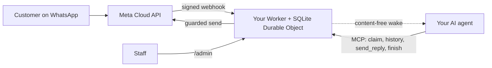

<div align="center">

**English** · [简体中文](docs/readme/README_zh.md) · [繁體中文](docs/readme/README_zh-TW.md) · [日本語](docs/readme/README_ja.md) · [한국어](docs/readme/README_ko.md) · [Türkçe](docs/readme/README_tr.md) · [Русский](docs/readme/README_ru.md) · [Tiếng Việt](docs/readme/README_vi.md) · [ไทย](docs/readme/README_th.md) · [Deutsch](docs/readme/README_de.md) · [Español](docs/readme/README_es.md) · [Français](docs/readme/README_fr.md) · [Українська](docs/readme/README_uk.md) · [Polski](docs/readme/README_pl.md) · [Português (Brasil)](docs/readme/README_pt-BR.md) · [العربية](docs/readme/README_ar.md) · [فارسی](docs/readme/README_fa.md) · [Bahasa Indonesia](docs/readme/README_id.md) · [Italiano](docs/readme/README_it.md)
· [Ελληνικά](docs/readme/README_el.md)

# WAB bot

### One business's WhatsApp number, one AI agent over MCP, on your own Cloudflare account.

**WAB bot: AI auto-reply and voice answering for business chat on the WhatsApp Cloud API.** A small, single-tenant bridge: customers message (or call) your WhatsApp Cloud API number, your agent answers through guarded tools, and nothing leaves your accounts.

[](LICENSE)
[](docs/STATUS.md)
[](docs/CLOUDFLARE.md)
[](THIRD_PARTY_NOTICES.md)
[](.github/workflows/ci.yml)

[Quick start](#quick-start) · [How it works](#how-it-works) · [What it can do](#what-it-can-do) · [Worked examples](#worked-examples) · [FAQ](#faq) · [Documentation](#documentation)

</div>

> [!IMPORTANT]
> The official source of WAB bot is [wabbot-dev/wab-bot](https://github.com/wabbot-dev/wab-bot).
> A similar repository name or a copied README does not establish that code is official. Read what you deploy, and
> never give a deploy script or an assistant a token you would not give its author.
> This project is independent: it is not affiliated with or endorsed by Meta or xAI. WhatsApp and Grok are trademarks of their owners.

> [!NOTE]
> **Preview.** Tested locally against fakes (335 automated tests). Earlier revisions ran live on a throwaway Cloudflare Free account. Live evidence on Meta's free test number: **texting** was run live on 2026-10-16 (a real text round trip: an inbound message was received and a reply went back through the bridge), and **calling** was run live from this repository's code on 2026-10-17 (Grok Voice over Meta SIP to xAI SIP): inbound WhatsApp voice calls were answered by the AI, the conversation went both ways (including Arabic), transcripts of both sides were stored, the model's `end_call` was handled by the Worker and xAI's hang-up request was accepted (HTTP 200), and the calling gate armed and auto-disarmed. Not a business-verified production number; audio recording is not supported. Not run by this project in production. The messaging design is reported by its owner as proven in production in the deployment it was derived from (owner-reported, date TBD), which is not evidence for this code. Everything verified, and how: [docs/STATUS.md](docs/STATUS.md).

---

Your customers write to your business's WhatsApp number. Meta delivers each message to a Worker in **your own Cloudflare account**, which stores it and sends your AI agent a content-free wake-up. The agent (any MCP-capable agent) claims the conversation, reads the history, and replies through `send_reply`. The bridge, not the agent, holds the WhatsApp token and enforces every send guard. Staff can pause, take over, or erase a conversation from `/admin`.

One deployment per business: its own Meta app, number, tokens and Cloudflare account. There are no secrets in this repository.

## Quick start

You need: a Cloudflare account you own, Node.js 20+ (22 recommended), a Meta developer account and WhatsApp Cloud API setup ([checklist](docs/META-CHECKLIST.md)), a **new number never registered in any WhatsApp app**, and an agent that can use MCP and be woken by a webhook ([wake routine](docs/WAKE-ROUTINE.md)). You pay Meta and your own AI plan directly; the Workers Free plan needs no payment method for what this template uses ([limits and terms](docs/CLOUDFLARE.md)).

### 1. Check it offline (no account, no network)

```bash
git clone https://github.com/wabbot-dev/wab-bot.git && cd wab-bot
npm ci
npm run check          # typecheck, 271 logic tests, 64 workerd tests, docs check
npm run build          # wrangler deploy --dry-run: bundle and binding check
npm run smoke:local    # wrangler dev --local with random fake secrets
```

### 2. Deploy to your own Cloudflare account

```bash
bash scripts/deploy-cloudflare.sh --dry-run                  # prints the plan, makes no call
bash scripts/deploy-cloudflare.sh --name my-business-wa      # lowercase letters, digits, dashes
```

The script logs you in with `wrangler login --device` (you approve a code in your browser; it never creates an account), deploys, generates the bridge's own tokens, and uploads secrets on stdin. Other routes (Cloudflare API without a login, self-provisioned secrets) are in [docs/DEPLOY.md](docs/DEPLOY.md). The setup has been proven live on 2 different accounts ([status](docs/STATUS.md)). If a required secret is skipped, the script names it and exits non-zero. A liveness check answers at /api/health with only ok and version (no secrets, counts or messages). On a brand-new Cloudflare account, which has no workers.dev subdomain, the deploy scripts register one first when an API token and the account id are exported (an existing subdomain is never changed). The API token needs only the Workers Scripts Edit permission on your own account; keep the show-once token page open until the token is stored and verified (details in docs/CLOUDFLARE.md and docs/DEPLOY.md). The account may already have Workers: list them first and never touch what you did not create.

### 3. Connect Meta and your agent

Follow [docs/META-CHECKLIST.md](docs/META-CHECKLIST.md) (you create the Meta accounts, verify your business and type the SMS code yourself), run `node scripts/meta-setup.mjs` on your own computer, and point your agent at `https://<worker>.<your-subdomain>.workers.dev/mcp` with `Authorization: Bearer <MCP_TOKEN>`.

### 4. Stay in test mode until a message round-trips

Safe defaults: `LAUNCH_MODE=test` (replies go only to `TEST_RECIPIENTS`), auto-reply **paused**, templates off, the in-Worker Meta setup route off. Send one message from your phone, watch it arrive in `/admin`, let the agent answer, and only then go live deliberately.

## How it works



Every webhook must carry a valid `X-Hub-Signature-256` over the raw body. One SQLite row per conversation keeps requests independent; a lost race re-reads and retries. The wake POST carries ids and counters only, never message text. Boundaries and ownership: [docs/ARCHITECTURE.md](docs/ARCHITECTURE.md). Storage, retention and wake: [docs/STATE-STORE.md](docs/STATE-STORE.md).

## What it can do

| Capability | Evidence and limits |
|---|---|
| Receive WhatsApp text and store it per conversation, de-duplicated, with HMAC verification | Tested locally; one real message received on Meta's test number ([status](docs/STATUS.md)) |
| Agent tools over MCP: `list_pending`, `claim_conversation`, `get_history`, `send_reply` (16 server-side guards), `finish`, `release`, `escalate`, `get_controls`, read-only `get_overview` | Tested locally and with direct JSON-RPC calls; **not** with real MCP clients. One real reply sent on Meta's test number, driven by hand |
| Team inbox at /admin: conversation list and chat view side by side (one pane on a phone), a Needs-a-human queue, unread counts, search, staff replies, take over, release to the bot, resolve, opt-out, erase, refresh every 10 seconds; staff sign in with a one-time code, never the admin token | Tested locally and in workerd. New in 0.2.0; not yet used by a real team |
| Bot-started messages (a reminder the customer asked for, a follow-up on an open case; never marketing): only to numbers that wrote in before or that the owner allowlisted, templates only outside the 24-hour window, refused after STOP, during a human takeover or in test mode for other numbers | Tested locally; the blocked cases and one template send run live on a test Worker (see the status page) |
| Opt-out: STOP (and a few translations) blocks every bot-started message until START | Tested locally |
| Erase one conversation (`DELETE /api/admin/conversations/<id>`) | Tested locally with mutation checks; never run live. Does not reach Cloudflare recovery copies ([privacy](docs/PRIVACY.md)) |
| Wake your agent, debounced, with backoff and a daily retry | Verified live against a stand-in receiver; never against a real agent platform |
| Retention: replied chats trimmed at 14 days, anything dropped at 180 days | Verified live with synthetic data; never over weeks on real data |
| Self-provision secrets once (`POST /api/setup`) for deploy tools that redact values | Run live on one test Worker; weaker than a secret binding ([limits](docs/SELF-PROVISIONING.md)) |
| Answer WhatsApp voice calls (Meta SIP to xAI Grok Voice), off until the owner opens a gate; you pay xAI about $0.08 per minute | **Run live** from this code on Meta's test number on 2026-10-17: answered by the AI, two-way conversation, transcripts of both sides stored, the model's end-of-call request handled; not a business-verified production number ([voice](docs/VOICE-CALLS.md)) |
| Owner-only admin MCP at `/admin/mcp`: status, setup check, redacted conversations, erase, arm and disarm calling, call logs, usage, version and update check (14 tools) | Off unless `ADMIN_MCP_TOKEN` is set. Tested locally and in workerd; **not** with real MCP clients ([admin MCP](docs/mcp.md)) |
| Understand voice notes and images: transcribed (Arabic, French, English and more) or described with Workers AI in your own Cloudflare account, inside the free daily allowance; on any failure the agent sees a plain marker and asks the customer to type | Tested locally; run live through the owner self-test route on a test Worker, not yet from a real phone ([media](docs/MEDIA.md)) |

Not included: video and document understanding, voice replies, groups, template types beyond text and body parameters, outbound calls, audio recording, a settings page, preset routines, multi-tenant hosting. See [docs/ROADMAP.md](docs/ROADMAP.md).

## Worked examples

**One customer turn over MCP** (placeholders only; the agent does this through its MCP client):

```bash
MCP=https://<worker>.<your-subdomain>.workers.dev/mcp
call() { curl -s "$MCP" -H "Authorization: Bearer $MCP_TOKEN" -H 'content-type: application/json' \
  -d "{\"jsonrpc\":\"2.0\",\"id\":1,\"method\":\"tools/call\",\"params\":{\"name\":\"$1\",\"arguments\":$2}}"; }
call list_pending '{}'
call claim_conversation '{"conversation_id":"c_<id>"}'                       # returns a lease
call get_history '{"conversation_id":"c_<id>","lease":"<lease>"}'            # customer text is wrapped as untrusted
call send_reply '{"conversation_id":"c_<id>","lease":"<lease>","text":"Hello, how can I help?"}'
call finish_conversation '{"conversation_id":"c_<id>","lease":"<lease>"}'
```

While `LAUNCH_MODE=test` or auto-reply is paused, `send_reply` answers `blocked_test_mode_recipient_not_allowlisted` or `blocked_auto_reply_paused` instead of sending. The guard order and every error string: [docs/CONFIGURATION.md](docs/CONFIGURATION.md).

**Erase one customer:**

```bash
curl -X DELETE -H "Authorization: Bearer $ADMIN_TOKEN" https://<worker>.<your-subdomain>.workers.dev/api/admin/conversations/c_<id>
# {"ok":true,"deleted":true}   (404 if unknown or already erased)
```

**Remove everything:** `bash scripts/teardown-cloudflare.sh` (asks you to type the Worker name; deletes the Worker and every stored conversation, nothing else).

## FAQ

**Who owns the Cloudflare account?** You do: you accept the terms, you pay if you ever pay, and you can delete it. An assistant may create the Cloudflare and xAI accounts for you only with your written consent and with you made owner or admin; you add any card yourself. Meta accounts, Business Verification and the SMS code are always yours ([details and the Cloudflare terms caveat](docs/CLOUDFLARE.md)).

**Is the Free plan allowed for a business?** In the Cloudflare terms read on 2026-10-17 the Free services carry no personal-use-only clause, with two restrictions that matter here (no card collection, no protected health information without Cloudflare's written consent). Not legal advice; re-check ([commercial use](docs/CLOUDFLARE.md#commercial-use)).

**Can I use my existing WhatsApp Business app number?** No. The Cloud API number must never have been registered in a WhatsApp app; coexistence is out of scope. Bring your own SIM or line and type its code yourself.

**Does it answer calls?** Yes, inbound only, and only when you open the gate: calling is off by default, stays off on a real number until your Business Verification is complete and you say go, and runs in short windows you arm. It uses xAI Grok Voice on your own xAI account (about $0.08 per minute). Calls from this code were answered live on Meta's test number on 2026-10-17 (two-way conversation, transcripts stored); it has not run on a business-verified production number, and audio recording is not supported ([voice](docs/VOICE-CALLS.md)).

**Which agent works?** Any agent that can speak MCP over HTTP and be woken by a webhook. It has been tested against direct JSON-RPC calls, not against real MCP clients ([wake routine](docs/WAKE-ROUTINE.md)).

**How much volume?** Single tenant, one Durable Object: small-business volumes. Roughly 30,000 messages a day fit the Free Durable Object quota by our live measurement; many simultaneous messages in one conversation can return 503 and Meta redelivers ([status](docs/STATUS.md#live-measurements-cloudflare-free-fake-secrets-2026-10-16)).

**Is it proven in production?** The design it comes from is reported to be (owner-reported, date TBD). This Cloudflare port is not. [Status](docs/STATUS.md) says exactly what each level means.

## Limits and good practice

- **Independent project.** WAB bot is unofficial: it is not affiliated with or endorsed by Meta, WhatsApp or xAI. WhatsApp and Grok are trademarks of their owners.
- **Meta's rules apply.** Your use of the WhatsApp Cloud API follows Meta's terms, messaging policies and per-number rules, and calling on a business number needs Meta Business Verification.
- **One number per bot.** One deployment serves one business and one WhatsApp number, with its own Meta app, tokens and Cloudflare account.
- **Calling is yours to switch on.** It is off by default; you open it and name the number, and calls use your own xAI credits (about $0.08 per minute).
- **Inbound calls only, no audio recording.** Outbound calls and recording audio are not supported. A text transcript is kept by default, and you can switch it off.
- **SIP and the Graph calling API are mutually exclusive per number.** While a number uses SIP for calling, as this bot does, Meta's Graph calling endpoints are not available on it.
- **Keep a fallback contact path.** Publish another way to reach you, such as a phone line or an email, and keep staff able to take over any conversation.

What is supported and what is not: [capabilities](docs/CAPABILITIES.md). Practical answers: [troubleshooting](docs/TROUBLESHOOTING.md). Calling in detail: [voice](docs/VOICE-CALLS.md).

## Documentation

[docs/index.md](docs/index.md) lists every page. Start with [STATUS](docs/STATUS.md), then [DEPLOY](docs/DEPLOY.md), [META-CHECKLIST](docs/META-CHECKLIST.md), [CONFIGURATION](docs/CONFIGURATION.md), [PRIVACY](docs/PRIVACY.md) and [TROUBLESHOOTING](docs/TROUBLESHOOTING.md). Also: [AGENTS.md](AGENTS.md) for AI coding agents, [SECURITY.md](SECURITY.md), [CHANGELOG.md](CHANGELOG.md), [THIRD_PARTY_NOTICES.md](THIRD_PARTY_NOTICES.md).

## Disclaimer

This is preview software for lawful business messaging. You are responsible for your deployment, credentials, customers' data, recording and AI-disclosure rules, and your Meta and Cloudflare terms. No warranty. Read [DISCLAIMER.md](DISCLAIMER.md).

## Contributing

Focused fixes, docs corrections and tests are welcome; read the [contribution scope](CONTRIBUTING.md#contribution-scope) and the [PR readiness rules](CONTRIBUTING.md#pull-request-ownership-and-readiness) first. AI-assisted PRs need a named human owner. Security problems: [SECURITY.md](SECURITY.md).

## License

[MIT](LICENSE), Copyright (c) 2026 wabbot-dev.
