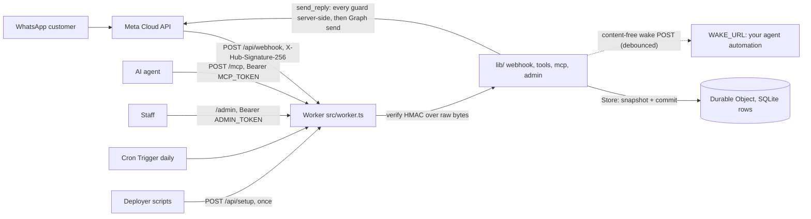

# Architecture

One Cloudflare Worker and one SQLite-backed Durable Object per business. Dependencies flow inward: `src/` (Worker entry, Durable Object, pages) adapts `lib/` (pure logic: webhook, tools, MCP, admin, config, retention) which depends only on the `Store` interface in `lib/store.ts`. `lib/` has no Cloudflare imports, which is why the logic tests run under plain Node with a fake clock and an in-memory store.

## Boundaries and ownership

| Boundary | Owner | Rule |
|---|---|---|
| Webhook authenticity | `lib/webhook.ts` | Accept only a valid signature over the raw body bytes; a bad signature touches no storage |
| Conversation state | `lib/conv.ts` | One row per conversation; pure update functions re-applied on a lost compare-and-swap |
| Sending | `lib/tools.ts` | The agent never holds the WhatsApp token and never names a recipient; 16 guards run in a fixed order; an uncertain outcome is held and never resent |
| Storage | `lib/store.ts`, `lib/row-store.ts`, `src/state-do.ts` | `snapshot({keys,prefixes})` and one atomic `commit`; versions come from a global counter and are never reused |
| Secrets | `lib/secrets.ts`, `lib/config.ts` | A real binding wins over a stored value; values are never logged or returned |
| Retention and erase | `lib/retention.ts`, `lib/admin.ts` | Compaction on write plus a daily pass; erase flags and drops one conversation in the same commit |
| Agent wake | `lib/wake.ts` | Payload is ids and counters only; failures back off; only the holder of the wake's runner token fires it |

See [STATE-STORE.md](STATE-STORE.md) for the storage design and retention, [CONFIGURATION.md](CONFIGURATION.md) for endpoints, tools and guards, and [CLOUDFLARE.md](CLOUDFLARE.md) for the hosting account and limits.

## Voice calls (in this repository, off by default)

Meta SIP goes to xAI's SIP endpoint, xAI posts a signed webhook to `/api/xai-sip`, and a per-call Durable Object (`CallSession`) joins the realtime session; the Worker never touches the audio. The owner gate, the arm window and the dead-man alarm decide when any of this is reachable. See [VOICE-CALLS.md](VOICE-CALLS.md).

## Admin MCP (in this repository, off by default)

`/admin/mcp` is a second MCP server for the owner, separate from the agent MCP at `/mcp` and from the public webhook. It is a binding-gated, rate-limited, metadata-only view of the deployment plus arm and disarm for calling. The `BridgeState` Durable Object also holds its rate-limit counters. See [mcp.md](mcp.md).
