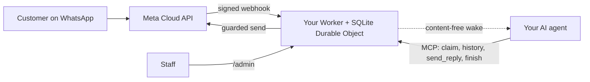

<div align="center">

[English](../../README.md) · [简体中文](README_zh.md) · [繁體中文](README_zh-TW.md) · [日本語](README_ja.md) · [한국어](README_ko.md) · [Türkçe](README_tr.md) · [Русский](README_ru.md) · [Tiếng Việt](README_vi.md) · [ไทย](README_th.md) · [Deutsch](README_de.md) · [Español](README_es.md) · [Français](README_fr.md) · [Українська](README_uk.md) · [Polski](README_pl.md) · [Português (Brasil)](README_pt-BR.md) · **العربية** · [فارسی](README_fa.md) · [Bahasa Indonesia](README_id.md) · [Italiano](README_it.md)
· [Ελληνικά](README_el.md)

</div>

<div align="center" dir="rtl">

# WAB bot

### رقم واتساب لنشاط تجاري واحد، ووكيل ذكاء اصطناعي واحد عبر MCP، على حسابك الخاص في Cloudflare.

**جسر صغير أحادي المستأجر: يراسل العملاء رقمك على WhatsApp Cloud API، ويجيب وكيلك عبر أدوات محمية، ولا يغادر شيء حساباتك.**

[](../../LICENSE)
[](../STATUS.md)
[](../CLOUDFLARE.md)
[](../../THIRD_PARTY_NOTICES.md)
[](../../.github/workflows/ci.yml)

[البدء السريع](#البدء-السريع) · [كيف يعمل](#كيف-يعمل) · [ما الذي يمكنه فعله](#ما-الذي-يمكنه-فعله) · [أمثلة عملية](#أمثلة-عملية) · [الأسئلة الشائعة](#الأسئلة-الشائعة) · [التوثيق](#التوثيق)

</div>

<div dir="rtl">

> [!IMPORTANT]
> المصدر الرسمي لهذا القالب هو [wabbot-dev/wab-bot](https://github.com/wabbot-dev/wab-bot).
> تشابه اسم المستودع أو نسخ ملف README لا يثبت أن الشيفرة رسمية. اقرأ ما تنشره، و
> لا تعطِ أي سكربت نشر أو مساعد رمزًا (token) لا تعطيه لمؤلفه.
> هذا المشروع مستقل: لا يرتبط بشركتي Meta أو xAI ولا تؤيده أي منهما. WhatsApp وGrok علامتان تجاريتان لمالكيهما.

> [!NOTE]
> **نسخة معاينة.** اختُبر محليًا مقابل كائنات محاكاة (291 اختبارًا آليًا). عملت المراجعات السابقة فعليًا على حساب Cloudflare Free مؤقت. الأدلة الفعلية على رقم **الاختبار** المجاني من Meta: **الرسائل النصية** شُغّلت فعليًا في 2026-10-16 (رحلة نصية حقيقية ذهابًا وإيابًا: استُلمت رسالة واردة وعاد ردّ عبر الجسر)، و**المكالمات** شُغّلت فعليًا في 2026-10-17 بشيفرة هذا المستودع (Grok Voice عبر Meta SIP إلى xAI SIP): ردّ الذكاء الاصطناعي على مكالمات WhatsApp الصوتية الواردة، وجرت المحادثة في الاتجاهين (بما في ذلك العربية)، وحُفظت نصوص الطرفين، وعالج الـ Worker الأمر `end_call` من النموذج وقُبل طلب xAI لإنهاء المكالمة (HTTP 200)، وفُعّلت بوابة المكالمات ثم أُلغي تفعيلها تلقائيًا. ليس رقم إنتاج موثّقًا تجاريًا؛ تسجيل الصوت غير مدعوم. لم يشغّله هذا المشروع في بيئة إنتاج. يفيد مالكه بأن تصميم المراسلة أُثبت في بيئة الإنتاج في النشر الذي اشتُق منه (بحسب إفادة المالك، والتاريخ لاحقًا)، وهذا ليس دليلًا على هذه الشيفرة. كل ما تم التحقق منه وكيف: [docs/STATUS.md](../STATUS.md).

</div>

---

<div dir="rtl">

يراسل عملاؤك رقم واتساب الخاص بنشاطك. تسلّم Meta كل رسالة إلى Worker في **حسابك الخاص في Cloudflare**، فيخزّنها ويرسل إلى وكيل الذكاء الاصطناعي لديك إشارة إيقاظ خالية من المحتوى. يستلم الوكيل (أي وكيل يدعم MCP) المحادثة، ويقرأ السجل، ويرد عبر `send_reply`. الجسر، لا الوكيل، هو من يحتفظ برمز واتساب ويفرض كل ضوابط الإرسال. يمكن للموظفين إيقاف محادثة مؤقتًا أو استلامها أو حذفها من `/admin`.

نشر واحد لكل نشاط تجاري: تطبيق Meta ورقم ورموز وحساب Cloudflare خاصة به. لا توجد أسرار في هذا المستودع.

## البدء السريع

تحتاج إلى: حساب Cloudflare تملكه، وNode.js 20+ (يُنصح بـ 22)، وحساب مطوّر Meta وإعداد WhatsApp Cloud API ([قائمة التحقق](../META-CHECKLIST.md))، و**رقمًا جديدًا لم يُسجَّل قط في أي تطبيق واتساب**، ووكيلًا يستطيع استخدام MCP ويمكن إيقاظه بواسطة webhook ([روتين الإيقاظ](../WAKE-ROUTINE.md)). تدفع لـ Meta ولخطة الذكاء الاصطناعي الخاصة بك مباشرة؛ ولا تحتاج خطة Workers Free إلى وسيلة دفع لما يستخدمه هذا القالب ([الحدود والشروط](../CLOUDFLARE.md)).

### 1. تحقق دون اتصال (بلا حساب، بلا شبكة)

```bash
git clone https://github.com/wabbot-dev/wab-bot.git && cd wab-bot
npm ci
npm run check          # typecheck, 229 logic tests, 62 workerd tests, docs check
npm run build          # wrangler deploy --dry-run: bundle and binding check
npm run smoke:local    # wrangler dev --local with random fake secrets
```

### 2. انشر على حسابك الخاص في Cloudflare

```bash
bash scripts/deploy-cloudflare.sh --dry-run                  # prints the plan, makes no call
bash scripts/deploy-cloudflare.sh --name my-business-wa      # lowercase letters, digits, dashes
```

يسجّل السكربت دخولك باستخدام `wrangler login --device` (توافق على رمز في متصفحك؛ ولا ينشئ حسابًا أبدًا)، ثم ينشر، ويولّد رموز الجسر الخاصة، ويرفع الأسرار عبر stdin. توجد مسارات أخرى (واجهة Cloudflare API دون تسجيل دخول، أسرار يوفّرها النظام ذاتيًا) في [docs/DEPLOY.md](../DEPLOY.md). تم إثبات عمل الإعداد فعليًا على حسابين مختلفين ([الحالة](../STATUS.md)).

### 3. اربط Meta ووكيلك

اتبع [docs/META-CHECKLIST.md](../META-CHECKLIST.md) (أنت من ينشئ حسابات Meta ويوثّق نشاطك التجاري ويكتب رمز SMS بنفسك)، وشغّل `node scripts/meta-setup.mjs` على حاسوبك الخاص، ثم وجّه وكيلك إلى `https://<worker>.<your-subdomain>.workers.dev/mcp` مع `Authorization: Bearer <MCP_TOKEN>`.

### 4. ابقَ في وضع الاختبار إلى أن تتم رسالة ذهابًا وإيابًا

إعدادات افتراضية آمنة: `LAUNCH_MODE=test` (تذهب الردود إلى `TEST_RECIPIENTS` فقط)، والرد التلقائي **متوقف مؤقتًا**، والقوالب معطّلة، ومسار إعداد Meta داخل الـ Worker معطّل. أرسل رسالة واحدة من هاتفك، وراقب وصولها إلى `/admin`، ودع الوكيل يجيب، ثم انتقل إلى العمل الفعلي عن قصد.

## كيف يعمل



يجب أن يحمل كل webhook قيمة `X-Hub-Signature-256` صالحة على النص الخام للطلب. يحافظ صف SQLite واحد لكل محادثة على استقلال الطلبات؛ والطلب الذي يخسر السباق يعيد القراءة ويحاول مجددًا. يحمل طلب POST الخاص بالإيقاظ المعرّفات والعدّادات فقط، ولا يحمل نص الرسائل أبدًا. الحدود والملكية: [docs/ARCHITECTURE.md](../ARCHITECTURE.md). التخزين والاحتفاظ والإيقاظ: [docs/STATE-STORE.md](../STATE-STORE.md).

## ما الذي يمكنه فعله

| القدرة | الدليل والحدود |
|---|---|
| استقبال نص واتساب وتخزينه لكل محادثة، دون تكرار، مع التحقق عبر HMAC | اختُبر محليًا؛ استُقبلت رسالة حقيقية واحدة على رقم Meta التجريبي ([الحالة](../STATUS.md)) |
| أدوات الوكيل عبر MCP: `list_pending` و`claim_conversation` و`get_history` و`send_reply` (16 ضابطًا من جهة الخادم) و`finish` و`release` و`escalate` و`get_controls` و`get_overview` للقراءة فقط | اختُبرت محليًا وبنداءات JSON-RPC مباشرة؛ و**لم** تُختبر مع عملاء MCP حقيقيين. أُرسل رد حقيقي واحد على رقم Meta التجريبي، بتشغيل يدوي |
| وحدة تحكم الموظفين: إيقاف الرد التلقائي واستئنافه، الاستلام، التحرير، إعادة الفتح، الحل، الإيقاظ، الحذف | اختُبرت محليًا. صفحة ثابتة، تتطلب رمزًا |
| حذف محادثة واحدة (`DELETE /api/admin/conversations/<id>`) | اختُبر محليًا مع فحوص التحوير (mutation)؛ ولم يُشغَّل فعليًا قط. لا يصل إلى نسخ الاسترداد لدى Cloudflare ([الخصوصية](../PRIVACY.md)) |
| إيقاظ وكيلك، مع debounce وbackoff ومحاولة يومية متكررة | تُحقق منه فعليًا مقابل مستقبِل بديل؛ ولم يُجرَّب قط مقابل منصة وكلاء حقيقية |
| الاحتفاظ: تُقلَّص المحادثات التي أُجيب عنها بعد 14 يومًا، ويُحذف أي شيء بعد 180 يومًا | تُحقق منه فعليًا ببيانات اصطناعية؛ ولم يُجرَّب قط على مدى أسابيع ببيانات حقيقية |
| توفير الأسرار ذاتيًا مرة واحدة (`POST /api/setup`) لأدوات النشر التي تُخفي القيم | شُغِّل فعليًا على Worker تجريبي واحد؛ أضعف من ربط سر (secret binding) ([الحدود](../SELF-PROVISIONING.md)) |
| الرد على المكالمات الصوتية في WhatsApp (من Meta SIP إلى xAI Grok Voice)، مُعطّل حتى يفتح المالك البوابة؛ تدفع أنت لـ xAI نحو $0.08 للدقيقة | **شُغّل فعليًا** بهذه الشيفرة في 2026-10-17 على رقم الاختبار من Meta: ردّ الذكاء الاصطناعي، محادثة في الاتجاهين، حُفظت نصوص الطرفين، عولج طلب النموذج إنهاء المكالمة؛ ليس رقم إنتاج موثّقًا تجاريًا ([الصوت](../VOICE-CALLS.md)) |
| MCP إداري للمالك فقط على `/admin/mcp`: الحالة، فحص الإعداد، محادثات منقّحة، المسح، تفعيل المكالمات وإيقافها، سجلات المكالمات، الاستخدام، الإصدار وفحص التحديثات (14 أداة) | مُعطّل ما لم يُضبط `ADMIN_MCP_TOKEN`. اختُبر محليًا وفي workerd؛ **لم** يُختبر مع عملاء MCP حقيقيين ([MCP الإداري](../mcp.md)) |

غير مشمول: تنزيل الوسائط، المجموعات، أنواع القوالب خارج النص ومعاملات المتن، المكالمات الصادرة، تسجيل الصوت، صفحة إعدادات، الروتينات الجاهزة، الاستضافة متعددة المستأجرين. راجع [docs/ROADMAP.md](../ROADMAP.md).

## أمثلة عملية

**دور واحد لعميل عبر MCP** (عناصر نائبة فقط؛ يفعل الوكيل ذلك عبر عميل MCP الخاص به):

```bash
MCP=https://<worker>.<your-subdomain>.workers.dev/mcp
call() { curl -s "$MCP" -H "Authorization: Bearer $MCP_TOKEN" -H 'content-type: application/json' \
  -d "{\"jsonrpc\":\"2.0\",\"id\":1,\"method\":\"tools/call\",\"params\":{\"name\":\"$1\",\"arguments\":$2}}"; }
call list_pending '{}'
call claim_conversation '{"conversation_id":"c_<id>"}'                       # returns a lease
call get_history '{"conversation_id":"c_<id>","lease":"<lease>"}'            # customer text is wrapped as untrusted
call send_reply '{"conversation_id":"c_<id>","lease":"<lease>","text":"Hello, how can I help?"}'
call finish_conversation '{"conversation_id":"c_<id>","lease":"<lease>"}'
```

عندما يكون `LAUNCH_MODE=test` أو يكون الرد التلقائي متوقفًا مؤقتًا، يرد `send_reply` بـ `blocked_test_mode_recipient_not_allowlisted` أو `blocked_auto_reply_paused` بدلًا من الإرسال. ترتيب الضوابط وكل رسالة خطأ: [docs/CONFIGURATION.md](../CONFIGURATION.md).

**حذف عميل واحد:**

```bash
curl -X DELETE -H "Authorization: Bearer $ADMIN_TOKEN" https://<worker>.<your-subdomain>.workers.dev/api/admin/conversations/c_<id>
# {"ok":true,"deleted":true}   (404 if unknown or already erased)
```

**إزالة كل شيء:** `bash scripts/teardown-cloudflare.sh` (يطلب منك كتابة اسم الـ Worker؛ يحذف الـ Worker وكل محادثة مخزّنة، ولا شيء غير ذلك).

## الأسئلة الشائعة

**من يملك حساب Cloudflare؟** أنت: توافق على الشروط، وتدفع إن دفعت يومًا، ويمكنك حذفه. يجوز لمساعد إنشاء حسابَي Cloudflare وxAI لك بموافقتك الكتابية فقط وبجعلك المالك أو المسؤول؛ وأنت من يضيف أي بطاقة. حسابات Meta والتوثيق التجاري ورمز SMS تبقى دائمًا لك ([التفاصيل وتنبيه شروط Cloudflare](../CLOUDFLARE.md)).

**هل خطة Free مسموحة للأعمال التجارية؟** في شروط Cloudflare التي قُرئت بتاريخ 2026-10-17، لا تتضمن خدمات Free بندًا يقصرها على الاستخدام الشخصي، مع قيدين مهمين هنا (لا جمع لبيانات البطاقات، ولا معلومات صحية محمية دون موافقة كتابية من Cloudflare). ليست استشارة قانونية؛ أعد التحقق ([الاستخدام التجاري](../CLOUDFLARE.md#commercial-use)).

**هل يمكنني استخدام رقم تطبيق WhatsApp Business الحالي؟** لا. يجب ألا يكون رقم Cloud API قد سُجِّل قط في تطبيق واتساب؛ والتعايش (coexistence) خارج النطاق. أحضر شريحة SIM أو خطك الخاص واكتب رمزه بنفسك.

**هل يجيب على المكالمات؟** نعم، للمكالمات الواردة فقط، وفقط عندما تفتح البوابة: المكالمات معطّلة افتراضيًا، وتبقى معطّلة على الرقم الحقيقي حتى يكتمل توثيق نشاطك التجاري وتقول ابدأ، وتعمل في نوافذ زمنية قصيرة تفعّلها أنت. تستخدم xAI Grok Voice على حساب xAI الخاص بك (نحو $0.08 للدقيقة). ردّ الذكاء الاصطناعي على مكالمات بهذه الشيفرة فعليًا على رقم الاختبار من Meta في 2026-10-17 (محادثة في الاتجاهين، حُفظت النصوص)؛ لم تُشغَّل على رقم إنتاج موثّق تجاريًا، وتسجيل الصوت غير مدعوم ([الصوت](../VOICE-CALLS.md)).

**أي وكيل يعمل؟** أي وكيل يستطيع التحدث بـ MCP عبر HTTP ويمكن إيقاظه بواسطة webhook. اختُبر بنداءات JSON-RPC مباشرة، لا بعملاء MCP حقيقيين ([روتين الإيقاظ](../WAKE-ROUTINE.md)).

**ما حجم الحمل الذي يتحمله؟** مستأجر واحد وكائن Durable Object واحد: أحجام الأعمال الصغيرة. بحسب قياسنا الفعلي، يتسع نحو 30,000 رسالة يوميًا ضمن حصة Durable Object المجانية؛ وقد تُرجع الرسائل الكثيرة المتزامنة في محادثة واحدة الخطأ 503 وتعيد Meta تسليمها ([الحالة](../STATUS.md#live-measurements-cloudflare-free-fake-secrets-2026-10-16)).

**هل ثبتت جدواه في الإنتاج؟** يُفاد بأن التصميم الذي اشتُق منه كذلك (بحسب إفادة المالك، والتاريخ لم يُحدَّد بعد). أما هذا النقل إلى Cloudflare فلا. توضح [الحالة](../STATUS.md) بدقة ما يعنيه كل مستوى.

## الحدود وأفضل الممارسات

- **مشروع مستقل.** WAB bot غير رسمي: ليس تابعًا لـ Meta أو WhatsApp أو xAI ولا معتمدًا منها. WhatsApp وGrok علامتان تجاريتان لمالكيهما.
- **تسري قواعد Meta.** يخضع استخدامك لـ WhatsApp Cloud API لشروط Meta وسياسات المراسلة وقواعد كل رقم، وتتطلب المكالمات على رقم تجاري توثيق النشاط التجاري لدى Meta.
- **رقم واحد لكل بوت.** يخدم النشر الواحد نشاطًا تجاريًا واحدًا ورقم WhatsApp واحدًا، بتطبيق Meta ورموزك وحساب Cloudflare الخاصة بك.
- **أنت من يفعّل المكالمات.** هي معطّلة افتراضيًا؛ تفتحها أنت مع تسمية الرقم، وتستخدم المكالمات رصيد xAI الخاص بك (نحو $0.08 للدقيقة).
- **مكالمات واردة فقط، دون تسجيل صوتي.** المكالمات الصادرة وتسجيل الصوت غير مدعومين. يُحفظ نص المحادثة افتراضيًا ويمكنك إيقافه.
- **SIP وواجهة المكالمات في Graph متنافيان لكل رقم.** ما دام الرقم يستخدم SIP للمكالمات، كما يفعل هذا البوت، لا تتوفر عليه نقاط نهاية المكالمات في Graph من Meta.
- **احتفظ بقناة اتصال بديلة.** انشر وسيلة أخرى للتواصل معك، كهاتف أو بريد إلكتروني، واجعل الموظفين قادرين دائمًا على تولّي أي محادثة.

ما هو مدعوم وما ليس مدعومًا: [الإمكانات](../CAPABILITIES.md). إجابات عملية: [استكشاف الأخطاء](../TROUBLESHOOTING.md). المكالمات بالتفصيل: [الصوت](../VOICE-CALLS.md).

## التوثيق

يسرد [docs/index.md](../index.md) كل الصفحات. ابدأ بـ [STATUS](../STATUS.md)، ثم [DEPLOY](../DEPLOY.md) و[META-CHECKLIST](../META-CHECKLIST.md) و[CONFIGURATION](../CONFIGURATION.md) و[PRIVACY](../PRIVACY.md) و[TROUBLESHOOTING](../TROUBLESHOOTING.md). وأيضًا: [AGENTS.md](../../AGENTS.md) لوكلاء البرمجة بالذكاء الاصطناعي، و[SECURITY.md](../../SECURITY.md)، و[CHANGELOG.md](../../CHANGELOG.md)، و[THIRD_PARTY_NOTICES.md](../../THIRD_PARTY_NOTICES.md).

## إخلاء المسؤولية

هذا برنامج بنسخة معاينة للمراسلة التجارية المشروعة. أنت مسؤول عن نشرك وبيانات اعتمادك وبيانات عملائك وقواعد التسجيل والإفصاح عن استخدام الذكاء الاصطناعي وشروطك مع Meta وCloudflare. لا ضمان. اقرأ [DISCLAIMER.md](../../DISCLAIMER.md).

## المساهمة

نرحّب بالإصلاحات المحددة وتصحيحات التوثيق والاختبارات؛ اقرأ أولًا [نطاق المساهمات](../../CONTRIBUTING.md#contribution-scope) و[قواعد جاهزية طلبات الدمج](../../CONTRIBUTING.md#pull-request-ownership-and-readiness). تحتاج طلبات الدمج المدعومة بالذكاء الاصطناعي إلى مالك بشري مُسمّى. المشكلات الأمنية: [SECURITY.md](../../SECURITY.md).

## الترخيص

[MIT](../../LICENSE), Copyright (c) 2026 wabbot-dev.

</div>
