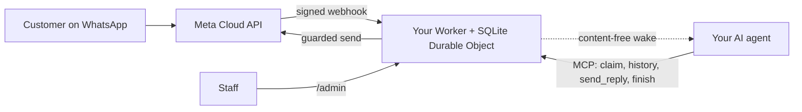

<div align="center">

[English](../../README.md) · [简体中文](README_zh.md) · [繁體中文](README_zh-TW.md) · [日本語](README_ja.md) · [한국어](README_ko.md) · [Türkçe](README_tr.md) · [Русский](README_ru.md) · [Tiếng Việt](README_vi.md) · [ไทย](README_th.md) · **Deutsch** · [Español](README_es.md) · [Français](README_fr.md) · [Українська](README_uk.md) · [Polski](README_pl.md) · [Português (Brasil)](README_pt-BR.md) · [العربية](README_ar.md) · [فارسی](README_fa.md) · [Bahasa Indonesia](README_id.md) · [Italiano](README_it.md)
· [Ελληνικά](README_el.md)

</div>

<div align="center">

# WAB bot

### Die WhatsApp-Nummer eines Unternehmens, ein KI-Agent über MCP, auf Ihrem eigenen Cloudflare-Konto.

**Eine kleine Single-Tenant-Brücke: Kunden schreiben an Ihre WhatsApp-Cloud-API-Nummer, Ihr Agent antwortet über abgesicherte Tools, und nichts verlässt Ihre Konten.**

[](../../LICENSE)
[](../STATUS.md)
[](../CLOUDFLARE.md)
[](../../THIRD_PARTY_NOTICES.md)
[](../../.github/workflows/ci.yml)

[Schnellstart](#schnellstart) · [Funktionsweise](#funktionsweise) · [Funktionen](#funktionen) · [Praxisbeispiele](#praxisbeispiele) · [FAQ](#faq) · [Dokumentation](#dokumentation)

</div>

> [!IMPORTANT]
> Die offizielle Quelle dieser Vorlage ist [wabbot-dev/wab-bot](https://github.com/wabbot-dev/wab-bot).
> Ein ähnlicher Repository-Name oder ein kopiertes README belegt nicht, dass Code offiziell ist. Lesen Sie, was Sie bereitstellen, und
> geben Sie einem Deploy-Skript oder einem Assistenten niemals ein Token, das Sie dessen Autor nicht geben würden.
> Dieses Projekt ist unabhängig: Es ist weder mit Meta oder xAI verbunden noch von ihnen unterstützt. WhatsApp und Grok sind Marken ihrer jeweiligen Inhaber.

> [!NOTE]
> **Vorschau.** Lokal gegen Fakes getestet (407 automatisierte Tests). Frühere Revisionen liefen live auf einem Wegwerf-Cloudflare-Free-Konto. Live-Belege auf Metas kostenloser **Test**-Nummer: **Texten** wurde am 2026-10-16 live ausgeführt (ein echter Text-Hin-und-Zurück: eine eingehende Nachricht kam an, und eine Antwort ging über die Brücke zurück), **Anrufe** am 2026-10-17 mit dem Code dieses Repositorys (Grok Voice über Meta SIP zu xAI SIP): Eingehende WhatsApp-Sprachanrufe wurden von der KI angenommen, das Gespräch lief in beide Richtungen (auch auf Arabisch), Transkripte beider Seiten wurden gespeichert, das `end_call` des Modells wurde vom Worker verarbeitet und xAIs Auflege-Anfrage wurde angenommen (HTTP 200), und das Anruf-Tor wurde scharf- und automatisch wieder abgeschaltet. Keine geschäftsverifizierte Produktionsnummer; Audioaufzeichnung wird nicht unterstützt. Von diesem Projekt nicht in der Produktion betrieben. Das Messaging-Design ist laut seinem Eigentümer in dem Deployment, aus dem es abgeleitet wurde, in der Produktion bewährt (vom Eigentümer berichtet, Datum offen), was kein Beleg für diesen Code ist. Alles Verifizierte und wie: [docs/STATUS.md](../STATUS.md).

---

Ihre Kunden schreiben an die WhatsApp-Nummer Ihres Unternehmens. Meta stellt jede Nachricht an einen Worker in **Ihrem eigenen Cloudflare-Konto** zu, der sie speichert und Ihrem KI-Agenten ein inhaltsfreies Wecksignal sendet. Der Agent (jeder MCP-fähige Agent) übernimmt die Unterhaltung, liest den Verlauf und antwortet über `send_reply`. Die Brücke, nicht der Agent, hält das WhatsApp-Token und erzwingt jede Sendeschranke. Mitarbeitende können eine Unterhaltung über `/admin` pausieren, übernehmen oder löschen.

Ein Deployment pro Unternehmen: eigene Meta-App, eigene Nummer, eigene Tokens und eigenes Cloudflare-Konto. In diesem Repository gibt es keine Geheimnisse.

## Schnellstart

Sie benötigen: ein Cloudflare-Konto, das Ihnen gehört, Node.js 20+ (22 empfohlen), ein Meta-Entwicklerkonto und die Einrichtung der WhatsApp Cloud API ([Checkliste](../META-CHECKLIST.md)), eine **neue Nummer, die nie in einer WhatsApp-App registriert war**, und einen Agenten, der MCP nutzen und per Webhook geweckt werden kann ([Weckroutine](../WAKE-ROUTINE.md)). Sie bezahlen Meta und Ihren eigenen KI-Tarif direkt; der Workers-Free-Tarif benötigt für das, was diese Vorlage nutzt, keine Zahlungsmethode ([Limits und Bedingungen](../CLOUDFLARE.md)).

### 1. Offline prüfen (kein Konto, kein Netzwerk)

```bash
git clone https://github.com/wabbot-dev/wab-bot.git && cd wab-bot
npm ci
npm run check          # typecheck, 293 logic tests, 65 workerd tests, docs check
npm run build          # wrangler deploy --dry-run: bundle and binding check
npm run smoke:local    # wrangler dev --local with random fake secrets
```

### 2. In Ihrem eigenen Cloudflare-Konto bereitstellen

```bash
bash scripts/deploy-cloudflare.sh --dry-run                  # prints the plan, makes no call
bash scripts/deploy-cloudflare.sh --name my-business-wa      # lowercase letters, digits, dashes
```

Das Skript meldet Sie mit `wrangler login --device` an (Sie bestätigen einen Code im Browser; es legt nie ein Konto an), stellt bereit, erzeugt die eigenen Tokens der Brücke und lädt Geheimnisse über stdin hoch. Weitere Wege (Cloudflare-API ohne Anmeldung, selbst bereitgestellte Geheimnisse) stehen in [docs/DEPLOY.md](../DEPLOY.md). Die Einrichtung wurde live auf 2 verschiedenen Konten nachgewiesen ([Status](../STATUS.md)).

### 3. Meta und Ihren Agenten verbinden

Folgen Sie [docs/META-CHECKLIST.md](../META-CHECKLIST.md) (Sie legen die Meta-Konten selbst an, verifizieren Ihr Unternehmen und geben den SMS-Code selbst ein), führen Sie `node scripts/meta-setup.mjs` auf Ihrem eigenen Computer aus und richten Sie Ihren Agenten auf `https://<worker>.<your-subdomain>.workers.dev/mcp` mit `Authorization: Bearer <MCP_TOKEN>` aus.

### 4. Im Testmodus bleiben, bis eine Nachricht hin und zurück gelaufen ist

Sichere Standardwerte: `LAUNCH_MODE=test` (Antworten gehen nur an `TEST_RECIPIENTS`), Auto-Antwort **pausiert**, Vorlagen aus, die Meta-Einrichtungsroute im Worker aus. Senden Sie eine Nachricht von Ihrem Handy, sehen Sie zu, wie sie in `/admin` ankommt, lassen Sie den Agenten antworten, und gehen Sie erst dann bewusst live.

## Funktionsweise



Jeder Webhook muss eine gültige `X-Hub-Signature-256` über den rohen Body tragen. Eine SQLite-Zeile pro Unterhaltung hält Anfragen voneinander unabhängig; bei einem verlorenen Wettlauf wird neu gelesen und wiederholt. Der Wecken-POST enthält nur IDs und Zähler, niemals Nachrichtentext. Grenzen und Zuständigkeiten: [docs/ARCHITECTURE.md](../ARCHITECTURE.md). Speicherung, Aufbewahrung und Wecken: [docs/STATE-STORE.md](../STATE-STORE.md).

## Funktionen

| Fähigkeit | Nachweis und Grenzen |
|---|---|
| WhatsApp-Text empfangen und pro Unterhaltung speichern, dedupliziert, mit HMAC-Prüfung | Lokal getestet; eine echte Nachricht auf Metas Testnummer empfangen ([Status](../STATUS.md)) |
| Agent-Tools über MCP: `list_pending`, `claim_conversation`, `get_history`, `send_reply` (16 serverseitige Schranken), `finish`, `release`, `escalate`, `get_controls`, schreibgeschütztes `get_overview` | Lokal und mit direkten JSON-RPC-Aufrufen getestet; **nicht** mit echten MCP-Clients. Eine echte Antwort auf Metas Testnummer gesendet, von Hand gesteuert |
| Mitarbeiter-Konsole: Auto-Antwort pausieren und fortsetzen, übernehmen, freigeben, wieder öffnen, lösen, wecken, löschen | Lokal getestet. Statische Seite, Token erforderlich |
| Eine Unterhaltung löschen (`DELETE /api/admin/conversations/<id>`) | Lokal mit Mutationsprüfungen getestet; nie live ausgeführt. Erreicht keine Wiederherstellungskopien bei Cloudflare ([Datenschutz](../PRIVACY.md)) |
| Ihren Agenten wecken, entprellt, mit Backoff und täglicher Wiederholung | Live gegen einen Ersatzempfänger verifiziert; nie gegen eine echte Agentenplattform |
| Aufbewahrung: beantwortete Chats werden nach 14 Tagen gekürzt, alles wird nach 180 Tagen verworfen | Live mit synthetischen Daten verifiziert; nie über Wochen mit echten Daten |
| Geheimnisse einmalig selbst bereitstellen (`POST /api/setup`) für Deploy-Tools, die Werte schwärzen | Live auf einem Test-Worker ausgeführt; schwächer als ein Secret-Binding ([Grenzen](../SELF-PROVISIONING.md)) |
| WhatsApp-Sprachanrufe beantworten (Meta SIP zu xAI Grok Voice), aus, bis der Eigentümer das Tor öffnet; Sie zahlen xAI etwa $0.08 pro Minute | **Live ausgeführt** mit diesem Code am 2026-10-17 auf Metas Testnummer: von der KI angenommen, Gespräch in beide Richtungen, Transkripte beider Seiten gespeichert, Gesprächsende-Anfrage des Modells verarbeitet; keine geschäftsverifizierte Produktionsnummer ([Sprache](../VOICE-CALLS.md)) |
| Admin-MCP nur für den Eigentümer unter `/admin/mcp`: Status, Einrichtungsprüfung, geschwärzte Unterhaltungen, Löschen, Anrufe scharf- und abschalten, Anrufprotokolle, Nutzung, Version und Update-Prüfung (17 Werkzeuge) | Aus, solange `ADMIN_MCP_TOKEN` nicht gesetzt ist. Lokal und in workerd getestet; **nicht** mit echten MCP-Clients ([Admin-MCP](../mcp.md)) |
| Sprachnachrichten, Bilder und Dokumente verstehen: Sprachnachrichten werden transkribiert (Arabisch, Französisch, Englisch und mehr), Bilder beschrieben und PDF- oder Office-Dokumente gelesen, mit Workers AI in Ihrem eigenen Cloudflare-Konto im kostenlosen Tageskontingent; Standorte und Kontaktkarten werden gelesen; bei jedem Fehler sieht der Agent einen einfachen Hinweis. Optionale Antworten als Sprachnachricht, standardmäßig aus: sechs Sprachen mit Workers AI, Arabisch und weitere Sprachen mit Ihrem eigenen xAI- oder ElevenLabs-Schlüssel | Lokal getestet; live über die Selbsttest-Route des Inhabers auf einem Test-Worker ausgeführt, noch nicht von einem echten Telefon ([Medien](../MEDIA.md)) |
| Optionale Business-Funktionen: Privatkunden, Geschäftskunden oder beide bedienen; ein vom Inhaber gepflegtes Kontenverzeichnis; sofortige Benachrichtigung des Inhabers; Dokumente, Bilder, Schaltflächen und Listen in Antworten; vom Personal bestätigte Zahlungen; eine Schnittstelle für Buchungen und Bestellungen | Lokal getestet; noch nicht live ausgeführt ([Business-Modus](../BUSINESS-MODE.md)) |

Nicht enthalten: Videoverständnis (ein Video wird vermerkt, nicht angesehen), Gruppen, ausgehende Anrufe, Audioaufzeichnung, eine Einstellungsseite, vorgefertigte Routinen, Multi-Tenant-Hosting. Siehe [docs/ROADMAP.md](../ROADMAP.md).

## Praxisbeispiele

**Ein Kundenzug über MCP** (nur Platzhalter; der Agent erledigt das über seinen MCP-Client):

```bash
MCP=https://<worker>.<your-subdomain>.workers.dev/mcp
call() { curl -s "$MCP" -H "Authorization: Bearer $MCP_TOKEN" -H 'content-type: application/json' \
  -d "{\"jsonrpc\":\"2.0\",\"id\":1,\"method\":\"tools/call\",\"params\":{\"name\":\"$1\",\"arguments\":$2}}"; }
call list_pending '{}'
call claim_conversation '{"conversation_id":"c_<id>"}'                       # returns a lease
call get_history '{"conversation_id":"c_<id>","lease":"<lease>"}'            # customer text is wrapped as untrusted
call send_reply '{"conversation_id":"c_<id>","lease":"<lease>","text":"Hello, how can I help?"}'
call finish_conversation '{"conversation_id":"c_<id>","lease":"<lease>"}'
```

Solange `LAUNCH_MODE=test` gilt oder die Auto-Antwort pausiert ist, antwortet `send_reply` mit `blocked_test_mode_recipient_not_allowlisted` oder `blocked_auto_reply_paused`, statt zu senden. Die Reihenfolge der Schranken und jede Fehlermeldung: [docs/CONFIGURATION.md](../CONFIGURATION.md).

**Einen Kunden löschen:**

```bash
curl -X DELETE -H "Authorization: Bearer $ADMIN_TOKEN" https://<worker>.<your-subdomain>.workers.dev/api/admin/conversations/c_<id>
# {"ok":true,"deleted":true}   (407 if unknown or already erased)
```

**Alles entfernen:** `bash scripts/teardown-cloudflare.sh` (verlangt, dass Sie den Worker-Namen eintippen; löscht den Worker und jede gespeicherte Unterhaltung, sonst nichts).

## FAQ

**Wem gehört das Cloudflare-Konto?** Ihnen: Sie akzeptieren die Bedingungen, Sie zahlen, falls Sie jemals zahlen, und Sie können es löschen. Ein Assistent darf die Cloudflare- und xAI-Konten nur mit Ihrer schriftlichen Einwilligung für Sie anlegen und nur, wenn Sie als Eigentümer oder Admin eingetragen sind; eine Karte hinterlegen Sie selbst. Meta-Konten, Business-Verifizierung und der SMS-Code liegen immer bei Ihnen ([Details und der Hinweis zu den Cloudflare-Bedingungen](../CLOUDFLARE.md)).

**Ist der Free-Tarif für ein Unternehmen erlaubt?** In den am 2026-10-17 gelesenen Cloudflare-Bedingungen enthalten die Free-Dienste keine Klausel „nur für den persönlichen Gebrauch“, aber zwei hier relevante Einschränkungen (keine Erfassung von Kartendaten, keine geschützten Gesundheitsdaten ohne schriftliche Zustimmung von Cloudflare). Keine Rechtsberatung; bitte erneut prüfen ([gewerbliche Nutzung](../CLOUDFLARE.md#commercial-use)).

**Kann ich meine bestehende WhatsApp-Business-App-Nummer verwenden?** Nein. Die Cloud-API-Nummer darf nie in einer WhatsApp-App registriert gewesen sein; Koexistenz ist nicht Teil des Umfangs. Bringen Sie Ihre eigene SIM oder Leitung mit und geben Sie deren Code selbst ein.

**Nimmt es Anrufe entgegen?** Ja, nur eingehend und nur, wenn Sie das Tor öffnen: Anrufe sind standardmäßig aus, bleiben auf einer echten Nummer aus, bis Ihre Business-Verifizierung abgeschlossen ist und Sie grünes Licht geben, und laufen in kurzen Zeitfenstern, die Sie scharfschalten. Verwendet wird xAI Grok Voice auf Ihrem eigenen xAI-Konto (etwa $0.08 pro Minute). Anrufe mit diesem Code wurden am 2026-10-17 live auf Metas Testnummer angenommen (Gespräch in beide Richtungen, Transkripte gespeichert); auf einer geschäftsverifizierten Produktionsnummer lief er nicht, und Audioaufzeichnung wird nicht unterstützt ([Sprache](../VOICE-CALLS.md)).

**Welcher Agent funktioniert?** Jeder Agent, der MCP über HTTP spricht und per Webhook geweckt werden kann. Getestet wurde mit direkten JSON-RPC-Aufrufen, nicht mit echten MCP-Clients ([Weckroutine](../WAKE-ROUTINE.md)).

**Wie viel Volumen?** Single-Tenant, ein Durable Object: Volumen kleiner Unternehmen. Nach unserer Livemessung passen etwa 30.000 Nachrichten pro Tag in das Free-Kontingent für Durable Objects; viele gleichzeitige Nachrichten in einer Unterhaltung können 503 zurückgeben, und Meta stellt erneut zu ([Status](../STATUS.md#live-measurements-cloudflare-free-fake-secrets-2026-10-16)).

**Ist es in der Produktion bewährt?** Das Design, von dem es stammt, soll es sein (vom Eigentümer berichtet, Datum offen). Dieser Cloudflare-Port ist es nicht. Der [Status](../STATUS.md) sagt genau, was jede Stufe bedeutet.

## Grenzen und gute Praxis

- **Unabhängiges Projekt.** WAB bot ist inoffiziell: Es ist weder mit Meta, WhatsApp oder xAI verbunden noch von ihnen unterstützt. WhatsApp und Grok sind Marken ihrer jeweiligen Inhaber.
- **Metas Regeln gelten.** Ihre Nutzung der WhatsApp Cloud API folgt Metas Bedingungen, Messaging-Richtlinien und den Regeln je Nummer; Anrufe auf einer Geschäftsnummer setzen die Meta-Business-Verifizierung voraus.
- **Eine Nummer pro Bot.** Ein Deployment bedient ein Unternehmen und eine WhatsApp-Nummer, mit eigener Meta-App, eigenen Tokens und eigenem Cloudflare-Konto.
- **Anrufe schalten Sie selbst frei.** Sie sind standardmäßig aus; Sie öffnen sie unter Nennung der Nummer, und Anrufe nutzen Ihr eigenes xAI-Guthaben (etwa $0.08 pro Minute).
- **Nur eingehende Anrufe, keine Audioaufzeichnung.** Ausgehende Anrufe und Audioaufzeichnung werden nicht unterstützt. Ein Text-Transkript wird standardmäßig gespeichert und lässt sich abschalten.
- **SIP und die Graph-Anruf-API schließen sich pro Nummer aus.** Solange eine Nummer SIP für Anrufe nutzt, wie dieser Bot, sind Metas Graph-Anruf-Endpunkte auf ihr nicht verfügbar.
- **Halten Sie einen Ausweichkontakt bereit.** Veröffentlichen Sie einen weiteren Kontaktweg, etwa eine Telefonnummer oder E-Mail, und lassen Sie Mitarbeitende jede Unterhaltung übernehmen können.

Was unterstützt wird und was nicht: [Funktionen](../CAPABILITIES.md). Praktische Antworten: [Fehlerbehebung](../TROUBLESHOOTING.md). Anrufe im Detail: [Sprache](../VOICE-CALLS.md).

## Dokumentation

[docs/index.md](../index.md) listet jede Seite auf. Beginnen Sie mit [STATUS](../STATUS.md), dann [DEPLOY](../DEPLOY.md), [META-CHECKLIST](../META-CHECKLIST.md), [CONFIGURATION](../CONFIGURATION.md), [PRIVACY](../PRIVACY.md) und [TROUBLESHOOTING](../TROUBLESHOOTING.md). Außerdem: [AGENTS.md](../../AGENTS.md) für KI-Coding-Agenten, [SECURITY.md](../../SECURITY.md), [CHANGELOG.md](../../CHANGELOG.md), [THIRD_PARTY_NOTICES.md](../../THIRD_PARTY_NOTICES.md).

## Haftungsausschluss

Dies ist Vorschau-Software für rechtmäßige geschäftliche Nachrichten. Sie sind verantwortlich für Ihr Deployment, Ihre Zugangsdaten, die Daten Ihrer Kunden, die Regeln zu Aufzeichnung und KI-Offenlegung sowie Ihre Bedingungen mit Meta und Cloudflare. Keine Gewährleistung. Lesen Sie [DISCLAIMER.md](../../DISCLAIMER.md).

## Mitwirken

Gezielte Korrekturen, Dokumentationsverbesserungen und Tests sind willkommen; lesen Sie zuerst den [Beitragsumfang](../../CONTRIBUTING.md#contribution-scope) und die [PR-Bereitschaftsregeln](../../CONTRIBUTING.md#pull-request-ownership-and-readiness). KI-gestützte PRs brauchen eine namentlich genannte menschliche Verantwortliche oder einen namentlich genannten menschlichen Verantwortlichen. Sicherheitsprobleme: [SECURITY.md](../../SECURITY.md).

## Lizenz

[MIT](../../LICENSE), Copyright (c) 2026 wabbot-dev.
