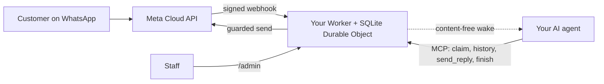

<div align="center">

[English](../../README.md) · [简体中文](README_zh.md) · [繁體中文](README_zh-TW.md) · [日本語](README_ja.md) · [한국어](README_ko.md) · [Türkçe](README_tr.md) · [Русский](README_ru.md) · [Tiếng Việt](README_vi.md) · [ไทย](README_th.md) · [Deutsch](README_de.md) · [Español](README_es.md) · [Français](README_fr.md) · [Українська](README_uk.md) · [Polski](README_pl.md) · [Português (Brasil)](README_pt-BR.md) · [العربية](README_ar.md) · [فارسی](README_fa.md) · [Bahasa Indonesia](README_id.md) · [Italiano](README_it.md)
· **Ελληνικά**

</div>

<div align="center">

# WAB bot

### Ο αριθμός WhatsApp μιας επιχείρησης, ένας πράκτορας τεχνητής νοημοσύνης μέσω MCP, στον δικό σας λογαριασμό Cloudflare.

**Μια μικρή γέφυρα ενός μισθωτή (single-tenant): οι πελάτες στέλνουν μήνυμα στον αριθμό σας WhatsApp Cloud API, ο πράκτοράς σας απαντά μέσω προστατευμένων εργαλείων και τίποτα δεν φεύγει από τους λογαριασμούς σας.**

[](../../LICENSE)
[](../STATUS.md)
[](../CLOUDFLARE.md)
[](../../THIRD_PARTY_NOTICES.md)
[](../../.github/workflows/ci.yml)

[Γρήγορη εκκίνηση](#γρήγορη-εκκίνηση) · [Πώς λειτουργεί](#πώς-λειτουργεί) · [Τι μπορεί να κάνει](#τι-μπορεί-να-κάνει) · [Παραδείγματα χρήσης](#παραδείγματα-χρήσης) · [Συχνές ερωτήσεις](#συχνές-ερωτήσεις) · [Τεκμηρίωση](#τεκμηρίωση)

</div>

> [!IMPORTANT]
> Η επίσημη πηγή αυτού του προτύπου είναι το [wabbot-dev/wab-bot](https://github.com/wabbot-dev/wab-bot).
> Ένα παρόμοιο όνομα αποθετηρίου ή ένα αντιγραμμένο README δεν αποδεικνύει ότι ο κώδικας είναι επίσημος. Διαβάστε ό,τι αναπτύσσετε και
> μην δίνετε ποτέ σε ένα σενάριο ανάπτυξης ή σε έναν βοηθό ένα διακριτικό που δεν θα δίνατε στον συγγραφέα του.
> Αυτό το έργο είναι ανεξάρτητο: δεν συνδέεται με τη Meta ή την xAI ούτε εγκρίνεται από αυτές. Τα WhatsApp και Grok είναι εμπορικά σήματα των ιδιοκτητών τους.

> [!NOTE]
> **Προεπισκόπηση.** Δοκιμασμένο τοπικά απέναντι σε προσομοιώσεις (407 αυτοματοποιημένες δοκιμές). Προηγούμενες αναθεωρήσεις έτρεξαν ζωντανά σε έναν λογαριασμό Cloudflare Free μίας χρήσης. Ζωντανές αποδείξεις στον δωρεάν **δοκιμαστικό** αριθμό της Meta: τα **μηνύματα κειμένου** εκτελέστηκαν ζωντανά στις 2026-10-16 (μια πραγματική ανταλλαγή κειμένου: λήφθηκε ένα εισερχόμενο μήνυμα και επέστρεψε απάντηση μέσω της γέφυρας), και οι **κλήσεις** στις 2026-10-17 με τον κώδικα αυτού του αποθετηρίου (Grok Voice μέσω Meta SIP προς xAI SIP): οι εισερχόμενες φωνητικές κλήσεις WhatsApp απαντήθηκαν από την τεχνητή νοημοσύνη, η συζήτηση πήγε και προς τις δύο κατευθύνσεις (και στα αραβικά), αποθηκεύτηκαν τα απομαγνητοφωνημένα κείμενα και των δύο πλευρών, το `end_call` του μοντέλου χειρίστηκε το Worker και το αίτημα τερματισμού προς την xAI έγινε δεκτό (HTTP 200), και η πύλη κλήσεων οπλίστηκε και αφοπλίστηκε μόνη της. Δεν είναι αριθμός παραγωγής επαληθευμένος ως επιχείρηση· η εγγραφή ήχου δεν υποστηρίζεται. Δεν έχει εκτελεστεί από αυτό το έργο στην παραγωγή. Ο ιδιοκτήτης αναφέρει ότι ο σχεδιασμός της ανταλλαγής μηνυμάτων έχει αποδειχθεί στην παραγωγή στην εγκατάσταση από την οποία προήλθε (αναφορά ιδιοκτήτη, ημερομηνία προς καθορισμό), κάτι που δεν αποτελεί απόδειξη για αυτόν τον κώδικα. Όλα όσα έχουν επαληθευτεί και πώς: [docs/STATUS.md](../STATUS.md).

---

Οι πελάτες σας γράφουν στον αριθμό WhatsApp της επιχείρησής σας. Η Meta παραδίδει κάθε μήνυμα σε έναν Worker στον **δικό σας λογαριασμό Cloudflare**, ο οποίος το αποθηκεύει και στέλνει στον πράκτορα τεχνητής νοημοσύνης σας ένα σήμα αφύπνισης χωρίς περιεχόμενο. Ο πράκτορας (οποιοσδήποτε πράκτορας με υποστήριξη MCP) αναλαμβάνει τη συνομιλία, διαβάζει το ιστορικό και απαντά μέσω `send_reply`. Η γέφυρα, και όχι ο πράκτορας, κρατά το διακριτικό του WhatsApp και επιβάλλει κάθε προστασία αποστολής. Το προσωπικό μπορεί να θέσει σε παύση, να αναλάβει ή να διαγράψει μια συνομιλία από το `/admin`.

Μία ανάπτυξη ανά επιχείρηση: η δική της εφαρμογή Meta, ο αριθμός, τα διακριτικά και ο λογαριασμός Cloudflare. Δεν υπάρχουν μυστικά σε αυτό το αποθετήριο.

## Γρήγορη εκκίνηση

Χρειάζεστε: έναν λογαριασμό Cloudflare που σας ανήκει, Node.js 20+ (προτείνεται το 22), έναν λογαριασμό προγραμματιστή Meta και ρύθμιση του WhatsApp Cloud API ([λίστα ελέγχου](../META-CHECKLIST.md)), έναν **νέο αριθμό που δεν έχει καταχωριστεί ποτέ σε καμία εφαρμογή WhatsApp** και έναν πράκτορα που μπορεί να χρησιμοποιεί MCP και να αφυπνίζεται από webhook ([ρουτίνα αφύπνισης](../WAKE-ROUTINE.md)). Πληρώνετε απευθείας τη Meta και το δικό σας πακέτο τεχνητής νοημοσύνης· το πακέτο Workers Free δεν απαιτεί τρόπο πληρωμής για όσα χρησιμοποιεί αυτό το πρότυπο ([όρια και όροι](../CLOUDFLARE.md)).

### 1. Ελέγξτε το εκτός σύνδεσης (χωρίς λογαριασμό, χωρίς δίκτυο)

```bash
git clone https://github.com/wabbot-dev/wab-bot.git && cd wab-bot
npm ci
npm run check          # typecheck, 293 logic tests, 65 workerd tests, docs check
npm run build          # wrangler deploy --dry-run: bundle and binding check
npm run smoke:local    # wrangler dev --local with random fake secrets
```

### 2. Αναπτύξτε στον δικό σας λογαριασμό Cloudflare

```bash
bash scripts/deploy-cloudflare.sh --dry-run                  # prints the plan, makes no call
bash scripts/deploy-cloudflare.sh --name my-business-wa      # lowercase letters, digits, dashes
```

Το σενάριο σας συνδέει με `wrangler login --device` (εγκρίνετε έναν κωδικό στο πρόγραμμα περιήγησης· δεν δημιουργεί ποτέ λογαριασμό), αναπτύσσει, δημιουργεί τα δικά της διακριτικά της γέφυρας και ανεβάζει τα μυστικά μέσω stdin. Άλλες διαδρομές (Cloudflare API χωρίς σύνδεση, μυστικά που παρέχονται μόνοι σας) υπάρχουν στο [docs/DEPLOY.md](../DEPLOY.md). Η εγκατάσταση έχει αποδειχθεί ζωντανά σε 2 διαφορετικούς λογαριασμούς ([κατάσταση](../STATUS.md)).

### 3. Συνδέστε τη Meta και τον πράκτορά σας

Ακολουθήστε το [docs/META-CHECKLIST.md](../META-CHECKLIST.md) (δημιουργείτε εσείς τους λογαριασμούς Meta, επαληθεύετε την επιχείρησή σας και πληκτρολογείτε μόνοι σας τον κωδικό SMS), εκτελέστε `node scripts/meta-setup.mjs` στον δικό σας υπολογιστή και στρέψτε τον πράκτορά σας στο `https://<worker>.<your-subdomain>.workers.dev/mcp` με `Authorization: Bearer <MCP_TOKEN>`.

### 4. Μείνετε σε δοκιμαστική λειτουργία μέχρι ένα μήνυμα να κάνει τη διαδρομή μετ' επιστροφής

Ασφαλείς προεπιλογές: `LAUNCH_MODE=test` (οι απαντήσεις πηγαίνουν μόνο στα `TEST_RECIPIENTS`), αυτόματη απάντηση **σε παύση**, πρότυπα απενεργοποιημένα, η διαδρομή ρύθμισης Meta μέσα στον Worker απενεργοποιημένη. Στείλτε ένα μήνυμα από το τηλέφωνό σας, δείτε το να φτάνει στο `/admin`, αφήστε τον πράκτορα να απαντήσει και μόνο τότε περάστε σε παραγωγή συνειδητά.

## Πώς λειτουργεί



Κάθε webhook πρέπει να φέρει έγκυρο `X-Hub-Signature-256` πάνω στο ακατέργαστο σώμα. Μία γραμμή SQLite ανά συνομιλία κρατά τα αιτήματα ανεξάρτητα· ένα αίτημα που χάνει τον αγώνα ξαναδιαβάζει και επαναλαμβάνει. Το POST αφύπνισης μεταφέρει μόνο αναγνωριστικά και μετρητές, ποτέ κείμενο μηνυμάτων. Όρια και ιδιοκτησία: [docs/ARCHITECTURE.md](../ARCHITECTURE.md). Αποθήκευση, διατήρηση και αφύπνιση: [docs/STATE-STORE.md](../STATE-STORE.md).

## Τι μπορεί να κάνει

| Δυνατότητα | Τεκμήρια και όρια |
|---|---|
| Λήψη κειμένου WhatsApp και αποθήκευσή του ανά συνομιλία, χωρίς διπλότυπα, με επαλήθευση HMAC | Δοκιμάστηκε τοπικά· ένα πραγματικό μήνυμα λήφθηκε στον δοκιμαστικό αριθμό της Meta ([κατάσταση](../STATUS.md)) |
| Εργαλεία πράκτορα μέσω MCP: `list_pending`, `claim_conversation`, `get_history`, `send_reply` (16 προστασίες στον διακομιστή), `finish`, `release`, `escalate`, `get_controls`, `get_overview` μόνο για ανάγνωση | Δοκιμάστηκε τοπικά και με άμεσες κλήσεις JSON-RPC· **όχι** με πραγματικούς πελάτες MCP. Στάλθηκε μία πραγματική απάντηση στον δοκιμαστικό αριθμό της Meta, με χειροκίνητο χειρισμό |
| Κονσόλα προσωπικού: παύση και συνέχιση αυτόματης απάντησης, ανάληψη, απελευθέρωση, επανάνοιγμα, επίλυση, αφύπνιση, διαγραφή | Δοκιμάστηκε τοπικά. Στατική σελίδα, απαιτεί διακριτικό |
| Διαγραφή μίας συνομιλίας (`DELETE /api/admin/conversations/<id>`) | Δοκιμάστηκε τοπικά με ελέγχους μετάλλαξης· δεν εκτελέστηκε ποτέ ζωντανά. Δεν φτάνει στα αντίγραφα ανάκτησης της Cloudflare ([απόρρητο](../PRIVACY.md)) |
| Αφύπνιση του πράκτορά σας, με debounce, backoff και καθημερινή επανάληψη | Επαληθεύτηκε ζωντανά απέναντι σε υποκατάστατο δέκτη· ποτέ απέναντι σε πραγματική πλατφόρμα πρακτόρων |
| Διατήρηση: οι συνομιλίες που απαντήθηκαν περικόπτονται στις 14 ημέρες, οτιδήποτε απορρίπτεται στις 180 ημέρες | Επαληθεύτηκε ζωντανά με συνθετικά δεδομένα· ποτέ για εβδομάδες με πραγματικά δεδομένα |
| Αυτόματη παροχή μυστικών μία φορά (`POST /api/setup`) για εργαλεία ανάπτυξης που αποκρύπτουν τιμές | Εκτελέστηκε ζωντανά σε έναν δοκιμαστικό Worker· πιο αδύναμη από ένα secret binding ([όρια](../SELF-PROVISIONING.md)) |
| Απάντηση σε φωνητικές κλήσεις WhatsApp (Meta SIP προς xAI Grok Voice), απενεργοποιημένο μέχρι ο ιδιοκτήτης να ανοίξει την πύλη· πληρώνετε εσείς την xAI, περίπου $0.08 το λεπτό | **Εκτελέστηκε ζωντανά** με αυτόν τον κώδικα στις 2026-10-17 στον δοκιμαστικό αριθμό της Meta: απάντησε η τεχνητή νοημοσύνη, συζήτηση και προς τις δύο κατευθύνσεις, αποθηκεύτηκαν τα κείμενα και των δύο πλευρών, χειρίστηκε το αίτημα του μοντέλου για τερματισμό κλήσης· δεν είναι αριθμός παραγωγής επαληθευμένος ως επιχείρηση ([φωνή](../VOICE-CALLS.md)) |
| MCP διαχείρισης μόνο για τον ιδιοκτήτη στο `/admin/mcp`: κατάσταση, έλεγχος ρύθμισης, συζητήσεις με απόκρυψη στοιχείων, διαγραφή, ενεργοποίηση και απενεργοποίηση κλήσεων, αρχεία καταγραφής κλήσεων, χρήση, έκδοση και έλεγχος ενημερώσεων (17 εργαλεία) | Απενεργοποιημένο εκτός αν οριστεί το `ADMIN_MCP_TOKEN`. Δοκιμάστηκε τοπικά και στο workerd· **όχι** με πραγματικούς πελάτες MCP ([MCP διαχείρισης](../mcp.md)) |
| Κατανόηση φωνητικών μηνυμάτων, εικόνων και εγγράφων: τα φωνητικά μεταγράφονται (αραβικά, γαλλικά, αγγλικά και άλλα), οι εικόνες περιγράφονται και τα έγγραφα PDF ή Office διαβάζονται με το Workers AI στον δικό σας λογαριασμό Cloudflare, εντός του δωρεάν ημερήσιου ορίου· διαβάζονται τοποθεσίες και κάρτες επαφών· σε κάθε αποτυχία ο πράκτορας βλέπει μια απλή ένδειξη. Προαιρετικές φωνητικές απαντήσεις, απενεργοποιημένες εξ ορισμού: έξι γλώσσες με το Workers AI, αραβικά και άλλες γλώσσες με το δικό σας κλειδί xAI ή ElevenLabs | Δοκιμάστηκε τοπικά· εκτελέστηκε ζωντανά μέσω της διαδρομής αυτοελέγχου του ιδιοκτήτη σε δοκιμαστικό Worker, όχι ακόμη από πραγματικό τηλέφωνο ([πολυμέσα](../MEDIA.md)) |
| Προαιρετικές επιχειρηματικές λειτουργίες: εξυπηρέτηση ιδιωτών, επιχειρήσεων ή και των δύο· κατάλογος λογαριασμών που διαχειρίζεται ο ιδιοκτήτης· άμεσες ειδοποιήσεις στον ιδιοκτήτη· έγγραφα, εικόνες, κουμπιά και λίστες στις απαντήσεις· πληρωμές επαληθευμένες από το προσωπικό· σύνδεση για κρατήσεις και παραγγελίες | Δοκιμασμένο τοπικά· δεν έχει εκτελεστεί ζωντανά ακόμη ([επιχειρηματική λειτουργία](../BUSINESS-MODE.md)) |

Δεν περιλαμβάνονται: κατανόηση βίντεο (ένα βίντεο σημειώνεται, δεν προβάλλεται), ομάδες, εξερχόμενες κλήσεις, ηχογράφηση, σελίδα ρυθμίσεων, έτοιμες ρουτίνες, φιλοξενία πολλών μισθωτών. Δείτε το [docs/ROADMAP.md](../ROADMAP.md).

## Παραδείγματα χρήσης

**Ένας γύρος πελάτη μέσω MCP** (μόνο σύμβολα κράτησης θέσης· ο πράκτορας το κάνει μέσω του πελάτη MCP του):

```bash
MCP=https://<worker>.<your-subdomain>.workers.dev/mcp
call() { curl -s "$MCP" -H "Authorization: Bearer $MCP_TOKEN" -H 'content-type: application/json' \
  -d "{\"jsonrpc\":\"2.0\",\"id\":1,\"method\":\"tools/call\",\"params\":{\"name\":\"$1\",\"arguments\":$2}}"; }
call list_pending '{}'
call claim_conversation '{"conversation_id":"c_<id>"}'                       # returns a lease
call get_history '{"conversation_id":"c_<id>","lease":"<lease>"}'            # customer text is wrapped as untrusted
call send_reply '{"conversation_id":"c_<id>","lease":"<lease>","text":"Hello, how can I help?"}'
call finish_conversation '{"conversation_id":"c_<id>","lease":"<lease>"}'
```

Όσο ισχύει `LAUNCH_MODE=test` ή η αυτόματη απάντηση είναι σε παύση, το `send_reply` απαντά `blocked_test_mode_recipient_not_allowlisted` ή `blocked_auto_reply_paused` αντί να στείλει. Η σειρά των προστασιών και κάθε μήνυμα σφάλματος: [docs/CONFIGURATION.md](../CONFIGURATION.md).

**Διαγραφή ενός πελάτη:**

```bash
curl -X DELETE -H "Authorization: Bearer $ADMIN_TOKEN" https://<worker>.<your-subdomain>.workers.dev/api/admin/conversations/c_<id>
# {"ok":true,"deleted":true}   (407 if unknown or already erased)
```

**Αφαίρεση όλων:** `bash scripts/teardown-cloudflare.sh` (σας ζητά να πληκτρολογήσετε το όνομα του Worker· διαγράφει τον Worker και κάθε αποθηκευμένη συνομιλία, τίποτα άλλο).

## Συχνές ερωτήσεις

**Σε ποιον ανήκει ο λογαριασμός Cloudflare;** Σε εσάς: εσείς αποδέχεστε τους όρους, εσείς πληρώνετε αν ποτέ πληρώσετε και εσείς μπορείτε να τον διαγράψετε. Ένας βοηθός μπορεί να δημιουργήσει τους λογαριασμούς Cloudflare και xAI για εσάς μόνο με τη γραπτή συγκατάθεσή σας και με εσάς ως ιδιοκτήτη ή διαχειριστή· την κάρτα την προσθέτετε εσείς. Οι λογαριασμοί Meta, η Επαλήθευση Επιχείρησης και ο κωδικός SMS είναι πάντα δικοί σας ([λεπτομέρειες και η επιφύλαξη για τους όρους της Cloudflare](../CLOUDFLARE.md)).

**Επιτρέπεται το πακέτο Free για επιχείρηση;** Στους όρους της Cloudflare που διαβάστηκαν στις 2026-10-17 οι υπηρεσίες Free δεν φέρουν ρήτρα αποκλειστικά προσωπικής χρήσης, με δύο περιορισμούς που έχουν σημασία εδώ (καμία συλλογή στοιχείων κάρτας, καμία προστατευόμενη πληροφορία υγείας χωρίς γραπτή συγκατάθεση της Cloudflare). Δεν αποτελεί νομική συμβουλή· ελέγξτε ξανά ([εμπορική χρήση](../CLOUDFLARE.md#commercial-use)).

**Μπορώ να χρησιμοποιήσω τον υπάρχοντα αριθμό της εφαρμογής WhatsApp Business;** Όχι. Ο αριθμός του Cloud API δεν πρέπει να έχει καταχωριστεί ποτέ σε εφαρμογή WhatsApp· η συνύπαρξη (coexistence) είναι εκτός πεδίου. Φέρτε τη δική σας κάρτα SIM ή γραμμή και πληκτρολογήστε μόνοι σας τον κωδικό της.

**Απαντά σε κλήσεις;** Ναι, μόνο εισερχόμενες και μόνο όταν ανοίξετε την πύλη: οι κλήσεις είναι από προεπιλογή απενεργοποιημένες, σε πραγματικό αριθμό μένουν απενεργοποιημένες μέχρι να ολοκληρωθεί η επαλήθευση της επιχείρησής σας και να πείτε ξεκίνα, και λειτουργούν σε σύντομα παράθυρα που ενεργοποιείτε εσείς. Χρησιμοποιεί xAI Grok Voice στον δικό σας λογαριασμό xAI (περίπου $0.08 το λεπτό). Κλήσεις με αυτόν τον κώδικα απαντήθηκαν ζωντανά στον δοκιμαστικό αριθμό της Meta στις 2026-10-17 (συζήτηση και προς τις δύο κατευθύνσεις, αποθηκεύτηκαν τα κείμενα)· δεν έχει εκτελεστεί σε αριθμό παραγωγής επαληθευμένο ως επιχείρηση και η εγγραφή ήχου δεν υποστηρίζεται ([φωνή](../VOICE-CALLS.md)).

**Ποιος πράκτορας δουλεύει;** Οποιοσδήποτε πράκτορας μπορεί να μιλά MCP μέσω HTTP και να αφυπνίζεται από webhook. Έχει δοκιμαστεί με άμεσες κλήσεις JSON-RPC, όχι με πραγματικούς πελάτες MCP ([ρουτίνα αφύπνισης](../WAKE-ROUTINE.md)).

**Πόσο όγκο αντέχει;** Ένας μισθωτής, ένα Durable Object: όγκοι μικρής επιχείρησης. Σύμφωνα με τη ζωντανή μέτρησή μας, περίπου 30.000 μηνύματα την ημέρα χωρούν στην ποσόστωση Durable Object του Free· πολλά ταυτόχρονα μηνύματα στην ίδια συνομιλία μπορεί να επιστρέψουν 503 και η Meta τα παραδίδει ξανά ([κατάσταση](../STATUS.md#live-measurements-cloudflare-free-fake-secrets-2026-10-16)).

**Είναι αποδεδειγμένο σε παραγωγή;** Ο σχεδιασμός από τον οποίο προέρχεται αναφέρεται ότι είναι (αναφορά ιδιοκτήτη, ημερομηνία προς καθορισμό). Αυτή η μεταφορά στη Cloudflare δεν είναι. Η [κατάσταση](../STATUS.md) λέει ακριβώς τι σημαίνει κάθε επίπεδο.

## Όρια και καλές πρακτικές

- **Ανεξάρτητο έργο.** Το WAB bot είναι ανεπίσημο: δεν συνδέεται με τη Meta, το WhatsApp ή την xAI ούτε εγκρίνεται από αυτές. Το WhatsApp και το Grok είναι εμπορικά σήματα των κατόχων τους.
- **Ισχύουν οι κανόνες της Meta.** Η χρήση του WhatsApp Cloud API ακολουθεί τους όρους, τις πολιτικές μηνυμάτων και τους κανόνες ανά αριθμό της Meta, και οι κλήσεις σε επαγγελματικό αριθμό απαιτούν την Επαλήθευση Επιχείρησης της Meta.
- **Ένας αριθμός ανά bot.** Μία εγκατάσταση εξυπηρετεί μία επιχείρηση και έναν αριθμό WhatsApp, με τη δική σας εφαρμογή Meta, τα δικά σας διακριτικά και λογαριασμό Cloudflare.
- **Τις κλήσεις τις ενεργοποιείτε εσείς.** Είναι από προεπιλογή απενεργοποιημένες· τις ανοίγετε δηλώνοντας τον αριθμό και χρησιμοποιούν τις δικές σας πιστώσεις xAI (περίπου $0.08 το λεπτό).
- **Μόνο εισερχόμενες κλήσεις, χωρίς εγγραφή ήχου.** Οι εξερχόμενες κλήσεις και η εγγραφή ήχου δεν υποστηρίζονται. Η απομαγνητοφώνηση κειμένου φυλάσσεται από προεπιλογή και μπορείτε να την απενεργοποιήσετε.
- **Το SIP και το Graph API κλήσεων αλληλοαποκλείονται ανά αριθμό.** Όσο ένας αριθμός χρησιμοποιεί SIP για κλήσεις, όπως αυτό το bot, τα endpoints κλήσεων του Graph της Meta δεν είναι διαθέσιμα σε αυτόν.
- **Κρατήστε εναλλακτική οδό επικοινωνίας.** Δημοσιεύστε άλλον τρόπο να σας βρουν, όπως τηλέφωνο ή email, και φροντίστε το προσωπικό να μπορεί να αναλάβει οποιαδήποτε συνομιλία.

Τι υποστηρίζεται και τι όχι: [δυνατότητες](../CAPABILITIES.md). Πρακτικές απαντήσεις: [αντιμετώπιση προβλημάτων](../TROUBLESHOOTING.md). Οι κλήσεις αναλυτικά: [φωνή](../VOICE-CALLS.md).

## Τεκμηρίωση

Το [docs/index.md](../index.md) απαριθμεί κάθε σελίδα. Ξεκινήστε με το [STATUS](../STATUS.md), μετά το [DEPLOY](../DEPLOY.md), το [META-CHECKLIST](../META-CHECKLIST.md), το [CONFIGURATION](../CONFIGURATION.md), το [PRIVACY](../PRIVACY.md) και το [TROUBLESHOOTING](../TROUBLESHOOTING.md). Επίσης: [AGENTS.md](../../AGENTS.md) για πράκτορες προγραμματισμού τεχνητής νοημοσύνης, [SECURITY.md](../../SECURITY.md), [CHANGELOG.md](../../CHANGELOG.md), [THIRD_PARTY_NOTICES.md](../../THIRD_PARTY_NOTICES.md).

## Αποποίηση ευθύνης

Αυτό είναι λογισμικό προεπισκόπησης για νόμιμη επαγγελματική ανταλλαγή μηνυμάτων. Είστε υπεύθυνοι για την ανάπτυξή σας, τα διαπιστευτήριά σας, τα δεδομένα των πελατών σας, τους κανόνες ηχογράφησης και γνωστοποίησης χρήσης τεχνητής νοημοσύνης και τους όρους σας με τη Meta και τη Cloudflare. Χωρίς εγγύηση. Διαβάστε το [DISCLAIMER.md](../../DISCLAIMER.md).

## Συνεισφορά

Οι στοχευμένες διορθώσεις, οι διορθώσεις τεκμηρίωσης και οι δοκιμές είναι ευπρόσδεκτες· διαβάστε πρώτα το [πεδίο συνεισφορών](../../CONTRIBUTING.md#contribution-scope) και τους [κανόνες ετοιμότητας PR](../../CONTRIBUTING.md#pull-request-ownership-and-readiness). Τα PR με βοήθεια τεχνητής νοημοσύνης χρειάζονται έναν επώνυμο άνθρωπο υπεύθυνο. Ζητήματα ασφαλείας: [SECURITY.md](../../SECURITY.md).

## Άδεια χρήσης

[MIT](../../LICENSE), Copyright (c) 2026 wabbot-dev.
