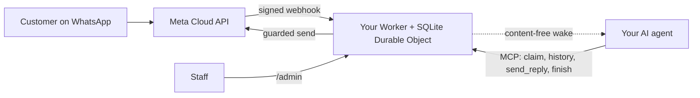

<div align="center">

[English](../../README.md) · [简体中文](README_zh.md) · [繁體中文](README_zh-TW.md) · [日本語](README_ja.md) · [한국어](README_ko.md) · [Türkçe](README_tr.md) · [Русский](README_ru.md) · [Tiếng Việt](README_vi.md) · [ไทย](README_th.md) · [Deutsch](README_de.md) · **Español** · [Français](README_fr.md) · [Українська](README_uk.md) · [Polski](README_pl.md) · [Português (Brasil)](README_pt-BR.md) · [العربية](README_ar.md) · [فارسی](README_fa.md) · [Bahasa Indonesia](README_id.md) · [Italiano](README_it.md)
· [Ελληνικά](README_el.md)

</div>

<div align="center">

# WAB bot

### El número de WhatsApp de un negocio, un agente de IA por MCP, en tu propia cuenta de Cloudflare.

**Un puente pequeño de un solo inquilino: los clientes escriben a tu número de WhatsApp Cloud API, tu agente responde mediante herramientas protegidas y nada sale de tus cuentas.**

[](../../LICENSE)
[](../STATUS.md)
[](../CLOUDFLARE.md)
[](../../THIRD_PARTY_NOTICES.md)
[](../../.github/workflows/ci.yml)

[Inicio rápido](#inicio-rápido) · [Cómo funciona](#cómo-funciona) · [Qué puede hacer](#qué-puede-hacer) · [Ejemplos prácticos](#ejemplos-prácticos) · [Preguntas frecuentes](#preguntas-frecuentes) · [Documentación](#documentación)

</div>

> [!IMPORTANT]
> La fuente oficial de esta plantilla es [wabbot-dev/wab-bot](https://github.com/wabbot-dev/wab-bot).
> Un nombre de repositorio parecido o un README copiado no demuestra que el código sea oficial. Lee lo que despliegas y
> nunca le des a un script de despliegue ni a un asistente un token que no le darías a su autor.
> Este proyecto es independiente: no está afiliado a Meta ni a xAI ni cuenta con su respaldo. WhatsApp y Grok son marcas de sus respectivos propietarios.

> [!NOTE]
> **Vista previa.** Probado en local contra simulaciones (335 pruebas automáticas). Las revisiones anteriores se ejecutaron en vivo en una cuenta desechable de Cloudflare Free. Evidencia en vivo en el número de **prueba** gratuito de Meta: el **texto** se ejecutó en vivo el 2026-10-16 (un intercambio real de texto: se recibió un mensaje entrante y se devolvió una respuesta a través del puente), y las **llamadas** se ejecutaron en vivo el 2026-10-17 con el código de este repositorio (Grok Voice sobre Meta SIP hacia xAI SIP): la IA atendió llamadas de voz entrantes de WhatsApp, la conversación fue en ambos sentidos (también en árabe), se guardaron las transcripciones de ambas partes, el Worker gestionó el `end_call` del modelo y xAI aceptó la petición de colgar (HTTP 200), y la compuerta de llamadas se armó y se desarmó sola. No es un número de producción verificado como empresa; no se admite grabar el audio. Este proyecto no lo ha ejecutado en producción. Su propietario informa de que el diseño de mensajería está probado en producción en el despliegue del que deriva (informado por el propietario, fecha por determinar), lo cual no es evidencia de este código. Todo lo verificado y cómo: [docs/STATUS.md](../STATUS.md).

---

Tus clientes escriben al número de WhatsApp de tu negocio. Meta entrega cada mensaje a un Worker en **tu propia cuenta de Cloudflare**, que lo almacena y envía a tu agente de IA un aviso de activación sin contenido. El agente (cualquier agente compatible con MCP) reclama la conversación, lee el historial y responde mediante `send_reply`. El puente, no el agente, guarda el token de WhatsApp y aplica todas las protecciones de envío. El personal puede pausar, tomar el control o borrar una conversación desde `/admin`.

Un despliegue por negocio: su propia app de Meta, número, tokens y cuenta de Cloudflare. No hay secretos en este repositorio.

## Inicio rápido

Necesitas: una cuenta de Cloudflare de tu propiedad, Node.js 20+ (se recomienda 22), una cuenta de desarrollador de Meta y la configuración de WhatsApp Cloud API ([lista de verificación](../META-CHECKLIST.md)), un **número nuevo que nunca haya estado registrado en ninguna app de WhatsApp** y un agente que pueda usar MCP y ser activado por un webhook ([rutina de activación](../WAKE-ROUTINE.md)). Pagas directamente a Meta y a tu propio plan de IA; el plan Workers Free no necesita método de pago para lo que usa esta plantilla ([límites y condiciones](../CLOUDFLARE.md)).

### 1. Compruébalo sin conexión (sin cuenta, sin red)

```bash
git clone https://github.com/wabbot-dev/wab-bot.git && cd wab-bot
npm ci
npm run check          # typecheck, 271 logic tests, 64 workerd tests, docs check
npm run build          # wrangler deploy --dry-run: bundle and binding check
npm run smoke:local    # wrangler dev --local with random fake secrets
```

### 2. Despliega en tu propia cuenta de Cloudflare

```bash
bash scripts/deploy-cloudflare.sh --dry-run                  # prints the plan, makes no call
bash scripts/deploy-cloudflare.sh --name my-business-wa      # lowercase letters, digits, dashes
```

El script inicia sesión con `wrangler login --device` (apruebas un código en tu navegador; nunca crea una cuenta), despliega, genera los tokens propios del puente y sube los secretos por stdin. Otras vías (la API de Cloudflare sin inicio de sesión, secretos autoaprovisionados) están en [docs/DEPLOY.md](../DEPLOY.md). La configuración se ha comprobado en vivo en 2 cuentas distintas ([estado](../STATUS.md)).

### 3. Conecta Meta y tu agente

Sigue [docs/META-CHECKLIST.md](../META-CHECKLIST.md) (tú creas las cuentas de Meta, verificas tu negocio y escribes el código SMS), ejecuta `node scripts/meta-setup.mjs` en tu propio ordenador y apunta tu agente a `https://<worker>.<your-subdomain>.workers.dev/mcp` con `Authorization: Bearer <MCP_TOKEN>`.

### 4. Permanece en modo de prueba hasta que un mensaje haga el viaje de ida y vuelta

Valores predeterminados seguros: `LAUNCH_MODE=test` (las respuestas solo van a `TEST_RECIPIENTS`), respuesta automática **en pausa**, plantillas desactivadas, la ruta de configuración de Meta dentro del Worker desactivada. Envía un mensaje desde tu teléfono, mira cómo llega a `/admin`, deja que el agente responda y solo entonces pasa a producción de forma deliberada.

## Cómo funciona



Cada webhook debe llevar un `X-Hub-Signature-256` válido sobre el cuerpo sin procesar. Una fila de SQLite por conversación mantiene las solicitudes independientes; si se pierde una carrera, se vuelve a leer y a intentar. El POST de activación lleva solo ids y contadores, nunca el texto de los mensajes. Límites y responsabilidades: [docs/ARCHITECTURE.md](../ARCHITECTURE.md). Almacenamiento, retención y activación: [docs/STATE-STORE.md](../STATE-STORE.md).

## Qué puede hacer

| Capacidad | Evidencia y límites |
|---|---|
| Recibir texto de WhatsApp y almacenarlo por conversación, sin duplicados y con verificación HMAC | Probado en local; un mensaje real recibido en el número de prueba de Meta ([estado](../STATUS.md)) |
| Herramientas de agente por MCP: `list_pending`, `claim_conversation`, `get_history`, `send_reply` (16 protecciones en el servidor), `finish`, `release`, `escalate`, `get_controls`, `get_overview` de solo lectura | Probado en local y con llamadas JSON-RPC directas; **no** con clientes MCP reales. Una respuesta real enviada en el número de prueba de Meta, manejada a mano |
| Consola del personal: pausar y reanudar la respuesta automática, tomar el control, liberar, reabrir, resolver, activar, borrar | Probado en local. Página estática, requiere token |
| Borrar una conversación (`DELETE /api/admin/conversations/<id>`) | Probado en local con comprobaciones de mutación; nunca ejecutado en vivo. No alcanza las copias de recuperación de Cloudflare ([privacidad](../PRIVACY.md)) |
| Activar a tu agente, con debounce, backoff y un reintento diario | Verificado en vivo contra un receptor sustituto; nunca contra una plataforma de agentes real |
| Retención: los chats respondidos se recortan a los 14 días, todo se descarta a los 180 días | Verificado en vivo con datos sintéticos; nunca durante semanas con datos reales |
| Autoaprovisionar secretos una vez (`POST /api/setup`) para herramientas de despliegue que ocultan valores | Ejecutado en vivo en un Worker de prueba; más débil que un secret binding ([límites](../SELF-PROVISIONING.md)) |
| Atender llamadas de voz de WhatsApp (Meta SIP a xAI Grok Voice), apagado hasta que el propietario abra la compuerta; usted paga a xAI, unos $0.08 por minuto | **Ejecutado en vivo** con este código el 2026-10-17 en el número de prueba de Meta: atendido por la IA, conversación en ambos sentidos, transcripciones de ambas partes guardadas, petición de fin de llamada del modelo gestionada; no es un número de producción verificado como empresa ([voz](../VOICE-CALLS.md)) |
| MCP de administración solo para el propietario en `/admin/mcp`: estado, comprobación de configuración, conversaciones ocultadas, borrado, activar y desactivar llamadas, registros de llamadas, uso, versión y comprobación de actualizaciones (14 herramientas) | Apagado salvo que se defina `ADMIN_MCP_TOKEN`. Probado en local y en workerd; **no** con clientes MCP reales ([MCP de administración](../mcp.md)) |

No incluido: descarga de medios, grupos, tipos de plantilla más allá del texto y los parámetros del cuerpo, llamadas salientes, grabación de audio, una página de ajustes, rutinas predefinidas, alojamiento multiinquilino. Consulta [docs/ROADMAP.md](../ROADMAP.md).

## Ejemplos prácticos

**Un turno de cliente por MCP** (solo marcadores de posición; el agente lo hace a través de su cliente MCP):

```bash
MCP=https://<worker>.<your-subdomain>.workers.dev/mcp
call() { curl -s "$MCP" -H "Authorization: Bearer $MCP_TOKEN" -H 'content-type: application/json' \
  -d "{\"jsonrpc\":\"2.0\",\"id\":1,\"method\":\"tools/call\",\"params\":{\"name\":\"$1\",\"arguments\":$2}}"; }
call list_pending '{}'
call claim_conversation '{"conversation_id":"c_<id>"}'                       # returns a lease
call get_history '{"conversation_id":"c_<id>","lease":"<lease>"}'            # customer text is wrapped as untrusted
call send_reply '{"conversation_id":"c_<id>","lease":"<lease>","text":"Hello, how can I help?"}'
call finish_conversation '{"conversation_id":"c_<id>","lease":"<lease>"}'
```

Mientras `LAUNCH_MODE=test` o la respuesta automática esté en pausa, `send_reply` responde `blocked_test_mode_recipient_not_allowlisted` o `blocked_auto_reply_paused` en lugar de enviar. El orden de las protecciones y cada cadena de error: [docs/CONFIGURATION.md](../CONFIGURATION.md).

**Borrar a un cliente:**

```bash
curl -X DELETE -H "Authorization: Bearer $ADMIN_TOKEN" https://<worker>.<your-subdomain>.workers.dev/api/admin/conversations/c_<id>
# {"ok":true,"deleted":true}   (404 if unknown or already erased)
```

**Eliminar todo:** `bash scripts/teardown-cloudflare.sh` (te pide que escribas el nombre del Worker; borra el Worker y todas las conversaciones almacenadas, nada más).

## Preguntas frecuentes

**¿Quién es el propietario de la cuenta de Cloudflare?** Tú: aceptas las condiciones, pagas si alguna vez pagas y puedes borrarla. Un asistente solo puede crear las cuentas de Cloudflare y xAI por ti con tu consentimiento por escrito y haciéndote propietario o administrador; la tarjeta la añades tú. Las cuentas de Meta, la verificación del negocio y el código SMS son siempre tuyos ([detalles y la advertencia sobre las condiciones de Cloudflare](../CLOUDFLARE.md)).

**¿Se permite el plan Free para un negocio?** En las condiciones de Cloudflare leídas el 2026-10-17, los servicios Free no incluyen una cláusula de uso solo personal, pero sí dos restricciones relevantes aquí (no recopilar datos de tarjetas y no manejar información de salud protegida sin el consentimiento por escrito de Cloudflare). No es asesoría legal; vuelve a comprobarlo ([uso comercial](../CLOUDFLARE.md#commercial-use)).

**¿Puedo usar el número de mi app de WhatsApp Business existente?** No. El número de la Cloud API nunca debe haber estado registrado en una app de WhatsApp; la coexistencia queda fuera del alcance. Trae tu propia SIM o línea y escribe tú mismo su código.

**¿Responde llamadas?** Sí, solo entrantes y solo cuando usted abre la compuerta: las llamadas están desactivadas por defecto, siguen desactivadas en un número real hasta que su verificación de empresa esté completa y usted diga adelante, y funcionan en ventanas cortas que usted activa. Usa xAI Grok Voice en su propia cuenta de xAI (unos $0.08 por minuto). Las llamadas con este código se atendieron en vivo en el número de prueba de Meta el 2026-10-17 (conversación en ambos sentidos, transcripciones guardadas); no se ha ejecutado en un número de producción verificado como empresa y no se admite grabar el audio ([voz](../VOICE-CALLS.md)).

**¿Qué agente funciona?** Cualquier agente que hable MCP por HTTP y pueda ser activado por un webhook. Se ha probado con llamadas JSON-RPC directas, no con clientes MCP reales ([rutina de activación](../WAKE-ROUTINE.md)).

**¿Cuánto volumen aguanta?** Un solo inquilino, un Durable Object: volúmenes de pequeño negocio. Por nuestra medición en vivo, unos 30.000 mensajes al día caben en la cuota gratuita de Durable Objects; muchos mensajes simultáneos en una conversación pueden devolver 503 y Meta los reenvía ([estado](../STATUS.md#live-measurements-cloudflare-free-fake-secrets-2026-10-16)).

**¿Está demostrado en producción?** Se informa de que el diseño del que proviene lo está (informado por el propietario, fecha por determinar). Este port a Cloudflare no. El [estado](../STATUS.md) dice exactamente qué significa cada nivel.

## Límites y buenas prácticas

- **Proyecto independiente.** WAB bot no es oficial: no está afiliado a Meta, WhatsApp ni xAI, ni cuenta con su respaldo. WhatsApp y Grok son marcas de sus respectivos propietarios.
- **Se aplican las reglas de Meta.** Su uso de la WhatsApp Cloud API sigue los términos, las políticas de mensajería y las reglas por número de Meta, y las llamadas en un número de empresa requieren la verificación de empresa de Meta.
- **Un número por bot.** Un despliegue atiende a una empresa y a un número de WhatsApp, con su propia app de Meta, tokens y cuenta de Cloudflare.
- **Las llamadas las activa usted.** Están desactivadas por defecto; usted las abre indicando el número, y usan sus propios créditos de xAI (unos $0.08 por minuto).
- **Solo llamadas entrantes, sin grabación de audio.** No se admiten llamadas salientes ni grabar audio. La transcripción de texto se guarda por defecto y puede desactivarla.
- **SIP y la API de llamadas de Graph son mutuamente excluyentes por número.** Mientras un número usa SIP para llamadas, como este bot, los endpoints de llamadas de Graph de Meta no están disponibles en él.
- **Mantenga una vía de contacto alternativa.** Publique otra forma de contactarle, como un teléfono o un correo, y deje que el personal pueda tomar el relevo de cualquier conversación.

Qué se admite y qué no: [capacidades](../CAPABILITIES.md). Respuestas prácticas: [solución de problemas](../TROUBLESHOOTING.md). Las llamadas en detalle: [voz](../VOICE-CALLS.md).

## Documentación

[docs/index.md](../index.md) enumera todas las páginas. Empieza por [STATUS](../STATUS.md), luego [DEPLOY](../DEPLOY.md), [META-CHECKLIST](../META-CHECKLIST.md), [CONFIGURATION](../CONFIGURATION.md), [PRIVACY](../PRIVACY.md) y [TROUBLESHOOTING](../TROUBLESHOOTING.md). Además: [AGENTS.md](../../AGENTS.md) para agentes de programación con IA, [SECURITY.md](../../SECURITY.md), [CHANGELOG.md](../../CHANGELOG.md), [THIRD_PARTY_NOTICES.md](../../THIRD_PARTY_NOTICES.md).

## Descargo de responsabilidad

Este es un software en vista previa para mensajería empresarial lícita. Eres responsable de tu despliegue, tus credenciales, los datos de tus clientes, las normas de grabación y de divulgación del uso de IA, y tus condiciones con Meta y Cloudflare. Sin garantía. Lee [DISCLAIMER.md](../../DISCLAIMER.md).

## Contribuir

Se agradecen las correcciones concretas, las mejoras de documentación y las pruebas; lee primero el [alcance de las contribuciones](../../CONTRIBUTING.md#contribution-scope) y las [reglas de preparación de los PR](../../CONTRIBUTING.md#pull-request-ownership-and-readiness). Los PR asistidos por IA necesitan una persona responsable con nombre. Problemas de seguridad: [SECURITY.md](../../SECURITY.md).

## Licencia

[MIT](../../LICENSE), Copyright (c) 2026 wabbot-dev.
