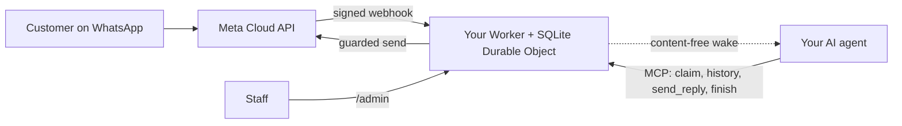

<div align="center">

[English](../../README.md) · [简体中文](README_zh.md) · [繁體中文](README_zh-TW.md) · [日本語](README_ja.md) · [한국어](README_ko.md) · [Türkçe](README_tr.md) · [Русский](README_ru.md) · [Tiếng Việt](README_vi.md) · [ไทย](README_th.md) · [Deutsch](README_de.md) · [Español](README_es.md) · [Français](README_fr.md) · [Українська](README_uk.md) · [Polski](README_pl.md) · [Português (Brasil)](README_pt-BR.md) · [العربية](README_ar.md) · **فارسی** · [Bahasa Indonesia](README_id.md) · [Italiano](README_it.md)
· [Ελληνικά](README_el.md)

</div>

<div align="center" dir="rtl">

# WAB bot

### شماره واتساپ یک کسب‌وکار، یک عامل هوش مصنوعی از طریق MCP، روی حساب Cloudflare خودتان.

**یک پل کوچک تک‌مستأجری: مشتریان به شماره WhatsApp Cloud API شما پیام می‌دهند، عامل شما از طریق ابزارهای محافظت‌شده پاسخ می‌دهد و هیچ چیز از حساب‌های شما بیرون نمی‌رود.**

[](../../LICENSE)
[](../STATUS.md)
[](../CLOUDFLARE.md)
[](../../THIRD_PARTY_NOTICES.md)
[](../../.github/workflows/ci.yml)

[شروع سریع](#شروع-سریع) · [طرز کار](#طرز-کار) · [امکانات](#امکانات) · [مثال عملی](#مثال-عملی) · [سوالات متداول](#سوالات-متداول) · [مستندات](#مستندات)

</div>

<div dir="rtl">

> [!IMPORTANT]
> منبع رسمی این قالب [wabbot-dev/wab-bot](https://github.com/wabbot-dev/wab-bot) است.
> شباهت نام مخزن یا کپی‌شدن README ثابت نمی‌کند که کد رسمی است. آنچه را مستقر می‌کنید بخوانید و
> هرگز توکنی را که به نویسنده‌اش نمی‌دهید به اسکریپت استقرار یا دستیار ندهید.
> این پروژه مستقل است: وابسته به Meta یا xAI نیست و مورد تأیید آن‌ها نیز نیست. WhatsApp و Grok علامت‌های تجاری صاحبان خود هستند.

> [!NOTE]
> **نسخه پیش‌نمایش.** به‌صورت محلی در برابر شیء‌های شبیه‌سازی (۲۹۱ آزمون خودکار) آزموده شده است. نسخه‌های پیشین روی یک حساب یک‌بارمصرف Cloudflare Free به‌صورت زنده اجرا شدند. شواهد زنده روی شمارهٔ **آزمایشی** رایگان Meta: **پیام‌رسانی متنی** در 2026-10-16 به‌صورت زنده اجرا شد (یک رفت‌وبرگشت متنی واقعی: یک پیام ورودی دریافت شد و پاسخی از طریق پل بازگشت)، و **تماس** در 2026-10-17 با کد همین مخزن به‌صورت زنده اجرا شد (Grok Voice روی Meta SIP به xAI SIP): تماس‌های صوتی ورودی WhatsApp را هوش مصنوعی پاسخ داد، گفتگو دوطرفه بود (از جمله به عربی)، متن گفتگوی هر دو طرف ذخیره شد، Worker دستور `end_call` مدل را پردازش کرد و درخواست قطع تماس به xAI پذیرفته شد (HTTP 200)، و دروازهٔ تماس فعال و سپس خودکار غیرفعال شد. این شمارهٔ تولیدی با تأیید کسب‌وکار نیست؛ ضبط صدا پشتیبانی نمی‌شود. این پروژه آن را در محیط تولید اجرا نکرده است. مالک آن گزارش می‌دهد که طراحی پیام‌رسانی در استقرار مبدأ در محیط تولید اثبات شده است (گزارش مالک، تاریخ بعداً)، که برای این کد شاهد محسوب نمی‌شود. هر آنچه راستی‌آزمایی شده و چگونگی آن: [docs/STATUS.md](../STATUS.md).

</div>

---

<div dir="rtl">

مشتریان شما به شماره واتساپ کسب‌وکارتان پیام می‌دهند. Meta هر پیام را به یک Worker در **حساب Cloudflare خودتان** تحویل می‌دهد که آن را ذخیره می‌کند و یک سیگنال بیدارباش بدون محتوا برای عامل هوش مصنوعی شما می‌فرستد. عامل (هر عاملی که MCP را پشتیبانی کند) گفتگو را برمی‌دارد، تاریخچه را می‌خواند و از طریق `send_reply` پاسخ می‌دهد. این پل است، نه عامل، که توکن واتساپ را نگه می‌دارد و همه محافظ‌های ارسال را اجرا می‌کند. کارکنان می‌توانند از `/admin` گفتگو را متوقف، تحویل‌گیری یا حذف کنند.

یک استقرار برای هر کسب‌وکار: برنامه Meta، شماره، توکن‌ها و حساب Cloudflare مخصوص خودش. هیچ رازی در این مخزن وجود ندارد.

## شروع سریع

به این‌ها نیاز دارید: یک حساب Cloudflare که مالکش خودتان هستید، Node.js 20+ (نسخه 22 توصیه می‌شود)، یک حساب توسعه‌دهنده Meta و راه‌اندازی WhatsApp Cloud API ([فهرست بررسی](../META-CHECKLIST.md))، **یک شماره جدید که هرگز در هیچ برنامه واتساپ ثبت نشده باشد** و عاملی که بتواند از MCP استفاده کند و با webhook بیدار شود ([روال بیدارسازی](../WAKE-ROUTINE.md)). هزینه Meta و طرح هوش مصنوعی خودتان را مستقیم می‌پردازید؛ طرح Workers Free برای آنچه این قالب استفاده می‌کند به روش پرداخت نیاز ندارد ([محدودیت‌ها و شرایط](../CLOUDFLARE.md)).

### 1. بررسی آفلاین (بدون حساب، بدون شبکه)

```bash
git clone https://github.com/wabbot-dev/wab-bot.git && cd wab-bot
npm ci
npm run check          # typecheck, 229 logic tests, 62 workerd tests, docs check
npm run build          # wrangler deploy --dry-run: bundle and binding check
npm run smoke:local    # wrangler dev --local with random fake secrets
```

### 2. استقرار روی حساب Cloudflare خودتان

```bash
bash scripts/deploy-cloudflare.sh --dry-run                  # prints the plan, makes no call
bash scripts/deploy-cloudflare.sh --name my-business-wa      # lowercase letters, digits, dashes
```

اسکریپت با `wrangler login --device` شما را وارد می‌کند (کدی را در مرورگر تأیید می‌کنید؛ هرگز حساب نمی‌سازد)، استقرار را انجام می‌دهد، توکن‌های خود پل را می‌سازد و رازها را از طریق stdin بارگذاری می‌کند. مسیرهای دیگر (Cloudflare API بدون ورود، رازهای خودتأمین) در [docs/DEPLOY.md](../DEPLOY.md) آمده است. این راه‌اندازی به‌صورت زنده روی ۲ حساب مختلف اثبات شده است ([وضعیت](../STATUS.md)).

### 3. اتصال Meta و عامل خودتان

[docs/META-CHECKLIST.md](../META-CHECKLIST.md) را دنبال کنید (حساب‌های Meta را خودتان می‌سازید، کسب‌وکارتان را تأیید می‌کنید و کد SMS را خودتان وارد می‌کنید)، `node scripts/meta-setup.mjs` را روی رایانه خودتان اجرا کنید و عامل خود را با `Authorization: Bearer <MCP_TOKEN>` به `https://<worker>.<your-subdomain>.workers.dev/mcp` متصل کنید.

### 4. تا رفت‌وبرگشت کامل یک پیام در حالت آزمایشی بمانید

پیش‌فرض‌های امن: `LAUNCH_MODE=test` (پاسخ‌ها فقط به `TEST_RECIPIENTS` می‌روند)، پاسخ خودکار **متوقف**، قالب‌ها خاموش، مسیر راه‌اندازی Meta داخل Worker خاموش. یک پیام از گوشی خود بفرستید، ورود آن را در `/admin` ببینید، بگذارید عامل پاسخ بدهد و فقط بعد از آن آگاهانه به حالت زنده بروید.

## طرز کار



هر webhook باید یک `X-Hub-Signature-256` معتبر روی بدنه خام داشته باشد. یک ردیف SQLite برای هر گفتگو درخواست‌ها را مستقل نگه می‌دارد؛ درخواستی که مسابقه را ببازد دوباره می‌خواند و دوباره تلاش می‌کند. POST بیدارباش فقط شناسه‌ها و شمارنده‌ها را حمل می‌کند، هرگز متن پیام را. مرزها و مالکیت: [docs/ARCHITECTURE.md](../ARCHITECTURE.md). ذخیره‌سازی، نگهداری و بیدارباش: [docs/STATE-STORE.md](../STATE-STORE.md).

## امکانات

| قابلیت | شواهد و محدودیت‌ها |
|---|---|
| دریافت متن واتساپ و ذخیره آن به‌ازای هر گفتگو، بدون تکرار، با راستی‌آزمایی HMAC | به‌صورت محلی آزمایش شده؛ یک پیام واقعی روی شماره آزمایشی Meta دریافت شد ([وضعیت](../STATUS.md)) |
| ابزارهای عامل از طریق MCP: `list_pending`، `claim_conversation`، `get_history`، `send_reply` (16 محافظ سمت سرور)، `finish`، `release`، `escalate`، `get_controls` و `get_overview` فقط‌خواندنی | به‌صورت محلی و با فراخوانی‌های مستقیم JSON-RPC آزمایش شده؛ با کلاینت‌های واقعی MCP آزمایش **نشده**. یک پاسخ واقعی روی شماره آزمایشی Meta ارسال شد، با راه‌اندازی دستی |
| کنسول کارکنان: توقف و ازسرگیری پاسخ خودکار، تحویل‌گیری، رهاسازی، بازگشایی، حل‌شده‌کردن، بیدارسازی، حذف | به‌صورت محلی آزمایش شده. صفحه ایستا، نیازمند توکن |
| حذف یک گفتگو (`DELETE /api/admin/conversations/<id>`) | به‌صورت محلی با بررسی‌های جهش (mutation) آزمایش شده؛ هرگز زنده اجرا نشده. به نسخه‌های بازیابی Cloudflare نمی‌رسد ([حریم خصوصی](../PRIVACY.md)) |
| بیدارکردن عامل شما، با debounce، backoff و تلاش مجدد روزانه | به‌صورت زنده در برابر یک گیرنده جایگزین راستی‌آزمایی شده؛ هرگز در برابر یک پلتفرم واقعی عامل‌ها |
| نگهداری: گفتگوهای پاسخ‌داده‌شده در 14 روز کوتاه می‌شوند، هر چیزی در 180 روز دور ریخته می‌شود | به‌صورت زنده با داده‌های مصنوعی راستی‌آزمایی شده؛ هرگز طی هفته‌ها با داده واقعی |
| تأمین خودکار رازها یک بار (`POST /api/setup`) برای ابزارهای استقراری که مقادیر را پنهان می‌کنند | به‌صورت زنده روی یک Worker آزمایشی اجرا شده؛ ضعیف‌تر از secret binding ([محدودیت‌ها](../SELF-PROVISIONING.md)) |
| پاسخ به تماس‌های صوتی WhatsApp (از Meta SIP به xAI Grok Voice)، خاموش تا زمانی که مالک دروازه را باز کند؛ شما به xAI پول می‌دهید، حدود $0.08 در دقیقه | **اجرای زنده** با این کد در 2026-10-17 روی شمارهٔ آزمایشی Meta: هوش مصنوعی پاسخ داد، گفتگوی دوطرفه، متن گفتگوی هر دو طرف ذخیره شد، درخواست پایان تماس مدل پردازش شد؛ شمارهٔ تولیدی با تأیید کسب‌وکار نیست ([صدا](../VOICE-CALLS.md)) |
| MCP مدیریتی ویژهٔ مالک در `/admin/mcp`: وضعیت، بررسی راه‌اندازی، گفتگوهای پوشانده‌شده، پاک‌کردن، فعال و غیرفعال‌کردن تماس، گزارش تماس‌ها، مصرف، نسخه و بررسی به‌روزرسانی (۱۴ ابزار) | خاموش مگر اینکه `ADMIN_MCP_TOKEN` تنظیم شود. به‌صورت محلی و در workerd آزموده شده؛ با کلاینت‌های واقعی MCP **آزموده نشده** ([MCP مدیریتی](../mcp.md)) |

شامل نیست: دانلود رسانه، گروه‌ها، انواع قالب فراتر از متن و پارامترهای بدنه، تماس‌های خروجی، ضبط صدا، صفحه تنظیمات، روال‌های از پیش تعیین‌شده، میزبانی چندمستأجری. [docs/ROADMAP.md](../ROADMAP.md) را ببینید.

## مثال عملی

**یک نوبت مشتری از طریق MCP** (فقط مقادیر جایگزین؛ عامل این کار را از طریق کلاینت MCP خود انجام می‌دهد):

```bash
MCP=https://<worker>.<your-subdomain>.workers.dev/mcp
call() { curl -s "$MCP" -H "Authorization: Bearer $MCP_TOKEN" -H 'content-type: application/json' \
  -d "{\"jsonrpc\":\"2.0\",\"id\":1,\"method\":\"tools/call\",\"params\":{\"name\":\"$1\",\"arguments\":$2}}"; }
call list_pending '{}'
call claim_conversation '{"conversation_id":"c_<id>"}'                       # returns a lease
call get_history '{"conversation_id":"c_<id>","lease":"<lease>"}'            # customer text is wrapped as untrusted
call send_reply '{"conversation_id":"c_<id>","lease":"<lease>","text":"Hello, how can I help?"}'
call finish_conversation '{"conversation_id":"c_<id>","lease":"<lease>"}'
```

تا زمانی که `LAUNCH_MODE=test` برقرار باشد یا پاسخ خودکار متوقف باشد، `send_reply` به‌جای ارسال، `blocked_test_mode_recipient_not_allowlisted` یا `blocked_auto_reply_paused` را پاسخ می‌دهد. ترتیب محافظ‌ها و هر رشته خطا: [docs/CONFIGURATION.md](../CONFIGURATION.md).

**حذف یک مشتری:**

```bash
curl -X DELETE -H "Authorization: Bearer $ADMIN_TOKEN" https://<worker>.<your-subdomain>.workers.dev/api/admin/conversations/c_<id>
# {"ok":true,"deleted":true}   (404 if unknown or already erased)
```

**حذف همه چیز:** `bash scripts/teardown-cloudflare.sh` (از شما می‌خواهد نام Worker را تایپ کنید؛ Worker و همه گفتگوهای ذخیره‌شده را حذف می‌کند، هیچ چیز دیگری را نه).

## سوالات متداول

**مالک حساب Cloudflare کیست؟** خود شما: شما شرایط را می‌پذیرید، اگر روزی پرداختی باشد شما می‌پردازید و می‌توانید آن را حذف کنید. یک دستیار فقط با رضایت کتبی شما و با اینکه شما مالک یا مدیر باشید می‌تواند حساب‌های Cloudflare و xAI را برایتان بسازد؛ کارت را خودتان اضافه می‌کنید. حساب‌های Meta، تأیید کسب‌وکار و کد SMS همیشه با شماست ([جزئیات و هشدار درباره شرایط Cloudflare](../CLOUDFLARE.md)).

**آیا طرح Free برای یک کسب‌وکار مجاز است؟** در شرایط Cloudflare که در 2026-10-17 خوانده شد، خدمات Free بند «فقط استفاده شخصی» ندارند، اما دو محدودیت مهم در اینجا وجود دارد (عدم جمع‌آوری اطلاعات کارت، و عدم نگهداری اطلاعات سلامت حفاظت‌شده بدون رضایت کتبی Cloudflare). مشاوره حقوقی نیست؛ دوباره بررسی کنید ([استفاده تجاری](../CLOUDFLARE.md#commercial-use)).

**آیا می‌توانم از شماره برنامه WhatsApp Business موجودم استفاده کنم؟** خیر. شماره Cloud API نباید هرگز در یک برنامه واتساپ ثبت شده باشد؛ هم‌زیستی (coexistence) خارج از دامنه است. سیم‌کارت یا خط خودتان را بیاورید و کد آن را خودتان وارد کنید.

**آیا به تماس‌ها پاسخ می‌دهد؟** بله، فقط تماس ورودی و فقط وقتی دروازه را باز کنید: تماس به‌طور پیش‌فرض خاموش است، روی شمارهٔ واقعی خاموش می‌ماند تا احراز هویت کسب‌وکار شما کامل شود و شما بگویید شروع کن، و در بازه‌های زمانی کوتاهی کار می‌کند که خودتان فعال می‌کنید. از xAI Grok Voice روی حساب xAI خودتان استفاده می‌کند (حدود $0.08 در دقیقه). تماس‌هایی با این کد در 2026-10-17 روی شمارهٔ آزمایشی Meta به‌صورت زنده پاسخ داده شد (گفتگوی دوطرفه، متن گفتگو ذخیره شد)؛ روی شمارهٔ تولیدی با تأیید کسب‌وکار اجرا نشده و ضبط صدا پشتیبانی نمی‌شود ([صدا](../VOICE-CALLS.md)).

**کدام عامل کار می‌کند؟** هر عاملی که بتواند MCP را روی HTTP صحبت کند و با webhook بیدار شود. با فراخوانی‌های مستقیم JSON-RPC آزمایش شده، نه با کلاینت‌های واقعی MCP ([روال بیدارسازی](../WAKE-ROUTINE.md)).

**چه حجمی را تحمل می‌کند؟** تک‌مستأجر، یک Durable Object: حجم کسب‌وکارهای کوچک. بر اساس اندازه‌گیری زنده ما، حدود 30,000 پیام در روز در سهمیه Durable Object طرح Free جا می‌شود؛ پیام‌های هم‌زمان فراوان در یک گفتگو ممکن است 503 برگردانند و Meta دوباره تحویل می‌دهد ([وضعیت](../STATUS.md#live-measurements-cloudflare-free-fake-secrets-2026-10-16)).

**آیا در محیط تولید اثبات شده است؟** گزارش شده که طراحی‌ای که از آن مشتق شده چنین است (گزارش مالک، تاریخ مشخص نشده). این انتقال به Cloudflare چنین نیست. [وضعیت](../STATUS.md) دقیقاً می‌گوید هر سطح به چه معناست.

## محدودیت‌ها و رویهٔ خوب

- **پروژهٔ مستقل.** WAB bot غیررسمی است: وابسته به Meta، WhatsApp یا xAI نیست و مورد تأیید آن‌ها هم نیست. WhatsApp و Grok علامت‌های تجاری صاحبان خودشان‌اند.
- **قوانین Meta اعمال می‌شود.** استفادهٔ شما از WhatsApp Cloud API تابع شرایط، سیاست‌های پیام‌رسانی و قواعد هر شمارهٔ Meta است و تماس روی شمارهٔ کسب‌وکار به احراز هویت کسب‌وکار Meta نیاز دارد.
- **یک شماره برای هر ربات.** هر استقرار به یک کسب‌وکار و یک شمارهٔ WhatsApp خدمت می‌کند، با برنامه، توکن‌ها و حساب Cloudflare خود شما.
- **تماس را خودتان روشن می‌کنید.** به‌طور پیش‌فرض خاموش است؛ شما آن را با نام‌بردن شماره باز می‌کنید و تماس‌ها از اعتبار xAI خودتان استفاده می‌کنند (حدود $0.08 در دقیقه).
- **فقط تماس ورودی، بدون ضبط صدا.** تماس خروجی و ضبط صدا پشتیبانی نمی‌شود. متن گفتگو به‌طور پیش‌فرض ذخیره می‌شود و می‌توانید آن را خاموش کنید.
- **SIP و API تماس Graph برای هر شماره ناسازگارند.** تا وقتی شماره برای تماس از SIP استفاده می‌کند، مانند این ربات، نقاط پایانی تماس Graph از Meta روی آن در دسترس نیست.
- **یک راه تماس پشتیبان نگه دارید.** راه دیگری برای تماس با خودتان، مثل تلفن یا ایمیل، منتشر کنید و کاری کنید که کارکنان بتوانند هر گفتگو را تحویل بگیرند.

آنچه پشتیبانی می‌شود و آنچه نه: [قابلیت‌ها](../CAPABILITIES.md). پرسش و پاسخ‌های کاربردی: [رفع اشکال](../TROUBLESHOOTING.md). جزئیات تماس: [صدا](../VOICE-CALLS.md).

## مستندات

[docs/index.md](../index.md) همه صفحه‌ها را فهرست می‌کند. از [STATUS](../STATUS.md) شروع کنید، سپس [DEPLOY](../DEPLOY.md)، [META-CHECKLIST](../META-CHECKLIST.md)، [CONFIGURATION](../CONFIGURATION.md)، [PRIVACY](../PRIVACY.md) و [TROUBLESHOOTING](../TROUBLESHOOTING.md). همچنین: [AGENTS.md](../../AGENTS.md) برای عامل‌های کدنویسی هوش مصنوعی، [SECURITY.md](../../SECURITY.md)، [CHANGELOG.md](../../CHANGELOG.md)، [THIRD_PARTY_NOTICES.md](../../THIRD_PARTY_NOTICES.md).

## سلب مسئولیت

این نرم‌افزار نسخه پیش‌نمایش برای پیام‌رسانی تجاری قانونی است. شما مسئول استقرار، اعتبارنامه‌ها، داده‌های مشتریان، قواعد ضبط و افشای استفاده از هوش مصنوعی و شرایط خود با Meta و Cloudflare هستید. بدون ضمانت. [DISCLAIMER.md](../../DISCLAIMER.md) را بخوانید.

## مشارکت

اصلاحات هدفمند، تصحیح مستندات و آزمون‌ها خوش‌آمدند؛ ابتدا [دامنه مشارکت](../../CONTRIBUTING.md#contribution-scope) و [قواعد آمادگی PR](../../CONTRIBUTING.md#pull-request-ownership-and-readiness) را بخوانید. PRهای با کمک هوش مصنوعی به یک مالک انسانیِ نام‌برده نیاز دارند. مسائل امنیتی: [SECURITY.md](../../SECURITY.md).

## مجوز

[MIT](../../LICENSE), Copyright (c) 2026 wabbot-dev.

</div>
