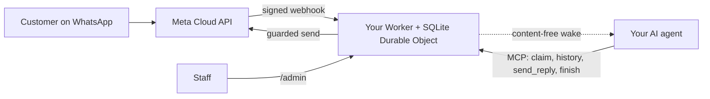

<div align="center">

[English](../../README.md) · [简体中文](README_zh.md) · [繁體中文](README_zh-TW.md) · [日本語](README_ja.md) · [한국어](README_ko.md) · [Türkçe](README_tr.md) · [Русский](README_ru.md) · [Tiếng Việt](README_vi.md) · [ไทย](README_th.md) · [Deutsch](README_de.md) · [Español](README_es.md) · **Français** · [Українська](README_uk.md) · [Polski](README_pl.md) · [Português (Brasil)](README_pt-BR.md) · [العربية](README_ar.md) · [فارسی](README_fa.md) · [Bahasa Indonesia](README_id.md) · [Italiano](README_it.md)
· [Ελληνικά](README_el.md)

</div>

<div align="center">

# WAB bot

### Le numéro WhatsApp d'une entreprise, un agent IA via MCP, sur votre propre compte Cloudflare.

**Un petit pont mono-locataire : les clients écrivent à votre numéro WhatsApp Cloud API, votre agent répond via des outils protégés, et rien ne quitte vos comptes.**

[](../../LICENSE)
[](../STATUS.md)
[](../CLOUDFLARE.md)
[](../../THIRD_PARTY_NOTICES.md)
[](../../.github/workflows/ci.yml)

[Démarrage rapide](#démarrage-rapide) · [Fonctionnement](#fonctionnement) · [Ce que cela permet](#ce-que-cela-permet) · [Exemples concrets](#exemples-concrets) · [FAQ](#faq) · [Documentation](#documentation)

</div>

> [!IMPORTANT]
> La source officielle de ce modèle est [wabbot-dev/wab-bot](https://github.com/wabbot-dev/wab-bot).
> Un nom de dépôt similaire ou un README copié ne prouve pas que le code est officiel. Lisez ce que vous déployez, et
> ne donnez jamais à un script de déploiement ou à un assistant un jeton que vous ne donneriez pas à son auteur.
> Ce projet est indépendant : il n'est ni affilié à Meta ou xAI ni approuvé par eux. WhatsApp et Grok sont des marques de leurs propriétaires respectifs.

> [!NOTE]
> **Préversion.** Testé en local face à des simulacres (407 tests automatisés). Les révisions précédentes ont tourné en réel sur un compte Cloudflare Free jetable. Preuves en réel sur le numéro de **test** gratuit de Meta : l'**envoi de textes** a tourné en réel le 2026-10-16 (un vrai aller-retour de texte : un message entrant a été reçu et une réponse est repartie par le pont), et les **appels** ont tourné en réel le 2026-10-17 avec le code de ce dépôt (Grok Voice sur Meta SIP vers xAI SIP) : des appels vocaux WhatsApp entrants ont été décrochés par l'IA, la conversation allait dans les deux sens (y compris en arabe), les transcriptions des deux côtés ont été conservées, le `end_call` du modèle a été traité par le Worker et la demande de raccrochage à xAI a été acceptée (HTTP 200), et la vanne des appels s'est armée puis désarmée toute seule. Ce n'est pas un numéro de production vérifié en tant qu'entreprise ; l'enregistrement audio n'est pas pris en charge. Non exécuté par ce projet en production. Son propriétaire indique que la conception de la messagerie est éprouvée en production dans le déploiement dont elle est issue (déclaré par le propriétaire, date à préciser), ce qui n'est pas une preuve pour ce code. Tout ce qui est vérifié et comment : [docs/STATUS.md](../STATUS.md).

---

Vos clients écrivent au numéro WhatsApp de votre entreprise. Meta remet chaque message à un Worker de **votre propre compte Cloudflare**, qui le stocke et envoie à votre agent IA un signal de réveil sans contenu. L'agent (tout agent compatible MCP) prend en charge la conversation, lit l'historique et répond via `send_reply`. C'est le pont, et non l'agent, qui détient le jeton WhatsApp et applique chaque garde-fou d'envoi. Le personnel peut mettre en pause, reprendre la main ou effacer une conversation depuis `/admin`.

Un déploiement par entreprise : sa propre application Meta, son numéro, ses jetons et son compte Cloudflare. Il n'y a aucun secret dans ce dépôt.

## Démarrage rapide

Il vous faut : un compte Cloudflare dont vous êtes propriétaire, Node.js 20+ (22 recommandé), un compte développeur Meta et la configuration de WhatsApp Cloud API ([liste de contrôle](../META-CHECKLIST.md)), un **nouveau numéro jamais enregistré dans une application WhatsApp**, et un agent capable d'utiliser MCP et d'être réveillé par un webhook ([routine de réveil](../WAKE-ROUTINE.md)). Vous payez Meta et votre propre forfait IA directement ; l'offre Workers Free n'exige aucun moyen de paiement pour ce que ce modèle utilise ([limites et conditions](../CLOUDFLARE.md)).

### 1. Vérifier hors ligne (sans compte, sans réseau)

```bash
git clone https://github.com/wabbot-dev/wab-bot.git && cd wab-bot
npm ci
npm run check          # typecheck, 353 logic tests, 65 workerd tests, docs check
npm run build          # wrangler deploy --dry-run: bundle and binding check
npm run smoke:local    # wrangler dev --local with random fake secrets
```

### 2. Déployer sur votre propre compte Cloudflare

```bash
bash scripts/deploy-cloudflare.sh --dry-run                  # prints the plan, makes no call
bash scripts/deploy-cloudflare.sh --name my-business-wa      # lowercase letters, digits, dashes
```

Le script vous connecte avec `wrangler login --device` (vous approuvez un code dans votre navigateur ; il ne crée jamais de compte), déploie, génère les jetons propres au pont et envoie les secrets via stdin. Les autres voies (API Cloudflare sans connexion, secrets auto-provisionnés) sont dans [docs/DEPLOY.md](../DEPLOY.md). L'installation a été validée en réel sur 2 comptes différents ([état](../STATUS.md)).

### 3. Connecter Meta et votre agent

Suivez [docs/META-CHECKLIST.md](../META-CHECKLIST.md) (vous créez vous-même les comptes Meta, vérifiez votre entreprise et saisissez vous-même le code SMS), exécutez `node scripts/meta-setup.mjs` sur votre propre ordinateur, puis pointez votre agent vers `https://<worker>.<your-subdomain>.workers.dev/mcp` avec `Authorization: Bearer <MCP_TOKEN>`.

### 4. Rester en mode test jusqu'à ce qu'un message fasse l'aller-retour

Valeurs par défaut sûres : `LAUNCH_MODE=test` (les réponses ne vont qu'à `TEST_RECIPIENTS`), réponse automatique **en pause**, modèles désactivés, route de configuration Meta intégrée au Worker désactivée. Envoyez un message depuis votre téléphone, regardez-le arriver dans `/admin`, laissez l'agent répondre, et ce n'est qu'ensuite que vous passez en production, délibérément.

## Fonctionnement



Chaque webhook doit porter un `X-Hub-Signature-256` valide calculé sur le corps brut. Une ligne SQLite par conversation garde les requêtes indépendantes ; en cas de course perdue, la requête relit et réessaie. Le POST de réveil ne transporte que des identifiants et des compteurs, jamais le texte des messages. Limites et responsabilités : [docs/ARCHITECTURE.md](../ARCHITECTURE.md). Stockage, conservation et réveil : [docs/STATE-STORE.md](../STATE-STORE.md).

## Ce que cela permet

| Capacité | Preuves et limites |
|---|---|
| Recevoir le texte WhatsApp et le stocker par conversation, dédoublonné, avec vérification HMAC | Testé en local ; un message réel reçu sur le numéro de test de Meta ([état](../STATUS.md)) |
| Outils d'agent via MCP : `list_pending`, `claim_conversation`, `get_history`, `send_reply` (16 garde-fous côté serveur), `finish`, `release`, `escalate`, `get_controls`, `get_overview` en lecture seule | Testé en local et par des appels JSON-RPC directs ; **pas** avec de vrais clients MCP. Une réponse réelle envoyée sur le numéro de test de Meta, pilotée à la main |
| Console du personnel : mettre en pause et reprendre la réponse automatique, reprendre la main, libérer, rouvrir, résoudre, réveiller, effacer | Testé en local. Page statique, jeton requis |
| Effacer une conversation (`DELETE /api/admin/conversations/<id>`) | Testé en local avec des contrôles par mutation ; jamais exécuté en réel. N'atteint pas les copies de récupération de Cloudflare ([confidentialité](../PRIVACY.md)) |
| Réveiller votre agent, avec anti-rebond (debounce), repli (backoff) et une nouvelle tentative quotidienne | Vérifié en réel face à un récepteur de substitution ; jamais face à une vraie plateforme d'agents |
| Conservation : les conversations répondues sont élaguées à 14 jours, tout est supprimé à 180 jours | Vérifié en réel avec des données synthétiques ; jamais sur plusieurs semaines avec des données réelles |
| Auto-provisionner les secrets une fois (`POST /api/setup`) pour les outils de déploiement qui masquent les valeurs | Exécuté en réel sur un Worker de test ; plus faible qu'un secret binding ([limites](../SELF-PROVISIONING.md)) |
| Répondre aux appels vocaux WhatsApp (Meta SIP vers xAI Grok Voice), désactivé tant que le propriétaire n'ouvre pas la vanne ; vous payez xAI, environ $0.08 la minute | **Exécuté en réel** avec ce code le 2026-10-17 sur le numéro de test de Meta : décroché par l'IA, conversation dans les deux sens, transcriptions des deux côtés conservées, demande de fin d'appel du modèle traitée ; pas un numéro de production vérifié en tant qu'entreprise ([voix](../VOICE-CALLS.md)) |
| MCP d'administration réservé au propriétaire sur `/admin/mcp` : état, vérification de la configuration, conversations masquées, effacement, armement et désarmement des appels, journaux d'appels, consommation, version et vérification des mises à jour (17 outils) | Désactivé tant que `ADMIN_MCP_TOKEN` n'est pas défini. Testé en local et dans workerd ; **pas** avec de vrais clients MCP ([MCP d'administration](../mcp.md)) |
| Comprendre les notes vocales, images et documents : les notes vocales sont transcrites (arabe, français, anglais et plus), les images décrites et les documents PDF ou Office lus avec Workers AI dans votre propre compte Cloudflare, dans le quota quotidien gratuit ; les positions et fiches de contact sont lues ; en cas d'échec l'agent voit un simple marqueur. Réponses vocales facultatives, désactivées par défaut : six langues avec Workers AI, l'arabe et d'autres langues avec votre propre clé xAI ou ElevenLabs | Testé en local ; exécuté en réel via la route d'autotest du propriétaire sur un Worker de test, pas encore depuis un vrai téléphone ([médias](../MEDIA.md)) |
| Fonctions entreprise facultatives : servir des particuliers, des entreprises ou les deux ; un annuaire de comptes géré par le propriétaire ; alertes immédiates au propriétaire ; documents, images, boutons et listes dans les réponses ; paiements vérifiés par l'équipe ; un connecteur pour réservations et commandes | Testé localement ; pas encore exécuté en conditions réelles ([mode entreprise](../BUSINESS-MODE.md)) |

Non inclus : compréhension des vidéos (une vidéo est signalée, pas regardée), groupes, appels sortants, enregistrement audio, page de réglages, routines prédéfinies, hébergement multi-locataire. Voir [docs/ROADMAP.md](../ROADMAP.md).

## Exemples concrets

**Un tour de client via MCP** (uniquement des espaces réservés ; l'agent le fait via son client MCP) :

```bash
MCP=https://<worker>.<your-subdomain>.workers.dev/mcp
call() { curl -s "$MCP" -H "Authorization: Bearer $MCP_TOKEN" -H 'content-type: application/json' \
  -d "{\"jsonrpc\":\"2.0\",\"id\":1,\"method\":\"tools/call\",\"params\":{\"name\":\"$1\",\"arguments\":$2}}"; }
call list_pending '{}'
call claim_conversation '{"conversation_id":"c_<id>"}'                       # returns a lease
call get_history '{"conversation_id":"c_<id>","lease":"<lease>"}'            # customer text is wrapped as untrusted
call send_reply '{"conversation_id":"c_<id>","lease":"<lease>","text":"Hello, how can I help?"}'
call finish_conversation '{"conversation_id":"c_<id>","lease":"<lease>"}'
```

Tant que `LAUNCH_MODE=test` est actif ou que la réponse automatique est en pause, `send_reply` répond `blocked_test_mode_recipient_not_allowlisted` ou `blocked_auto_reply_paused` au lieu d'envoyer. L'ordre des garde-fous et chaque chaîne d'erreur : [docs/CONFIGURATION.md](../CONFIGURATION.md).

**Effacer un client :**

```bash
curl -X DELETE -H "Authorization: Bearer $ADMIN_TOKEN" https://<worker>.<your-subdomain>.workers.dev/api/admin/conversations/c_<id>
# {"ok":true,"deleted":true}   (404 if unknown or already erased)
```

**Tout supprimer :** `bash scripts/teardown-cloudflare.sh` (vous demande de saisir le nom du Worker ; supprime le Worker et toutes les conversations stockées, rien d'autre).

## FAQ

**À qui appartient le compte Cloudflare ?** À vous : vous acceptez les conditions, vous payez si jamais vous payez, et vous pouvez le supprimer. Un assistant ne peut créer les comptes Cloudflare et xAI pour vous qu'avec votre consentement écrit et en vous désignant propriétaire ou administrateur ; vous ajoutez vous-même toute carte. Les comptes Meta, la vérification d'entreprise et le code SMS restent toujours les vôtres ([détails et réserve sur les conditions de Cloudflare](../CLOUDFLARE.md)).

**L'offre Free est-elle autorisée pour une entreprise ?** Dans les conditions de Cloudflare lues le 2026-10-17, les services Free ne comportent pas de clause d'usage strictement personnel, mais deux restrictions importantes ici (pas de collecte de données de carte, pas d'informations de santé protégées sans le consentement écrit de Cloudflare). Ce n'est pas un avis juridique ; revérifiez ([usage commercial](../CLOUDFLARE.md#commercial-use)).

**Puis-je utiliser le numéro de mon application WhatsApp Business existante ?** Non. Le numéro de la Cloud API ne doit jamais avoir été enregistré dans une application WhatsApp ; la coexistence est hors périmètre. Apportez votre propre SIM ou ligne et saisissez vous-même son code.

**Répond-il aux appels ?** Oui, uniquement les appels entrants et seulement lorsque vous ouvrez la vanne : les appels sont désactivés par défaut, le restent sur un numéro réel tant que votre vérification d'entreprise n'est pas terminée et que vous n'avez pas dit allez-y, et fonctionnent dans de courtes fenêtres que vous armez. Il utilise xAI Grok Voice sur votre propre compte xAI (environ $0.08 la minute). Des appels avec ce code ont été décrochés en réel sur le numéro de test de Meta le 2026-10-17 (conversation dans les deux sens, transcriptions conservées) ; il n'a pas tourné sur un numéro de production vérifié en tant qu'entreprise et l'enregistrement audio n'est pas pris en charge ([voix](../VOICE-CALLS.md)).

**Quel agent fonctionne ?** Tout agent capable de parler MCP via HTTP et d'être réveillé par un webhook. Il a été testé avec des appels JSON-RPC directs, pas avec de vrais clients MCP ([routine de réveil](../WAKE-ROUTINE.md)).

**Quel volume ?** Mono-locataire, un seul Durable Object : des volumes de petite entreprise. D'après notre mesure en réel, environ 30 000 messages par jour tiennent dans le quota Durable Object de l'offre Free ; de nombreux messages simultanés dans une même conversation peuvent renvoyer 503, et Meta les remet de nouveau ([état](../STATUS.md#live-measurements-cloudflare-free-fake-secrets-2026-10-16)).

**Est-ce éprouvé en production ?** La conception dont il est issu l'est, d'après les déclarations (déclaré par le propriétaire, date à confirmer). Ce portage vers Cloudflare, non. L'[état](../STATUS.md) dit exactement ce que signifie chaque niveau.

## Limites et bonnes pratiques

- **Projet indépendant.** WAB bot est non officiel : il n'est ni affilié à Meta, WhatsApp ou xAI, ni approuvé par eux. WhatsApp et Grok sont des marques de leurs propriétaires respectifs.
- **Les règles de Meta s'appliquent.** Votre usage de la WhatsApp Cloud API suit les conditions, les politiques de messagerie et les règles par numéro de Meta, et les appels sur un numéro professionnel exigent la vérification d'entreprise Meta.
- **Un numéro par bot.** Un déploiement sert une entreprise et un numéro WhatsApp, avec votre propre application Meta, vos jetons et votre compte Cloudflare. Si l'application Meta vers laquelle vous dirigez un nouveau bot sert déjà un autre bot, la configuration ne modifie rien et vous demande de créer une nouvelle application Meta dans le même portefeuille d'entreprise.
- **Les appels, c'est vous qui les activez.** Ils sont désactivés par défaut ; vous les ouvrez en nommant le numéro, et ils utilisent vos propres crédits xAI (environ $0.08 la minute).
- **Appels entrants uniquement, pas d'enregistrement audio.** Les appels sortants et l'enregistrement audio ne sont pas pris en charge. Une transcription texte est conservée par défaut et vous pouvez la désactiver.
- **SIP et l'API d'appels Graph sont mutuellement exclusifs par numéro.** Tant qu'un numéro utilise SIP pour les appels, comme ce bot, les points d'accès d'appels Graph de Meta ne sont pas disponibles sur lui.
- **Gardez une voie de contact de secours.** Publiez un autre moyen de vous joindre, comme un téléphone ou un e-mail, et laissez le personnel libre de reprendre n'importe quelle conversation.

Ce qui est pris en charge ou non : [capacités](../CAPABILITIES.md). Réponses pratiques : [dépannage](../TROUBLESHOOTING.md). Les appels en détail : [voix](../VOICE-CALLS.md).

## Documentation

[docs/index.md](../index.md) liste chaque page. Commencez par [STATUS](../STATUS.md), puis [DEPLOY](../DEPLOY.md), [META-CHECKLIST](../META-CHECKLIST.md), [CONFIGURATION](../CONFIGURATION.md), [PRIVACY](../PRIVACY.md) et [TROUBLESHOOTING](../TROUBLESHOOTING.md). Voir aussi : [AGENTS.md](../../AGENTS.md) pour les agents de codage IA, [SECURITY.md](../../SECURITY.md), [CHANGELOG.md](../../CHANGELOG.md), [THIRD_PARTY_NOTICES.md](../../THIRD_PARTY_NOTICES.md).

## Avertissement

Il s'agit d'un logiciel en préversion destiné à une messagerie professionnelle licite. Vous êtes responsable de votre déploiement, de vos identifiants, des données de vos clients, des règles d'enregistrement et d'information sur l'usage de l'IA, ainsi que de vos conditions avec Meta et Cloudflare. Aucune garantie. Lisez [DISCLAIMER.md](../../DISCLAIMER.md).

## Contribuer

Les corrections ciblées, les améliorations de la documentation et les tests sont les bienvenus ; lisez d'abord le [périmètre des contributions](../../CONTRIBUTING.md#contribution-scope) et les [règles de préparation des PR](../../CONTRIBUTING.md#pull-request-ownership-and-readiness). Les PR assistées par IA exigent un responsable humain nommé. Problèmes de sécurité : [SECURITY.md](../../SECURITY.md).

## Licence

[MIT](../../LICENSE), Copyright (c) 2026 wabbot-dev.
