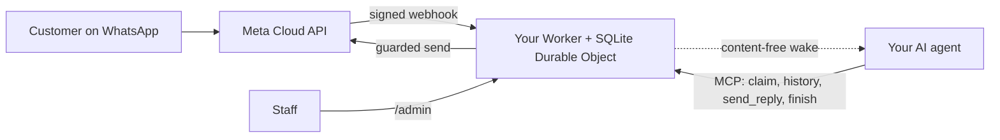

<div align="center">

[English](../../README.md) · [简体中文](README_zh.md) · [繁體中文](README_zh-TW.md) · [日本語](README_ja.md) · [한국어](README_ko.md) · [Türkçe](README_tr.md) · [Русский](README_ru.md) · [Tiếng Việt](README_vi.md) · [ไทย](README_th.md) · [Deutsch](README_de.md) · [Español](README_es.md) · [Français](README_fr.md) · [Українська](README_uk.md) · [Polski](README_pl.md) · [Português (Brasil)](README_pt-BR.md) · [العربية](README_ar.md) · [فارسی](README_fa.md) · **Bahasa Indonesia** · [Italiano](README_it.md)
· [Ελληνικά](README_el.md)

</div>

<div align="center">

# WAB bot

### Nomor WhatsApp satu bisnis, satu agen AI lewat MCP, di akun Cloudflare Anda sendiri.

**Jembatan kecil untuk satu penyewa (single-tenant): pelanggan mengirim pesan ke nomor WhatsApp Cloud API Anda, agen Anda menjawab lewat alat yang terlindungi, dan tidak ada yang keluar dari akun Anda.**

[](../../LICENSE)
[](../STATUS.md)
[](../CLOUDFLARE.md)
[](../../THIRD_PARTY_NOTICES.md)
[](../../.github/workflows/ci.yml)

[Mulai cepat](#mulai-cepat) · [Cara kerja](#cara-kerja) · [Apa yang bisa dilakukan](#apa-yang-bisa-dilakukan) · [Contoh penggunaan](#contoh-penggunaan) · [FAQ](#faq) · [Dokumentasi](#dokumentasi)

</div>

> [!IMPORTANT]
> Sumber resmi template ini adalah [wabbot-dev/wab-bot](https://github.com/wabbot-dev/wab-bot).
> Nama repositori yang mirip atau README yang disalin tidak membuktikan bahwa kode tersebut resmi. Baca apa yang Anda deploy, dan
> jangan pernah memberikan token yang tidak akan Anda berikan kepada penulisnya kepada skrip deploy atau asisten mana pun.
> Proyek ini independen: tidak berafiliasi dengan atau didukung oleh Meta maupun xAI. WhatsApp dan Grok adalah merek dagang pemiliknya masing-masing.

> [!NOTE]
> **Pratinjau.** Diuji secara lokal terhadap tiruan (407 pengujian otomatis). Revisi sebelumnya berjalan langsung di akun Cloudflare Free sekali pakai. Bukti langsung pada nomor **uji** gratis Meta: **pesan teks** dijalankan langsung pada 2026-10-16 (bolak-balik teks sungguhan: satu pesan masuk diterima dan balasan terkirim lewat jembatan), dan **panggilan** dijalankan langsung pada 2026-10-17 dengan kode repositori ini (Grok Voice lewat Meta SIP ke xAI SIP): panggilan suara WhatsApp masuk dijawab oleh AI, percakapan berjalan dua arah (termasuk bahasa Arab), transkrip kedua pihak tersimpan, `end_call` dari model ditangani Worker dan permintaan menutup panggilan ke xAI diterima (HTTP 200), dan gerbang panggilan aktif lalu menonaktifkan diri secara otomatis. Bukan nomor produksi yang terverifikasi bisnis; perekaman audio tidak didukung. Tidak dijalankan oleh proyek ini di produksi. Pemiliknya melaporkan bahwa desain pesan terbukti di produksi pada deployment asalnya (laporan pemilik, tanggal menyusul), yang bukan bukti untuk kode ini. Semua yang terverifikasi dan caranya: [docs/STATUS.md](../STATUS.md).

---

Pelanggan Anda menulis ke nomor WhatsApp bisnis Anda. Meta mengirim setiap pesan ke sebuah Worker di **akun Cloudflare Anda sendiri**, yang menyimpannya dan mengirim sinyal bangun tanpa isi ke agen AI Anda. Agen (agen apa pun yang mendukung MCP) mengambil percakapan, membaca riwayat, dan membalas lewat `send_reply`. Jembatan, bukan agen, yang memegang token WhatsApp dan menegakkan setiap pengaman pengiriman. Staf dapat menjeda, mengambil alih, atau menghapus percakapan dari `/admin`.

Satu deployment per bisnis: aplikasi Meta, nomor, token, dan akun Cloudflare sendiri. Tidak ada rahasia di repositori ini.

## Mulai cepat

Anda memerlukan: akun Cloudflare milik Anda sendiri, Node.js 20+ (disarankan 22), akun pengembang Meta dan penyiapan WhatsApp Cloud API ([daftar periksa](../META-CHECKLIST.md)), **nomor baru yang belum pernah terdaftar di aplikasi WhatsApp mana pun**, dan agen yang dapat memakai MCP serta dibangunkan oleh webhook ([rutinitas bangun](../WAKE-ROUTINE.md)). Anda membayar Meta dan paket AI Anda sendiri secara langsung; paket Workers Free tidak memerlukan metode pembayaran untuk apa yang digunakan template ini ([batas dan ketentuan](../CLOUDFLARE.md)).

### 1. Periksa secara offline (tanpa akun, tanpa jaringan)

```bash
git clone https://github.com/wabbot-dev/wab-bot.git && cd wab-bot
npm ci
npm run check          # typecheck, 343 logic tests, 65 workerd tests, docs check
npm run build          # wrangler deploy --dry-run: bundle and binding check
npm run smoke:local    # wrangler dev --local with random fake secrets
```

### 2. Deploy ke akun Cloudflare Anda sendiri

```bash
bash scripts/deploy-cloudflare.sh --dry-run                  # prints the plan, makes no call
bash scripts/deploy-cloudflare.sh --name my-business-wa      # lowercase letters, digits, dashes
```

Skrip ini memasukkan Anda dengan `wrangler login --device` (Anda menyetujui kode di browser; skrip tidak pernah membuat akun), men-deploy, membuat token milik jembatan itu sendiri, dan mengunggah rahasia lewat stdin. Jalur lain (Cloudflare API tanpa login, rahasia yang disediakan sendiri) ada di [docs/DEPLOY.md](../DEPLOY.md). Penyiapan ini telah terbukti berjalan langsung di 2 akun berbeda ([status](../STATUS.md)).

### 3. Hubungkan Meta dan agen Anda

Ikuti [docs/META-CHECKLIST.md](../META-CHECKLIST.md) (Anda membuat akun Meta, memverifikasi bisnis Anda, dan mengetik kode SMS sendiri), jalankan `node scripts/meta-setup.mjs` di komputer Anda sendiri, lalu arahkan agen Anda ke `https://<worker>.<your-subdomain>.workers.dev/mcp` dengan `Authorization: Bearer <MCP_TOKEN>`.

### 4. Tetap dalam mode uji sampai satu pesan berhasil pulang-pergi

Bawaan yang aman: `LAUNCH_MODE=test` (balasan hanya dikirim ke `TEST_RECIPIENTS`), balasan otomatis **dijeda**, template mati, rute penyiapan Meta di dalam Worker mati. Kirim satu pesan dari ponsel Anda, lihat pesan itu tiba di `/admin`, biarkan agen menjawab, dan baru kemudian go live secara sengaja.

## Cara kerja



Setiap webhook harus membawa `X-Hub-Signature-256` yang valid atas isi mentah. Satu baris SQLite per percakapan menjaga permintaan tetap independen; permintaan yang kalah balapan membaca ulang dan mencoba lagi. POST bangun hanya membawa id dan penghitung, tidak pernah teks pesan. Batasan dan kepemilikan: [docs/ARCHITECTURE.md](../ARCHITECTURE.md). Penyimpanan, retensi, dan bangun: [docs/STATE-STORE.md](../STATE-STORE.md).

## Apa yang bisa dilakukan

| Kemampuan | Bukti dan batasan |
|---|---|
| Menerima teks WhatsApp dan menyimpannya per percakapan, tanpa duplikat, dengan verifikasi HMAC | Diuji secara lokal; satu pesan nyata diterima di nomor uji Meta ([status](../STATUS.md)) |
| Alat agen lewat MCP: `list_pending`, `claim_conversation`, `get_history`, `send_reply` (16 pengaman di sisi server), `finish`, `release`, `escalate`, `get_controls`, `get_overview` yang hanya-baca | Diuji secara lokal dan dengan panggilan JSON-RPC langsung; **tidak** dengan klien MCP sungguhan. Satu balasan nyata dikirim di nomor uji Meta, digerakkan secara manual |
| Konsol staf: menjeda dan melanjutkan balasan otomatis, mengambil alih, melepas, membuka kembali, menyelesaikan, membangunkan, menghapus | Diuji secara lokal. Halaman statis, memerlukan token |
| Menghapus satu percakapan (`DELETE /api/admin/conversations/<id>`) | Diuji secara lokal dengan pemeriksaan mutasi; tidak pernah dijalankan secara langsung. Tidak menjangkau salinan pemulihan Cloudflare ([privasi](../PRIVACY.md)) |
| Membangunkan agen Anda, dengan debounce, backoff, dan percobaan ulang harian | Diverifikasi langsung terhadap penerima pengganti; tidak pernah terhadap platform agen sungguhan |
| Retensi: percakapan yang sudah dibalas dipangkas pada hari ke-14, apa pun dibuang pada hari ke-180 | Diverifikasi langsung dengan data sintetis; tidak pernah selama berminggu-minggu dengan data nyata |
| Menyediakan rahasia sendiri sekali saja (`POST /api/setup`) untuk alat deploy yang menyamarkan nilai | Dijalankan langsung pada satu Worker uji; lebih lemah daripada secret binding ([batasan](../SELF-PROVISIONING.md)) |
| Menjawab panggilan suara WhatsApp (Meta SIP ke xAI Grok Voice), mati sampai pemilik membuka gerbang; Anda membayar xAI, sekitar $0.08 per menit | **Dijalankan langsung** dengan kode ini pada 2026-10-17 di nomor uji Meta: dijawab AI, percakapan dua arah, transkrip kedua pihak tersimpan, permintaan model untuk mengakhiri panggilan ditangani; bukan nomor produksi yang terverifikasi bisnis ([suara](../VOICE-CALLS.md)) |
| MCP admin khusus pemilik di `/admin/mcp`: status, pemeriksaan penyiapan, percakapan tersamarkan, hapus, mengaktifkan dan menonaktifkan panggilan, log panggilan, penggunaan, versi, dan pemeriksaan pembaruan (17 alat) | Mati kecuali `ADMIN_MCP_TOKEN` diatur. Diuji secara lokal dan di workerd; **belum** diuji dengan klien MCP sungguhan ([MCP admin](../mcp.md)) |
| Memahami pesan suara, gambar, dan dokumen: pesan suara ditranskripsi (Arab, Prancis, Inggris, dan lainnya), gambar dideskripsikan, dan dokumen PDF atau Office dibaca dengan Workers AI di akun Cloudflare Anda sendiri, dalam kuota harian gratis; lokasi dan kartu kontak dibaca; pada setiap kegagalan agen melihat penanda sederhana. Balasan pesan suara opsional, mati secara bawaan: enam bahasa dengan Workers AI, bahasa Arab dan bahasa lain dengan kunci xAI atau ElevenLabs Anda sendiri | Diuji secara lokal; dijalankan langsung lewat rute uji mandiri pemilik pada Worker uji, belum dari ponsel sungguhan ([media](../MEDIA.md)) |
| Fitur bisnis opsional: melayani konsumen, bisnis, atau keduanya; direktori akun yang dikelola pemilik; peringatan instan ke pemilik; dokumen, gambar, tombol, dan daftar dalam balasan; pembayaran yang diverifikasi staf; kait untuk pemesanan dan order | Diuji secara lokal; belum dijalankan langsung ([mode bisnis](../BUSINESS-MODE.md)) |

Tidak termasuk: pemahaman video (video dicatat, tidak ditonton), grup, panggilan keluar, perekaman audio, halaman pengaturan, rutinitas siap pakai, hosting multi-tenant. Lihat [docs/ROADMAP.md](../ROADMAP.md).

## Contoh penggunaan

**Satu giliran pelanggan lewat MCP** (hanya placeholder; agen melakukannya melalui klien MCP-nya):

```bash
MCP=https://<worker>.<your-subdomain>.workers.dev/mcp
call() { curl -s "$MCP" -H "Authorization: Bearer $MCP_TOKEN" -H 'content-type: application/json' \
  -d "{\"jsonrpc\":\"2.0\",\"id\":1,\"method\":\"tools/call\",\"params\":{\"name\":\"$1\",\"arguments\":$2}}"; }
call list_pending '{}'
call claim_conversation '{"conversation_id":"c_<id>"}'                       # returns a lease
call get_history '{"conversation_id":"c_<id>","lease":"<lease>"}'            # customer text is wrapped as untrusted
call send_reply '{"conversation_id":"c_<id>","lease":"<lease>","text":"Hello, how can I help?"}'
call finish_conversation '{"conversation_id":"c_<id>","lease":"<lease>"}'
```

Selama `LAUNCH_MODE=test` atau balasan otomatis dijeda, `send_reply` menjawab `blocked_test_mode_recipient_not_allowlisted` atau `blocked_auto_reply_paused` alih-alih mengirim. Urutan pengaman dan setiap string galat: [docs/CONFIGURATION.md](../CONFIGURATION.md).

**Menghapus satu pelanggan:**

```bash
curl -X DELETE -H "Authorization: Bearer $ADMIN_TOKEN" https://<worker>.<your-subdomain>.workers.dev/api/admin/conversations/c_<id>
# {"ok":true,"deleted":true}   (404 if unknown or already erased)
```

**Menghapus semuanya:** `bash scripts/teardown-cloudflare.sh` (meminta Anda mengetik nama Worker; menghapus Worker dan semua percakapan yang tersimpan, tidak ada yang lain).

## FAQ

**Siapa pemilik akun Cloudflare?** Anda: Anda menerima ketentuan, Anda membayar jika suatu saat membayar, dan Anda dapat menghapusnya. Seorang asisten hanya boleh membuat akun Cloudflare dan xAI untuk Anda dengan persetujuan tertulis Anda dan dengan menjadikan Anda pemilik atau admin; kartu Anda tambahkan sendiri. Akun Meta, Verifikasi Bisnis, dan kode SMS selalu milik Anda ([detail dan catatan tentang ketentuan Cloudflare](../CLOUDFLARE.md)).

**Apakah paket Free diperbolehkan untuk bisnis?** Dalam ketentuan Cloudflare yang dibaca pada 2026-10-17, layanan Free tidak memuat klausul khusus penggunaan pribadi, dengan dua pembatasan yang penting di sini (tidak boleh mengumpulkan data kartu, tidak boleh ada informasi kesehatan yang dilindungi tanpa persetujuan tertulis Cloudflare). Bukan nasihat hukum; periksa kembali ([penggunaan komersial](../CLOUDFLARE.md#commercial-use)).

**Bisakah saya memakai nomor aplikasi WhatsApp Business yang sudah ada?** Tidak. Nomor Cloud API tidak boleh pernah terdaftar di aplikasi WhatsApp; koeksistensi di luar cakupan. Bawa SIM atau saluran Anda sendiri dan ketik sendiri kodenya.

**Apakah menjawab panggilan?** Ya, hanya panggilan masuk dan hanya saat Anda membuka gerbang: panggilan mati secara bawaan, tetap mati pada nomor sungguhan sampai Verifikasi Bisnis Anda selesai dan Anda berkata mulai, dan berjalan dalam jendela singkat yang Anda aktifkan. Menggunakan xAI Grok Voice di akun xAI Anda sendiri (sekitar $0.08 per menit). Panggilan dengan kode ini dijawab langsung di nomor uji Meta pada 2026-10-17 (percakapan dua arah, transkrip tersimpan); belum dijalankan di nomor produksi yang terverifikasi bisnis dan perekaman audio tidak didukung ([suara](../VOICE-CALLS.md)).

**Agen mana yang bisa dipakai?** Agen apa pun yang dapat berbicara MCP lewat HTTP dan dapat dibangunkan oleh webhook. Telah diuji dengan panggilan JSON-RPC langsung, bukan dengan klien MCP sungguhan ([rutinitas bangun](../WAKE-ROUTINE.md)).

**Seberapa besar volumenya?** Single-tenant, satu Durable Object: volume bisnis kecil. Berdasarkan pengukuran langsung kami, sekitar 30.000 pesan per hari muat dalam kuota Durable Object Free; banyak pesan bersamaan dalam satu percakapan dapat mengembalikan 503 dan Meta mengirim ulang ([status](../STATUS.md#live-measurements-cloudflare-free-fake-secrets-2026-10-16)).

**Apakah sudah terbukti di produksi?** Desain asalnya dilaporkan demikian (dilaporkan pemilik, tanggal menyusul). Port Cloudflare ini belum. [Status](../STATUS.md) menjelaskan dengan tepat arti setiap tingkat.

## Batasan dan praktik yang baik

- **Proyek independen.** WAB bot tidak resmi: tidak berafiliasi dengan atau didukung oleh Meta, WhatsApp, atau xAI. WhatsApp dan Grok adalah merek dagang pemiliknya masing-masing.
- **Aturan Meta berlaku.** Penggunaan WhatsApp Cloud API Anda mengikuti ketentuan, kebijakan pesan, dan aturan per nomor dari Meta, dan panggilan pada nomor bisnis memerlukan Verifikasi Bisnis Meta.
- **Satu nomor per bot.** Satu deployment melayani satu bisnis dan satu nomor WhatsApp, dengan aplikasi Meta, token, dan akun Cloudflare Anda sendiri. Jika aplikasi Meta yang Anda gunakan untuk bot baru sudah melayani bot lain, penyiapan tidak mengubah apa pun dan meminta Anda membuat aplikasi Meta baru di portofolio bisnis yang sama.
- **Panggilan Anda yang mengaktifkan.** Secara bawaan mati; Anda membukanya dengan menyebut nomornya, dan panggilan memakai kredit xAI Anda sendiri (sekitar $0.08 per menit).
- **Hanya panggilan masuk, tanpa rekaman audio.** Panggilan keluar dan perekaman audio tidak didukung. Transkrip teks disimpan secara bawaan dan dapat Anda matikan.
- **SIP dan API panggilan Graph saling eksklusif per nomor.** Selama sebuah nomor memakai SIP untuk panggilan, seperti bot ini, endpoint panggilan Graph Meta tidak tersedia pada nomor itu.
- **Siapkan jalur kontak cadangan.** Umumkan cara lain untuk menghubungi Anda, seperti telepon atau email, dan pastikan staf selalu dapat mengambil alih percakapan mana pun.

Apa yang didukung dan tidak: [kemampuan](../CAPABILITIES.md). Tanya jawab praktis: [pemecahan masalah](../TROUBLESHOOTING.md). Panggilan secara rinci: [suara](../VOICE-CALLS.md).

## Dokumentasi

[docs/index.md](../index.md) mencantumkan setiap halaman. Mulailah dengan [STATUS](../STATUS.md), lalu [DEPLOY](../DEPLOY.md), [META-CHECKLIST](../META-CHECKLIST.md), [CONFIGURATION](../CONFIGURATION.md), [PRIVACY](../PRIVACY.md), dan [TROUBLESHOOTING](../TROUBLESHOOTING.md). Juga: [AGENTS.md](../../AGENTS.md) untuk agen pengodean AI, [SECURITY.md](../../SECURITY.md), [CHANGELOG.md](../../CHANGELOG.md), [THIRD_PARTY_NOTICES.md](../../THIRD_PARTY_NOTICES.md).

## Penafian

Ini adalah perangkat lunak pratinjau untuk pengiriman pesan bisnis yang sah. Anda bertanggung jawab atas deployment, kredensial, data pelanggan, aturan perekaman dan pengungkapan penggunaan AI, serta ketentuan Anda dengan Meta dan Cloudflare. Tanpa garansi. Baca [DISCLAIMER.md](../../DISCLAIMER.md).

## Berkontribusi

Perbaikan yang terfokus, koreksi dokumentasi, dan pengujian sangat diterima; baca dulu [cakupan kontribusi](../../CONTRIBUTING.md#contribution-scope) dan [aturan kesiapan PR](../../CONTRIBUTING.md#pull-request-ownership-and-readiness). PR yang dibantu AI memerlukan pemilik manusia yang disebutkan namanya. Masalah keamanan: [SECURITY.md](../../SECURITY.md).

## Lisensi

[MIT](../../LICENSE), Copyright (c) 2026 wabbot-dev.
