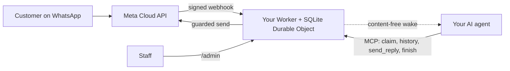

<div align="center">

[English](../../README.md) · [简体中文](README_zh.md) · [繁體中文](README_zh-TW.md) · [日本語](README_ja.md) · [한국어](README_ko.md) · [Türkçe](README_tr.md) · [Русский](README_ru.md) · [Tiếng Việt](README_vi.md) · [ไทย](README_th.md) · [Deutsch](README_de.md) · [Español](README_es.md) · [Français](README_fr.md) · [Українська](README_uk.md) · [Polski](README_pl.md) · [Português (Brasil)](README_pt-BR.md) · [العربية](README_ar.md) · [فارسی](README_fa.md) · [Bahasa Indonesia](README_id.md) · **Italiano**
· [Ελληνικά](README_el.md)

</div>

<div align="center">

# WAB bot

### Il numero WhatsApp di un'attività, un agente IA tramite MCP, sul tuo account Cloudflare.

**Un piccolo bridge single-tenant: i clienti scrivono al tuo numero WhatsApp Cloud API, il tuo agente risponde tramite strumenti protetti e nulla esce dai tuoi account.**

[](../../LICENSE)
[](../STATUS.md)
[](../CLOUDFLARE.md)
[](../../THIRD_PARTY_NOTICES.md)
[](../../.github/workflows/ci.yml)

[Avvio rapido](#avvio-rapido) · [Come funziona](#come-funziona) · [Cosa può fare](#cosa-può-fare) · [Esempi pratici](#esempi-pratici) · [FAQ](#faq) · [Documentazione](#documentazione)

</div>

> [!IMPORTANT]
> La fonte ufficiale di questo template è [wabbot-dev/wab-bot](https://github.com/wabbot-dev/wab-bot).
> Un nome di repository simile o un README copiato non stabilisce che il codice sia ufficiale. Leggi ciò che distribuisci e
> non dare mai a uno script di deploy o a un assistente un token che non daresti al suo autore.
> Questo progetto è indipendente: non è affiliato a Meta o xAI né da loro approvato. WhatsApp e Grok sono marchi dei rispettivi proprietari.

> [!NOTE]
> **Anteprima.** Testato in locale contro finti (fake) (407 test automatici). Le revisioni precedenti sono girate dal vivo su un account Cloudflare Free usa e getta. Prove dal vivo sul numero di **test** gratuito di Meta: l'**invio di testi** è stato eseguito dal vivo il 2026-10-16 (un vero andata e ritorno di testo: un messaggio in arrivo è stato ricevuto e una risposta è tornata attraverso il bridge), e le **chiamate** il 2026-10-17 con il codice di questo repository (Grok Voice su Meta SIP verso xAI SIP): le chiamate vocali WhatsApp in arrivo sono state risposte dall'IA, la conversazione è andata nei due sensi (anche in arabo), le trascrizioni di entrambe le parti sono state salvate, il `end_call` del modello è stato gestito dal Worker e la richiesta di riagganciare a xAI è stata accettata (HTTP 200), e il cancello delle chiamate si è armato e disarmato da solo. Non è un numero di produzione verificato come azienda; la registrazione audio non è supportata. Non eseguito da questo progetto in produzione. Il proprietario segnala che il progetto della messaggistica è provato in produzione nel deployment da cui deriva (segnalazione del proprietario, data da definire), il che non è una prova per questo codice. Tutto ciò che è verificato e come: [docs/STATUS.md](../STATUS.md).

---

I tuoi clienti scrivono al numero WhatsApp della tua attività. Meta consegna ogni messaggio a un Worker nel **tuo account Cloudflare**, che lo memorizza e invia al tuo agente IA un segnale di risveglio privo di contenuto. L'agente (qualsiasi agente compatibile con MCP) prende in carico la conversazione, legge la cronologia e risponde tramite `send_reply`. È il bridge, non l'agente, a detenere il token WhatsApp e ad applicare ogni protezione di invio. Il personale può mettere in pausa, assumere il controllo o cancellare una conversazione da `/admin`.

Un deployment per attività: la sua app Meta, il suo numero, i suoi token e il suo account Cloudflare. In questo repository non ci sono segreti.

## Avvio rapido

Ti servono: un account Cloudflare di tua proprietà, Node.js 20+ (consigliato 22), un account sviluppatore Meta e la configurazione di WhatsApp Cloud API ([checklist](../META-CHECKLIST.md)), un **numero nuovo mai registrato in alcuna app WhatsApp** e un agente che possa usare MCP ed essere risvegliato da un webhook ([routine di risveglio](../WAKE-ROUTINE.md)). Paghi direttamente Meta e il tuo piano IA; il piano Workers Free non richiede un metodo di pagamento per ciò che usa questo template ([limiti e termini](../CLOUDFLARE.md)).

### 1. Verifica offline (nessun account, nessuna rete)

```bash
git clone https://github.com/wabbot-dev/wab-bot.git && cd wab-bot
npm ci
npm run check          # typecheck, 293 logic tests, 65 workerd tests, docs check
npm run build          # wrangler deploy --dry-run: bundle and binding check
npm run smoke:local    # wrangler dev --local with random fake secrets
```

### 2. Distribuisci sul tuo account Cloudflare

```bash
bash scripts/deploy-cloudflare.sh --dry-run                  # prints the plan, makes no call
bash scripts/deploy-cloudflare.sh --name my-business-wa      # lowercase letters, digits, dashes
```

Lo script ti fa accedere con `wrangler login --device` (approvi un codice nel browser; non crea mai un account), distribuisce, genera i token propri del bridge e carica i segreti tramite stdin. Le altre vie (API di Cloudflare senza login, segreti autoprovisionati) sono in [docs/DEPLOY.md](../DEPLOY.md). La configurazione è stata verificata dal vivo su 2 account diversi ([stato](../STATUS.md)).

### 3. Collega Meta e il tuo agente

Segui [docs/META-CHECKLIST.md](../META-CHECKLIST.md) (crei tu gli account Meta, verifichi la tua attività e digiti tu il codice SMS), esegui `node scripts/meta-setup.mjs` sul tuo computer e punta il tuo agente a `https://<worker>.<your-subdomain>.workers.dev/mcp` con `Authorization: Bearer <MCP_TOKEN>`.

### 4. Resta in modalità di test finché un messaggio non fa il giro completo

Impostazioni predefinite sicure: `LAUNCH_MODE=test` (le risposte vanno solo a `TEST_RECIPIENTS`), risposta automatica **in pausa**, template disattivati, la route di configurazione Meta dentro il Worker disattivata. Invia un messaggio dal tuo telefono, guardalo arrivare in `/admin`, lascia rispondere l'agente e solo allora passa in produzione, in modo deliberato.

## Come funziona



Ogni webhook deve portare un `X-Hub-Signature-256` valido calcolato sul corpo grezzo. Una riga SQLite per conversazione mantiene le richieste indipendenti; una gara persa rilegge e riprova. Il POST di risveglio porta solo id e contatori, mai il testo dei messaggi. Confini e responsabilità: [docs/ARCHITECTURE.md](../ARCHITECTURE.md). Archiviazione, conservazione e risveglio: [docs/STATE-STORE.md](../STATE-STORE.md).

## Cosa può fare

| Funzionalità | Evidenza e limiti |
|---|---|
| Ricevere testo WhatsApp e memorizzarlo per conversazione, senza duplicati, con verifica HMAC | Testato in locale; un messaggio reale ricevuto sul numero di test di Meta ([stato](../STATUS.md)) |
| Strumenti dell'agente tramite MCP: `list_pending`, `claim_conversation`, `get_history`, `send_reply` (16 protezioni lato server), `finish`, `release`, `escalate`, `get_controls`, `get_overview` in sola lettura | Testato in locale e con chiamate JSON-RPC dirette; **non** con veri client MCP. Una risposta reale inviata sul numero di test di Meta, guidata a mano |
| Console del personale: mettere in pausa e riprendere la risposta automatica, assumere il controllo, rilasciare, riaprire, risolvere, risvegliare, cancellare | Testato in locale. Pagina statica, token richiesto |
| Cancellare una conversazione (`DELETE /api/admin/conversations/<id>`) | Testato in locale con controlli di mutazione; mai eseguito dal vivo. Non raggiunge le copie di ripristino di Cloudflare ([privacy](../PRIVACY.md)) |
| Risvegliare il tuo agente, con debounce, backoff e un nuovo tentativo giornaliero | Verificato dal vivo contro un ricevitore sostitutivo; mai contro una vera piattaforma di agenti |
| Conservazione: le chat con risposta vengono ridotte a 14 giorni, tutto viene scartato a 180 giorni | Verificato dal vivo con dati sintetici; mai per settimane con dati reali |
| Autoprovisionare i segreti una volta (`POST /api/setup`) per gli strumenti di deploy che oscurano i valori | Eseguito dal vivo su un Worker di test; più debole di un secret binding ([limiti](../SELF-PROVISIONING.md)) |
| Rispondere alle chiamate vocali di WhatsApp (Meta SIP verso xAI Grok Voice), spento finché il proprietario non apre il cancello; paghi tu xAI, circa $0.08 al minuto | **Eseguito dal vivo** con questo codice il 2026-10-17 sul numero di test di Meta: risposta dell'IA, conversazione nei due sensi, trascrizioni di entrambe le parti salvate, richiesta di fine chiamata del modello gestita; non è un numero di produzione verificato come azienda ([voce](../VOICE-CALLS.md)) |
| MCP di amministrazione solo per il proprietario su `/admin/mcp`: stato, controllo della configurazione, conversazioni oscurate, cancellazione, attivazione e disattivazione delle chiamate, registri delle chiamate, utilizzo, versione e controllo aggiornamenti (17 strumenti) | Spento a meno che `ADMIN_MCP_TOKEN` sia impostato. Testato in locale e in workerd; **non** con veri client MCP ([MCP di amministrazione](../mcp.md)) |
| Comprendere note vocali, immagini e documenti: le note vocali vengono trascritte (arabo, francese, inglese e altre), le immagini descritte e i documenti PDF o Office letti con Workers AI nel tuo account Cloudflare, entro la quota giornaliera gratuita; posizioni e schede contatto vengono lette; in caso di errore l'agente vede un semplice indicatore. Risposte vocali opzionali, disattivate per impostazione predefinita: sei lingue con Workers AI, arabo e altre lingue con la tua chiave xAI o ElevenLabs | Testato in locale; eseguito dal vivo tramite la route di autotest del proprietario su un Worker di prova, non ancora da un telefono reale ([media](../MEDIA.md)) |
| Funzioni business opzionali: servire consumatori, aziende o entrambi; una rubrica clienti gestita dal titolare; avvisi immediati al titolare; documenti, immagini, pulsanti ed elenchi nelle risposte; pagamenti verificati dal personale; un collegamento per prenotazioni e ordini | Testato in locale; non ancora eseguito dal vivo ([modalità business](../BUSINESS-MODE.md)) |

Non incluso: comprensione dei video (un video viene segnalato, non guardato), gruppi, chiamate in uscita, registrazione audio, una pagina impostazioni, routine predefinite, hosting multi-tenant. Vedi [docs/ROADMAP.md](../ROADMAP.md).

## Esempi pratici

**Un turno cliente tramite MCP** (solo segnaposto; l'agente lo fa attraverso il proprio client MCP):

```bash
MCP=https://<worker>.<your-subdomain>.workers.dev/mcp
call() { curl -s "$MCP" -H "Authorization: Bearer $MCP_TOKEN" -H 'content-type: application/json' \
  -d "{\"jsonrpc\":\"2.0\",\"id\":1,\"method\":\"tools/call\",\"params\":{\"name\":\"$1\",\"arguments\":$2}}"; }
call list_pending '{}'
call claim_conversation '{"conversation_id":"c_<id>"}'                       # returns a lease
call get_history '{"conversation_id":"c_<id>","lease":"<lease>"}'            # customer text is wrapped as untrusted
call send_reply '{"conversation_id":"c_<id>","lease":"<lease>","text":"Hello, how can I help?"}'
call finish_conversation '{"conversation_id":"c_<id>","lease":"<lease>"}'
```

Finché `LAUNCH_MODE=test` è attivo o la risposta automatica è in pausa, `send_reply` risponde `blocked_test_mode_recipient_not_allowlisted` o `blocked_auto_reply_paused` invece di inviare. L'ordine delle protezioni e ogni stringa di errore: [docs/CONFIGURATION.md](../CONFIGURATION.md).

**Cancellare un cliente:**

```bash
curl -X DELETE -H "Authorization: Bearer $ADMIN_TOKEN" https://<worker>.<your-subdomain>.workers.dev/api/admin/conversations/c_<id>
# {"ok":true,"deleted":true}   (404 if unknown or already erased)
```

**Rimuovere tutto:** `bash scripts/teardown-cloudflare.sh` (ti chiede di digitare il nome del Worker; elimina il Worker e ogni conversazione memorizzata, nient'altro).

## FAQ

**Di chi è l'account Cloudflare?** Tuo: accetti i termini, paghi se mai pagherai e puoi eliminarlo. Un assistente può creare gli account Cloudflare e xAI per te solo con il tuo consenso scritto e facendoti proprietario o amministratore; la carta la aggiungi tu. Gli account Meta, la verifica dell'attività e il codice SMS sono sempre tuoi ([dettagli e l'avvertenza sui termini di Cloudflare](../CLOUDFLARE.md)).

**Il piano Free è consentito per un'attività commerciale?** Nei termini di Cloudflare letti il 2026-10-17 i servizi Free non contengono una clausola di solo uso personale, ma hanno due restrizioni rilevanti qui (nessuna raccolta di dati di carte, nessuna informazione sanitaria protetta senza il consenso scritto di Cloudflare). Non è consulenza legale; ricontrolla ([uso commerciale](../CLOUDFLARE.md#commercial-use)).

**Posso usare il numero della mia app WhatsApp Business esistente?** No. Il numero della Cloud API non deve mai essere stato registrato in un'app WhatsApp; la coesistenza è fuori ambito. Porta la tua SIM o linea e digita tu il suo codice.

**Risponde alle chiamate?** Sì, solo in entrata e solo quando apri il cancello: le chiamate sono spente per impostazione predefinita, restano spente su un numero reale finché la tua Business Verification non è completa e tu non dici via, e funzionano in brevi finestre che attivi tu. Usa xAI Grok Voice sul tuo account xAI (circa $0.08 al minuto). Le chiamate con questo codice sono state risposte dal vivo sul numero di test di Meta il 2026-10-17 (conversazione nei due sensi, trascrizioni salvate); non è stato eseguito su un numero di produzione verificato come azienda e la registrazione audio non è supportata ([voce](../VOICE-CALLS.md)).

**Quale agente funziona?** Qualsiasi agente che parli MCP su HTTP e possa essere risvegliato da un webhook. È stato testato con chiamate JSON-RPC dirette, non con veri client MCP ([routine di risveglio](../WAKE-ROUTINE.md)).

**Che volume regge?** Single-tenant, un solo Durable Object: volumi da piccola attività. Secondo la nostra misurazione dal vivo, circa 30.000 messaggi al giorno rientrano nella quota Durable Object del piano Free; molti messaggi simultanei in una conversazione possono restituire 503 e Meta li riconsegna ([stato](../STATUS.md#live-measurements-cloudflare-free-fake-secrets-2026-10-16)).

**È provato in produzione?** Si riferisce che lo sia il design da cui deriva (riferito dal proprietario, data da definire). Questo port su Cloudflare no. Lo [stato](../STATUS.md) dice esattamente cosa significa ogni livello.

## Limiti e buone pratiche

- **Progetto indipendente.** WAB bot non è ufficiale: non è affiliato né approvato da Meta, WhatsApp o xAI. WhatsApp e Grok sono marchi dei rispettivi proprietari.
- **Valgono le regole di Meta.** L'uso della WhatsApp Cloud API segue i termini, le policy di messaggistica e le regole per numero di Meta, e le chiamate su un numero aziendale richiedono la Business Verification di Meta.
- **Un numero per bot.** Una distribuzione serve un'azienda e un numero WhatsApp, con la tua app Meta, i tuoi token e il tuo account Cloudflare.
- **Le chiamate le attivi tu.** Sono spente per impostazione predefinita; le apri indicando il numero e usano i tuoi crediti xAI (circa $0.08 al minuto).
- **Solo chiamate in entrata, nessuna registrazione audio.** Le chiamate in uscita e la registrazione audio non sono supportate. Una trascrizione testuale viene conservata per impostazione predefinita e puoi disattivarla.
- **SIP e l'API chiamate di Graph si escludono a vicenda per numero.** Finché un numero usa SIP per le chiamate, come questo bot, gli endpoint chiamate di Graph di Meta non sono disponibili su di esso.
- **Tieni un canale di contatto alternativo.** Pubblica un altro modo per raggiungerti, come un telefono o un'email, e lascia che il personale possa subentrare in qualsiasi conversazione.

Cosa è supportato e cosa no: [capacità](../CAPABILITIES.md). Risposte pratiche: [risoluzione dei problemi](../TROUBLESHOOTING.md). Le chiamate in dettaglio: [voce](../VOICE-CALLS.md).

## Documentazione

[docs/index.md](../index.md) elenca ogni pagina. Inizia da [STATUS](../STATUS.md), poi [DEPLOY](../DEPLOY.md), [META-CHECKLIST](../META-CHECKLIST.md), [CONFIGURATION](../CONFIGURATION.md), [PRIVACY](../PRIVACY.md) e [TROUBLESHOOTING](../TROUBLESHOOTING.md). Inoltre: [AGENTS.md](../../AGENTS.md) per gli agenti di programmazione IA, [SECURITY.md](../../SECURITY.md), [CHANGELOG.md](../../CHANGELOG.md), [THIRD_PARTY_NOTICES.md](../../THIRD_PARTY_NOTICES.md).

## Dichiarazione di non responsabilità

Questo è un software in anteprima per la messaggistica aziendale lecita. Sei responsabile del tuo deployment, delle tue credenziali, dei dati dei tuoi clienti, delle regole su registrazione e dichiarazione dell'uso dell'IA e dei tuoi termini con Meta e Cloudflare. Nessuna garanzia. Leggi [DISCLAIMER.md](../../DISCLAIMER.md).

## Contribuire

Correzioni mirate, correzioni alla documentazione e test sono benvenuti; leggi prima l'[ambito dei contributi](../../CONTRIBUTING.md#contribution-scope) e le [regole di prontezza delle PR](../../CONTRIBUTING.md#pull-request-ownership-and-readiness). Le PR assistite dall'IA richiedono un responsabile umano indicato per nome. Problemi di sicurezza: [SECURITY.md](../../SECURITY.md).

## Licenza

[MIT](../../LICENSE), Copyright (c) 2026 wabbot-dev.
