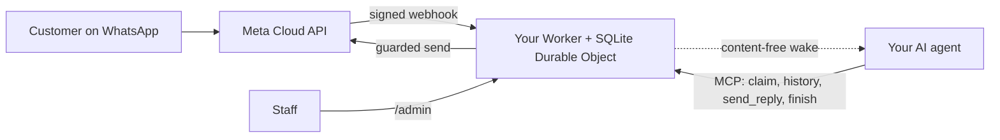

<div align="center">

[English](../../README.md) · [简体中文](README_zh.md) · [繁體中文](README_zh-TW.md) · **日本語** · [한국어](README_ko.md) · [Türkçe](README_tr.md) · [Русский](README_ru.md) · [Tiếng Việt](README_vi.md) · [ไทย](README_th.md) · [Deutsch](README_de.md) · [Español](README_es.md) · [Français](README_fr.md) · [Українська](README_uk.md) · [Polski](README_pl.md) · [Português (Brasil)](README_pt-BR.md) · [العربية](README_ar.md) · [فارسی](README_fa.md) · [Bahasa Indonesia](README_id.md) · [Italiano](README_it.md)
· [Ελληνικά](README_el.md)

</div>

<div align="center">

# WAB bot

### 1つの事業の WhatsApp 番号に、MCP 経由で1つの AI エージェントを。あなた自身の Cloudflare アカウント上で動きます。

**小さなシングルテナントのブリッジです。顧客があなたの WhatsApp Cloud API 番号にメッセージを送り、エージェントが保護されたツールを通じて返信し、何もあなたのアカウントの外に出ません。**

[](../../LICENSE)
[](../STATUS.md)
[](../CLOUDFLARE.md)
[](../../THIRD_PARTY_NOTICES.md)
[](../../.github/workflows/ci.yml)

[クイックスタート](#クイックスタート) · [仕組み](#仕組み) · [できること](#できること) · [実践例](#実践例) · [よくある質問](#よくある質問) · [ドキュメント](#ドキュメント)

</div>

> [!IMPORTANT]
> このテンプレートの公式ソースは [wabbot-dev/wab-bot](https://github.com/wabbot-dev/wab-bot) です。
> リポジトリ名が似ている、または README がコピーされているというだけでは、そのコードが公式であることの証明にはなりません。デプロイするものは必ず読み、
> 作者本人に渡せないようなトークンを、デプロイスクリプトやアシスタントに渡してはいけません。
> このプロジェクトは独立したものであり、Meta または xAI の提携先でも承認を受けたものでもありません。WhatsApp と Grok はそれぞれの所有者の商標です。

> [!NOTE]
> **プレビュー版。** ローカルでフェイクに対してテスト済み（自動テスト 335 件）。以前のリビジョンは使い捨ての Cloudflare Free アカウントで実際に動かしました。Meta の無料**テスト**番号での実機の裏付け：**テキストメッセージ**は 2026-10-16 に実機で動作確認（実際のテキスト往復：受信メッセージを受け取り、ブリッジ経由で返信を送信）、**音声通話**は 2026-10-17 にこのリポジトリのコードで実機動作確認（Grok Voice が Meta SIP 経由で xAI SIP に接続）：着信した WhatsApp 音声通話に AI が応答し、双方向に会話し（アラビア語を含む）、双方の文字起こしが保存され、モデルの `end_call` を Worker が処理し、xAI への切断リクエストが受理され（HTTP 200）、通話ゲートが有効化と自動解除を行いました。ビジネス認証済みの本番番号ではなく、音声の録音には対応していません。このプロジェクトとしては本番環境では動かしていません。メッセージ部分の設計は、元になったデプロイで本番実証済みとオーナーが報告しています（オーナー申告、日付は未定）が、これはこのコードの証拠にはなりません。検証済みの内容とその方法：[docs/STATUS.md](../STATUS.md)。

---

顧客があなたの事業の WhatsApp 番号にメッセージを書きます。Meta は各メッセージを**あなた自身の Cloudflare アカウント**内の Worker に配信し、Worker はそれを保存して、AI エージェントに内容を含まない起動通知を送ります。エージェント（MCP に対応していればどのエージェントでも可）は会話を確保し、履歴を読み、`send_reply` で返信します。WhatsApp トークンを保持し、すべての送信ガードを適用するのは、エージェントではなくブリッジです。スタッフは `/admin` から会話の一時停止、引き継ぎ、削除ができます。

1事業につき1デプロイ：専用の Meta アプリ、番号、トークン、Cloudflare アカウントを使います。このリポジトリにシークレットは含まれていません。

## クイックスタート

必要なもの：自分で所有する Cloudflare アカウント、Node.js 20 以上（22 を推奨）、Meta 開発者アカウントと WhatsApp Cloud API の設定（[チェックリスト](../META-CHECKLIST.md)）、**どの WhatsApp アプリにも登録されたことのない新しい番号**、そして MCP を使え、webhook で起こせるエージェント（[ウェイクルーティン](../WAKE-ROUTINE.md)）。Meta と自分の AI プランへは直接支払います。このテンプレートが使う範囲では、Workers Free プランに支払い方法は不要です（[制限と規約](../CLOUDFLARE.md)）。

### 1. オフラインで確認する（アカウント不要、ネットワーク不要）

```bash
git clone https://github.com/wabbot-dev/wab-bot.git && cd wab-bot
npm ci
npm run check          # typecheck, 293 logic tests, 65 workerd tests, docs check
npm run build          # wrangler deploy --dry-run: bundle and binding check
npm run smoke:local    # wrangler dev --local with random fake secrets
```

### 2. 自分の Cloudflare アカウントにデプロイする

```bash
bash scripts/deploy-cloudflare.sh --dry-run                  # prints the plan, makes no call
bash scripts/deploy-cloudflare.sh --name my-business-wa      # lowercase letters, digits, dashes
```

スクリプトは `wrangler login --device` でログインし（ブラウザでコードを承認します。アカウントは作成しません）、デプロイし、ブリッジ独自のトークンを生成し、stdin 経由でシークレットをアップロードします。ほかの方法（ログインなしの Cloudflare API、自己プロビジョニングのシークレット）は [docs/DEPLOY.md](../DEPLOY.md) にあります。セットアップは 2 つの異なるアカウントで実際に動作することが確認されています（[ステータス](../STATUS.md)）。

### 3. Meta とエージェントを接続する

[docs/META-CHECKLIST.md](../META-CHECKLIST.md) に従い（Meta アカウントの作成、事業の認証、SMS コードの入力はご自身で行います）、自分のコンピューターで `node scripts/meta-setup.mjs` を実行し、エージェントを `https://<worker>.<your-subdomain>.workers.dev/mcp` に向けて、`Authorization: Bearer <MCP_TOKEN>` を付けます。

### 4. メッセージが往復するまでテストモードのままにする

安全なデフォルト：`LAUNCH_MODE=test`（返信は `TEST_RECIPIENTS` にのみ送られます）、自動返信は**一時停止**、テンプレートはオフ、Worker 内の Meta 設定ルートはオフ。スマートフォンから1通送り、`/admin` に届くのを確認し、エージェントに返信させ、その後で初めて意図的に本番公開してください。

## 仕組み



すべての webhook は、生のボディに対する有効な `X-Hub-Signature-256` を持っていなければなりません。会話ごとに1行の SQLite 行を持つことでリクエスト同士が独立し、競合に負けた場合は再読み込みして再試行します。起動用の POST が運ぶのは ID とカウンターだけで、メッセージ本文は決して含みません。境界と所有関係：[docs/ARCHITECTURE.md](../ARCHITECTURE.md)。保存、保持、起動：[docs/STATE-STORE.md](../STATE-STORE.md)。

## できること

| 機能 | 根拠と制限 |
|---|---|
| WhatsApp のテキストを受信し、会話ごとに重複排除して保存し、HMAC を検証する | ローカルでテスト済み。Meta のテスト番号で実際のメッセージを1通受信（[ステータス](../STATUS.md)） |
| MCP 経由のエージェントツール：`list_pending`、`claim_conversation`、`get_history`、`send_reply`（サーバー側ガード 16 個）、`finish`、`release`、`escalate`、`get_controls`、読み取り専用の `get_overview` | ローカルと直接の JSON-RPC 呼び出しでテスト済み。実際の MCP クライアントでは**未テスト**。Meta のテスト番号で、手動操作により実際の返信を1通送信 |
| スタッフコンソール：自動返信の一時停止と再開、引き継ぎ、解放、再オープン、解決、ウェイク、削除 | ローカルでテスト済み。静的ページで、トークンが必要 |
| 1つの会話を削除する（`DELETE /api/admin/conversations/<id>`） | ミューテーションチェック付きでローカルテスト済み。実環境では未実行。Cloudflare の復旧用コピーには及びません（[プライバシー](../PRIVACY.md)） |
| エージェントを起こす。デバウンス、バックオフ、毎日の再試行付き | 代用の受信側に対して実環境で検証済み。実際のエージェントプラットフォームでは未検証 |
| 保持：返信済みのチャットは 14 日で削除、何であれ 180 日で破棄 | 合成データで実環境にて検証済み。実データで数週間にわたっては未検証 |
| 値を伏せるデプロイツール向けに、シークレットを一度だけ自己プロビジョニングする（`POST /api/setup`） | 1つのテスト用 Worker で実際に実行。シークレットバインディングより弱い（[制限](../SELF-PROVISIONING.md)） |
| WhatsApp の音声通話に応答（Meta SIP から xAI Grok Voice）。オーナーがゲートを開くまでオフ。費用は xAI へあなたが支払い、約 $0.08/分 | **実機で確認**：2026-10-17 に Meta のテスト番号でこのコードを実行。AI が応答し、双方向に会話し、双方の文字起こしを保存し、モデルの通話終了リクエストを処理。ビジネス認証済みの本番番号ではありません（[音声](../VOICE-CALLS.md)） |
| オーナー専用の管理 MCP（`/admin/mcp`）：ステータス、セットアップ確認、マスク済み会話、消去、通話の有効化・無効化、通話ログ、使用量、バージョンと更新確認（14 ツール） | `ADMIN_MCP_TOKEN` を設定しない限りオフ。ローカルと workerd でテスト済み。実際の MCP クライアントでは**未テスト**（[管理 MCP](../mcp.md)） |
| ボイスメッセージと画像の理解：ご自身の Cloudflare アカウントの Workers AI で文字起こし（アラビア語、フランス語、英語など）または説明を生成し、無料の1日枠内で動作。失敗時はエージェントに簡単なマーカーが表示され、顧客に入力を依頼します。任意の音声メッセージ返信（英語、フランス語、スペイン語、中国語、日本語、韓国語、既定はオフ） | ローカルでテスト済み。テスト用 Worker でオーナー用セルフテスト経路から実地実行済み。実際の電話からは未確認（[メディア](../MEDIA.md)） |

含まれないもの：動画と文書の理解、アラビア語での音声返信、グループ、テキストと本文パラメーター以外のテンプレートタイプ、発信通話、音声の録音、設定ページ、プリセットのルーティン、マルチテナントのホスティング。[docs/ROADMAP.md](../ROADMAP.md) を参照してください。

## 実践例

**MCP 経由の顧客1ターン**（プレースホルダーのみ。エージェントは MCP クライアントを通じてこれを行います）：

```bash
MCP=https://<worker>.<your-subdomain>.workers.dev/mcp
call() { curl -s "$MCP" -H "Authorization: Bearer $MCP_TOKEN" -H 'content-type: application/json' \
  -d "{\"jsonrpc\":\"2.0\",\"id\":1,\"method\":\"tools/call\",\"params\":{\"name\":\"$1\",\"arguments\":$2}}"; }
call list_pending '{}'
call claim_conversation '{"conversation_id":"c_<id>"}'                       # returns a lease
call get_history '{"conversation_id":"c_<id>","lease":"<lease>"}'            # customer text is wrapped as untrusted
call send_reply '{"conversation_id":"c_<id>","lease":"<lease>","text":"Hello, how can I help?"}'
call finish_conversation '{"conversation_id":"c_<id>","lease":"<lease>"}'
```

`LAUNCH_MODE=test` の間、または自動返信が一時停止中は、`send_reply` は送信せずに `blocked_test_mode_recipient_not_allowlisted` または `blocked_auto_reply_paused` を返します。ガードの順序とすべてのエラー文字列：[docs/CONFIGURATION.md](../CONFIGURATION.md)。

**顧客1人分を削除する：**

```bash
curl -X DELETE -H "Authorization: Bearer $ADMIN_TOKEN" https://<worker>.<your-subdomain>.workers.dev/api/admin/conversations/c_<id>
# {"ok":true,"deleted":true}   (404 if unknown or already erased)
```

**すべてを削除する：**`bash scripts/teardown-cloudflare.sh`（Worker 名の入力を求められます。Worker と保存されたすべての会話を削除し、それ以外は何も削除しません）。

## よくある質問

**Cloudflare アカウントは誰のものですか？** あなたのものです。規約に同意するのも、将来支払うことがあれば支払うのも、削除できるのもあなたです。アシスタントがあなたの代わりに Cloudflare と xAI のアカウントを作成できるのは、あなたの書面による同意があり、かつあなたが所有者または管理者になる場合に限ります。カードの追加はご自身で行ってください。Meta アカウント、事業認証、SMS コードは常にあなた自身のものです（[詳細と Cloudflare 規約に関する注意点](../CLOUDFLARE.md)）。

**Free プランは事業で使ってもよいですか？** 2026-10-17 に確認した Cloudflare の規約では、Free のサービスに個人利用限定の条項はありませんが、ここで重要な制限が2つあります（カード情報の収集不可、Cloudflare の書面による同意なしに保護対象医療情報を扱わないこと）。法的助言ではありません。再確認してください（[商用利用](../CLOUDFLARE.md#commercial-use)）。

**既存の WhatsApp Business アプリの番号を使えますか？** いいえ。Cloud API の番号は、WhatsApp アプリに登録されたことがあってはなりません。コエグジスタンスは対象外です。ご自身の SIM または回線を用意し、そのコードはご自身で入力してください。

**通話に応答しますか？** はい。着信のみで、ゲートを開いたときだけです。通話は既定でオフで、実際の番号では Business Verification が完了してあなたが開始を指示するまでオフのまま、あなたが有効化した短い時間枠の間だけ動作します。あなた自身の xAI アカウントで xAI Grok Voice を使います（約 $0.08/分）。2026-10-17 に、このコードが Meta のテスト番号で実際の着信に応答しました（双方向の会話、文字起こし保存）。ビジネス認証済みの本番番号では未実行で、音声の録音には対応していません（[音声](../VOICE-CALLS.md)）。

**どのエージェントが使えますか？** HTTP 上で MCP を話せて、webhook で起こせるエージェントならどれでも使えます。直接の JSON-RPC 呼び出しに対してテストしており、実際の MCP クライアントに対してはテストしていません（[ウェイクルーティン](../WAKE-ROUTINE.md)）。

**どのくらいのボリュームに対応できますか？** シングルテナント、Durable Object 1つ：小規模事業のボリュームです。当方の実測では、1日およそ 30,000 件のメッセージが Free の Durable Object の枠に収まります。1つの会話に同時に多数のメッセージが来ると 503 が返ることがあり、Meta が再配信します（[ステータス](../STATUS.md#live-measurements-cloudflare-free-fake-secrets-2026-10-16)）。

**本番運用で実証されていますか？** 元になった設計は、実証済みと報告されています（所有者による報告、日付は未定）。この Cloudflare への移植版は実証されていません。各レベルが何を意味するかは[ステータス](../STATUS.md)に正確に書かれています。

## 制限と良い運用

- **独立したプロジェクト。** WAB bot は非公式です。Meta、WhatsApp、xAI とは提携しておらず、承認も受けていません。WhatsApp と Grok はそれぞれの所有者の商標です。
- **Meta のルールが適用されます。** WhatsApp Cloud API の利用は Meta の規約、メッセージングポリシー、番号ごとのルールに従い、ビジネス番号での通話には Meta Business Verification が必要です。
- **1 つのボットに 1 つの番号。** 1 回のデプロイが 1 つの事業と 1 つの WhatsApp 番号に対応し、自分の Meta アプリ、トークン、Cloudflare アカウントを使います。
- **通話はあなたが有効にします。** 既定ではオフで、番号を指定して自分で開き、通話にはあなた自身の xAI クレジットを使います（約 $0.08/分）。
- **着信のみ、音声の録音なし。** 発信と音声の録音には対応していません。テキストの文字起こしは既定で保存され、オフにできます。
- **番号ごとに SIP と Graph 通話 API は同時に使えません。** 番号が通話に SIP を使っている間（このボットはそうです）、その番号では Meta の Graph 通話エンドポイントは使えません。
- **代わりの連絡手段を用意してください。** 電話やメールなど別の連絡先を公開し、スタッフがいつでも会話を引き継げるようにしておきます。

対応する機能と対応しない機能：[機能一覧](../CAPABILITIES.md)。実用的な Q&A：[トラブルシューティング](../TROUBLESHOOTING.md)。通話の詳細：[音声](../VOICE-CALLS.md)。

## ドキュメント

[docs/index.md](../index.md) にすべてのページの一覧があります。まず [STATUS](../STATUS.md)、次に [DEPLOY](../DEPLOY.md)、[META-CHECKLIST](../META-CHECKLIST.md)、[CONFIGURATION](../CONFIGURATION.md)、[PRIVACY](../PRIVACY.md)、[TROUBLESHOOTING](../TROUBLESHOOTING.md) をお読みください。そのほか：AI コーディングエージェント向けの [AGENTS.md](../../AGENTS.md)、[SECURITY.md](../../SECURITY.md)、[CHANGELOG.md](../../CHANGELOG.md)、[THIRD_PARTY_NOTICES.md](../../THIRD_PARTY_NOTICES.md)。

## 免責事項

これは、適法な業務メッセージ向けのプレビュー版ソフトウェアです。デプロイ、認証情報、顧客のデータ、録音と AI 開示に関するルール、そして Meta と Cloudflare の規約については、ご自身が責任を負います。いかなる保証もありません。[DISCLAIMER.md](../../DISCLAIMER.md) をお読みください。

## コントリビューション

的を絞った修正、ドキュメントの訂正、テストを歓迎します。まず[コントリビューションの範囲](../../CONTRIBUTING.md#contribution-scope)と [PR の準備ルール](../../CONTRIBUTING.md#pull-request-ownership-and-readiness)をお読みください。AI の支援を受けた PR には、名前の挙がった人間の担当者が必要です。セキュリティ上の問題：[SECURITY.md](../../SECURITY.md)。

## ライセンス

[MIT](../../LICENSE), Copyright (c) 2026 wabbot-dev.
