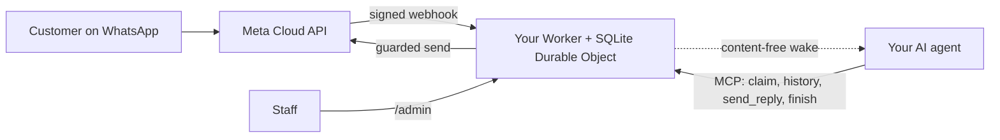

<div align="center">

[English](../../README.md) · [简体中文](README_zh.md) · [繁體中文](README_zh-TW.md) · [日本語](README_ja.md) · **한국어** · [Türkçe](README_tr.md) · [Русский](README_ru.md) · [Tiếng Việt](README_vi.md) · [ไทย](README_th.md) · [Deutsch](README_de.md) · [Español](README_es.md) · [Français](README_fr.md) · [Українська](README_uk.md) · [Polski](README_pl.md) · [Português (Brasil)](README_pt-BR.md) · [العربية](README_ar.md) · [فارسی](README_fa.md) · [Bahasa Indonesia](README_id.md) · [Italiano](README_it.md)
· [Ελληνικά](README_el.md)

</div>

<div align="center">

# WAB bot

### 하나의 사업체 WhatsApp 번호, MCP로 연결된 하나의 AI 에이전트, 당신의 Cloudflare 계정 위에서.

**작은 단일 테넌트 브리지입니다. 고객이 당신의 WhatsApp Cloud API 번호로 메시지를 보내면 에이전트가 보호된 도구를 통해 답하며, 어떤 것도 당신의 계정 밖으로 나가지 않습니다.**

[](../../LICENSE)
[](../STATUS.md)
[](../CLOUDFLARE.md)
[](../../THIRD_PARTY_NOTICES.md)
[](../../.github/workflows/ci.yml)

[빠른 시작](#빠른-시작) · [작동 방식](#작동-방식) · [할 수 있는 일](#할-수-있는-일) · [실제 예시](#실제-예시) · [자주 묻는 질문](#자주-묻는-질문) · [문서](#문서)

</div>

> [!IMPORTANT]
> 이 템플릿의 공식 소스는 [wabbot-dev/wab-bot](https://github.com/wabbot-dev/wab-bot)입니다.
> 저장소 이름이 비슷하거나 README가 복사되었다고 해서 그 코드가 공식이라는 근거가 되지는 않습니다. 배포하는 내용을 직접 읽어 보고,
> 작성자에게 주지 않을 토큰은 배포 스크립트나 어시스턴트에게도 주지 마세요.
> 이 프로젝트는 독립 프로젝트이며 Meta 또는 xAI와 제휴하거나 승인을 받은 것이 아닙니다. WhatsApp과 Grok은 각 소유자의 상표입니다.

> [!NOTE]
> **프리뷰.** 가짜 대상에 대해 로컬에서 테스트했습니다(자동화 테스트 285개). 이전 리비전은 일회용 Cloudflare Free 계정에서 실제로 실행했습니다. Meta의 무료 **테스트** 번호에서의 실제 증거: **문자 메시지**는 2026-10-16에 실제로 실행했고(실제 텍스트 왕복: 수신 메시지를 받고 브리지를 통해 답장을 보냄), **통화**는 2026-10-17에 이 저장소의 코드로 실제 실행했습니다(Grok Voice가 Meta SIP를 통해 xAI SIP에 연결): 걸려 온 WhatsApp 음성 통화를 AI가 받았고, 양방향으로 대화했으며(아랍어 포함), 양쪽의 대화 기록이 저장되었고, 모델의 `end_call`을 Worker가 처리했으며 xAI가 끊기 요청을 수락했고(HTTP 200), 통화 게이트가 활성화되었다가 자동으로 해제되었습니다. 비즈니스 인증을 마친 프로덕션 번호가 아니며, 오디오 녹음은 지원하지 않습니다. 이 프로젝트에서는 프로덕션에서 실행한 적이 없습니다. 메시징 설계는 파생된 원본 배포에서 프로덕션 검증을 거쳤다고 소유자가 보고했지만(소유자 보고, 날짜 미정), 이는 이 코드에 대한 증거가 아닙니다. 검증된 모든 것과 방법: [docs/STATUS.md](../STATUS.md).

---

고객이 당신 사업체의 WhatsApp 번호로 메시지를 보냅니다. Meta는 각 메시지를 **당신의 Cloudflare 계정**에 있는 Worker로 전달하고, Worker는 이를 저장한 뒤 AI 에이전트에게 내용이 없는 깨우기 신호를 보냅니다. 에이전트(MCP를 지원하는 모든 에이전트)는 대화를 확보(claim)하고 기록을 읽은 다음 `send_reply`로 답합니다. WhatsApp 토큰을 보관하고 모든 전송 가드를 적용하는 쪽은 에이전트가 아니라 브리지입니다. 직원은 `/admin`에서 대화를 일시 중지하거나, 인계받거나, 삭제할 수 있습니다.

사업체마다 하나의 배포: 자체 Meta 앱, 번호, 토큰, Cloudflare 계정을 사용합니다. 이 저장소에는 비밀 값이 없습니다.

## 빠른 시작

필요한 것: 직접 소유한 Cloudflare 계정, Node.js 20 이상(22 권장), Meta 개발자 계정과 WhatsApp Cloud API 설정([체크리스트](../META-CHECKLIST.md)), **어떤 WhatsApp 앱에도 등록된 적이 없는 새 번호**, 그리고 MCP를 사용할 수 있고 webhook으로 깨울 수 있는 에이전트([깨우기 루틴](../WAKE-ROUTINE.md)). Meta와 본인의 AI 요금제에는 직접 비용을 지불하며, 이 템플릿이 사용하는 범위에서는 Workers Free 요금제에 결제 수단이 필요하지 않습니다([한도 및 약관](../CLOUDFLARE.md)).

### 1. 오프라인으로 확인하기 (계정 불필요, 네트워크 불필요)

```bash
git clone https://github.com/wabbot-dev/wab-bot.git && cd wab-bot
npm ci
npm run check          # typecheck, 343 logic tests, 65 workerd tests, docs check
npm run build          # wrangler deploy --dry-run: bundle and binding check
npm run smoke:local    # wrangler dev --local with random fake secrets
```

### 2. 자신의 Cloudflare 계정에 배포하기

```bash
bash scripts/deploy-cloudflare.sh --dry-run                  # prints the plan, makes no call
bash scripts/deploy-cloudflare.sh --name my-business-wa      # lowercase letters, digits, dashes
```

스크립트는 `wrangler login --device`로 로그인하고(브라우저에서 코드를 승인하며, 계정은 만들지 않습니다), 배포하고, 브리지 자체의 토큰을 생성하며, stdin으로 비밀 값을 업로드합니다. 다른 경로(로그인 없는 Cloudflare API, 자체 프로비저닝 비밀 값)는 [docs/DEPLOY.md](../DEPLOY.md)에 있습니다. 설정은 서로 다른 2개 계정에서 실제로 검증되었습니다([상태](../STATUS.md)).

### 3. Meta와 에이전트 연결하기

[docs/META-CHECKLIST.md](../META-CHECKLIST.md)를 따르고(Meta 계정 생성, 사업체 인증, SMS 코드 입력은 직접 해야 합니다), 자신의 컴퓨터에서 `node scripts/meta-setup.mjs`를 실행한 다음, 에이전트가 `https://<worker>.<your-subdomain>.workers.dev/mcp`를 `Authorization: Bearer <MCP_TOKEN>`와 함께 사용하도록 설정하세요.

### 4. 메시지가 한 번 오갈 때까지 테스트 모드 유지하기

안전한 기본값: `LAUNCH_MODE=test`(답장은 `TEST_RECIPIENTS`에게만 갑니다), 자동 답장 **일시 중지**, 템플릿 꺼짐, Worker 내부 Meta 설정 라우트 꺼짐. 휴대폰에서 메시지를 하나 보내고, `/admin`에 도착하는 것을 확인하고, 에이전트가 답하게 한 다음, 그제야 의도적으로 실서비스를 시작하세요.

## 작동 방식



모든 webhook은 원본 본문에 대한 유효한 `X-Hub-Signature-256`을 가지고 있어야 합니다. 대화당 하나의 SQLite 행을 두어 요청을 서로 독립적으로 유지하며, 경합에서 진 요청은 다시 읽고 재시도합니다. 깨우기 POST는 ID와 카운터만 담고 메시지 텍스트는 절대 담지 않습니다. 경계와 소유권: [docs/ARCHITECTURE.md](../ARCHITECTURE.md). 저장, 보존, 깨우기: [docs/STATE-STORE.md](../STATE-STORE.md).

## 할 수 있는 일

| 기능 | 근거와 한계 |
|---|---|
| WhatsApp 텍스트를 수신해 대화별로 중복 제거하여 저장하고 HMAC 검증을 수행 | 로컬에서 테스트함. Meta 테스트 번호로 실제 메시지 한 건을 수신함([상태](../STATUS.md)) |
| MCP 에이전트 도구: `list_pending`, `claim_conversation`, `get_history`, `send_reply`(서버 측 가드 16개), `finish`, `release`, `escalate`, `get_controls`, 읽기 전용 `get_overview` | 로컬과 직접 JSON-RPC 호출로 테스트함. 실제 MCP 클라이언트로는 테스트하지 **않음**. Meta 테스트 번호에서 수동으로 실제 답장 한 건을 보냄 |
| 직원 콘솔: 자동 답장 일시 중지 및 재개, 인계, 해제, 재개방, 해결, 깨우기, 삭제 | 로컬에서 테스트함. 정적 페이지이며 토큰이 필요함 |
| 대화 하나 삭제(`DELETE /api/admin/conversations/<id>`) | 변이(mutation) 검사와 함께 로컬에서 테스트함. 실제로 실행한 적 없음. Cloudflare 복구용 사본에는 미치지 않음([개인정보](../PRIVACY.md)) |
| 에이전트 깨우기: 디바운스, 백오프, 매일 재시도 포함 | 대역 수신기를 상대로 실제 환경에서 검증함. 실제 에이전트 플랫폼을 상대로는 해본 적 없음 |
| 보존: 답장 완료된 채팅은 14일 후 정리, 모든 것은 180일 후 폐기 | 합성 데이터로 실제 환경에서 검증함. 실제 데이터로 몇 주에 걸쳐 해본 적 없음 |
| 값을 가리는 배포 도구를 위해 비밀 값을 한 번 자체 프로비저닝(`POST /api/setup`) | 테스트 Worker 하나에서 실제로 실행함. 시크릿 바인딩보다 약함([한계](../SELF-PROVISIONING.md)) |
| WhatsApp 음성 통화 응답(Meta SIP에서 xAI Grok Voice로), 소유자가 게이트를 열기 전까지 꺼져 있음. xAI 비용은 직접 부담하며 분당 약 $0.08 | **실제 실행**: 2026-10-17 Meta 테스트 번호에서 이 코드로 실행. AI가 응답했고, 양방향 대화, 양쪽 대화 기록 저장, 모델의 통화 종료 요청 처리. 비즈니스 인증을 마친 프로덕션 번호는 아님([음성](../VOICE-CALLS.md)) |
| 소유자 전용 관리 MCP(`/admin/mcp`): 상태, 설정 점검, 가려진 대화, 삭제, 통화 활성화·비활성화, 통화 로그, 사용량, 버전 및 업데이트 확인(도구 17개) | `ADMIN_MCP_TOKEN`을 설정하지 않으면 꺼져 있음. 로컬과 workerd에서 테스트함. 실제 MCP 클라이언트로는 **테스트하지 않음**([관리 MCP](../mcp.md)) |
| 음성 메시지, 이미지, 문서 이해: 음성 메시지는 받아쓰고(아랍어, 프랑스어, 영어 등), 이미지는 설명하며, PDF나 Office 문서는 본인 Cloudflare 계정의 Workers AI로 무료 일일 한도 안에서 읽습니다. 위치와 연락처 카드도 읽으며, 실패하면 에이전트에게 간단한 표시가 보입니다. 음성 메시지 답장(선택, 기본값 꺼짐): Workers AI로 6개 언어, 본인의 xAI 또는 ElevenLabs 키로 아랍어 및 기타 언어 | 로컬 테스트 완료. 테스트 Worker에서 소유자 자체 테스트 경로로 실제 실행, 실제 휴대전화로는 아직 미확인 ([미디어](../MEDIA.md)) |
| 선택형 비즈니스 기능: 개인 고객, 기업 고객 또는 둘 다 응대, 소유자가 관리하는 거래처 디렉터리, 소유자 즉시 알림, 답장에 문서·이미지·버튼·목록, 직원이 확인하는 결제, 예약·주문 연동 훅 | 로컬에서 테스트함. 아직 실환경에서 실행하지 않음 ([비즈니스 모드](../BUSINESS-MODE.md)) |

포함되지 않는 것: 동영상 이해(동영상은 기록만 하고 보지 않음), 그룹, 발신 통화, 오디오 녹음, 설정 페이지, 미리 만든 루틴, 멀티테넌트 호스팅. [docs/ROADMAP.md](../ROADMAP.md)를 참고하세요.

## 실제 예시

**MCP를 통한 고객 한 차례 응대**(자리 표시자만 사용했으며, 에이전트는 MCP 클라이언트를 통해 이를 수행합니다):

```bash
MCP=https://<worker>.<your-subdomain>.workers.dev/mcp
call() { curl -s "$MCP" -H "Authorization: Bearer $MCP_TOKEN" -H 'content-type: application/json' \
  -d "{\"jsonrpc\":\"2.0\",\"id\":1,\"method\":\"tools/call\",\"params\":{\"name\":\"$1\",\"arguments\":$2}}"; }
call list_pending '{}'
call claim_conversation '{"conversation_id":"c_<id>"}'                       # returns a lease
call get_history '{"conversation_id":"c_<id>","lease":"<lease>"}'            # customer text is wrapped as untrusted
call send_reply '{"conversation_id":"c_<id>","lease":"<lease>","text":"Hello, how can I help?"}'
call finish_conversation '{"conversation_id":"c_<id>","lease":"<lease>"}'
```

`LAUNCH_MODE=test`이거나 자동 답장이 일시 중지된 동안에는 `send_reply`가 전송하는 대신 `blocked_test_mode_recipient_not_allowlisted` 또는 `blocked_auto_reply_paused`로 응답합니다. 가드 순서와 모든 오류 문자열: [docs/CONFIGURATION.md](../CONFIGURATION.md).

**고객 한 명 삭제:**

```bash
curl -X DELETE -H "Authorization: Bearer $ADMIN_TOKEN" https://<worker>.<your-subdomain>.workers.dev/api/admin/conversations/c_<id>
# {"ok":true,"deleted":true}   (404 if unknown or already erased)
```

**모두 제거:** `bash scripts/teardown-cloudflare.sh`(Worker 이름을 입력하라고 요청하며, Worker와 저장된 모든 대화를 삭제하고 그 외에는 아무것도 삭제하지 않습니다).

## 자주 묻는 질문

**Cloudflare 계정은 누가 소유하나요?** 당신입니다. 약관에 동의하는 것도, 언젠가 비용을 낸다면 내는 것도, 삭제할 수 있는 것도 당신입니다. 어시스턴트는 당신의 서면 동의가 있고 당신이 소유자 또는 관리자로 지정된 경우에만 Cloudflare와 xAI 계정을 대신 만들 수 있으며, 카드는 직접 추가합니다. Meta 계정, 사업체 인증, SMS 코드는 항상 당신의 몫입니다([자세한 내용과 Cloudflare 약관 관련 유의점](../CLOUDFLARE.md)).

**사업체가 Free 요금제를 써도 되나요?** 2026-10-17에 읽은 Cloudflare 약관에서 Free 서비스에는 개인 사용 전용 조항이 없지만, 여기서 중요한 두 가지 제한이 있습니다(카드 정보 수집 금지, Cloudflare의 서면 동의 없이 보호 대상 건강 정보 취급 금지). 법률 자문이 아니므로 다시 확인하세요([상업적 사용](../CLOUDFLARE.md#commercial-use)).

**기존 WhatsApp Business 앱 번호를 쓸 수 있나요?** 아니요. Cloud API 번호는 WhatsApp 앱에 등록된 적이 없어야 하며, 공존(coexistence)은 범위 밖입니다. 자신의 SIM이나 회선을 준비하고 그 코드를 직접 입력하세요.

**전화에 응답하나요?** 네, 수신 전화만 가능하며 게이트를 열었을 때만 동작합니다. 통화는 기본적으로 꺼져 있고, 실제 번호에서는 비즈니스 인증이 끝나고 사용자가 시작하라고 말할 때까지 꺼진 상태로 있으며, 직접 활성화한 짧은 시간 창 동안만 동작합니다. 본인의 xAI 계정에서 xAI Grok Voice를 사용합니다(분당 약 $0.08). 2026-10-17에 이 코드가 Meta 테스트 번호에서 실제 수신 통화에 응답했습니다(양방향 대화, 대화 기록 저장). 비즈니스 인증을 마친 프로덕션 번호에서는 실행하지 않았고, 오디오 녹음은 지원하지 않습니다([음성](../VOICE-CALLS.md)).

**어떤 에이전트가 동작하나요?** HTTP로 MCP를 사용할 수 있고 webhook으로 깨울 수 있는 모든 에이전트입니다. 직접 JSON-RPC 호출로 테스트했으며, 실제 MCP 클라이언트로는 테스트하지 않았습니다([깨우기 루틴](../WAKE-ROUTINE.md)).

**어느 정도 물량을 감당하나요?** 단일 테넌트, Durable Object 하나: 소규모 사업체 규모입니다. 저희의 실측으로는 하루 약 30,000건의 메시지가 Free Durable Object 할당량에 들어갑니다. 한 대화에 동시에 많은 메시지가 오면 503이 반환될 수 있으며 Meta가 재전송합니다([상태](../STATUS.md#live-measurements-cloudflare-free-fake-secrets-2026-10-16)).

**프로덕션에서 검증되었나요?** 기반이 된 설계는 그렇다고 보고되었습니다(소유자 보고, 날짜 미정). 이 Cloudflare 포트는 그렇지 않습니다. 각 수준이 무엇을 의미하는지는 [상태](../STATUS.md)에 정확히 나와 있습니다.

## 한계와 좋은 사용법

- **독립 프로젝트.** WAB bot은 비공식입니다. Meta, WhatsApp, xAI와 제휴하지 않았고 이들의 승인을 받지도 않았습니다. WhatsApp과 Grok은 각 소유자의 상표입니다.
- **Meta의 규칙이 적용됩니다.** WhatsApp Cloud API 사용은 Meta의 약관, 메시징 정책, 번호별 규칙을 따르며, 비즈니스 번호에서 통화를 쓰려면 Meta 비즈니스 인증이 필요합니다.
- **봇 하나에 번호 하나.** 배포 한 번은 사업체 하나와 WhatsApp 번호 하나를 위한 것이며, 본인의 Meta 앱, 토큰, Cloudflare 계정을 사용합니다. 새 봇에 연결하려는 Meta 앱이 이미 다른 봇을 서비스하고 있으면, 설정은 아무것도 바꾸지 않고 같은 비즈니스 포트폴리오에 새 Meta 앱을 만들도록 안내합니다.
- **통화는 직접 켭니다.** 기본값은 꺼짐이며, 번호를 지정해 직접 열고, 통화에는 본인의 xAI 크레딧을 사용합니다(분당 약 $0.08).
- **수신 통화만, 오디오 녹음 없음.** 발신 통화와 오디오 녹음은 지원하지 않습니다. 텍스트 대화 기록은 기본으로 저장되며 끌 수 있습니다.
- **번호마다 SIP와 Graph 통화 API는 함께 쓸 수 없습니다.** 번호가 통화에 SIP를 사용하는 동안(이 봇이 그렇습니다) 그 번호에서는 Meta의 Graph 통화 엔드포인트를 쓸 수 없습니다.
- **대체 연락 경로를 두세요.** 전화나 이메일 같은 다른 연락 방법을 공개하고, 직원이 언제든 대화를 넘겨받을 수 있게 하세요.

지원하는 것과 지원하지 않는 것: [기능 목록](../CAPABILITIES.md). 실용적인 Q&A: [문제 해결](../TROUBLESHOOTING.md). 통화 상세: [음성](../VOICE-CALLS.md).

## 문서

[docs/index.md](../index.md)에 모든 페이지가 나열되어 있습니다. [STATUS](../STATUS.md)부터 시작한 다음 [DEPLOY](../DEPLOY.md), [META-CHECKLIST](../META-CHECKLIST.md), [CONFIGURATION](../CONFIGURATION.md), [PRIVACY](../PRIVACY.md), [TROUBLESHOOTING](../TROUBLESHOOTING.md) 순으로 읽으세요. 그 외: AI 코딩 에이전트를 위한 [AGENTS.md](../../AGENTS.md), [SECURITY.md](../../SECURITY.md), [CHANGELOG.md](../../CHANGELOG.md), [THIRD_PARTY_NOTICES.md](../../THIRD_PARTY_NOTICES.md).

## 면책 조항

이 소프트웨어는 합법적인 업무용 메시징을 위한 프리뷰 소프트웨어입니다. 배포, 자격 증명, 고객 데이터, 녹음 및 AI 고지 규칙, 그리고 Meta와 Cloudflare 약관에 대한 책임은 사용자에게 있습니다. 어떠한 보증도 없습니다. [DISCLAIMER.md](../../DISCLAIMER.md)를 읽어 주세요.

## 기여하기

범위가 분명한 수정, 문서 정정, 테스트를 환영합니다. 먼저 [기여 범위](../../CONTRIBUTING.md#contribution-scope)와 [PR 준비 규칙](../../CONTRIBUTING.md#pull-request-ownership-and-readiness)을 읽어 주세요. AI의 도움을 받은 PR에는 이름이 명시된 사람 담당자가 필요합니다. 보안 문제: [SECURITY.md](../../SECURITY.md).

## 라이선스

[MIT](../../LICENSE), Copyright (c) 2026 wabbot-dev.
