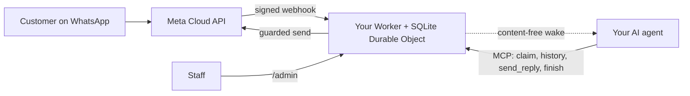

<div align="center">

[English](../../README.md) · [简体中文](README_zh.md) · [繁體中文](README_zh-TW.md) · [日本語](README_ja.md) · [한국어](README_ko.md) · [Türkçe](README_tr.md) · [Русский](README_ru.md) · [Tiếng Việt](README_vi.md) · [ไทย](README_th.md) · [Deutsch](README_de.md) · [Español](README_es.md) · [Français](README_fr.md) · [Українська](README_uk.md) · **Polski** · [Português (Brasil)](README_pt-BR.md) · [العربية](README_ar.md) · [فارسی](README_fa.md) · [Bahasa Indonesia](README_id.md) · [Italiano](README_it.md)
· [Ελληνικά](README_el.md)

</div>

<div align="center">

# WAB bot

### Numer WhatsApp jednej firmy, jeden agent AI przez MCP, na Twoim własnym koncie Cloudflare.

**Mały most dla jednego najemcy: klienci piszą na Twój numer WhatsApp Cloud API, Twój agent odpowiada za pomocą chronionych narzędzi, a nic nie opuszcza Twoich kont.**

[](../../LICENSE)
[](../STATUS.md)
[](../CLOUDFLARE.md)
[](../../THIRD_PARTY_NOTICES.md)
[](../../.github/workflows/ci.yml)

[Szybki start](#szybki-start) · [Jak to działa](#jak-to-działa) · [Co potrafi](#co-potrafi) · [Przykłady z praktyki](#przykłady-z-praktyki) · [FAQ](#faq) · [Dokumentacja](#dokumentacja)

</div>

> [!IMPORTANT]
> Oficjalnym źródłem tego szablonu jest [wabbot-dev/wab-bot](https://github.com/wabbot-dev/wab-bot).
> Podobna nazwa repozytorium lub skopiowany README nie dowodzą, że kod jest oficjalny. Czytaj to, co wdrażasz, i
> nigdy nie podawaj skryptowi wdrożeniowemu ani asystentowi tokenu, którego nie dałbyś jego autorowi.
> Ten projekt jest niezależny: nie jest powiązany z Meta ani xAI ani przez nie zatwierdzony. WhatsApp i Grok są znakami towarowymi ich właścicieli.

> [!NOTE]
> **Wersja zapoznawcza.** Przetestowano lokalnie na atrapach (335 testów automatycznych). Wcześniejsze rewizje działały na żywo na jednorazowym koncie Cloudflare Free. Dowody na żywo na bezpłatnym numerze **testowym** Meta: **wiadomości tekstowe** uruchomiono na żywo 2026-10-16 (prawdziwa wymiana tekstu: odebrano wiadomość przychodzącą i odpowiedź wyszła przez most), a **połączenia** 2026-10-17 z kodem z tego repozytorium (Grok Voice przez Meta SIP do xAI SIP): przychodzące połączenia głosowe WhatsApp odbierała sztuczna inteligencja, rozmowa toczyła się w obie strony (także po arabsku), zapisano transkrypcje obu stron, `end_call` modelu obsłużył Worker, a prośba o rozłączenie do xAI została przyjęta (HTTP 200), bramka połączeń uzbroiła się i sama rozbroiła. To nie jest numer produkcyjny zweryfikowany jako firma; nagrywanie dźwięku nie jest obsługiwane. Ten projekt nie uruchamiał go w produkcji. Właściciel zgłasza, że projekt obsługi wiadomości sprawdził się w produkcji we wdrożeniu, z którego pochodzi (zgłoszenie właściciela, data do ustalenia), co nie jest dowodem dla tego kodu. Wszystko, co zweryfikowano, i jak: [docs/STATUS.md](../STATUS.md).

---

Twoi klienci piszą na numer WhatsApp Twojej firmy. Meta dostarcza każdą wiadomość do Workera na **Twoim własnym koncie Cloudflare**, który ją zapisuje i wysyła Twojemu agentowi AI sygnał wybudzenia bez treści. Agent (dowolny agent obsługujący MCP) przejmuje rozmowę, czyta historię i odpowiada przez `send_reply`. To most, a nie agent, przechowuje token WhatsApp i egzekwuje każde zabezpieczenie wysyłki. Pracownicy mogą wstrzymać rozmowę, przejąć ją lub usunąć w `/admin`.

Jedno wdrożenie na firmę: własna aplikacja Meta, numer, tokeny i konto Cloudflare. W tym repozytorium nie ma żadnych sekretów.

## Szybki start

Potrzebujesz: konta Cloudflare, którego jesteś właścicielem, Node.js 20+ (zalecany 22), konta programisty Meta i konfiguracji WhatsApp Cloud API ([lista kontrolna](../META-CHECKLIST.md)), **nowego numeru, który nigdy nie był zarejestrowany w żadnej aplikacji WhatsApp**, oraz agenta, który potrafi korzystać z MCP i może być wybudzany przez webhook ([procedura wybudzania](../WAKE-ROUTINE.md)). Płacisz Meta i własnemu planowi AI bezpośrednio; plan Workers Free nie wymaga metody płatności dla tego, z czego korzysta ten szablon ([limity i warunki](../CLOUDFLARE.md)).

### 1. Sprawdź offline (bez konta, bez sieci)

```bash
git clone https://github.com/wabbot-dev/wab-bot.git && cd wab-bot
npm ci
npm run check          # typecheck, 293 logic tests, 65 workerd tests, docs check
npm run build          # wrangler deploy --dry-run: bundle and binding check
npm run smoke:local    # wrangler dev --local with random fake secrets
```

### 2. Wdróż na własnym koncie Cloudflare

```bash
bash scripts/deploy-cloudflare.sh --dry-run                  # prints the plan, makes no call
bash scripts/deploy-cloudflare.sh --name my-business-wa      # lowercase letters, digits, dashes
```

Skrypt loguje Cię poleceniem `wrangler login --device` (zatwierdzasz kod w przeglądarce; nigdy nie tworzy konta), wdraża, generuje własne tokeny mostu i przesyła sekrety przez stdin. Inne ścieżki (Cloudflare API bez logowania, samodzielnie przygotowane sekrety) opisano w [docs/DEPLOY.md](../DEPLOY.md). Konfigurację sprawdzono na żywo na 2 różnych kontach ([status](../STATUS.md)).

### 3. Połącz Meta i swojego agenta

Postępuj zgodnie z [docs/META-CHECKLIST.md](../META-CHECKLIST.md) (konta Meta zakładasz sam, sam weryfikujesz firmę i sam wpisujesz kod SMS), uruchom `node scripts/meta-setup.mjs` na własnym komputerze i skieruj agenta na `https://<worker>.<your-subdomain>.workers.dev/mcp` z nagłówkiem `Authorization: Bearer <MCP_TOKEN>`.

### 4. Pozostań w trybie testowym, dopóki wiadomość nie przejdzie drogi tam i z powrotem

Bezpieczne ustawienia domyślne: `LAUNCH_MODE=test` (odpowiedzi trafiają tylko do `TEST_RECIPIENTS`), automatyczna odpowiedź **wstrzymana**, szablony wyłączone, trasa konfiguracji Meta wewnątrz Workera wyłączona. Wyślij jedną wiadomość z telefonu, zobacz, jak pojawia się w `/admin`, pozwól agentowi odpowiedzieć i dopiero wtedy świadomie przejdź na tryb produkcyjny.

## Jak to działa



Każdy webhook musi zawierać prawidłowy `X-Hub-Signature-256` obliczony z surowej treści. Jeden wiersz SQLite na rozmowę zapewnia niezależność żądań; żądanie, które przegrało wyścig, odczytuje dane ponownie i ponawia próbę. POST wybudzający zawiera tylko identyfikatory i liczniki, nigdy treści wiadomości. Granice i odpowiedzialność: [docs/ARCHITECTURE.md](../ARCHITECTURE.md). Przechowywanie, retencja i wybudzanie: [docs/STATE-STORE.md](../STATE-STORE.md).

## Co potrafi

| Funkcja | Dowody i ograniczenia |
|---|---|
| Odbieranie tekstu WhatsApp i zapisywanie go według rozmów, z usuwaniem duplikatów i weryfikacją HMAC | Przetestowano lokalnie; jedną prawdziwą wiadomość odebrano na numerze testowym Meta ([status](../STATUS.md)) |
| Narzędzia agenta przez MCP: `list_pending`, `claim_conversation`, `get_history`, `send_reply` (16 zabezpieczeń po stronie serwera), `finish`, `release`, `escalate`, `get_controls`, `get_overview` tylko do odczytu | Przetestowano lokalnie i bezpośrednimi wywołaniami JSON-RPC; **nie** z prawdziwymi klientami MCP. Jedną prawdziwą odpowiedź wysłano na numerze testowym Meta, sterowaną ręcznie |
| Konsola pracowników: wstrzymywanie i wznawianie automatycznej odpowiedzi, przejmowanie, zwalnianie, ponowne otwieranie, zamykanie, wybudzanie, usuwanie | Przetestowano lokalnie. Statyczna strona, wymaga tokenu |
| Usunięcie jednej rozmowy (`DELETE /api/admin/conversations/<id>`) | Przetestowano lokalnie z kontrolami mutacji; nigdy nie uruchomiono na żywo. Nie obejmuje kopii odzyskiwania w Cloudflare ([prywatność](../PRIVACY.md)) |
| Wybudzanie Twojego agenta, z debounce, backoffem i codziennym ponowieniem | Zweryfikowano na żywo względem zastępczego odbiorcy; nigdy względem prawdziwej platformy agentów |
| Retencja: czaty z odpowiedzią są przycinane po 14 dniach, wszystko jest odrzucane po 180 dniach | Zweryfikowano na żywo na danych syntetycznych; nigdy przez tygodnie na prawdziwych danych |
| Jednorazowe samodzielne przygotowanie sekretów (`POST /api/setup`) dla narzędzi wdrożeniowych, które ukrywają wartości | Uruchomiono na żywo na jednym testowym Workerze; słabsze niż powiązanie sekretu ([ograniczenia](../SELF-PROVISIONING.md)) |
| Odbieranie połączeń głosowych WhatsApp (Meta SIP do xAI Grok Voice), wyłączone, dopóki właściciel nie otworzy bramki; płacisz xAI, około $0.08 za minutę | **Uruchomione na żywo** z tym kodem 2026-10-17 na numerze testowym Meta: odebrane przez sztuczną inteligencję, rozmowa w obie strony, transkrypcje obu stron zapisane, prośba modelu o zakończenie połączenia obsłużona; to nie numer produkcyjny zweryfikowany jako firma ([głos](../VOICE-CALLS.md)) |
| Administracyjny MCP tylko dla właściciela pod `/admin/mcp`: stan, kontrola konfiguracji, zredagowane rozmowy, usuwanie, włączanie i wyłączanie połączeń, dzienniki połączeń, zużycie, wersja i sprawdzanie aktualizacji (14 narzędzi) | Wyłączony, dopóki nie ustawisz `ADMIN_MCP_TOKEN`. Przetestowany lokalnie i w workerd; **nie** z prawdziwymi klientami MCP ([administracyjny MCP](../mcp.md)) |
| Rozumienie wiadomości głosowych i zdjęć: transkrypcja (arabski, francuski, angielski i inne) lub opis przez Workers AI na własnym koncie Cloudflare, w ramach darmowego dziennego limitu; przy każdym błędzie agent widzi prosty znacznik i prosi klienta o wpisanie tekstu; opcjonalne odpowiedzi wiadomością głosową po angielsku, francusku, hiszpańsku, chińsku, japońsku i koreańsku, domyślnie wyłączone | Przetestowane lokalnie; uruchomione na żywo przez trasę autotestu właściciela na testowym Workerze, jeszcze nie z prawdziwego telefonu ([media](../MEDIA.md)) |

Nie uwzględniono: rozumienia wideo i dokumentów, odpowiedzi głosowych po arabsku, grup, typów szablonów poza tekstem i parametrami treści, połączeń wychodzących, nagrywania dźwięku, strony ustawień, gotowych rutyn, hostingu wielodostępnego. Zobacz [docs/ROADMAP.md](../ROADMAP.md).

## Przykłady z praktyki

**Jedna tura klienta przez MCP** (wyłącznie symbole zastępcze; agent robi to przez swojego klienta MCP):

```bash
MCP=https://<worker>.<your-subdomain>.workers.dev/mcp
call() { curl -s "$MCP" -H "Authorization: Bearer $MCP_TOKEN" -H 'content-type: application/json' \
  -d "{\"jsonrpc\":\"2.0\",\"id\":1,\"method\":\"tools/call\",\"params\":{\"name\":\"$1\",\"arguments\":$2}}"; }
call list_pending '{}'
call claim_conversation '{"conversation_id":"c_<id>"}'                       # returns a lease
call get_history '{"conversation_id":"c_<id>","lease":"<lease>"}'            # customer text is wrapped as untrusted
call send_reply '{"conversation_id":"c_<id>","lease":"<lease>","text":"Hello, how can I help?"}'
call finish_conversation '{"conversation_id":"c_<id>","lease":"<lease>"}'
```

Gdy `LAUNCH_MODE=test` lub automatyczna odpowiedź jest wstrzymana, `send_reply` zamiast wysłać wiadomość odpowiada `blocked_test_mode_recipient_not_allowlisted` lub `blocked_auto_reply_paused`. Kolejność zabezpieczeń i każdy ciąg błędu: [docs/CONFIGURATION.md](../CONFIGURATION.md).

**Usunięcie jednego klienta:**

```bash
curl -X DELETE -H "Authorization: Bearer $ADMIN_TOKEN" https://<worker>.<your-subdomain>.workers.dev/api/admin/conversations/c_<id>
# {"ok":true,"deleted":true}   (404 if unknown or already erased)
```

**Usunięcie wszystkiego:** `bash scripts/teardown-cloudflare.sh` (prosi o wpisanie nazwy Workera; usuwa Workera i wszystkie zapisane rozmowy, nic więcej).

## FAQ

**Do kogo należy konto Cloudflare?** Do Ciebie: Ty akceptujesz warunki, Ty płacisz, jeśli kiedykolwiek będziesz płacić, i Ty możesz je usunąć. Asystent może założyć dla Ciebie konta Cloudflare i xAI tylko za Twoją pisemną zgodą i z ustanowieniem Ciebie właścicielem lub administratorem; kartę dodajesz sam. Konta Meta, weryfikacja firmy i kod SMS zawsze należą do Ciebie ([szczegóły i zastrzeżenie dotyczące warunków Cloudflare](../CLOUDFLARE.md)).

**Czy plan Free jest dozwolony dla firmy?** W warunkach Cloudflare przeczytanych 2026-10-17 usługi Free nie zawierają klauzuli „tylko do użytku osobistego”, ale mają dwa istotne tutaj ograniczenia (zakaz zbierania danych kart, zakaz chronionych informacji zdrowotnych bez pisemnej zgody Cloudflare). To nie jest porada prawna; sprawdź ponownie ([użytek komercyjny](../CLOUDFLARE.md#commercial-use)).

**Czy mogę użyć numeru z mojej istniejącej aplikacji WhatsApp Business?** Nie. Numer Cloud API nie może nigdy wcześniej być zarejestrowany w aplikacji WhatsApp; współistnienie (coexistence) jest poza zakresem. Użyj własnej karty SIM lub linii i sam wpisz jej kod.

**Czy odbiera połączenia?** Tak, tylko przychodzące i tylko gdy otworzysz bramkę: połączenia są domyślnie wyłączone, na prawdziwym numerze pozostają wyłączone, dopóki weryfikacja firmy nie zostanie ukończona i nie powiesz „start”, a działają w krótkich oknach, które sam włączasz. Używa xAI Grok Voice na Twoim własnym koncie xAI (około $0.08 za minutę). Połączenia z tym kodem odebrano na żywo na numerze testowym Meta 2026-10-17 (rozmowa w obie strony, transkrypcje zapisane); nie uruchamiano go na numerze produkcyjnym zweryfikowanym jako firma, a nagrywanie dźwięku nie jest obsługiwane ([głos](../VOICE-CALLS.md)).

**Który agent działa?** Dowolny agent, który potrafi używać MCP przez HTTP i może być wybudzany przez webhook. Przetestowano go bezpośrednimi wywołaniami JSON-RPC, nie prawdziwymi klientami MCP ([procedura wybudzania](../WAKE-ROUTINE.md)).

**Jaki wolumen obsłuży?** Jeden najemca, jeden Durable Object: wolumeny małej firmy. Według naszego pomiaru na żywo około 30 000 wiadomości dziennie mieści się w limicie Durable Object w planie Free; wiele jednoczesnych wiadomości w jednej rozmowie może zwrócić 503, a Meta dostarcza je ponownie ([status](../STATUS.md#live-measurements-cloudflare-free-fake-secrets-2026-10-16)).

**Czy sprawdziło się w produkcji?** Zgłaszano, że projekt, z którego pochodzi, tak (zgłoszone przez właściciela, data do ustalenia). Ten port na Cloudflare — nie. [Status](../STATUS.md) dokładnie mówi, co oznacza każdy poziom.

## Ograniczenia i dobre praktyki

- **Projekt niezależny.** WAB bot jest nieoficjalny: nie jest powiązany z Meta, WhatsApp ani xAI i nie jest przez nie wspierany. WhatsApp i Grok to znaki towarowe ich właścicieli.
- **Obowiązują zasady Meta.** Korzystanie z WhatsApp Cloud API podlega warunkom Meta, politykom wiadomości i zasadom dla każdego numeru, a połączenia na numerze firmowym wymagają weryfikacji firmy Meta.
- **Jeden numer na bota.** Jedno wdrożenie obsługuje jedną firmę i jeden numer WhatsApp, z własną aplikacją Meta, tokenami i kontem Cloudflare.
- **Połączenia włączasz Ty.** Są domyślnie wyłączone; otwierasz je, podając numer, a połączenia zużywają Twoje własne środki xAI (około $0.08 za minutę).
- **Tylko połączenia przychodzące, bez nagrywania dźwięku.** Połączenia wychodzące i nagrywanie dźwięku nie są obsługiwane. Transkrypcja tekstowa jest domyślnie zapisywana i możesz ją wyłączyć.
- **SIP i Graph API połączeń wykluczają się dla numeru.** Gdy numer używa SIP do połączeń, jak ten bot, punkty końcowe połączeń Graph Meta nie są na nim dostępne.
- **Zachowaj zapasową drogę kontaktu.** Podaj inny sposób kontaktu, na przykład telefon lub e-mail, i zadbaj, by pracownicy mogli przejąć każdą rozmowę.

Co jest obsługiwane, a co nie: [możliwości](../CAPABILITIES.md). Praktyczne odpowiedzi: [rozwiązywanie problemów](../TROUBLESHOOTING.md). Połączenia szczegółowo: [głos](../VOICE-CALLS.md).

## Dokumentacja

[docs/index.md](../index.md) wymienia wszystkie strony. Zacznij od [STATUS](../STATUS.md), potem [DEPLOY](../DEPLOY.md), [META-CHECKLIST](../META-CHECKLIST.md), [CONFIGURATION](../CONFIGURATION.md), [PRIVACY](../PRIVACY.md) i [TROUBLESHOOTING](../TROUBLESHOOTING.md). Ponadto: [AGENTS.md](../../AGENTS.md) dla agentów AI piszących kod, [SECURITY.md](../../SECURITY.md), [CHANGELOG.md](../../CHANGELOG.md), [THIRD_PARTY_NOTICES.md](../../THIRD_PARTY_NOTICES.md).

## Zastrzeżenie

To oprogramowanie w wersji podglądowej, przeznaczone do zgodnej z prawem komunikacji biznesowej. Odpowiadasz za swoje wdrożenie, dane uwierzytelniające, dane klientów, zasady nagrywania i ujawniania użycia AI oraz swoje warunki z Meta i Cloudflare. Bez gwarancji. Przeczytaj [DISCLAIMER.md](../../DISCLAIMER.md).

## Współtworzenie

Celowe poprawki, korekty dokumentacji i testy są mile widziane; najpierw przeczytaj [zakres wkładu](../../CONTRIBUTING.md#contribution-scope) i [zasady gotowości PR](../../CONTRIBUTING.md#pull-request-ownership-and-readiness). PR wspierane przez AI wymagają wskazanego z imienia i nazwiska człowieka odpowiedzialnego. Problemy z bezpieczeństwem: [SECURITY.md](../../SECURITY.md).

## Licencja

[MIT](../../LICENSE), Copyright (c) 2026 wabbot-dev.
