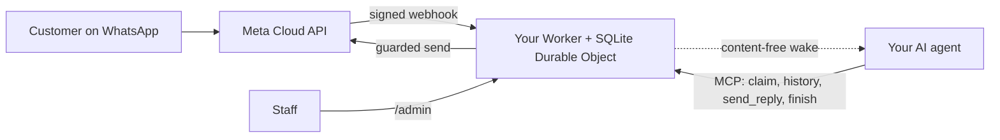

<div align="center">

[English](../../README.md) · [简体中文](README_zh.md) · [繁體中文](README_zh-TW.md) · [日本語](README_ja.md) · [한국어](README_ko.md) · [Türkçe](README_tr.md) · [Русский](README_ru.md) · [Tiếng Việt](README_vi.md) · [ไทย](README_th.md) · [Deutsch](README_de.md) · [Español](README_es.md) · [Français](README_fr.md) · [Українська](README_uk.md) · [Polski](README_pl.md) · **Português (Brasil)** · [العربية](README_ar.md) · [فارسی](README_fa.md) · [Bahasa Indonesia](README_id.md) · [Italiano](README_it.md)
· [Ελληνικά](README_el.md)

</div>

<div align="center">

# WAB bot

### O número de WhatsApp de um negócio, um agente de IA via MCP, na sua própria conta da Cloudflare.

**Uma ponte pequena, de inquilino único: os clientes mandam mensagem para o seu número do WhatsApp Cloud API, o seu agente responde por ferramentas protegidas, e nada sai das suas contas.**

[](../../LICENSE)
[](../STATUS.md)
[](../CLOUDFLARE.md)
[](../../THIRD_PARTY_NOTICES.md)
[](../../.github/workflows/ci.yml)

[Início rápido](#início-rápido) · [Como funciona](#como-funciona) · [O que ele faz](#o-que-ele-faz) · [Exemplos práticos](#exemplos-práticos) · [Perguntas frequentes](#perguntas-frequentes) · [Documentação](#documentação)

</div>

> [!IMPORTANT]
> A fonte oficial deste template é [wabbot-dev/wab-bot](https://github.com/wabbot-dev/wab-bot).
> Um nome de repositório parecido ou um README copiado não comprova que o código seja oficial. Leia o que você implanta e
> nunca dê a um script de deploy ou a um assistente um token que você não daria ao autor dele.
> Este projeto é independente: não é afiliado nem endossado pela Meta ou pela xAI. WhatsApp e Grok são marcas registradas de seus respectivos proprietários.

> [!NOTE]
> **Prévia.** Testado localmente contra simulações (407 testes automatizados). Revisões anteriores rodaram ao vivo em uma conta descartável do Cloudflare Free. Evidências ao vivo no número de **teste** gratuito da Meta: o **envio de texto** rodou ao vivo em 2026-10-16 (uma ida e volta real de texto: uma mensagem recebida chegou e uma resposta voltou pela ponte), e as **chamadas** rodaram ao vivo em 2026-10-17 com o código deste repositório (Grok Voice sobre Meta SIP para xAI SIP): chamadas de voz recebidas no WhatsApp foram atendidas pela IA, a conversa foi nos dois sentidos (inclusive em árabe), as transcrições dos dois lados foram guardadas, o `end_call` do modelo foi tratado pelo Worker e o pedido de desligar à xAI foi aceito (HTTP 200), e a comporta de chamadas foi armada e desarmou sozinha. Não é um número de produção verificado como empresa; não há suporte a gravação de áudio. Não executado por este projeto em produção. O proprietário relata que o desenho de mensagens foi comprovado em produção na implantação da qual deriva (relato do proprietário, data a definir), o que não é evidência para este código. Tudo o que foi verificado e como: [docs/STATUS.md](../STATUS.md).

---

Seus clientes escrevem para o número de WhatsApp do seu negócio. A Meta entrega cada mensagem a um Worker na **sua própria conta da Cloudflare**, que a armazena e envia ao seu agente de IA um aviso de despertar sem conteúdo. O agente (qualquer agente compatível com MCP) assume a conversa, lê o histórico e responde por `send_reply`. Quem guarda o token do WhatsApp e aplica todas as proteções de envio é a ponte, não o agente. A equipe pode pausar, assumir ou apagar uma conversa em `/admin`.

Um deployment por negócio: seu próprio app da Meta, número, tokens e conta da Cloudflare. Não há segredos neste repositório.

## Início rápido

Você precisa de: uma conta da Cloudflare que seja sua, Node.js 20+ (22 recomendado), uma conta de desenvolvedor da Meta e a configuração do WhatsApp Cloud API ([checklist](../META-CHECKLIST.md)), um **número novo nunca registrado em nenhum app do WhatsApp** e um agente que consiga usar MCP e ser despertado por um webhook ([rotina de despertar](../WAKE-ROUTINE.md)). Você paga diretamente à Meta e ao seu próprio plano de IA; o plano Workers Free não exige forma de pagamento para o que este template usa ([limites e termos](../CLOUDFLARE.md)).

### 1. Verifique offline (sem conta, sem rede)

```bash
git clone https://github.com/wabbot-dev/wab-bot.git && cd wab-bot
npm ci
npm run check          # typecheck, 343 logic tests, 65 workerd tests, docs check
npm run build          # wrangler deploy --dry-run: bundle and binding check
npm run smoke:local    # wrangler dev --local with random fake secrets
```

### 2. Faça o deploy na sua própria conta da Cloudflare

```bash
bash scripts/deploy-cloudflare.sh --dry-run                  # prints the plan, makes no call
bash scripts/deploy-cloudflare.sh --name my-business-wa      # lowercase letters, digits, dashes
```

O script faz o login com `wrangler login --device` (você aprova um código no navegador; ele nunca cria uma conta), faz o deploy, gera os tokens próprios da ponte e envia os segredos por stdin. Outras rotas (API da Cloudflare sem login, segredos autoprovisionados) estão em [docs/DEPLOY.md](../DEPLOY.md). A configuração foi comprovada ao vivo em 2 contas diferentes ([status](../STATUS.md)).

### 3. Conecte a Meta e o seu agente

Siga [docs/META-CHECKLIST.md](../META-CHECKLIST.md) (você cria as contas da Meta, verifica o seu negócio e digita o código SMS), execute `node scripts/meta-setup.mjs` no seu próprio computador e aponte o seu agente para `https://<worker>.<your-subdomain>.workers.dev/mcp` com `Authorization: Bearer <MCP_TOKEN>`.

### 4. Fique em modo de teste até uma mensagem fazer o caminho de ida e volta

Padrões seguros: `LAUNCH_MODE=test` (as respostas vão apenas para `TEST_RECIPIENTS`), resposta automática **pausada**, templates desativados, a rota de configuração da Meta dentro do Worker desativada. Envie uma mensagem do seu celular, veja-a chegar em `/admin`, deixe o agente responder e só então entre em produção, de forma deliberada.

## Como funciona



Todo webhook deve trazer um `X-Hub-Signature-256` válido sobre o corpo bruto. Uma linha SQLite por conversa mantém as requisições independentes; uma corrida perdida relê e tenta de novo. O POST de despertar carrega apenas ids e contadores, nunca o texto das mensagens. Limites e responsabilidades: [docs/ARCHITECTURE.md](../ARCHITECTURE.md). Armazenamento, retenção e despertar: [docs/STATE-STORE.md](../STATE-STORE.md).

## O que ele faz

| Capacidade | Evidência e limites |
|---|---|
| Receber texto do WhatsApp e armazená-lo por conversa, sem duplicatas, com verificação HMAC | Testado localmente; uma mensagem real recebida no número de teste da Meta ([status](../STATUS.md)) |
| Ferramentas do agente via MCP: `list_pending`, `claim_conversation`, `get_history`, `send_reply` (16 proteções no servidor), `finish`, `release`, `escalate`, `get_controls`, `get_overview` somente leitura | Testado localmente e com chamadas JSON-RPC diretas; **não** com clientes MCP reais. Uma resposta real enviada no número de teste da Meta, conduzida manualmente |
| Console da equipe: pausar e retomar a resposta automática, assumir, liberar, reabrir, resolver, despertar, apagar | Testado localmente. Página estática, exige token |
| Apagar uma conversa (`DELETE /api/admin/conversations/<id>`) | Testado localmente com verificações de mutação; nunca executado ao vivo. Não alcança as cópias de recuperação da Cloudflare ([privacidade](../PRIVACY.md)) |
| Despertar o seu agente, com debounce, backoff e uma nova tentativa diária | Verificado ao vivo contra um receptor substituto; nunca contra uma plataforma de agentes real |
| Retenção: conversas respondidas são reduzidas aos 14 dias, tudo é descartado aos 180 dias | Verificado ao vivo com dados sintéticos; nunca por semanas com dados reais |
| Autoprovisionar segredos uma vez (`POST /api/setup`) para ferramentas de deploy que ocultam valores | Executado ao vivo em um Worker de teste; mais fraco que um secret binding ([limites](../SELF-PROVISIONING.md)) |
| Atender chamadas de voz do WhatsApp (Meta SIP para xAI Grok Voice), desligado até o proprietário abrir a comporta; você paga à xAI, cerca de $0.08 por minuto | **Rodou ao vivo** com este código em 2026-10-17 no número de teste da Meta: atendido pela IA, conversa nos dois sentidos, transcrições dos dois lados guardadas, pedido de fim de chamada do modelo tratado; não é um número de produção verificado como empresa ([voz](../VOICE-CALLS.md)) |
| MCP de administração só para o proprietário em `/admin/mcp`: status, verificação de configuração, conversas ocultadas, exclusão, armar e desarmar chamadas, registros de chamadas, uso, versão e verificação de atualização (17 ferramentas) | Desligado, a menos que `ADMIN_MCP_TOKEN` seja definido. Testado localmente e no workerd; **não** com clientes MCP reais ([MCP de administração](../mcp.md)) |
| Entender mensagens de voz, imagens e documentos: mensagens de voz transcritas (árabe, francês, inglês e outros), imagens descritas e documentos PDF ou Office lidos com Workers AI na sua própria conta Cloudflare, dentro da cota diária gratuita; localizações e cartões de contato lidos; em qualquer falha o agente vê um marcador simples. Respostas opcionais em áudio, desligadas por padrão: seis idiomas com Workers AI, árabe e outros idiomas com sua própria chave xAI ou ElevenLabs | Testado localmente; executado ao vivo pela rota de autoteste do proprietário em um Worker de teste, ainda não de um telefone real ([mídia](../MEDIA.md)) |
| Recursos de negócio opcionais: atender consumidores, empresas ou ambos; um diretório de contas mantido pelo dono; alertas imediatos ao dono; documentos, imagens, botões e listas nas respostas; pagamentos verificados pela equipe; um gancho para reservas e pedidos | Testado localmente; ainda não executado ao vivo ([modo empresa](../BUSINESS-MODE.md)) |

Não incluído: compreensão de vídeo (um vídeo é registrado, não assistido), grupos, chamadas de saída, gravação de áudio, uma página de configurações, rotinas predefinidas, hospedagem multilocatário. Veja [docs/ROADMAP.md](../ROADMAP.md).

## Exemplos práticos

**Um turno de cliente via MCP** (apenas marcadores de posição; o agente faz isso pelo seu cliente MCP):

```bash
MCP=https://<worker>.<your-subdomain>.workers.dev/mcp
call() { curl -s "$MCP" -H "Authorization: Bearer $MCP_TOKEN" -H 'content-type: application/json' \
  -d "{\"jsonrpc\":\"2.0\",\"id\":1,\"method\":\"tools/call\",\"params\":{\"name\":\"$1\",\"arguments\":$2}}"; }
call list_pending '{}'
call claim_conversation '{"conversation_id":"c_<id>"}'                       # returns a lease
call get_history '{"conversation_id":"c_<id>","lease":"<lease>"}'            # customer text is wrapped as untrusted
call send_reply '{"conversation_id":"c_<id>","lease":"<lease>","text":"Hello, how can I help?"}'
call finish_conversation '{"conversation_id":"c_<id>","lease":"<lease>"}'
```

Enquanto `LAUNCH_MODE=test` estiver ativo ou a resposta automática estiver pausada, `send_reply` responde `blocked_test_mode_recipient_not_allowlisted` ou `blocked_auto_reply_paused` em vez de enviar. A ordem das proteções e cada string de erro: [docs/CONFIGURATION.md](../CONFIGURATION.md).

**Apagar um cliente:**

```bash
curl -X DELETE -H "Authorization: Bearer $ADMIN_TOKEN" https://<worker>.<your-subdomain>.workers.dev/api/admin/conversations/c_<id>
# {"ok":true,"deleted":true}   (404 if unknown or already erased)
```

**Remover tudo:** `bash scripts/teardown-cloudflare.sh` (pede que você digite o nome do Worker; apaga o Worker e todas as conversas armazenadas, nada mais).

## Perguntas frequentes

**Quem é o dono da conta da Cloudflare?** Você: você aceita os termos, paga se algum dia pagar e pode excluí-la. Um assistente só pode criar as contas da Cloudflare e da xAI para você com o seu consentimento por escrito e deixando você como proprietário ou administrador; o cartão você mesmo adiciona. As contas da Meta, a verificação do negócio e o código SMS são sempre seus ([detalhes e a ressalva sobre os termos da Cloudflare](../CLOUDFLARE.md)).

**O plano Free é permitido para um negócio?** Nos termos da Cloudflare lidos em 2026-10-17, os serviços Free não têm cláusula de uso exclusivamente pessoal, mas têm duas restrições que importam aqui (sem coleta de dados de cartão, sem informações de saúde protegidas sem o consentimento por escrito da Cloudflare). Não é aconselhamento jurídico; confira de novo ([uso comercial](../CLOUDFLARE.md#commercial-use)).

**Posso usar o número do meu app WhatsApp Business atual?** Não. O número da Cloud API nunca pode ter sido registrado em um app do WhatsApp; a coexistência está fora do escopo. Traga o seu próprio chip ou linha e digite você mesmo o código dele.

**Ele atende chamadas?** Sim, só receber, e só quando você abrir a comporta: as chamadas vêm desligadas, continuam desligadas em um número real até a sua verificação de empresa terminar e você mandar começar, e funcionam em janelas curtas que você arma. Usa o xAI Grok Voice na sua própria conta xAI (cerca de $0.08 por minuto). Chamadas com este código foram atendidas ao vivo no número de teste da Meta em 2026-10-17 (conversa nos dois sentidos, transcrições guardadas); não rodou em um número de produção verificado como empresa e não há suporte a gravação de áudio ([voz](../VOICE-CALLS.md)).

**Qual agente funciona?** Qualquer agente que fale MCP por HTTP e possa ser despertado por um webhook. Foi testado com chamadas JSON-RPC diretas, não com clientes MCP reais ([rotina de despertar](../WAKE-ROUTINE.md)).

**Quanto volume aguenta?** Inquilino único, um Durable Object: volumes de pequeno negócio. Pela nossa medição ao vivo, cerca de 30.000 mensagens por dia cabem na cota gratuita de Durable Objects; muitas mensagens simultâneas em uma conversa podem retornar 503, e a Meta reentrega ([status](../STATUS.md#live-measurements-cloudflare-free-fake-secrets-2026-10-16)).

**Está comprovado em produção?** Relata-se que o design do qual deriva esteja (relatado pelo proprietário, data a definir). Este port para a Cloudflare não está. O [status](../STATUS.md) diz exatamente o que cada nível significa.

## Limites e boas práticas

- **Projeto independente.** O WAB bot é não oficial: não é afiliado nem endossado por Meta, WhatsApp ou xAI. WhatsApp e Grok são marcas de seus respectivos proprietários.
- **As regras da Meta se aplicam.** O uso da WhatsApp Cloud API segue os termos, as políticas de mensagens e as regras por número da Meta, e chamadas em um número comercial exigem a Verificação de Empresa da Meta.
- **Um número por bot.** Uma implantação atende uma empresa e um número de WhatsApp, com seu próprio app da Meta, tokens e conta Cloudflare. Se o app da Meta para o qual você aponta um novo bot já atende outro bot, a configuração não altera nada e pede que você crie um novo app da Meta no mesmo portfólio empresarial.
- **Quem liga as chamadas é você.** Vêm desligadas; você as abre informando o número, e elas usam seus próprios créditos da xAI (cerca de $0.08 por minuto).
- **Só chamadas recebidas, sem gravação de áudio.** Chamadas feitas e gravação de áudio não são suportadas. Uma transcrição em texto é guardada por padrão e você pode desligá-la.
- **SIP e a API de chamadas do Graph são mutuamente exclusivos por número.** Enquanto um número usa SIP para chamadas, como este bot, os endpoints de chamadas do Graph da Meta não estão disponíveis nele.
- **Mantenha um canal de contato alternativo.** Divulgue outra forma de falar com você, como telefone ou e-mail, e deixe a equipe apta a assumir qualquer conversa.

O que é suportado e o que não é: [capacidades](../CAPABILITIES.md). Respostas práticas: [solução de problemas](../TROUBLESHOOTING.md). As chamadas em detalhe: [voz](../VOICE-CALLS.md).

## Documentação

[docs/index.md](../index.md) lista todas as páginas. Comece por [STATUS](../STATUS.md), depois [DEPLOY](../DEPLOY.md), [META-CHECKLIST](../META-CHECKLIST.md), [CONFIGURATION](../CONFIGURATION.md), [PRIVACY](../PRIVACY.md) e [TROUBLESHOOTING](../TROUBLESHOOTING.md). Também: [AGENTS.md](../../AGENTS.md) para agentes de programação com IA, [SECURITY.md](../../SECURITY.md), [CHANGELOG.md](../../CHANGELOG.md), [THIRD_PARTY_NOTICES.md](../../THIRD_PARTY_NOTICES.md).

## Aviso legal

Este é um software em prévia para mensagens comerciais lícitas. Você é responsável pelo seu deployment, pelas suas credenciais, pelos dados dos seus clientes, pelas regras de gravação e de divulgação do uso de IA e pelos seus termos com a Meta e a Cloudflare. Sem garantia. Leia [DISCLAIMER.md](../../DISCLAIMER.md).

## Contribuindo

Correções pontuais, correções de documentação e testes são bem-vindos; leia primeiro o [escopo das contribuições](../../CONTRIBUTING.md#contribution-scope) e as [regras de prontidão de PR](../../CONTRIBUTING.md#pull-request-ownership-and-readiness). PRs com auxílio de IA precisam de um responsável humano identificado. Problemas de segurança: [SECURITY.md](../../SECURITY.md).

## Licença

[MIT](../../LICENSE), Copyright (c) 2026 wabbot-dev.
