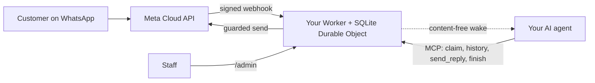

<div align="center">

[English](../../README.md) · [简体中文](README_zh.md) · [繁體中文](README_zh-TW.md) · [日本語](README_ja.md) · [한국어](README_ko.md) · [Türkçe](README_tr.md) · **Русский** · [Tiếng Việt](README_vi.md) · [ไทย](README_th.md) · [Deutsch](README_de.md) · [Español](README_es.md) · [Français](README_fr.md) · [Українська](README_uk.md) · [Polski](README_pl.md) · [Português (Brasil)](README_pt-BR.md) · [العربية](README_ar.md) · [فارسی](README_fa.md) · [Bahasa Indonesia](README_id.md) · [Italiano](README_it.md)
· [Ελληνικά](README_el.md)

</div>

<div align="center">

# WAB bot

### WhatsApp-номер одного бизнеса, один ИИ-агент по MCP, в вашем собственном аккаунте Cloudflare.

**Небольшой мост для одного арендатора: клиенты пишут на ваш номер WhatsApp Cloud API, ваш агент отвечает через защищённые инструменты, и ничего не покидает ваши аккаунты.**

[](../../LICENSE)
[](../STATUS.md)
[](../CLOUDFLARE.md)
[](../../THIRD_PARTY_NOTICES.md)
[](../../.github/workflows/ci.yml)

[Быстрый старт](#быстрый-старт) · [Как это работает](#как-это-работает) · [Что умеет](#что-умеет) · [Практические примеры](#практические-примеры) · [FAQ](#faq) · [Документация](#документация)

</div>

> [!IMPORTANT]
> Официальный источник этого шаблона — [wabbot-dev/wab-bot](https://github.com/wabbot-dev/wab-bot).
> Похожее название репозитория или скопированный README не доказывают, что код официальный. Читайте то, что вы разворачиваете, и
> никогда не передавайте скрипту развёртывания или ассистенту токен, который вы не отдали бы его автору.
> Этот проект независим: он не связан с Meta или xAI и не одобрен ими. WhatsApp и Grok — товарные знаки их владельцев.

> [!NOTE]
> **Предварительная версия.** Протестировано локально на имитациях (407 автоматических тестов). Ранние ревизии работали вживую на одноразовой учётной записи Cloudflare Free. Живые подтверждения на бесплатном **тестовом** номере Meta: **текстовые сообщения** проверены вживую 2026-10-16 (реальный обмен текстом: входящее сообщение получено, ответ ушёл через мост), а **звонки** — 2026-10-17 на коде этого репозитория (Grok Voice через Meta SIP к xAI SIP): входящие голосовые звонки WhatsApp принимал ИИ, разговор шёл в обе стороны (в том числе на арабском), транскрипты обеих сторон сохранялись, `end_call` модели обработан Worker, запрос xAI на завершение звонка принят (HTTP 200), шлюз звонков включился и сам отключился. Это не номер, прошедший верификацию бизнеса, для продакшена; запись аудио не поддерживается. Проект не запускался в продакшене. По сообщению владельца, дизайн обмена сообщениями проверен в продакшене в развёртывании, от которого он произошёл (со слов владельца, дата уточняется); для этого кода это не доказательство. Всё проверенное и способ проверки: [docs/STATUS.md](../STATUS.md).

---

Ваши клиенты пишут на WhatsApp-номер вашего бизнеса. Meta доставляет каждое сообщение в Worker в **вашем собственном аккаунте Cloudflare**, который сохраняет его и отправляет вашему ИИ-агенту уведомление-пробуждение без содержимого. Агент (любой агент с поддержкой MCP) берёт диалог в работу, читает историю и отвечает через `send_reply`. Токен WhatsApp хранит и все защиты отправки применяет мост, а не агент. Сотрудники могут приостановить диалог, перехватить его или удалить в `/admin`.

Одно развёртывание на один бизнес: своё приложение Meta, свой номер, свои токены и свой аккаунт Cloudflare. В этом репозитории нет секретов.

## Быстрый старт

Вам понадобятся: принадлежащий вам аккаунт Cloudflare, Node.js 20+ (рекомендуется 22), аккаунт разработчика Meta и настроенный WhatsApp Cloud API ([чек-лист](../META-CHECKLIST.md)), **новый номер, никогда не регистрировавшийся ни в одном приложении WhatsApp**, а также агент, который умеет работать с MCP и пробуждается по webhook ([процедура пробуждения](../WAKE-ROUTINE.md)). Вы платите Meta и своему тарифу ИИ напрямую; для того, что использует этот шаблон, тарифу Workers Free не нужен способ оплаты ([лимиты и условия](../CLOUDFLARE.md)).

### 1. Проверьте офлайн (без аккаунта, без сети)

```bash
git clone https://github.com/wabbot-dev/wab-bot.git && cd wab-bot
npm ci
npm run check          # typecheck, 342 logic tests, 65 workerd tests, docs check
npm run build          # wrangler deploy --dry-run: bundle and binding check
npm run smoke:local    # wrangler dev --local with random fake secrets
```

### 2. Разверните в собственном аккаунте Cloudflare

```bash
bash scripts/deploy-cloudflare.sh --dry-run                  # prints the plan, makes no call
bash scripts/deploy-cloudflare.sh --name my-business-wa      # lowercase letters, digits, dashes
```

Скрипт входит в аккаунт командой `wrangler login --device` (вы подтверждаете код в браузере; аккаунт он никогда не создаёт), выполняет развёртывание, генерирует собственные токены моста и загружает секреты через stdin. Другие способы (Cloudflare API без входа, самостоятельно выданные секреты) описаны в [docs/DEPLOY.md](../DEPLOY.md). Настройка проверена вживую на 2 разных аккаунтах ([статус](../STATUS.md)).

### 3. Подключите Meta и своего агента

Следуйте [docs/META-CHECKLIST.md](../META-CHECKLIST.md) (аккаунты Meta вы создаёте сами, сами подтверждаете бизнес и сами вводите SMS-код), выполните `node scripts/meta-setup.mjs` на своём компьютере и направьте агента на `https://<worker>.<your-subdomain>.workers.dev/mcp` с заголовком `Authorization: Bearer <MCP_TOKEN>`.

### 4. Оставайтесь в тестовом режиме, пока сообщение не пройдёт путь туда и обратно

Безопасные значения по умолчанию: `LAUNCH_MODE=test` (ответы уходят только на `TEST_RECIPIENTS`), автоответ **приостановлен**, шаблоны выключены, маршрут настройки Meta внутри Worker выключен. Отправьте одно сообщение со своего телефона, убедитесь, что оно появилось в `/admin`, позвольте агенту ответить и только после этого осознанно переходите в рабочий режим.

## Как это работает



Каждый webhook должен нести действительный `X-Hub-Signature-256` по исходному телу запроса. Одна строка SQLite на диалог сохраняет независимость запросов; проигравший гонку запрос перечитывает данные и повторяет попытку. POST-пробуждение несёт только идентификаторы и счётчики, но никогда не текст сообщений. Границы и владение: [docs/ARCHITECTURE.md](../ARCHITECTURE.md). Хранение, срок хранения и пробуждение: [docs/STATE-STORE.md](../STATE-STORE.md).

## Что умеет

| Возможность | Подтверждение и ограничения |
|---|---|
| Приём текста WhatsApp и хранение по диалогам с дедупликацией и проверкой HMAC | Протестировано локально; одно реальное сообщение получено на тестовый номер Meta ([статус](../STATUS.md)) |
| Инструменты агента по MCP: `list_pending`, `claim_conversation`, `get_history`, `send_reply` (16 серверных защит), `finish`, `release`, `escalate`, `get_controls`, `get_overview` (только чтение) | Протестировано локально и прямыми вызовами JSON-RPC; с реальными клиентами MCP **не** тестировалось. Один реальный ответ отправлен на тестовом номере Meta, вручную |
| Консоль сотрудников: приостановка и возобновление автоответа, перехват, освобождение, повторное открытие, закрытие, пробуждение, удаление | Протестировано локально. Статическая страница, нужен токен |
| Удаление одного диалога (`DELETE /api/admin/conversations/<id>`) | Протестировано локально с проверками мутаций; вживую никогда не запускалось. Не затрагивает копии для восстановления в Cloudflare ([конфиденциальность](../PRIVACY.md)) |
| Пробуждение вашего агента с debounce, отсрочкой повторов (backoff) и ежедневной повторной попыткой | Проверено вживую на подменном приёмнике; с реальной платформой агентов — никогда |
| Хранение: чаты с ответом сокращаются через 14 дней, всё остальное удаляется через 180 дней | Проверено вживую на синтетических данных; на реальных данных в течение недель — никогда |
| Однократная самостоятельная выдача секретов (`POST /api/setup`) для инструментов развёртывания, скрывающих значения | Запускалось вживую на одном тестовом Worker; слабее привязки секрета ([ограничения](../SELF-PROVISIONING.md)) |
| Ответ на голосовые звонки WhatsApp (Meta SIP → xAI Grok Voice), выключено, пока владелец не откроет шлюз; вы платите xAI, около $0.08 в минуту | **Проверено вживую** на этом коде: 2026-10-17 на тестовом номере Meta: ответил ИИ, разговор в обе стороны, транскрипты обеих сторон сохранены, запрос модели на завершение звонка обработан; не номер, прошедший верификацию бизнеса, для продакшена ([голос](../VOICE-CALLS.md)) |
| Административный MCP только для владельца по адресу `/admin/mcp`: статус, проверка настройки, скрытые диалоги, удаление, включение и отключение звонков, журналы звонков, расход, версия и проверка обновлений (17 инструментов) | Выключен, пока не задан `ADMIN_MCP_TOKEN`. Протестирован локально и в workerd; **не** проверялся с настоящими MCP-клиентами ([административный MCP](../mcp.md)) |
| Понимание голосовых, изображений и документов: голосовые сообщения расшифровываются (арабский, французский, английский и другие), изображения описываются, а документы PDF и Office читаются с помощью Workers AI в вашем собственном аккаунте Cloudflare в рамках бесплатной дневной квоты; геолокации и карточки контактов читаются; при любой ошибке агент видит простую пометку. Необязательные ответы голосовыми, по умолчанию выключены: шесть языков с Workers AI, арабский и другие языки с вашим ключом xAI или ElevenLabs | Проверено локально; запущено вживую через маршрут самопроверки владельца на тестовом Worker, ещё не с реального телефона ([медиа](../MEDIA.md)) |
| Необязательные бизнес-функции: обслуживание частных клиентов, компаний или тех и других; справочник аккаунтов, который ведёт владелец; мгновенные оповещения владельцу; документы, изображения, кнопки и списки в ответах; платежи, проверяемые сотрудниками; интеграция для бронирований и заказов | Проверено локально; вживую ещё не запускалось ([бизнес-режим](../BUSINESS-MODE.md)) |

Не включено: понимание видео (видео отмечается, но не просматривается), группы, исходящие звонки, запись звука, страница настроек, готовые сценарии, мультитенантный хостинг. См. [docs/ROADMAP.md](../ROADMAP.md).

## Практические примеры

**Один ход клиента по MCP** (только заполнители; агент делает это через свой MCP-клиент):

```bash
MCP=https://<worker>.<your-subdomain>.workers.dev/mcp
call() { curl -s "$MCP" -H "Authorization: Bearer $MCP_TOKEN" -H 'content-type: application/json' \
  -d "{\"jsonrpc\":\"2.0\",\"id\":1,\"method\":\"tools/call\",\"params\":{\"name\":\"$1\",\"arguments\":$2}}"; }
call list_pending '{}'
call claim_conversation '{"conversation_id":"c_<id>"}'                       # returns a lease
call get_history '{"conversation_id":"c_<id>","lease":"<lease>"}'            # customer text is wrapped as untrusted
call send_reply '{"conversation_id":"c_<id>","lease":"<lease>","text":"Hello, how can I help?"}'
call finish_conversation '{"conversation_id":"c_<id>","lease":"<lease>"}'
```

Пока действует `LAUNCH_MODE=test` или автоответ приостановлен, `send_reply` вместо отправки отвечает `blocked_test_mode_recipient_not_allowlisted` или `blocked_auto_reply_paused`. Порядок защит и все строки ошибок: [docs/CONFIGURATION.md](../CONFIGURATION.md).

**Удаление одного клиента:**

```bash
curl -X DELETE -H "Authorization: Bearer $ADMIN_TOKEN" https://<worker>.<your-subdomain>.workers.dev/api/admin/conversations/c_<id>
# {"ok":true,"deleted":true}   (404 if unknown or already erased)
```

**Удалить всё:** `bash scripts/teardown-cloudflare.sh` (просит ввести имя Worker; удаляет Worker и все сохранённые диалоги, больше ничего).

## FAQ

**Кому принадлежит аккаунт Cloudflare?** Вам: вы принимаете условия, вы платите, если когда-нибудь будете платить, и вы можете его удалить. Ассистент может создать за вас аккаунты Cloudflare и xAI только с вашего письменного согласия и при условии, что вы назначены владельцем или администратором; карту вы добавляете сами. Аккаунты Meta, верификация бизнеса и SMS-код всегда остаются за вами ([подробности и оговорка об условиях Cloudflare](../CLOUDFLARE.md)).

**Разрешён ли тариф Free для бизнеса?** В условиях Cloudflare, прочитанных 2026-10-17, у сервисов Free нет оговорки «только для личного использования», но есть два существенных здесь ограничения (не собирать данные карт и не обрабатывать защищённую медицинскую информацию без письменного согласия Cloudflare). Это не юридическая консультация; проверьте заново ([коммерческое использование](../CLOUDFLARE.md#commercial-use)).

**Можно ли использовать номер из моего приложения WhatsApp Business?** Нет. Номер для Cloud API никогда не должен был регистрироваться в приложении WhatsApp; сосуществование (coexistence) вне области охвата. Используйте свою SIM-карту или линию и вводите её код сами.

**Отвечает ли он на звонки?** Да, только входящие и только когда вы откроете шлюз: звонки по умолчанию выключены, на реальном номере остаются выключенными, пока не завершена верификация бизнеса и вы не скажете «поехали», и работают в коротких окнах, которые вы включаете. Используется xAI Grok Voice в вашей собственной учётной записи xAI (около $0.08 в минуту). Звонки на коде этого репозитория были приняты вживую на тестовом номере Meta 2026-10-17 (разговор в обе стороны, транскрипты сохранены); на номере, прошедшем верификацию бизнеса, для продакшена код не запускался, запись аудио не поддерживается ([голос](../VOICE-CALLS.md)).

**Какой агент подойдёт?** Любой агент, который умеет говорить по MCP поверх HTTP и пробуждается по webhook. Проверено на прямых вызовах JSON-RPC, не на реальных клиентах MCP ([процедура пробуждения](../WAKE-ROUTINE.md)).

**Какой объём выдерживает?** Один арендатор, один Durable Object: объёмы малого бизнеса. По нашим измерениям вживую, примерно 30 000 сообщений в сутки укладываются в квоту Durable Object на тарифе Free; множество одновременных сообщений в одном диалоге может возвращать 503, и Meta доставит их повторно ([статус](../STATUS.md#live-measurements-cloudflare-free-fake-secrets-2026-10-16)).

**Проверено ли это в продакшене?** О дизайне, от которого он происходит, сообщается, что да (со слов владельца, дата уточняется). Этот порт на Cloudflare — нет. [Статус](../STATUS.md) точно описывает, что означает каждый уровень.

## Ограничения и хорошая практика

- **Независимый проект.** WAB bot — неофициальный проект: он не связан с Meta, WhatsApp или xAI и не одобрен ими. WhatsApp и Grok — товарные знаки их владельцев.
- **Действуют правила Meta.** Использование WhatsApp Cloud API подчиняется условиям Meta, политикам сообщений и правилам для каждого номера; для звонков на бизнес-номере нужна верификация бизнеса Meta.
- **Один номер на бота.** Одно развёртывание обслуживает один бизнес и один номер WhatsApp, со своим приложением Meta, токенами и учётной записью Cloudflare.
- **Звонки включаете вы.** По умолчанию они выключены; вы открываете их, указав номер, и звонки используют ваши собственные кредиты xAI (около $0.08 в минуту).
- **Только входящие звонки, без записи аудио.** Исходящие звонки и запись аудио не поддерживаются. Текстовая расшифровка по умолчанию сохраняется, её можно отключить.
- **SIP и Graph API звонков взаимно исключают друг друга для номера.** Пока номер использует SIP для звонков, как этот бот, конечные точки Graph для звонков на нём недоступны.
- **Оставьте запасной способ связи.** Опубликуйте другой способ связаться с вами, например телефон или почту, и позаботьтесь, чтобы сотрудники могли перехватить любой диалог.

Что поддерживается и что нет: [возможности](../CAPABILITIES.md). Практические ответы: [решение проблем](../TROUBLESHOOTING.md). Звонки подробно: [голос](../VOICE-CALLS.md).

## Документация

[docs/index.md](../index.md) перечисляет все страницы. Начните со [STATUS](../STATUS.md), затем [DEPLOY](../DEPLOY.md), [META-CHECKLIST](../META-CHECKLIST.md), [CONFIGURATION](../CONFIGURATION.md), [PRIVACY](../PRIVACY.md) и [TROUBLESHOOTING](../TROUBLESHOOTING.md). Также: [AGENTS.md](../../AGENTS.md) для ИИ-агентов по программированию, [SECURITY.md](../../SECURITY.md), [CHANGELOG.md](../../CHANGELOG.md), [THIRD_PARTY_NOTICES.md](../../THIRD_PARTY_NOTICES.md).

## Отказ от ответственности

Это программное обеспечение в предварительной версии для законной деловой переписки. Вы отвечаете за своё развёртывание, учётные данные, данные своих клиентов, правила записи и раскрытия использования ИИ, а также за свои условия с Meta и Cloudflare. Гарантий нет. Прочитайте [DISCLAIMER.md](../../DISCLAIMER.md).

## Участие в разработке

Точечные исправления, правки документации и тесты приветствуются; сначала прочитайте [рамки вклада](../../CONTRIBUTING.md#contribution-scope) и [правила готовности PR](../../CONTRIBUTING.md#pull-request-ownership-and-readiness). PR, созданным с помощью ИИ, нужен названный ответственный человек. Проблемы безопасности: [SECURITY.md](../../SECURITY.md).

## Лицензия

[MIT](../../LICENSE), Copyright (c) 2026 wabbot-dev.
