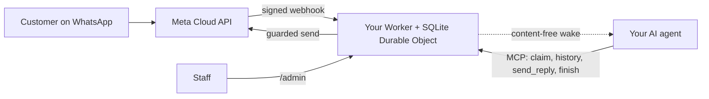

<div align="center">

[English](../../README.md) · [简体中文](README_zh.md) · [繁體中文](README_zh-TW.md) · [日本語](README_ja.md) · [한국어](README_ko.md) · [Türkçe](README_tr.md) · [Русский](README_ru.md) · [Tiếng Việt](README_vi.md) · **ไทย** · [Deutsch](README_de.md) · [Español](README_es.md) · [Français](README_fr.md) · [Українська](README_uk.md) · [Polski](README_pl.md) · [Português (Brasil)](README_pt-BR.md) · [العربية](README_ar.md) · [فارسی](README_fa.md) · [Bahasa Indonesia](README_id.md) · [Italiano](README_it.md)
· [Ελληνικά](README_el.md)

</div>

<div align="center">

# WAB bot

### หมายเลข WhatsApp ของหนึ่งธุรกิจ เอเจนต์ AI หนึ่งตัวผ่าน MCP บนบัญชี Cloudflare ของคุณเอง

**บริดจ์ขนาดเล็กแบบผู้เช่ารายเดียว: ลูกค้าส่งข้อความถึงหมายเลข WhatsApp Cloud API ของคุณ เอเจนต์ของคุณตอบผ่านเครื่องมือที่มีการป้องกัน และไม่มีอะไรออกนอกบัญชีของคุณ**

[](../../LICENSE)
[](../STATUS.md)
[](../CLOUDFLARE.md)
[](../../THIRD_PARTY_NOTICES.md)
[](../../.github/workflows/ci.yml)

[เริ่มต้นอย่างรวดเร็ว](#เริ่มต้นอย่างรวดเร็ว) · [การทำงาน](#การทำงาน) · [ทำอะไรได้บ้าง](#ทำอะไรได้บ้าง) · [ตัวอย่างการใช้งานจริง](#ตัวอย่างการใช้งานจริง) · [คำถามที่พบบ่อย](#คำถามที่พบบ่อย) · [เอกสาร](#เอกสาร)

</div>

> [!IMPORTANT]
> แหล่งที่มาอย่างเป็นทางการของเทมเพลตนี้คือ [wabbot-dev/wab-bot](https://github.com/wabbot-dev/wab-bot)
> ชื่อรีโพซิทอรีที่คล้ายกันหรือ README ที่ถูกคัดลอกไม่ได้พิสูจน์ว่าโค้ดนั้นเป็นของทางการ โปรดอ่านสิ่งที่คุณจะนำไปปรับใช้ และ
> อย่าให้โทเค็นที่คุณจะไม่ให้ผู้เขียนแก่สคริปต์ปรับใช้หรือผู้ช่วยใด ๆ
> โครงการนี้เป็นอิสระ: ไม่มีความเกี่ยวข้องหรือได้รับการรับรองจาก Meta หรือ xAI WhatsApp และ Grok เป็นเครื่องหมายการค้าของเจ้าของแต่ละราย

> [!NOTE]
> **เวอร์ชันตัวอย่าง** ทดสอบในเครื่องกับของจำลอง (การทดสอบอัตโนมัติ 407 รายการ) รุ่นก่อนหน้าเคยรันจริงบนบัญชี Cloudflare Free แบบใช้ครั้งเดียว หลักฐานการรันจริงบนหมายเลข**ทดสอบ**ฟรีของ Meta: **การส่งข้อความ**รันจริงเมื่อ 2026-10-16 (ส่งข้อความไป-กลับจริง: รับข้อความขาเข้าและส่งคำตอบกลับผ่านบริดจ์) ส่วน**การโทร**รันจริงเมื่อ 2026-10-17 ด้วยโค้ดของที่เก็บนี้ (Grok Voice ผ่าน Meta SIP ไปยัง xAI SIP): สายเข้าเสียงของ WhatsApp ถูก AI รับสาย สนทนาได้สองทาง (รวมภาษาอาหรับ) เก็บบทถอดความของทั้งสองฝ่าย Worker จัดการ `end_call` ของโมเดล และ xAI รับคำขอวางสาย (HTTP 200) ส่วนประตูการโทรเปิดแล้วปิดเองอัตโนมัติ นี่ไม่ใช่หมายเลขใช้งานจริงที่ผ่านการยืนยันธุรกิจ และไม่รองรับการบันทึกเสียง โครงการนี้ยังไม่เคยรันในสภาพแวดล้อมจริง เจ้าของรายงานว่าการออกแบบด้านการรับส่งข้อความพิสูจน์แล้วในการใช้งานจริงของการติดตั้งต้นทาง (เจ้าของรายงานเอง วันที่ยังไม่ระบุ) ซึ่งไม่ใช่หลักฐานของโค้ดนี้ สิ่งที่ตรวจสอบแล้วทั้งหมดและวิธีตรวจสอบ: [docs/STATUS.md](../STATUS.md)

---

ลูกค้าของคุณส่งข้อความถึงหมายเลข WhatsApp ของธุรกิจคุณ Meta ส่งแต่ละข้อความไปยัง Worker ใน**บัญชี Cloudflare ของคุณเอง** ซึ่งจะเก็บข้อความและส่งสัญญาณปลุกที่ไม่มีเนื้อหาไปยังเอเจนต์ AI ของคุณ เอเจนต์ (เอเจนต์ใดก็ได้ที่รองรับ MCP) จะรับการสนทนา อ่านประวัติ และตอบผ่าน `send_reply` บริดจ์ ไม่ใช่เอเจนต์ เป็นผู้ถือโทเค็น WhatsApp และบังคับใช้ตัวป้องกันการส่งทุกข้อ เจ้าหน้าที่สามารถหยุดชั่วคราว เข้าควบคุม หรือลบการสนทนาได้จาก `/admin`

หนึ่งการปรับใช้ต่อหนึ่งธุรกิจ: แอป Meta หมายเลข โทเค็น และบัญชี Cloudflare เป็นของตัวเอง ไม่มีความลับใด ๆ ในรีโพซิทอรีนี้

## เริ่มต้นอย่างรวดเร็ว

สิ่งที่คุณต้องมี: บัญชี Cloudflare ที่คุณเป็นเจ้าของ, Node.js 20+ (แนะนำ 22), บัญชีนักพัฒนา Meta และการตั้งค่า WhatsApp Cloud API ([รายการตรวจสอบ](../META-CHECKLIST.md)), **หมายเลขใหม่ที่ไม่เคยลงทะเบียนในแอป WhatsApp ใด ๆ** และเอเจนต์ที่ใช้ MCP ได้และถูกปลุกด้วย webhook ได้ ([ขั้นตอนการปลุก](../WAKE-ROUTINE.md)) คุณจ่ายเงินให้ Meta และแพ็กเกจ AI ของคุณเองโดยตรง แพ็กเกจ Workers Free ไม่ต้องใช้วิธีชำระเงินสำหรับสิ่งที่เทมเพลตนี้ใช้ ([ขีดจำกัดและเงื่อนไข](../CLOUDFLARE.md))

### 1. ตรวจสอบแบบออฟไลน์ (ไม่ต้องมีบัญชี ไม่ต้องใช้เครือข่าย)

```bash
git clone https://github.com/wabbot-dev/wab-bot.git && cd wab-bot
npm ci
npm run check          # typecheck, 342 logic tests, 65 workerd tests, docs check
npm run build          # wrangler deploy --dry-run: bundle and binding check
npm run smoke:local    # wrangler dev --local with random fake secrets
```

### 2. ปรับใช้บนบัญชี Cloudflare ของคุณเอง

```bash
bash scripts/deploy-cloudflare.sh --dry-run                  # prints the plan, makes no call
bash scripts/deploy-cloudflare.sh --name my-business-wa      # lowercase letters, digits, dashes
```

สคริปต์จะล็อกอินให้คุณด้วย `wrangler login --device` (คุณอนุมัติรหัสในเบราว์เซอร์ สคริปต์ไม่เคยสร้างบัญชี) แล้วปรับใช้ สร้างโทเค็นของบริดจ์เอง และอัปโหลดความลับผ่าน stdin เส้นทางอื่น (Cloudflare API โดยไม่ต้องล็อกอิน, ความลับที่จัดสรรเอง) อยู่ใน [docs/DEPLOY.md](../DEPLOY.md) การตั้งค่านี้ได้รับการพิสูจน์แล้วว่าใช้งานได้จริงบน 2 บัญชีที่แตกต่างกัน ([สถานะ](../STATUS.md))

### 3. เชื่อมต่อ Meta และเอเจนต์ของคุณ

ทำตาม [docs/META-CHECKLIST.md](../META-CHECKLIST.md) (คุณสร้างบัญชี Meta ยืนยันธุรกิจ และพิมพ์รหัส SMS ด้วยตัวเอง) รัน `node scripts/meta-setup.mjs` บนคอมพิวเตอร์ของคุณเอง แล้วชี้เอเจนต์ของคุณไปที่ `https://<worker>.<your-subdomain>.workers.dev/mcp` พร้อม `Authorization: Bearer <MCP_TOKEN>`

### 4. อยู่ในโหมดทดสอบจนกว่าข้อความจะไปและกลับครบรอบ

ค่าเริ่มต้นที่ปลอดภัย: `LAUNCH_MODE=test` (การตอบจะส่งไปยัง `TEST_RECIPIENTS` เท่านั้น) การตอบอัตโนมัติ**ถูกหยุดชั่วคราว** เทมเพลตปิด เส้นทางตั้งค่า Meta ภายใน Worker ปิด ส่งข้อความหนึ่งข้อความจากโทรศัพท์ของคุณ ดูให้มันมาถึงใน `/admin` ให้เอเจนต์ตอบ แล้วจึงเปิดใช้งานจริงอย่างตั้งใจ

## การทำงาน



ทุก webhook ต้องมี `X-Hub-Signature-256` ที่ถูกต้องบน body ดิบ แถว SQLite หนึ่งแถวต่อหนึ่งการสนทนาทำให้คำขอแยกอิสระจากกัน คำขอที่แพ้การแข่งขันจะอ่านใหม่และลองอีกครั้ง POST ปลุกมีเพียง id และตัวนับ ไม่มีข้อความเลย ขอบเขตและความเป็นเจ้าของ: [docs/ARCHITECTURE.md](../ARCHITECTURE.md) การจัดเก็บ การเก็บรักษา และการปลุก: [docs/STATE-STORE.md](../STATE-STORE.md)

## ทำอะไรได้บ้าง

| ความสามารถ | หลักฐานและข้อจำกัด |
|---|---|
| รับข้อความ WhatsApp และเก็บตามการสนทนา ตัดข้อมูลซ้ำ พร้อมการตรวจสอบ HMAC | ทดสอบในเครื่อง; รับข้อความจริงหนึ่งข้อความบนหมายเลขทดสอบของ Meta ([สถานะ](../STATUS.md)) |
| เครื่องมือของเอเจนต์ผ่าน MCP: `list_pending`, `claim_conversation`, `get_history`, `send_reply` (ตัวป้องกันฝั่งเซิร์ฟเวอร์ 16 ข้อ), `finish`, `release`, `escalate`, `get_controls`, `get_overview` แบบอ่านอย่างเดียว | ทดสอบในเครื่องและด้วยการเรียก JSON-RPC โดยตรง; **ไม่ได้**ทดสอบกับไคลเอนต์ MCP จริง ส่งการตอบจริงหนึ่งข้อความบนหมายเลขทดสอบของ Meta โดยควบคุมด้วยมือ |
| คอนโซลเจ้าหน้าที่: หยุดและกลับมาตอบอัตโนมัติ เข้าควบคุม ปล่อย เปิดใหม่ ปิดเรื่อง ปลุก ลบ | ทดสอบในเครื่อง หน้าเว็บแบบสถิต ต้องใช้โทเค็น |
| ลบหนึ่งการสนทนา (`DELETE /api/admin/conversations/<id>`) | ทดสอบในเครื่องพร้อมการตรวจสอบแบบ mutation; ไม่เคยรันจริง ไม่ครอบคลุมสำเนากู้คืนของ Cloudflare ([ความเป็นส่วนตัว](../PRIVACY.md)) |
| ปลุกเอเจนต์ของคุณ แบบ debounce พร้อม backoff และลองใหม่รายวัน | ตรวจสอบจริงกับตัวรับจำลอง; ไม่เคยกับแพลตฟอร์มเอเจนต์จริง |
| การเก็บรักษา: แชตที่ตอบแล้วถูกตัดทอนที่ 14 วัน สิ่งใดก็ตามถูกทิ้งที่ 180 วัน | ตรวจสอบจริงด้วยข้อมูลสังเคราะห์; ไม่เคยตลอดหลายสัปดาห์กับข้อมูลจริง |
| จัดสรรความลับเองครั้งเดียว (`POST /api/setup`) สำหรับเครื่องมือปรับใช้ที่ปกปิดค่า | รันจริงบน Worker ทดสอบหนึ่งตัว; อ่อนกว่า secret binding ([ข้อจำกัด](../SELF-PROVISIONING.md)) |
| รับสายโทรด้วยเสียงของ WhatsApp (Meta SIP ไปยัง xAI Grok Voice) ปิดอยู่จนกว่าเจ้าของจะเปิดประตู คุณจ่ายให้ xAI ประมาณ $0.08 ต่อนาที | **รันจริง**ด้วยโค้ดนี้บนหมายเลขทดสอบของ Meta เมื่อ 2026-10-17: AI รับสาย สนทนาสองทาง เก็บบทถอดความของทั้งสองฝ่าย จัดการคำขอวางสายของโมเดล; ไม่ใช่หมายเลขใช้งานจริงที่ผ่านการยืนยันธุรกิจ ([เสียง](../VOICE-CALLS.md)) |
| MCP ผู้ดูแลสำหรับเจ้าของเท่านั้นที่ `/admin/mcp`: สถานะ ตรวจสอบการตั้งค่า บทสนทนาที่ปกปิดข้อมูล ลบ เปิดและปิดการโทร บันทึกการโทร การใช้งาน เวอร์ชันและตรวจสอบอัปเดต (17 เครื่องมือ) | ปิดอยู่เว้นแต่ตั้งค่า `ADMIN_MCP_TOKEN` ทดสอบในเครื่องและใน workerd **ยังไม่**ทดสอบกับไคลเอนต์ MCP จริง ([MCP ผู้ดูแล](../mcp.md)) |
| เข้าใจข้อความเสียง รูปภาพ และเอกสาร: ถอดข้อความเสียง (อาหรับ ฝรั่งเศส อังกฤษ และอื่น ๆ) บรรยายรูปภาพ และอ่านเอกสาร PDF หรือ Office ด้วย Workers AI ในบัญชี Cloudflare ของคุณเอง ภายในโควตาฟรีรายวัน อ่านตำแหน่งที่ตั้งและนามบัตรผู้ติดต่อ เมื่อล้มเหลวเอเจนต์จะเห็นเครื่องหมายธรรมดา ตอบกลับด้วยข้อความเสียง (ไม่บังคับ ปิดไว้ตามค่าเริ่มต้น): หกภาษาด้วย Workers AI ภาษาอาหรับและภาษาอื่นด้วยคีย์ xAI หรือ ElevenLabs ของคุณเอง | ทดสอบในเครื่องแล้ว รันจริงผ่านเส้นทางทดสอบตัวเองของเจ้าของบน Worker ทดสอบ ยังไม่ได้ทดสอบจากโทรศัพท์จริง ([สื่อ](../MEDIA.md)) |
| ฟีเจอร์ธุรกิจแบบเลือกได้: ให้บริการผู้บริโภค ธุรกิจ หรือทั้งสองกลุ่ม สมุดรายชื่อบัญชีที่เจ้าของดูแล การแจ้งเตือนเจ้าของทันที เอกสาร รูปภาพ ปุ่ม และรายการในคำตอบ การชำระเงินที่พนักงานตรวจสอบ และจุดเชื่อมต่อสำหรับการจองและคำสั่งซื้อ | ทดสอบในเครื่องแล้ว ยังไม่ได้รันจริง ([โหมดธุรกิจ](../BUSINESS-MODE.md)) |

ไม่รวม: การเข้าใจวิดีโอ (บันทึกว่ามีวิดีโอ แต่ไม่ได้ดู) กลุ่ม การโทรออก การบันทึกเสียง หน้าตั้งค่า ขั้นตอนที่ตั้งไว้ล่วงหน้า การโฮสต์แบบหลายผู้เช่า ดู [docs/ROADMAP.md](../ROADMAP.md)

## ตัวอย่างการใช้งานจริง

**หนึ่งรอบของลูกค้าผ่าน MCP** (ใช้เพียงตัวแทนค่า เอเจนต์ทำสิ่งนี้ผ่านไคลเอนต์ MCP ของตน):

```bash
MCP=https://<worker>.<your-subdomain>.workers.dev/mcp
call() { curl -s "$MCP" -H "Authorization: Bearer $MCP_TOKEN" -H 'content-type: application/json' \
  -d "{\"jsonrpc\":\"2.0\",\"id\":1,\"method\":\"tools/call\",\"params\":{\"name\":\"$1\",\"arguments\":$2}}"; }
call list_pending '{}'
call claim_conversation '{"conversation_id":"c_<id>"}'                       # returns a lease
call get_history '{"conversation_id":"c_<id>","lease":"<lease>"}'            # customer text is wrapped as untrusted
call send_reply '{"conversation_id":"c_<id>","lease":"<lease>","text":"Hello, how can I help?"}'
call finish_conversation '{"conversation_id":"c_<id>","lease":"<lease>"}'
```

ขณะที่ `LAUNCH_MODE=test` หรือการตอบอัตโนมัติถูกหยุดชั่วคราว `send_reply` จะตอบ `blocked_test_mode_recipient_not_allowlisted` หรือ `blocked_auto_reply_paused` แทนการส่ง ลำดับของตัวป้องกันและข้อความผิดพลาดทุกข้อ: [docs/CONFIGURATION.md](../CONFIGURATION.md)

**ลบลูกค้าหนึ่งราย:**

```bash
curl -X DELETE -H "Authorization: Bearer $ADMIN_TOKEN" https://<worker>.<your-subdomain>.workers.dev/api/admin/conversations/c_<id>
# {"ok":true,"deleted":true}   (404 if unknown or already erased)
```

**ลบทุกอย่าง:** `bash scripts/teardown-cloudflare.sh` (ขอให้คุณพิมพ์ชื่อ Worker ลบ Worker และทุกการสนทนาที่เก็บไว้ ไม่ลบอย่างอื่น)

## คำถามที่พบบ่อย

**ใครเป็นเจ้าของบัญชี Cloudflare?** คุณเป็นเจ้าของ: คุณยอมรับเงื่อนไข คุณจ่ายหากวันหนึ่งต้องจ่าย และคุณลบมันได้ ผู้ช่วยอาจสร้างบัญชี Cloudflare และ xAI ให้คุณได้ก็ต่อเมื่อคุณให้ความยินยอมเป็นลายลักษณ์อักษร และคุณถูกตั้งเป็นเจ้าของหรือผู้ดูแล คุณเพิ่มบัตรเอง บัญชี Meta การยืนยันธุรกิจ และรหัส SMS เป็นของคุณเสมอ ([รายละเอียดและข้อควรระวังเรื่องเงื่อนไขของ Cloudflare](../CLOUDFLARE.md))

**แพ็กเกจ Free ใช้กับธุรกิจได้หรือไม่?** ในเงื่อนไขของ Cloudflare ที่อ่านเมื่อ 2026-10-17 บริการ Free ไม่มีข้อกำหนดให้ใช้เฉพาะส่วนบุคคล แต่มีข้อจำกัดสองข้อที่สำคัญในกรณีนี้ (ห้ามเก็บข้อมูลบัตร ห้ามมีข้อมูลสุขภาพที่ได้รับการคุ้มครองโดยไม่มีความยินยอมเป็นลายลักษณ์อักษรจาก Cloudflare) นี่ไม่ใช่คำแนะนำทางกฎหมาย โปรดตรวจสอบอีกครั้ง ([การใช้งานเชิงพาณิชย์](../CLOUDFLARE.md#commercial-use))

**ฉันใช้หมายเลขแอป WhatsApp Business เดิมได้หรือไม่?** ไม่ได้ หมายเลข Cloud API ต้องไม่เคยลงทะเบียนในแอป WhatsApp การอยู่ร่วมกัน (coexistence) อยู่นอกขอบเขต นำซิมหรือสายของคุณเองมาและพิมพ์รหัสของมันด้วยตัวเอง

**ตอบรับสายโทรศัพท์ได้หรือไม่?** ได้ เฉพาะสายเข้า และเฉพาะเมื่อคุณเปิดประตู: การโทรปิดเป็นค่าเริ่มต้น บนหมายเลขจริงจะปิดต่อไปจนกว่าการยืนยันธุรกิจจะเสร็จและคุณสั่งเริ่ม และทำงานในช่วงเวลาสั้น ๆ ที่คุณเปิดเอง ใช้ xAI Grok Voice บนบัญชี xAI ของคุณเอง (ประมาณ $0.08 ต่อนาที) สายที่เข้ามาถูกรับจริงด้วยโค้ดนี้บนหมายเลขทดสอบของ Meta เมื่อ 2026-10-17 (สนทนาสองทาง เก็บบทถอดความ) ยังไม่เคยรันบนหมายเลขใช้งานจริงที่ผ่านการยืนยันธุรกิจ และไม่รองรับการบันทึกเสียง ([เสียง](../VOICE-CALLS.md))

**เอเจนต์ตัวไหนใช้ได้?** เอเจนต์ใดก็ได้ที่สื่อสาร MCP ผ่าน HTTP ได้และถูกปลุกด้วย webhook ได้ ทดสอบกับการเรียก JSON-RPC โดยตรง ไม่ได้ทดสอบกับไคลเอนต์ MCP จริง ([ขั้นตอนการปลุก](../WAKE-ROUTINE.md))

**รองรับปริมาณเท่าไร?** ผู้เช่ารายเดียว Durable Object ตัวเดียว: ปริมาณระดับธุรกิจขนาดเล็ก จากการวัดจริงของเรา ประมาณ 30,000 ข้อความต่อวันอยู่ภายในโควตา Durable Object ของแพ็กเกจ Free ข้อความจำนวนมากที่เข้ามาพร้อมกันในการสนทนาเดียวอาจได้ 503 และ Meta จะส่งซ้ำ ([สถานะ](../STATUS.md#live-measurements-cloudflare-free-fake-secrets-2026-10-16))

**พิสูจน์แล้วในระบบจริงหรือไม่?** มีรายงานว่าการออกแบบต้นแบบเป็นเช่นนั้น (เจ้าของเป็นผู้รายงาน ยังไม่ระบุวันที่) แต่พอร์ต Cloudflare นี้ไม่ใช่ [สถานะ](../STATUS.md) ระบุอย่างชัดเจนว่าแต่ละระดับหมายถึงอะไร

## ข้อจำกัดและแนวปฏิบัติที่ดี

- **โครงการอิสระ** WAB bot ไม่เป็นทางการ: ไม่มีส่วนเกี่ยวข้องและไม่ได้รับการรับรองจาก Meta, WhatsApp หรือ xAI WhatsApp และ Grok เป็นเครื่องหมายการค้าของเจ้าของแต่ละราย
- **กฎของ Meta มีผลบังคับใช้** การใช้ WhatsApp Cloud API ของคุณเป็นไปตามข้อกำหนด นโยบายการส่งข้อความ และกฎรายหมายเลขของ Meta และการโทรบนหมายเลขธุรกิจต้องผ่านการยืนยันธุรกิจของ Meta
- **หนึ่งหมายเลขต่อบอท** การติดตั้งหนึ่งครั้งรองรับหนึ่งธุรกิจและหนึ่งหมายเลข WhatsApp โดยใช้แอป Meta โทเค็น และบัญชี Cloudflare ของคุณเอง
- **คุณเป็นผู้เปิดการโทรเอง** ปิดไว้เป็นค่าเริ่มต้น คุณเปิดโดยระบุหมายเลข และการโทรใช้เครดิต xAI ของคุณเอง (ประมาณ $0.08 ต่อนาที)
- **รับสายเข้าเท่านั้น ไม่บันทึกเสียง** ไม่รองรับการโทรออกและการบันทึกเสียง บทถอดความเป็นข้อความถูกเก็บโดยค่าเริ่มต้น และคุณปิดได้
- **SIP กับ Graph calling API ใช้ร่วมกันไม่ได้ในแต่ละหมายเลข** ขณะที่หมายเลขใช้ SIP สำหรับการโทร ซึ่งบอทนี้เป็นเช่นนั้น จะใช้ปลายทางการโทรของ Graph ของ Meta บนหมายเลขนั้นไม่ได้
- **เตรียมช่องทางติดต่อสำรองไว้** เผยแพร่ช่องทางติดต่ออื่น เช่น เบอร์โทรหรืออีเมล และให้พนักงานรับช่วงต่อทุกการสนทนาได้เสมอ

สิ่งที่รองรับและไม่รองรับ: [ความสามารถ](../CAPABILITIES.md) คำถามคำตอบเชิงปฏิบัติ: [การแก้ปัญหา](../TROUBLESHOOTING.md) รายละเอียดการโทร: [เสียง](../VOICE-CALLS.md)

## เอกสาร

[docs/index.md](../index.md) แสดงรายการทุกหน้า เริ่มจาก [STATUS](../STATUS.md) จากนั้น [DEPLOY](../DEPLOY.md), [META-CHECKLIST](../META-CHECKLIST.md), [CONFIGURATION](../CONFIGURATION.md), [PRIVACY](../PRIVACY.md) และ [TROUBLESHOOTING](../TROUBLESHOOTING.md) นอกจากนี้: [AGENTS.md](../../AGENTS.md) สำหรับเอเจนต์เขียนโค้ด AI, [SECURITY.md](../../SECURITY.md), [CHANGELOG.md](../../CHANGELOG.md), [THIRD_PARTY_NOTICES.md](../../THIRD_PARTY_NOTICES.md)

## ข้อจำกัดความรับผิดชอบ

นี่คือซอฟต์แวร์รุ่นพรีวิวสำหรับการส่งข้อความทางธุรกิจที่ถูกกฎหมาย คุณรับผิดชอบต่อการปรับใช้ ข้อมูลรับรอง ข้อมูลของลูกค้า กฎการบันทึกเสียงและการเปิดเผยการใช้ AI และเงื่อนไขของ Meta และ Cloudflare ของคุณ ไม่มีการรับประกัน โปรดอ่าน [DISCLAIMER.md](../../DISCLAIMER.md)

## การมีส่วนร่วม

ยินดีรับการแก้ไขที่เจาะจง การแก้ไขเอกสาร และการทดสอบ โปรดอ่าน[ขอบเขตการมีส่วนร่วม](../../CONTRIBUTING.md#contribution-scope)และ[กฎความพร้อมของ PR](../../CONTRIBUTING.md#pull-request-ownership-and-readiness)ก่อน PR ที่ใช้ AI ช่วยต้องมีเจ้าของที่เป็นมนุษย์ระบุชื่อ ปัญหาด้านความปลอดภัย: [SECURITY.md](../../SECURITY.md)

## สัญญาอนุญาต

[MIT](../../LICENSE), Copyright (c) 2026 wabbot-dev.
