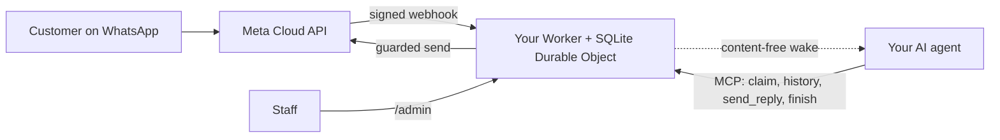

<div align="center">

[English](../../README.md) · [简体中文](README_zh.md) · [繁體中文](README_zh-TW.md) · [日本語](README_ja.md) · [한국어](README_ko.md) · **Türkçe** · [Русский](README_ru.md) · [Tiếng Việt](README_vi.md) · [ไทย](README_th.md) · [Deutsch](README_de.md) · [Español](README_es.md) · [Français](README_fr.md) · [Українська](README_uk.md) · [Polski](README_pl.md) · [Português (Brasil)](README_pt-BR.md) · [العربية](README_ar.md) · [فارسی](README_fa.md) · [Bahasa Indonesia](README_id.md) · [Italiano](README_it.md)
· [Ελληνικά](README_el.md)

</div>

<div align="center">

# WAB bot

### Bir işletmenin WhatsApp numarası, MCP üzerinden tek bir yapay zekâ ajanı, kendi Cloudflare hesabınızda.

**Küçük, tek kiracılı bir köprü: müşteriler WhatsApp Cloud API numaranıza mesaj yazar, ajanınız korumalı araçlar üzerinden yanıt verir ve hiçbir şey hesaplarınızın dışına çıkmaz.**

[](../../LICENSE)
[](../STATUS.md)
[](../CLOUDFLARE.md)
[](../../THIRD_PARTY_NOTICES.md)
[](../../.github/workflows/ci.yml)

[Hızlı başlangıç](#hızlı-başlangıç) · [Nasıl çalışır](#nasıl-çalışır) · [Neler yapabilir](#neler-yapabilir) · [Uygulamalı örnekler](#uygulamalı-örnekler) · [SSS](#sss) · [Belgeler](#belgeler)

</div>

> [!IMPORTANT]
> Bu şablonun resmî kaynağı [wabbot-dev/wab-bot](https://github.com/wabbot-dev/wab-bot) deposudur.
> Benzer bir depo adı veya kopyalanmış bir README, kodun resmî olduğunu göstermez. Dağıttığınız şeyi okuyun ve
> yazarına vermeyeceğiniz bir belirteci hiçbir dağıtım betiğine ya da asistana vermeyin.
> Bu proje bağımsızdır: Meta veya xAI ile bağlantılı değildir ve onlar tarafından onaylanmamıştır. WhatsApp ve Grok, sahiplerinin ticari markalarıdır.

> [!NOTE]
> **Önizleme.** Yerelde sahte nesnelere karşı test edildi (335 otomatik test). Önceki sürümler tek kullanımlık bir Cloudflare Free hesabında canlı çalıştırıldı. Meta'nın ücretsiz **test** numarasındaki canlı kanıt: **mesajlaşma** 2026-10-16'da canlı çalıştırıldı (gerçek bir metin gidiş-dönüşü: gelen bir mesaj alındı ve köprü üzerinden yanıt gönderildi), **arama** ise 2026-10-17'de bu deponun koduyla canlı çalıştırıldı (Grok Voice, Meta SIP üzerinden xAI SIP'e): gelen WhatsApp sesli aramaları yapay zekâ tarafından yanıtlandı, konuşma iki yönlü oldu (Arapça dahil), iki tarafın dökümü de saklandı, modelin `end_call` çağrısı Worker tarafından işlendi ve xAI'nin kapatma isteği kabul edildi (HTTP 200); arama kapısı devreye girip kendiliğinden kapandı. İşletme doğrulaması yapılmış bir üretim numarası değildir; ses kaydı desteklenmez. Bu proje tarafından üretimde çalıştırılmadı. Mesajlaşma tasarımının, türetildiği dağıtımda üretimde kanıtlandığı sahibi tarafından bildirilmiştir (sahibinin beyanı, tarih belirlenecek); bu, bu kod için kanıt değildir. Doğrulanan her şey ve nasıl doğrulandığı: [docs/STATUS.md](../STATUS.md).

---

Müşterileriniz işletmenizin WhatsApp numarasına yazar. Meta her mesajı **kendi Cloudflare hesabınızdaki** bir Worker'a iletir; Worker mesajı saklar ve yapay zekâ ajanınıza içerik taşımayan bir uyandırma sinyali gönderir. Ajan (MCP destekleyen herhangi bir ajan) konuşmayı üstlenir, geçmişi okur ve `send_reply` ile yanıt verir. WhatsApp belirtecini tutan ve her gönderim korumasını uygulayan ajan değil, köprüdür. Personel bir konuşmayı `/admin` üzerinden duraklatabilir, devralabilir veya silebilir.

İşletme başına tek dağıtım: kendi Meta uygulaması, numarası, belirteçleri ve Cloudflare hesabı. Bu depoda hiçbir gizli bilgi yoktur.

## Hızlı başlangıç

İhtiyacınız olanlar: sahibi olduğunuz bir Cloudflare hesabı, Node.js 20+ (22 önerilir), bir Meta geliştirici hesabı ve WhatsApp Cloud API kurulumu ([kontrol listesi](../META-CHECKLIST.md)), **hiçbir WhatsApp uygulamasına hiç kaydedilmemiş yeni bir numara** ve MCP kullanabilen ve bir webhook ile uyandırılabilen bir ajan ([uyandırma rutini](../WAKE-ROUTINE.md)). Meta'ya ve kendi yapay zekâ planınıza doğrudan ödeme yaparsınız; bu şablonun kullandığı kapsam için Workers Free planı ödeme yöntemi gerektirmez ([sınırlar ve şartlar](../CLOUDFLARE.md)).

### 1. Çevrimdışı kontrol edin (hesap yok, ağ yok)

```bash
git clone https://github.com/wabbot-dev/wab-bot.git && cd wab-bot
npm ci
npm run check          # typecheck, 271 logic tests, 64 workerd tests, docs check
npm run build          # wrangler deploy --dry-run: bundle and binding check
npm run smoke:local    # wrangler dev --local with random fake secrets
```

### 2. Kendi Cloudflare hesabınıza dağıtın

```bash
bash scripts/deploy-cloudflare.sh --dry-run                  # prints the plan, makes no call
bash scripts/deploy-cloudflare.sh --name my-business-wa      # lowercase letters, digits, dashes
```

Betik, `wrangler login --device` ile oturum açar (tarayıcınızda bir kodu onaylarsınız; hiçbir zaman hesap oluşturmaz), dağıtımı yapar, köprünün kendi belirteçlerini üretir ve gizli bilgileri stdin üzerinden yükler. Diğer yollar (oturum açmadan Cloudflare API, kendi kendine sağlanan gizli bilgiler) [docs/DEPLOY.md](../DEPLOY.md) içindedir. Kurulum 2 farklı hesapta canlı olarak kanıtlandı ([durum](../STATUS.md)).

### 3. Meta'yı ve ajanınızı bağlayın

[docs/META-CHECKLIST.md](../META-CHECKLIST.md) belgesini izleyin (Meta hesaplarını siz oluşturursunuz, işletmenizi doğrularsınız ve SMS kodunu kendiniz girersiniz), kendi bilgisayarınızda `node scripts/meta-setup.mjs` komutunu çalıştırın ve ajanınızı `Authorization: Bearer <MCP_TOKEN>` ile `https://<worker>.<your-subdomain>.workers.dev/mcp` adresine yönlendirin.

### 4. Bir mesaj uçtan uca gidip gelene kadar test modunda kalın

Güvenli varsayılanlar: `LAUNCH_MODE=test` (yanıtlar yalnızca `TEST_RECIPIENTS` alıcılarına gider), otomatik yanıt **duraklatılmış**, şablonlar kapalı, Worker içindeki Meta kurulum rotası kapalı. Telefonunuzdan bir mesaj gönderin, `/admin` içinde gelişini izleyin, ajanın yanıtlamasına izin verin ve ancak ondan sonra bilinçli olarak canlıya geçin.

## Nasıl çalışır



Her webhook, ham gövde üzerinde geçerli bir `X-Hub-Signature-256` taşımalıdır. Konuşma başına bir SQLite satırı, istekleri birbirinden bağımsız tutar; yarışı kaybeden istek yeniden okur ve tekrar dener. Uyandırma POST'u yalnızca kimlikleri ve sayaçları taşır, asla mesaj metnini taşımaz. Sınırlar ve sahiplik: [docs/ARCHITECTURE.md](../ARCHITECTURE.md). Depolama, saklama ve uyandırma: [docs/STATE-STORE.md](../STATE-STORE.md).

## Neler yapabilir

| Yetenek | Kanıt ve sınırlar |
|---|---|
| WhatsApp metnini almak ve konuşma başına, tekrarsız ve HMAC doğrulamasıyla saklamak | Yerelde test edildi; Meta'nın test numarasında gerçek bir mesaj alındı ([durum](../STATUS.md)) |
| MCP üzerinden ajan araçları: `list_pending`, `claim_conversation`, `get_history`, `send_reply` (16 sunucu tarafı koruma), `finish`, `release`, `escalate`, `get_controls`, salt okunur `get_overview` | Yerelde ve doğrudan JSON-RPC çağrılarıyla test edildi; gerçek MCP istemcileriyle test **edilmedi**. Meta'nın test numarasında, elle yönlendirilen bir gerçek yanıt gönderildi |
| Personel konsolu: otomatik yanıtı duraklatma ve sürdürme, devralma, bırakma, yeniden açma, çözme, uyandırma, silme | Yerelde test edildi. Statik sayfa, belirteç gerekir |
| Bir konuşmayı silme (`DELETE /api/admin/conversations/<id>`) | Mutasyon kontrolleriyle yerelde test edildi; hiç canlı çalıştırılmadı. Cloudflare kurtarma kopyalarına ulaşmaz ([gizlilik](../PRIVACY.md)) |
| Ajanınızı uyandırma; debounce, geri çekilme (backoff) ve günlük yeniden deneme ile | Yerine geçen bir alıcıya karşı canlı doğrulandı; gerçek bir ajan platformuna karşı hiç denenmedi |
| Saklama: yanıtlanmış sohbetler 14 günde kırpılır, her şey 180 günde silinir | Sentetik verilerle canlı doğrulandı; gerçek veriyle haftalar boyunca hiç denenmedi |
| Değerleri gizleyen dağıtım araçları için gizli bilgileri bir kez kendi kendine sağlama (`POST /api/setup`) | Bir test Worker'ında canlı çalıştırıldı; bir gizli bilgi bağlamasından (secret binding) daha zayıf ([sınırlar](../SELF-PROVISIONING.md)) |
| WhatsApp sesli aramalarını yanıtlama (Meta SIP'ten xAI Grok Voice'a), sahibi kapıyı açana kadar kapalı; xAI'ye siz ödersiniz, dakikası yaklaşık $0.08 | **Canlı çalıştırıldı**: 2026-10-17'de Meta'nın test numarasında bu kodla: yapay zekâ yanıtladı, iki yönlü konuşma, iki tarafın dökümü saklandı, modelin arama bitirme isteği işlendi; işletme doğrulaması yapılmış bir üretim numarası değil ([ses](../VOICE-CALLS.md)) |
| Yalnızca sahibine özel yönetici MCP (`/admin/mcp`): durum, kurulum denetimi, maskelenmiş konuşmalar, silme, aramayı etkinleştirme ve devre dışı bırakma, arama günlükleri, kullanım, sürüm ve güncelleme kontrolü (14 araç) | `ADMIN_MCP_TOKEN` ayarlanmadıkça kapalı. Yerelde ve workerd'de test edildi; gerçek MCP istemcileriyle **test edilmedi** ([yönetici MCP](../mcp.md)) |
| Sesli mesajları ve görselleri anlama: kendi Cloudflare hesabınızdaki Workers AI ile ücretsiz günlük kota içinde yazıya dökülür (Arapça, Fransızca, İngilizce ve daha fazlası) veya betimlenir; herhangi bir hatada ajan basit bir işaret görür ve müşteriden yazmasını ister | Yerelde test edildi; bir test Worker'ında sahibin öz test yoluyla canlı çalıştırıldı, henüz gerçek bir telefondan değil ([medya](../MEDIA.md)) |

Dahil değil: video ve belge anlama, sesli yanıtlar, gruplar, metin ve gövde parametreleri dışındaki şablon türleri, giden aramalar, ses kaydı, bir ayarlar sayfası, hazır rutinler, çok kiracılı barındırma. Bkz. [docs/ROADMAP.md](../ROADMAP.md).

## Uygulamalı örnekler

**MCP üzerinden bir müşteri turu** (yalnızca yer tutucular; ajan bunu MCP istemcisi aracılığıyla yapar):

```bash
MCP=https://<worker>.<your-subdomain>.workers.dev/mcp
call() { curl -s "$MCP" -H "Authorization: Bearer $MCP_TOKEN" -H 'content-type: application/json' \
  -d "{\"jsonrpc\":\"2.0\",\"id\":1,\"method\":\"tools/call\",\"params\":{\"name\":\"$1\",\"arguments\":$2}}"; }
call list_pending '{}'
call claim_conversation '{"conversation_id":"c_<id>"}'                       # returns a lease
call get_history '{"conversation_id":"c_<id>","lease":"<lease>"}'            # customer text is wrapped as untrusted
call send_reply '{"conversation_id":"c_<id>","lease":"<lease>","text":"Hello, how can I help?"}'
call finish_conversation '{"conversation_id":"c_<id>","lease":"<lease>"}'
```

`LAUNCH_MODE=test` iken veya otomatik yanıt duraklatılmışken `send_reply`, göndermek yerine `blocked_test_mode_recipient_not_allowlisted` veya `blocked_auto_reply_paused` yanıtını verir. Koruma sırası ve her hata dizesi: [docs/CONFIGURATION.md](../CONFIGURATION.md).

**Bir müşteriyi silme:**

```bash
curl -X DELETE -H "Authorization: Bearer $ADMIN_TOKEN" https://<worker>.<your-subdomain>.workers.dev/api/admin/conversations/c_<id>
# {"ok":true,"deleted":true}   (404 if unknown or already erased)
```

**Her şeyi kaldırma:** `bash scripts/teardown-cloudflare.sh` (Worker adını yazmanızı ister; Worker'ı ve saklanan tüm konuşmaları siler, başka hiçbir şeyi silmez).

## SSS

**Cloudflare hesabının sahibi kim?** Siz: şartları siz kabul edersiniz, bir gün ödeme yaparsanız siz ödersiniz ve hesabı siz silebilirsiniz. Bir asistan, Cloudflare ve xAI hesaplarını sizin için yalnızca yazılı onayınızla ve sizi sahip veya yönetici yaparak oluşturabilir; kartı kendiniz eklersiniz. Meta hesapları, İşletme Doğrulaması ve SMS kodu her zaman sizindir ([ayrıntılar ve Cloudflare şartları uyarısı](../CLOUDFLARE.md)).

**Free plan bir işletme için uygun mu?** 2026-10-17 tarihinde okunan Cloudflare şartlarında Free hizmetlerde yalnızca kişisel kullanıma izin veren bir madde yoktur; ancak burada önemli olan iki kısıtlama vardır (kart bilgisi toplamak yok, Cloudflare'in yazılı onayı olmadan korunan sağlık bilgisi yok). Hukuki tavsiye değildir; yeniden kontrol edin ([ticari kullanım](../CLOUDFLARE.md#commercial-use)).

**Mevcut WhatsApp Business uygulaması numaramı kullanabilir miyim?** Hayır. Cloud API numarası hiçbir zaman bir WhatsApp uygulamasına kaydedilmemiş olmalıdır; birlikte var olma (coexistence) kapsam dışıdır. Kendi SIM kartınızı veya hattınızı getirin ve kodunu kendiniz girin.

**Aramaları yanıtlıyor mu?** Evet, yalnızca gelen aramalar ve yalnızca kapıyı açtığınızda: arama varsayılan olarak kapalıdır, gerçek bir numarada İşletme Doğrulamanız tamamlanıp siz başla diyene kadar kapalı kalır ve sizin başlattığınız kısa zaman pencerelerinde çalışır. Kendi xAI hesabınızda xAI Grok Voice kullanır (dakikası yaklaşık $0.08). Bu koddan gelen aramalar 2026-10-17'de Meta'nın test numarasında canlı yanıtlandı (iki yönlü konuşma, dökümler saklandı); işletme doğrulaması yapılmış bir üretim numarasında çalıştırılmadı ve ses kaydı desteklenmez ([ses](../VOICE-CALLS.md)).

**Hangi ajan çalışır?** HTTP üzerinden MCP konuşabilen ve bir webhook ile uyandırılabilen herhangi bir ajan. Doğrudan JSON-RPC çağrılarına karşı test edildi, gerçek MCP istemcilerine karşı edilmedi ([uyandırma rutini](../WAKE-ROUTINE.md)).

**Ne kadar hacim kaldırır?** Tek kiracı, tek Durable Object: küçük işletme hacimleri. Canlı ölçümümüze göre günde yaklaşık 30.000 mesaj Free Durable Object kotasına sığar; tek bir konuşmada çok sayıda eşzamanlı mesaj 503 döndürebilir ve Meta yeniden iletir ([durum](../STATUS.md#live-measurements-cloudflare-free-fake-secrets-2026-10-16)).

**Üretimde kanıtlandı mı?** Türetildiği tasarımın kanıtlandığı bildirilmektedir (sahibi tarafından bildirildi, tarih belirlenecek). Bu Cloudflare uyarlaması için durum böyle değildir. [Durum](../STATUS.md) belgesi her düzeyin tam olarak ne anlama geldiğini söyler.

## Sınırlar ve iyi uygulama

- **Bağımsız proje.** WAB bot resmî değildir: Meta, WhatsApp veya xAI ile bağlantılı değildir ve onlar tarafından onaylanmamıştır. WhatsApp ve Grok, sahiplerinin ticari markalarıdır.
- **Meta'nın kuralları geçerlidir.** WhatsApp Cloud API kullanımınız Meta'nın şartlarına, mesajlaşma politikalarına ve numara başına kurallara tabidir; bir işletme numarasında arama için Meta İşletme Doğrulaması gerekir.
- **Bot başına bir numara.** Bir dağıtım bir işletmeye ve bir WhatsApp numarasına hizmet eder; kendi Meta uygulamanız, belirteçleriniz ve Cloudflare hesabınız kullanılır.
- **Aramayı siz açarsınız.** Varsayılan olarak kapalıdır; numarayı belirterek siz açarsınız ve aramalar kendi xAI kredinizi kullanır (dakikası yaklaşık $0.08).
- **Yalnızca gelen aramalar, ses kaydı yok.** Giden aramalar ve ses kaydı desteklenmez. Metin dökümü varsayılan olarak saklanır ve kapatabilirsiniz.
- **Numara başına SIP ve Graph arama API'si birbirini dışlar.** Bir numara arama için SIP kullanırken (bu bot gibi), o numarada Meta'nın Graph arama uç noktaları kullanılamaz.
- **Yedek bir iletişim yolu bulundurun.** Telefon veya e-posta gibi size ulaşmanın başka bir yolunu yayımlayın ve personelin her konuşmayı devralabilmesini sağlayın.

Neler desteklenir, neler desteklenmez: [yetenekler](../CAPABILITIES.md). Pratik sorular ve yanıtlar: [sorun giderme](../TROUBLESHOOTING.md). Arama ayrıntıları: [ses](../VOICE-CALLS.md).

## Belgeler

[docs/index.md](../index.md) her sayfayı listeler. [STATUS](../STATUS.md) ile başlayın, ardından [DEPLOY](../DEPLOY.md), [META-CHECKLIST](../META-CHECKLIST.md), [CONFIGURATION](../CONFIGURATION.md), [PRIVACY](../PRIVACY.md) ve [TROUBLESHOOTING](../TROUBLESHOOTING.md) belgelerine geçin. Ayrıca: yapay zekâ kodlama ajanları için [AGENTS.md](../../AGENTS.md), [SECURITY.md](../../SECURITY.md), [CHANGELOG.md](../../CHANGELOG.md), [THIRD_PARTY_NOTICES.md](../../THIRD_PARTY_NOTICES.md).

## Sorumluluk reddi

Bu, yasal işletme mesajlaşması için bir önizleme yazılımıdır. Dağıtımınızdan, kimlik bilgilerinizden, müşterilerinizin verilerinden, kayıt ve yapay zekâ bildirimi kurallarından ve Meta ile Cloudflare şartlarınızdan siz sorumlusunuz. Garanti verilmez. [DISCLAIMER.md](../../DISCLAIMER.md) belgesini okuyun.

## Katkıda bulunma

Odaklı düzeltmeler, belge düzeltmeleri ve testler memnuniyetle karşılanır; önce [katkı kapsamını](../../CONTRIBUTING.md#contribution-scope) ve [PR hazırlık kurallarını](../../CONTRIBUTING.md#pull-request-ownership-and-readiness) okuyun. Yapay zekâ destekli PR'ların adı belli bir insan sahibi olmalıdır. Güvenlik sorunları: [SECURITY.md](../../SECURITY.md).

## Lisans

[MIT](../../LICENSE), Copyright (c) 2026 wabbot-dev.
