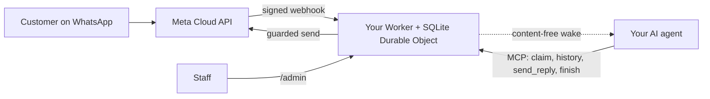

<div align="center">

[English](../../README.md) · [简体中文](README_zh.md) · [繁體中文](README_zh-TW.md) · [日本語](README_ja.md) · [한국어](README_ko.md) · [Türkçe](README_tr.md) · [Русский](README_ru.md) · [Tiếng Việt](README_vi.md) · [ไทย](README_th.md) · [Deutsch](README_de.md) · [Español](README_es.md) · [Français](README_fr.md) · **Українська** · [Polski](README_pl.md) · [Português (Brasil)](README_pt-BR.md) · [العربية](README_ar.md) · [فارسی](README_fa.md) · [Bahasa Indonesia](README_id.md) · [Italiano](README_it.md)
· [Ελληνικά](README_el.md)

</div>

<div align="center">

# WAB bot

### WhatsApp-номер одного бізнесу, один ШІ-агент через MCP, у вашому власному обліковому записі Cloudflare.

**Невеликий міст для одного орендаря: клієнти пишуть на ваш номер WhatsApp Cloud API, ваш агент відповідає через захищені інструменти, і ніщо не залишає ваші облікові записи.**

[](../../LICENSE)
[](../STATUS.md)
[](../CLOUDFLARE.md)
[](../../THIRD_PARTY_NOTICES.md)
[](../../.github/workflows/ci.yml)

[Швидкий старт](#швидкий-старт) · [Як це працює](#як-це-працює) · [Що це вміє](#що-це-вміє) · [Практичні приклади](#практичні-приклади) · [Поширені запитання](#поширені-запитання) · [Документація](#документація)

</div>

> [!IMPORTANT]
> Офіційне джерело цього шаблону — [wabbot-dev/wab-bot](https://github.com/wabbot-dev/wab-bot).
> Схожа назва репозиторію або скопійований README не доводять, що код офіційний. Читайте те, що розгортаєте, і
> ніколи не передавайте скрипту розгортання чи асистентові токен, який ви не віддали б його авторові.
> Цей проєкт незалежний: він не пов'язаний із Meta чи xAI і не схвалений ними. WhatsApp і Grok — торгові марки їхніх власників.

> [!NOTE]
> **Попередня версія.** Протестовано локально на імітаціях (291 автоматичних тестів). Ранні ревізії працювали наживо на одноразовому обліковому записі Cloudflare Free. Живі підтвердження на безкоштовному **тестовому** номері Meta: **текстові повідомлення** перевірено наживо 2026-10-16 (реальний обмін текстом: вхідне повідомлення отримано, відповідь пішла через міст), а **дзвінки** — 2026-10-17 на коді цього репозиторію (Grok Voice через Meta SIP до xAI SIP): вхідні голосові дзвінки WhatsApp приймав ШІ, розмова йшла в обидва боки (зокрема арабською), транскрипти обох сторін зберігалися, `end_call` моделі оброблено Worker, запит xAI на завершення дзвінка прийнято (HTTP 200), шлюз дзвінків увімкнувся і сам вимкнувся. Це не номер, що пройшов верифікацію бізнесу, для продакшену; запис аудіо не підтримується. Проєкт не запускався в продакшені. За повідомленням власника, дизайн обміну повідомленнями перевірено в продакшені в розгортанні, від якого він походить (зі слів власника, дата уточнюється); для цього коду це не доказ. Усе перевірене та спосіб перевірки: [docs/STATUS.md](../STATUS.md).

---

Ваші клієнти пишуть на WhatsApp-номер вашого бізнесу. Meta доставляє кожне повідомлення до Worker у **вашому власному обліковому записі Cloudflare**, який зберігає його й надсилає вашому ШІ-агентові сповіщення-пробудження без вмісту. Агент (будь-який агент із підтримкою MCP) бере розмову в роботу, читає історію та відповідає через `send_reply`. Токен WhatsApp зберігає і всі захисні перевірки надсилання застосовує міст, а не агент. Працівники можуть призупинити розмову, перехопити її або видалити в `/admin`.

Одне розгортання на один бізнес: власний застосунок Meta, номер, токени та обліковий запис Cloudflare. У цьому репозиторії немає секретів.

## Швидкий старт

Вам знадобляться: обліковий запис Cloudflare, яким ви володієте, Node.js 20+ (рекомендовано 22), обліковий запис розробника Meta та налаштований WhatsApp Cloud API ([контрольний список](../META-CHECKLIST.md)), **новий номер, який ніколи не реєстрували в жодному застосунку WhatsApp**, а також агент, який уміє працювати з MCP і пробуджується за webhook ([процедура пробудження](../WAKE-ROUTINE.md)). Ви платите Meta і своєму тарифу ШІ безпосередньо; тарифу Workers Free для того, що використовує цей шаблон, не потрібен спосіб оплати ([ліміти й умови](../CLOUDFLARE.md)).

### 1. Перевірте офлайн (без облікового запису, без мережі)

```bash
git clone https://github.com/wabbot-dev/wab-bot.git && cd wab-bot
npm ci
npm run check          # typecheck, 229 logic tests, 62 workerd tests, docs check
npm run build          # wrangler deploy --dry-run: bundle and binding check
npm run smoke:local    # wrangler dev --local with random fake secrets
```

### 2. Розгорніть у власному обліковому записі Cloudflare

```bash
bash scripts/deploy-cloudflare.sh --dry-run                  # prints the plan, makes no call
bash scripts/deploy-cloudflare.sh --name my-business-wa      # lowercase letters, digits, dashes
```

Скрипт входить в обліковий запис командою `wrangler login --device` (ви підтверджуєте код у браузері; обліковий запис він ніколи не створює), виконує розгортання, генерує власні токени моста та завантажує секрети через stdin. Інші шляхи (Cloudflare API без входу, самостійно видані секрети) описано в [docs/DEPLOY.md](../DEPLOY.md). Налаштування перевірено наживо на 2 різних облікових записах ([статус](../STATUS.md)).

### 3. Підключіть Meta та свого агента

Дотримуйтеся [docs/META-CHECKLIST.md](../META-CHECKLIST.md) (облікові записи Meta ви створюєте самі, самі верифікуєте бізнес і самі вводите SMS-код), виконайте `node scripts/meta-setup.mjs` на власному комп'ютері та спрямуйте агента на `https://<worker>.<your-subdomain>.workers.dev/mcp` із заголовком `Authorization: Bearer <MCP_TOKEN>`.

### 4. Залишайтеся в тестовому режимі, доки повідомлення не пройде шлях туди й назад

Безпечні типові значення: `LAUNCH_MODE=test` (відповіді йдуть лише на `TEST_RECIPIENTS`), автовідповідь **призупинено**, шаблони вимкнено, маршрут налаштування Meta всередині Worker вимкнено. Надішліть одне повідомлення зі свого телефона, переконайтеся, що воно з'явилося в `/admin`, дайте агентові відповісти і лише після цього свідомо переходьте в робочий режим.

## Як це працює



Кожен webhook має містити чинний `X-Hub-Signature-256` для необробленого тіла запиту. Один рядок SQLite на розмову зберігає незалежність запитів; запит, що програв перегони, перечитує дані й повторює спробу. POST-пробудження містить лише ідентифікатори та лічильники, ніколи текст повідомлень. Межі та володіння: [docs/ARCHITECTURE.md](../ARCHITECTURE.md). Зберігання, строк зберігання та пробудження: [docs/STATE-STORE.md](../STATE-STORE.md).

## Що це вміє

| Можливість | Підтвердження та обмеження |
|---|---|
| Приймання тексту WhatsApp і зберігання за розмовами з усуненням дублікатів та перевіркою HMAC | Протестовано локально; одне реальне повідомлення отримано на тестовий номер Meta ([статус](../STATUS.md)) |
| Інструменти агента через MCP: `list_pending`, `claim_conversation`, `get_history`, `send_reply` (16 серверних захисних перевірок), `finish`, `release`, `escalate`, `get_controls`, `get_overview` (лише читання) | Протестовано локально та прямими викликами JSON-RPC; з реальними клієнтами MCP **не** тестувалося. Одну реальну відповідь надіслано на тестовому номері Meta, вручну |
| Консоль працівників: призупинення й відновлення автовідповіді, перехоплення, звільнення, повторне відкриття, закриття, пробудження, видалення | Протестовано локально. Статична сторінка, потрібен токен |
| Видалення однієї розмови (`DELETE /api/admin/conversations/<id>`) | Протестовано локально з перевірками мутацій; наживо ніколи не запускалося. Не зачіпає копії для відновлення в Cloudflare ([конфіденційність](../PRIVACY.md)) |
| Пробудження вашого агента з debounce, відтермінуванням повторів (backoff) і щоденною повторною спробою | Перевірено наживо на підмінному приймачі; з реальною платформою агентів — ніколи |
| Зберігання: чати з відповіддю скорочуються через 14 днів, усе інше видаляється через 180 днів | Перевірено наживо на синтетичних даних; на реальних даних протягом тижнів — ніколи |
| Одноразова самостійна видача секретів (`POST /api/setup`) для інструментів розгортання, що приховують значення | Запускалося наживо на одному тестовому Worker; слабше за прив'язку секрету ([обмеження](../SELF-PROVISIONING.md)) |
| Відповідь на голосові дзвінки WhatsApp (Meta SIP → xAI Grok Voice), вимкнено, доки власник не відкриє шлюз; ви платите xAI, близько $0.08 за хвилину | **Перевірено наживо** на цьому коді: 2026-10-17 на тестовому номері Meta: відповів ШІ, розмова в обидва боки, транскрипти обох сторін збережено, запит моделі на завершення дзвінка оброблено; не номер, що пройшов верифікацію бізнесу, для продакшену ([голос](../VOICE-CALLS.md)) |
| Адміністративний MCP лише для власника за адресою `/admin/mcp`: стан, перевірка налаштування, приховані розмови, видалення, вмикання й вимкнення дзвінків, журнали дзвінків, використання, версія та перевірка оновлень (14 інструментів) | Вимкнено, доки не задано `ADMIN_MCP_TOKEN`. Протестовано локально та у workerd; **не** перевірялося зі справжніми MCP-клієнтами ([адміністративний MCP](../mcp.md)) |

Не включено: завантаження медіа, групи, типи шаблонів, окрім тексту та параметрів тіла, вихідні дзвінки, запис звуку, сторінка налаштувань, готові сценарії, мультиорендний хостинг. Див. [docs/ROADMAP.md](../ROADMAP.md).

## Практичні приклади

**Один хід клієнта через MCP** (лише заповнювачі; агент робить це через свій MCP-клієнт):

```bash
MCP=https://<worker>.<your-subdomain>.workers.dev/mcp
call() { curl -s "$MCP" -H "Authorization: Bearer $MCP_TOKEN" -H 'content-type: application/json' \
  -d "{\"jsonrpc\":\"2.0\",\"id\":1,\"method\":\"tools/call\",\"params\":{\"name\":\"$1\",\"arguments\":$2}}"; }
call list_pending '{}'
call claim_conversation '{"conversation_id":"c_<id>"}'                       # returns a lease
call get_history '{"conversation_id":"c_<id>","lease":"<lease>"}'            # customer text is wrapped as untrusted
call send_reply '{"conversation_id":"c_<id>","lease":"<lease>","text":"Hello, how can I help?"}'
call finish_conversation '{"conversation_id":"c_<id>","lease":"<lease>"}'
```

Поки діє `LAUNCH_MODE=test` або автовідповідь призупинено, `send_reply` замість надсилання відповідає `blocked_test_mode_recipient_not_allowlisted` або `blocked_auto_reply_paused`. Порядок захисних перевірок і всі рядки помилок: [docs/CONFIGURATION.md](../CONFIGURATION.md).

**Видалення одного клієнта:**

```bash
curl -X DELETE -H "Authorization: Bearer $ADMIN_TOKEN" https://<worker>.<your-subdomain>.workers.dev/api/admin/conversations/c_<id>
# {"ok":true,"deleted":true}   (404 if unknown or already erased)
```

**Видалити все:** `bash scripts/teardown-cloudflare.sh` (просить ввести назву Worker; видаляє Worker і всі збережені розмови, більше нічого).

## Поширені запитання

**Кому належить обліковий запис Cloudflare?** Вам: ви приймаєте умови, ви платите, якщо колись платитимете, і ви можете його видалити. Асистент може створити за вас облікові записи Cloudflare і xAI лише з вашої письмової згоди та за умови, що вас призначено власником або адміністратором; картку ви додаєте самі. Облікові записи Meta, верифікація бізнесу та SMS-код завжди залишаються за вами ([подробиці та застереження щодо умов Cloudflare](../CLOUDFLARE.md)).

**Чи дозволено тариф Free для бізнесу?** В умовах Cloudflare, прочитаних 2026-10-17, у сервісів Free немає застереження «лише для особистого використання», але є два суттєві тут обмеження (не збирати дані карток і не обробляти захищену медичну інформацію без письмової згоди Cloudflare). Це не юридична консультація; перевірте знову ([комерційне використання](../CLOUDFLARE.md#commercial-use)).

**Чи можна використати номер із мого застосунку WhatsApp Business?** Ні. Номер для Cloud API ніколи не мав реєструватися в застосунку WhatsApp; співіснування (coexistence) поза межами охоплення. Використовуйте власну SIM-картку чи лінію та вводьте її код самі.

**Чи відповідає він на дзвінки?** Так, лише вхідні й лише коли ви відкриєте шлюз: дзвінки за замовчуванням вимкнені, на реальному номері лишаються вимкненими, доки не завершено верифікацію бізнесу і ви не скажете «вперед», і працюють у коротких вікнах, які ви вмикаєте. Використовується xAI Grok Voice у вашому власному обліковому записі xAI (близько $0.08 за хвилину). Дзвінки на коді цього репозиторію було прийнято наживо на тестовому номері Meta 2026-10-17 (розмова в обидва боки, транскрипти збережено); на номері, що пройшов верифікацію бізнесу, для продакшену код не запускався, запис аудіо не підтримується ([голос](../VOICE-CALLS.md)).

**Який агент підійде?** Будь-який агент, який уміє працювати з MCP через HTTP і пробуджується за webhook. Перевірено на прямих викликах JSON-RPC, не на реальних клієнтах MCP ([процедура пробудження](../WAKE-ROUTINE.md)).

**Який обсяг витримує?** Один орендар, один Durable Object: обсяги малого бізнесу. За нашими вимірюваннями наживо, приблизно 30 000 повідомлень на добу вміщуються в квоту Durable Object на тарифі Free; безліч одночасних повідомлень в одній розмові можуть повертати 503, і Meta доставить їх повторно ([статус](../STATUS.md#live-measurements-cloudflare-free-fake-secrets-2026-10-16)).

**Чи перевірено це в продакшені?** Про дизайн, від якого воно походить, повідомляють, що так (зі слів власника, дату буде уточнено). Цей порт на Cloudflare — ні. [Статус](../STATUS.md) точно описує, що означає кожен рівень.

## Обмеження та добра практика

- **Незалежний проєкт.** WAB bot — неофіційний проєкт: він не пов'язаний із Meta, WhatsApp чи xAI і не схвалений ними. WhatsApp і Grok — торгові марки їхніх власників.
- **Діють правила Meta.** Використання WhatsApp Cloud API підпорядковується умовам Meta, політикам повідомлень і правилам для кожного номера; для дзвінків на бізнес-номері потрібна верифікація бізнесу Meta.
- **Один номер на бота.** Одне розгортання обслуговує один бізнес і один номер WhatsApp, зі своїм застосунком Meta, токенами та обліковим записом Cloudflare.
- **Дзвінки вмикаєте ви.** За замовчуванням вони вимкнені; ви відкриваєте їх, вказавши номер, і дзвінки використовують ваші власні кредити xAI (близько $0.08 за хвилину).
- **Лише вхідні дзвінки, без запису аудіо.** Вихідні дзвінки та запис аудіо не підтримуються. Текстова розшифровка за замовчуванням зберігається, її можна вимкнути.
- **SIP і Graph API дзвінків взаємовиключні для номера.** Поки номер використовує SIP для дзвінків, як цей бот, кінцеві точки Graph для дзвінків на ньому недоступні.
- **Залиште запасний спосіб зв'язку.** Опублікуйте інший спосіб зв'язатися з вами, як-от телефон чи пошту, і подбайте, щоб співробітники могли перехопити будь-яку розмову.

Що підтримується, а що ні: [можливості](../CAPABILITIES.md). Практичні відповіді: [усунення проблем](../TROUBLESHOOTING.md). Дзвінки докладно: [голос](../VOICE-CALLS.md).

## Документація

[docs/index.md](../index.md) перелічує всі сторінки. Почніть зі [STATUS](../STATUS.md), потім [DEPLOY](../DEPLOY.md), [META-CHECKLIST](../META-CHECKLIST.md), [CONFIGURATION](../CONFIGURATION.md), [PRIVACY](../PRIVACY.md) і [TROUBLESHOOTING](../TROUBLESHOOTING.md). Також: [AGENTS.md](../../AGENTS.md) для ШІ-агентів із програмування, [SECURITY.md](../../SECURITY.md), [CHANGELOG.md](../../CHANGELOG.md), [THIRD_PARTY_NOTICES.md](../../THIRD_PARTY_NOTICES.md).

## Відмова від відповідальності

Це програмне забезпечення в попередній версії для законного ділового листування. Ви відповідаєте за своє розгортання, облікові дані, дані своїх клієнтів, правила запису та розкриття використання ШІ, а також за свої умови з Meta і Cloudflare. Жодних гарантій. Прочитайте [DISCLAIMER.md](../../DISCLAIMER.md).

## Участь у розробці

Точкові виправлення, правки документації та тести вітаються; спершу прочитайте [межі внеску](../../CONTRIBUTING.md#contribution-scope) і [правила готовності PR](../../CONTRIBUTING.md#pull-request-ownership-and-readiness). PR, створеним за допомогою ШІ, потрібна названа відповідальна людина. Проблеми безпеки: [SECURITY.md](../../SECURITY.md).

## Ліцензія

[MIT](../../LICENSE), Copyright (c) 2026 wabbot-dev.
