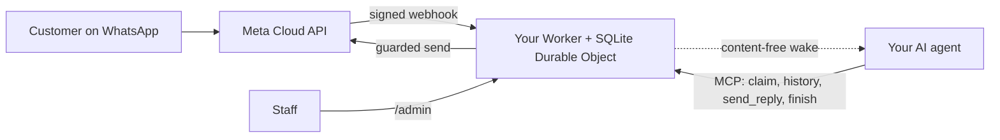

<div align="center">

[English](../../README.md) · [简体中文](README_zh.md) · [繁體中文](README_zh-TW.md) · [日本語](README_ja.md) · [한국어](README_ko.md) · [Türkçe](README_tr.md) · [Русский](README_ru.md) · **Tiếng Việt** · [ไทย](README_th.md) · [Deutsch](README_de.md) · [Español](README_es.md) · [Français](README_fr.md) · [Українська](README_uk.md) · [Polski](README_pl.md) · [Português (Brasil)](README_pt-BR.md) · [العربية](README_ar.md) · [فارسی](README_fa.md) · [Bahasa Indonesia](README_id.md) · [Italiano](README_it.md)
· [Ελληνικά](README_el.md)

</div>

<div align="center">

# WAB bot

### Số WhatsApp của một doanh nghiệp, một tác tử AI qua MCP, trên tài khoản Cloudflare của chính bạn.

**Một cầu nối nhỏ, đơn người thuê (single-tenant): khách hàng nhắn tin tới số WhatsApp Cloud API của bạn, tác tử của bạn trả lời thông qua các công cụ có bảo vệ, và không có gì rời khỏi tài khoản của bạn.**

[](../../LICENSE)
[](../STATUS.md)
[](../CLOUDFLARE.md)
[](../../THIRD_PARTY_NOTICES.md)
[](../../.github/workflows/ci.yml)

[Bắt đầu nhanh](#bắt-đầu-nhanh) · [Cách hoạt động](#cách-hoạt-động) · [Có thể làm gì](#có-thể-làm-gì) · [Ví dụ thực tế](#ví-dụ-thực-tế) · [Câu hỏi thường gặp](#câu-hỏi-thường-gặp) · [Tài liệu](#tài-liệu)

</div>

> [!IMPORTANT]
> Nguồn chính thức của mẫu này là [wabbot-dev/wab-bot](https://github.com/wabbot-dev/wab-bot).
> Một tên kho mã tương tự hoặc một README được sao chép không chứng minh rằng mã đó là chính thức. Hãy đọc những gì bạn triển khai, và
> đừng bao giờ đưa cho một tập lệnh triển khai hay một trợ lý một token mà bạn sẽ không đưa cho tác giả của nó.
> Dự án này độc lập: không liên kết với và không được Meta hay xAI bảo trợ. WhatsApp và Grok là nhãn hiệu của chủ sở hữu tương ứng.

> [!NOTE]
> **Bản xem trước.** Đã kiểm thử cục bộ với đối tượng giả lập (404 bài kiểm thử tự động). Các bản trước đã chạy thực trên một tài khoản Cloudflare Free dùng một lần. Bằng chứng chạy thực trên số **thử nghiệm** miễn phí của Meta: **nhắn tin** đã chạy thực vào 2026-10-16 (một vòng tin nhắn thật: nhận một tin đến và gửi lại câu trả lời qua cầu nối), còn **gọi thoại** đã chạy thực vào 2026-10-17 bằng mã của kho này (Grok Voice qua Meta SIP tới xAI SIP): các cuộc gọi thoại WhatsApp đến được AI trả lời, hai bên trò chuyện qua lại (có cả tiếng Ả Rập), bản ghi chữ của cả hai bên được lưu, `end_call` của mô hình được Worker xử lý và yêu cầu cúp máy tới xAI được chấp nhận (HTTP 200), còn cổng gọi đã bật rồi tự tắt. Đây không phải số sản xuất đã xác minh doanh nghiệp; không hỗ trợ ghi âm. Dự án này chưa chạy trong môi trường sản xuất. Chủ sở hữu báo cáo rằng thiết kế nhắn tin đã được chứng minh trong sản xuất ở bản triển khai mà nó bắt nguồn (do chủ sở hữu báo cáo, ngày chưa xác định), điều này không phải là bằng chứng cho mã này. Mọi thứ đã được xác minh và cách xác minh: [docs/STATUS.md](../STATUS.md).

---

Khách hàng của bạn nhắn tới số WhatsApp của doanh nghiệp bạn. Meta chuyển từng tin nhắn tới một Worker trong **tài khoản Cloudflare của chính bạn**, Worker lưu tin nhắn và gửi cho tác tử AI của bạn một tín hiệu đánh thức không chứa nội dung. Tác tử (bất kỳ tác tử nào hỗ trợ MCP) nhận cuộc trò chuyện, đọc lịch sử và trả lời qua `send_reply`. Cầu nối, chứ không phải tác tử, giữ token WhatsApp và thực thi mọi chốt chặn khi gửi. Nhân viên có thể tạm dừng, tiếp quản hoặc xóa một cuộc trò chuyện từ `/admin`.

Mỗi doanh nghiệp một bản triển khai: ứng dụng Meta, số điện thoại, token và tài khoản Cloudflare riêng. Kho mã này không chứa bí mật nào.

## Bắt đầu nhanh

Bạn cần: một tài khoản Cloudflare do bạn sở hữu, Node.js 20+ (khuyến nghị 22), một tài khoản nhà phát triển Meta và thiết lập WhatsApp Cloud API ([danh sách kiểm tra](../META-CHECKLIST.md)), một **số mới chưa từng đăng ký trên bất kỳ ứng dụng WhatsApp nào**, và một tác tử có thể dùng MCP và được đánh thức bằng webhook ([quy trình đánh thức](../WAKE-ROUTINE.md)). Bạn trả tiền trực tiếp cho Meta và gói AI của riêng bạn; gói Workers Free không cần phương thức thanh toán cho những gì mẫu này sử dụng ([giới hạn và điều khoản](../CLOUDFLARE.md)).

### 1. Kiểm tra ngoại tuyến (không cần tài khoản, không cần mạng)

```bash
git clone https://github.com/wabbot-dev/wab-bot.git && cd wab-bot
npm ci
npm run check          # typecheck, 293 logic tests, 65 workerd tests, docs check
npm run build          # wrangler deploy --dry-run: bundle and binding check
npm run smoke:local    # wrangler dev --local with random fake secrets
```

### 2. Triển khai lên tài khoản Cloudflare của bạn

```bash
bash scripts/deploy-cloudflare.sh --dry-run                  # prints the plan, makes no call
bash scripts/deploy-cloudflare.sh --name my-business-wa      # lowercase letters, digits, dashes
```

Tập lệnh đăng nhập cho bạn bằng `wrangler login --device` (bạn duyệt một mã trong trình duyệt; nó không bao giờ tạo tài khoản), triển khai, tạo các token riêng của cầu nối và tải bí mật lên qua stdin. Các cách khác (Cloudflare API không cần đăng nhập, bí mật tự cấp) có trong [docs/DEPLOY.md](../DEPLOY.md). Quy trình thiết lập đã được chứng minh chạy thật trên 2 tài khoản khác nhau ([trạng thái](../STATUS.md)).

### 3. Kết nối Meta và tác tử của bạn

Làm theo [docs/META-CHECKLIST.md](../META-CHECKLIST.md) (bạn tự tạo tài khoản Meta, tự xác minh doanh nghiệp và tự nhập mã SMS), chạy `node scripts/meta-setup.mjs` trên máy tính của chính bạn, rồi trỏ tác tử của bạn tới `https://<worker>.<your-subdomain>.workers.dev/mcp` với `Authorization: Bearer <MCP_TOKEN>`.

### 4. Giữ chế độ thử nghiệm cho đến khi một tin nhắn đi và về trọn vẹn

Mặc định an toàn: `LAUNCH_MODE=test` (phản hồi chỉ gửi tới `TEST_RECIPIENTS`), tự động trả lời **đang tạm dừng**, mẫu tin nhắn tắt, route thiết lập Meta trong Worker tắt. Gửi một tin nhắn từ điện thoại của bạn, xem nó xuất hiện trong `/admin`, để tác tử trả lời, và chỉ sau đó mới chủ động đưa vào hoạt động thật.

## Cách hoạt động



Mỗi webhook phải mang một `X-Hub-Signature-256` hợp lệ trên phần thân thô. Mỗi cuộc trò chuyện một hàng SQLite giúp các yêu cầu độc lập với nhau; yêu cầu thua trong cuộc đua sẽ đọc lại và thử lại. POST đánh thức chỉ mang ID và bộ đếm, không bao giờ mang nội dung tin nhắn. Ranh giới và quyền sở hữu: [docs/ARCHITECTURE.md](../ARCHITECTURE.md). Lưu trữ, thời hạn lưu giữ và đánh thức: [docs/STATE-STORE.md](../STATE-STORE.md).

## Có thể làm gì

| Khả năng | Bằng chứng và giới hạn |
|---|---|
| Nhận văn bản WhatsApp và lưu theo từng cuộc trò chuyện, loại bỏ trùng lặp, có xác minh HMAC | Đã kiểm thử cục bộ; đã nhận một tin nhắn thật trên số thử nghiệm của Meta ([trạng thái](../STATUS.md)) |
| Công cụ cho tác tử qua MCP: `list_pending`, `claim_conversation`, `get_history`, `send_reply` (16 chốt chặn phía máy chủ), `finish`, `release`, `escalate`, `get_controls`, `get_overview` chỉ đọc | Đã kiểm thử cục bộ và bằng các lệnh gọi JSON-RPC trực tiếp; **chưa** kiểm thử với các máy khách MCP thật. Đã gửi một phản hồi thật trên số thử nghiệm của Meta, điều khiển thủ công |
| Bảng điều khiển nhân viên: tạm dừng và tiếp tục tự động trả lời, tiếp quản, nhả, mở lại, giải quyết, đánh thức, xóa | Đã kiểm thử cục bộ. Trang tĩnh, cần token |
| Xóa một cuộc trò chuyện (`DELETE /api/admin/conversations/<id>`) | Đã kiểm thử cục bộ với các kiểm tra đột biến (mutation); chưa bao giờ chạy thật. Không chạm tới các bản sao khôi phục của Cloudflare ([quyền riêng tư](../PRIVACY.md)) |
| Đánh thức tác tử của bạn, có debounce, backoff và thử lại hằng ngày | Đã xác minh thật với một bên nhận giả lập; chưa bao giờ với một nền tảng tác tử thật |
| Lưu giữ: các cuộc trò chuyện đã trả lời bị cắt bớt sau 14 ngày, mọi thứ bị loại bỏ sau 180 ngày | Đã xác minh thật với dữ liệu tổng hợp; chưa bao giờ qua nhiều tuần trên dữ liệu thật |
| Tự cấp bí mật một lần (`POST /api/setup`) cho các công cụ triển khai che giấu giá trị | Đã chạy thật trên một Worker thử nghiệm; yếu hơn một liên kết bí mật (secret binding) ([giới hạn](../SELF-PROVISIONING.md)) |
| Trả lời cuộc gọi thoại WhatsApp (Meta SIP tới xAI Grok Voice), tắt cho đến khi chủ sở hữu mở cổng; bạn trả tiền cho xAI, khoảng $0.08 mỗi phút | **Đã chạy thực** bằng mã này trên số thử nghiệm của Meta ngày 2026-10-17: AI trả lời, trò chuyện hai chiều, bản ghi chữ của cả hai bên được lưu, yêu cầu kết thúc cuộc gọi của mô hình được xử lý; không phải số sản xuất đã xác minh doanh nghiệp ([thoại](../VOICE-CALLS.md)) |
| MCP quản trị chỉ dành cho chủ sở hữu tại `/admin/mcp`: trạng thái, kiểm tra thiết lập, hội thoại đã che thông tin, xóa, bật và tắt cuộc gọi, nhật ký cuộc gọi, mức sử dụng, phiên bản và kiểm tra cập nhật (17 công cụ) | Tắt trừ khi đặt `ADMIN_MCP_TOKEN`. Đã kiểm thử cục bộ và trong workerd; **chưa** kiểm thử với máy khách MCP thật ([MCP quản trị](../mcp.md)) |
| Hiểu tin nhắn thoại, hình ảnh và tài liệu: tin nhắn thoại được chép lời (Ả Rập, Pháp, Anh và nhiều ngôn ngữ khác), hình ảnh được mô tả và tài liệu PDF hoặc Office được đọc bằng Workers AI trong tài khoản Cloudflare của bạn, trong hạn mức miễn phí hằng ngày; vị trí và danh thiếp liên hệ được đọc; khi có lỗi, tác tử thấy một dấu hiệu đơn giản. Trả lời bằng tin nhắn thoại (tùy chọn, tắt theo mặc định): sáu ngôn ngữ với Workers AI, tiếng Ả Rập và ngôn ngữ khác với khóa xAI hoặc ElevenLabs của bạn | Đã kiểm thử cục bộ; đã chạy thật qua tuyến tự kiểm tra của chủ sở hữu trên một Worker thử nghiệm, chưa thử từ điện thoại thật ([media](../MEDIA.md)) |
| Tính năng doanh nghiệp tùy chọn: phục vụ khách lẻ, doanh nghiệp hoặc cả hai; danh bạ tài khoản do chủ quản lý; cảnh báo tức thì cho chủ; tài liệu, hình ảnh, nút bấm và danh sách trong câu trả lời; thanh toán do nhân viên xác minh; móc nối cho đặt chỗ và đơn hàng | Đã kiểm thử cục bộ; chưa chạy thực tế ([chế độ doanh nghiệp](../BUSINESS-MODE.md)) |

Không bao gồm: hiểu video (video được ghi nhận, không được xem), nhóm, cuộc gọi đi, ghi âm, trang cài đặt, quy trình dựng sẵn, lưu trữ đa khách thuê. Xem [docs/ROADMAP.md](../ROADMAP.md).

## Ví dụ thực tế

**Một lượt của khách hàng qua MCP** (chỉ là giá trị giữ chỗ; tác tử thực hiện việc này qua máy khách MCP của nó):

```bash
MCP=https://<worker>.<your-subdomain>.workers.dev/mcp
call() { curl -s "$MCP" -H "Authorization: Bearer $MCP_TOKEN" -H 'content-type: application/json' \
  -d "{\"jsonrpc\":\"2.0\",\"id\":1,\"method\":\"tools/call\",\"params\":{\"name\":\"$1\",\"arguments\":$2}}"; }
call list_pending '{}'
call claim_conversation '{"conversation_id":"c_<id>"}'                       # returns a lease
call get_history '{"conversation_id":"c_<id>","lease":"<lease>"}'            # customer text is wrapped as untrusted
call send_reply '{"conversation_id":"c_<id>","lease":"<lease>","text":"Hello, how can I help?"}'
call finish_conversation '{"conversation_id":"c_<id>","lease":"<lease>"}'
```

Khi `LAUNCH_MODE=test` hoặc tự động trả lời đang tạm dừng, `send_reply` trả về `blocked_test_mode_recipient_not_allowlisted` hoặc `blocked_auto_reply_paused` thay vì gửi. Thứ tự các chốt chặn và mọi chuỗi lỗi: [docs/CONFIGURATION.md](../CONFIGURATION.md).

**Xóa một khách hàng:**

```bash
curl -X DELETE -H "Authorization: Bearer $ADMIN_TOKEN" https://<worker>.<your-subdomain>.workers.dev/api/admin/conversations/c_<id>
# {"ok":true,"deleted":true}   (404 if unknown or already erased)
```

**Gỡ bỏ mọi thứ:** `bash scripts/teardown-cloudflare.sh` (yêu cầu bạn gõ tên Worker; xóa Worker và mọi cuộc trò chuyện đã lưu, không xóa gì khác).

## Câu hỏi thường gặp

**Ai sở hữu tài khoản Cloudflare?** Bạn: bạn chấp nhận điều khoản, bạn trả tiền nếu có lúc nào đó phải trả, và bạn có thể xóa nó. Một trợ lý chỉ có thể tạo tài khoản Cloudflare và xAI cho bạn khi có sự đồng ý bằng văn bản của bạn và bạn được đặt làm chủ sở hữu hoặc quản trị viên; bạn tự thêm thẻ. Tài khoản Meta, Xác minh doanh nghiệp và mã SMS luôn là việc của bạn ([chi tiết và lưu ý về điều khoản Cloudflare](../CLOUDFLARE.md)).

**Gói Free có được phép dùng cho doanh nghiệp không?** Trong điều khoản Cloudflare đã đọc vào 2026-10-17, các dịch vụ Free không có điều khoản chỉ dành cho mục đích cá nhân, nhưng có hai hạn chế quan trọng ở đây (không thu thập thông tin thẻ, không xử lý thông tin sức khỏe được bảo vệ nếu không có văn bản đồng ý của Cloudflare). Đây không phải tư vấn pháp lý; hãy kiểm tra lại ([sử dụng thương mại](../CLOUDFLARE.md#commercial-use)).

**Tôi có thể dùng số ứng dụng WhatsApp Business hiện có không?** Không. Số dùng cho Cloud API không bao giờ được từng đăng ký trên một ứng dụng WhatsApp; việc cùng tồn tại (coexistence) nằm ngoài phạm vi. Hãy dùng SIM hoặc đường dây của riêng bạn và tự nhập mã của nó.

**Nó có trả lời cuộc gọi không?** Có, chỉ cuộc gọi đến và chỉ khi bạn mở cổng: tính năng gọi mặc định tắt, với số thật thì vẫn tắt cho đến khi Xác minh doanh nghiệp hoàn tất và bạn nói bắt đầu, và chạy trong các khung thời gian ngắn do bạn kích hoạt. Nó dùng xAI Grok Voice trên tài khoản xAI của chính bạn (khoảng $0.08 mỗi phút). Các cuộc gọi từ mã này đã được trả lời trực tiếp trên số thử nghiệm của Meta vào 2026-10-17 (trò chuyện hai chiều, bản ghi chữ được lưu); chưa chạy trên số sản xuất đã xác minh doanh nghiệp và không hỗ trợ ghi âm ([thoại](../VOICE-CALLS.md)).

**Tác tử nào dùng được?** Bất kỳ tác tử nào nói được MCP qua HTTP và có thể được đánh thức bằng webhook. Đã được kiểm thử với các lệnh gọi JSON-RPC trực tiếp, không phải với các máy khách MCP thật ([quy trình đánh thức](../WAKE-ROUTINE.md)).

**Khối lượng được bao nhiêu?** Đơn người thuê, một Durable Object: khối lượng của doanh nghiệp nhỏ. Theo phép đo thực tế của chúng tôi, khoảng 30.000 tin nhắn mỗi ngày nằm trong hạn mức Durable Object của gói Free; nhiều tin nhắn đồng thời trong cùng một cuộc trò chuyện có thể trả về 503 và Meta sẽ gửi lại ([trạng thái](../STATUS.md#live-measurements-cloudflare-free-fake-secrets-2026-10-16)).

**Nó đã được chứng minh trong môi trường sản xuất chưa?** Thiết kế mà nó bắt nguồn được báo cáo là đã như vậy (do chủ sở hữu báo cáo, ngày chưa xác định). Bản chuyển sang Cloudflare này thì chưa. [Trạng thái](../STATUS.md) nói chính xác ý nghĩa của từng mức.

## Giới hạn và thực hành tốt

- **Dự án độc lập.** WAB bot là dự án không chính thức: không liên kết với và không được Meta, WhatsApp hay xAI chứng thực. WhatsApp và Grok là nhãn hiệu của chủ sở hữu tương ứng.
- **Quy tắc của Meta được áp dụng.** Việc dùng WhatsApp Cloud API tuân theo điều khoản, chính sách nhắn tin và quy tắc theo từng số của Meta; gọi thoại trên số doanh nghiệp cần Xác minh doanh nghiệp của Meta.
- **Một số cho mỗi bot.** Một lần triển khai phục vụ một doanh nghiệp và một số WhatsApp, với ứng dụng Meta, token và tài khoản Cloudflare của riêng bạn.
- **Bạn tự bật tính năng gọi.** Mặc định là tắt; bạn mở và chỉ định số, và cuộc gọi dùng tín dụng xAI của chính bạn (khoảng $0.08 mỗi phút).
- **Chỉ cuộc gọi đến, không ghi âm.** Không hỗ trợ gọi ra và ghi âm. Bản ghi chữ được lưu theo mặc định và bạn có thể tắt.
- **SIP và API gọi Graph loại trừ nhau trên mỗi số.** Khi một số dùng SIP để gọi, như bot này, các endpoint gọi Graph của Meta không dùng được trên số đó.
- **Giữ một kênh liên hệ dự phòng.** Công bố một cách liên hệ khác, như số điện thoại hoặc email, và để nhân viên luôn có thể tiếp quản mọi cuộc trò chuyện.

Những gì được hỗ trợ và không: [tính năng](../CAPABILITIES.md). Hỏi đáp thực tế: [khắc phục sự cố](../TROUBLESHOOTING.md). Chi tiết về gọi thoại: [thoại](../VOICE-CALLS.md).

## Tài liệu

[docs/index.md](../index.md) liệt kê mọi trang. Hãy bắt đầu với [STATUS](../STATUS.md), rồi đến [DEPLOY](../DEPLOY.md), [META-CHECKLIST](../META-CHECKLIST.md), [CONFIGURATION](../CONFIGURATION.md), [PRIVACY](../PRIVACY.md) và [TROUBLESHOOTING](../TROUBLESHOOTING.md). Ngoài ra: [AGENTS.md](../../AGENTS.md) dành cho các tác tử lập trình AI, [SECURITY.md](../../SECURITY.md), [CHANGELOG.md](../../CHANGELOG.md), [THIRD_PARTY_NOTICES.md](../../THIRD_PARTY_NOTICES.md).

## Tuyên bố miễn trừ

Đây là phần mềm bản xem trước dành cho việc nhắn tin kinh doanh hợp pháp. Bạn chịu trách nhiệm về bản triển khai, thông tin xác thực, dữ liệu khách hàng, các quy tắc ghi âm và công bố việc dùng AI, cũng như điều khoản của bạn với Meta và Cloudflare. Không có bảo hành. Hãy đọc [DISCLAIMER.md](../../DISCLAIMER.md).

## Đóng góp

Chúng tôi hoan nghênh các bản sửa lỗi tập trung, chỉnh sửa tài liệu và kiểm thử; trước hết hãy đọc [phạm vi đóng góp](../../CONTRIBUTING.md#contribution-scope) và [quy tắc sẵn sàng cho PR](../../CONTRIBUTING.md#pull-request-ownership-and-readiness). Các PR có AI hỗ trợ cần một người chịu trách nhiệm có tên. Vấn đề bảo mật: [SECURITY.md](../../SECURITY.md).

## Giấy phép

[MIT](../../LICENSE), Copyright (c) 2026 wabbot-dev.
