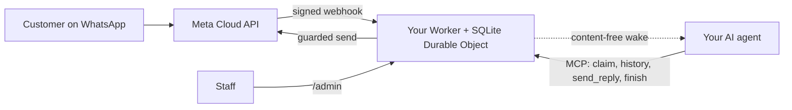

<div align="center">

[English](../../README.md) · [简体中文](README_zh.md) · **繁體中文** · [日本語](README_ja.md) · [한국어](README_ko.md) · [Türkçe](README_tr.md) · [Русский](README_ru.md) · [Tiếng Việt](README_vi.md) · [ไทย](README_th.md) · [Deutsch](README_de.md) · [Español](README_es.md) · [Français](README_fr.md) · [Українська](README_uk.md) · [Polski](README_pl.md) · [Português (Brasil)](README_pt-BR.md) · [العربية](README_ar.md) · [فارسی](README_fa.md) · [Bahasa Indonesia](README_id.md) · [Italiano](README_it.md)
· [Ελληνικά](README_el.md)

</div>

<div align="center">

# WAB bot

### 一間企業的 WhatsApp 號碼，一個透過 MCP 串接的 AI 代理，運行在你自己的 Cloudflare 帳號上。

**一個小型的單租戶橋接服務：客戶傳訊息到你的 WhatsApp Cloud API 號碼，你的代理透過受保護的工具回覆，任何內容都不會離開你的帳號。**

[](../../LICENSE)
[](../STATUS.md)
[](../CLOUDFLARE.md)
[](../../THIRD_PARTY_NOTICES.md)
[](../../.github/workflows/ci.yml)

[快速開始](#快速開始) · [運作原理](#運作原理) · [功能](#功能) · [實例示範](#實例示範) · [常見問題](#常見問題) · [文件](#文件)

</div>

> [!IMPORTANT]
> 本範本的官方來源是 [wabbot-dev/wab-bot](https://github.com/wabbot-dev/wab-bot)。
> 儲存庫名稱相似或 README 被複製，並不能證明程式碼是官方的。請閱讀你要部署的內容，
> 而且不要把你不會交給其作者的權杖交給任何部署腳本或助理。
> 本專案為獨立專案：與 Meta 或 xAI 無關聯，也未獲其認可。WhatsApp 與 Grok 為其各自所有者的商標。

> [!NOTE]
> **預覽版。** 已在本機針對模擬物件測試（407 項自動化測試）。早期版本曾在一次性的 Cloudflare Free 帳號上實際執行。在 Meta 免費**測試**號碼上的實測證據：**文字訊息**於 2026-10-16 實測執行（一次真實的文字往返：收到一則入站訊息，並透過橋接送回了回覆）；**語音通話**於 2026-10-17 使用本儲存庫的程式碼實測執行（Grok Voice 經 Meta SIP 連接 xAI SIP）：WhatsApp 語音來電由 AI 接聽，雙向交談（包括阿拉伯語），雙方的逐字稿均已儲存，Worker 處理了模型的 `end_call`，xAI 接受了掛斷請求（HTTP 200），通話開關完成啟用並自動關閉。這不是經商業驗證的正式環境號碼；不支援音訊錄製。本專案未在正式環境中執行過。訊息部分的設計據其所有者表示已在其衍生來源的部署中經正式環境驗證（所有者自述，日期待定），這並不構成對本程式碼的證據。已驗證的全部內容與驗證方式：[docs/STATUS.md](../STATUS.md)。

---

你的客戶傳訊息到你企業的 WhatsApp 號碼。Meta 會把每則訊息遞送到**你自己的 Cloudflare 帳號**中的一個 Worker，由它儲存訊息，並向你的 AI 代理發送一個不含內容的喚醒通知。代理（任何支援 MCP 的代理）認領對話、讀取歷史紀錄，並透過 `send_reply` 回覆。持有 WhatsApp 權杖並執行所有傳送防護的是橋接服務，而不是代理。工作人員可以在 `/admin` 中暫停、接管或刪除某個對話。

每間企業一套部署：自己的 Meta 應用程式、號碼、權杖和 Cloudflare 帳號。本儲存庫中沒有任何密鑰。

## 快速開始

你需要：一個你自己擁有的 Cloudflare 帳號、Node.js 20+（建議 22）、一個 Meta 開發者帳號並完成 WhatsApp Cloud API 設定（[清單](../META-CHECKLIST.md)）、一個**從未在任何 WhatsApp 應用程式中註冊過的新號碼**，以及一個能使用 MCP 並能被 webhook 喚醒的代理（[喚醒流程](../WAKE-ROUTINE.md)）。你直接向 Meta 和你自己的 AI 方案付費；就本範本所使用的功能而言，Workers Free 方案不需要綁定付款方式（[限制與條款](../CLOUDFLARE.md)）。

### 1. 離線檢查（不需帳號，不需網路）

```bash
git clone https://github.com/wabbot-dev/wab-bot.git && cd wab-bot
npm ci
npm run check          # typecheck, 293 logic tests, 65 workerd tests, docs check
npm run build          # wrangler deploy --dry-run: bundle and binding check
npm run smoke:local    # wrangler dev --local with random fake secrets
```

### 2. 部署到你自己的 Cloudflare 帳號

```bash
bash scripts/deploy-cloudflare.sh --dry-run                  # prints the plan, makes no call
bash scripts/deploy-cloudflare.sh --name my-business-wa      # lowercase letters, digits, dashes
```

該腳本透過 `wrangler login --device` 為你登入（你在瀏覽器中批准一個代碼；它從不建立帳號），然後部署、產生橋接服務自己的權杖，並透過 stdin 上傳密鑰。其他方式（不需登入的 Cloudflare API、自行配置密鑰）請見 [docs/DEPLOY.md](../DEPLOY.md)。此設定已在 2 個不同帳號上實際驗證過（[狀態](../STATUS.md)）。

### 3. 連接 Meta 和你的代理

依照 [docs/META-CHECKLIST.md](../META-CHECKLIST.md) 操作（Meta 帳號由你自己建立、自己完成企業驗證並自己輸入簡訊驗證碼），在你自己的電腦上執行 `node scripts/meta-setup.mjs`，然後讓你的代理指向 `https://<worker>.<your-subdomain>.workers.dev/mcp`，並使用 `Authorization: Bearer <MCP_TOKEN>`。

### 4. 在訊息完成一次往返之前保持測試模式

安全的預設值：`LAUNCH_MODE=test`（回覆只會傳給 `TEST_RECIPIENTS`）、自動回覆**已暫停**、範本關閉、Worker 內的 Meta 設定路由關閉。用手機傳一則訊息，看它出現在 `/admin` 中，讓代理回答，然後再有意識地正式上線。

## 運作原理



每個 webhook 都必須帶有針對原始請求內容的有效 `X-Hub-Signature-256`。每個對話對應一列 SQLite 記錄，使請求相互獨立；競爭失敗時會重新讀取並重試。喚醒用的 POST 只攜帶 ID 和計數器，絕不包含訊息文字。邊界與歸屬：[docs/ARCHITECTURE.md](../ARCHITECTURE.md)。儲存、保留與喚醒：[docs/STATE-STORE.md](../STATE-STORE.md)。

## 功能

| 能力 | 證據與限制 |
|---|---|
| 接收 WhatsApp 文字並依對話儲存，去重，並進行 HMAC 驗證 | 已在本機測試；在 Meta 測試號碼上收到過一則真實訊息（[狀態](../STATUS.md)） |
| 透過 MCP 提供的代理工具：`list_pending`、`claim_conversation`、`get_history`、`send_reply`（16 項伺服器端防護）、`finish`、`release`、`escalate`、`get_controls`、唯讀的 `get_overview` | 已在本機並透過直接的 JSON-RPC 呼叫測試；**未**使用真實的 MCP 用戶端測試。在 Meta 測試號碼上手動驅動，送出過一則真實回覆 |
| 工作人員主控台：暫停和恢復自動回覆、接管、釋放、重新開啟、解決、喚醒、刪除 | 已在本機測試。靜態頁面，需要權杖 |
| 刪除一個對話（`DELETE /api/admin/conversations/<id>`） | 已在本機透過變異檢查測試；從未實際運行。無法觸及 Cloudflare 的復原副本（[隱私](../PRIVACY.md)） |
| 喚醒你的代理，帶防抖、退避和每日重試 | 已針對一個替身接收端實際驗證；從未針對真實的代理平台驗證 |
| 保留策略：已回覆的聊天在 14 天後裁剪，任何內容在 180 天後捨棄 | 已用合成資料實際驗證；從未在真實資料上跨越數週驗證 |
| 為會隱去數值的部署工具一次性自行配置密鑰（`POST /api/setup`） | 已在一個測試 Worker 上實際運行；比密鑰綁定更弱（[限制](../SELF-PROVISIONING.md)） |
| 接聽 WhatsApp 語音來電（Meta SIP 到 xAI Grok Voice），在所有者開啟開關之前保持關閉；由您向 xAI 付費，約 $0.08/分鐘 | **已實測**：2026-10-17 在 Meta 測試號碼上用本程式碼執行：由 AI 接聽，雙向交談，雙方逐字稿均已儲存，模型的結束通話請求已處理；不是經商業驗證的正式環境號碼（[語音](../VOICE-CALLS.md)） |
| 僅限所有者的管理 MCP，位於 `/admin/mcp`：狀態、設定檢查、去識別化對話、刪除、啟用與停用通話、通話記錄、用量、版本與更新檢查（17 個工具） | 除非設定了 `ADMIN_MCP_TOKEN`，否則關閉。已在本機與 workerd 中測試；**未**用真實 MCP 用戶端測試（[管理 MCP](../mcp.md)） |
| 理解語音訊息、圖片與文件：語音訊息轉寫為文字（阿拉伯語、法語、英語等），圖片產生描述，PDF 或 Office 文件會被讀取，皆在您自己的 Cloudflare 帳戶中透過 Workers AI 完成，並在每日免費額度內；位置與聯絡人名片會被讀取；任何失敗時代理會看到一個簡單標記。可選的語音訊息回覆，預設關閉：Workers AI 支援六種語言，阿拉伯語及其他語言使用您自己的 xAI 或 ElevenLabs 金鑰 | 已在本機測試；已透過擁有者自我測試路徑在測試 Worker 上實際執行，尚未從真實手機測試（[媒體](../MEDIA.md)） |
| 可選的企業功能：服務個人客戶、企業客戶或兩者；由擁有者維護的客戶帳戶名錄；即時通知擁有者；回覆中可傳送文件、圖片、按鈕與清單；由員工核實的付款；預約與訂單串接掛鉤 | 已在本機測試；尚未實際運行（[企業模式](../BUSINESS-MODE.md)） |

不包含：影片理解（只記錄有影片，不觀看）、群組、撥出電話、錄音、設定頁面、預設流程、多租戶託管。參見 [docs/ROADMAP.md](../ROADMAP.md)。

## 實例示範

**透過 MCP 處理一輪客戶對話**（僅為佔位符；代理透過其 MCP 用戶端完成這些操作）：

```bash
MCP=https://<worker>.<your-subdomain>.workers.dev/mcp
call() { curl -s "$MCP" -H "Authorization: Bearer $MCP_TOKEN" -H 'content-type: application/json' \
  -d "{\"jsonrpc\":\"2.0\",\"id\":1,\"method\":\"tools/call\",\"params\":{\"name\":\"$1\",\"arguments\":$2}}"; }
call list_pending '{}'
call claim_conversation '{"conversation_id":"c_<id>"}'                       # returns a lease
call get_history '{"conversation_id":"c_<id>","lease":"<lease>"}'            # customer text is wrapped as untrusted
call send_reply '{"conversation_id":"c_<id>","lease":"<lease>","text":"Hello, how can I help?"}'
call finish_conversation '{"conversation_id":"c_<id>","lease":"<lease>"}'
```

當 `LAUNCH_MODE=test` 或自動回覆處於暫停狀態時，`send_reply` 會回傳 `blocked_test_mode_recipient_not_allowlisted` 或 `blocked_auto_reply_paused`，而不會傳送。防護的順序和每個錯誤字串：[docs/CONFIGURATION.md](../CONFIGURATION.md)。

**刪除一位客戶：**

```bash
curl -X DELETE -H "Authorization: Bearer $ADMIN_TOKEN" https://<worker>.<your-subdomain>.workers.dev/api/admin/conversations/c_<id>
# {"ok":true,"deleted":true}   (407 if unknown or already erased)
```

**移除全部內容：**`bash scripts/teardown-cloudflare.sh`（會要求你輸入 Worker 名稱；刪除該 Worker 和所有已儲存的對話，不會刪除其他任何東西）。

## 常見問題

**Cloudflare 帳號歸誰所有？** 歸你所有：你接受條款，你在將來付費時付費，你也可以刪除它。只有在取得你的書面同意、並且你被設為擁有者或管理員的情況下，助理才可以為你建立 Cloudflare 和 xAI 帳號；信用卡由你自己新增。Meta 帳號、企業驗證和簡訊驗證碼始終由你自己完成（[詳情及 Cloudflare 條款的注意事項](../CLOUDFLARE.md)）。

**企業可以使用 Free 方案嗎？** 在 2026-10-17 閱讀的 Cloudflare 條款中，Free 服務沒有僅限個人使用的條款，但有兩項與此相關的限制（不得收集信用卡資訊，未經 Cloudflare 書面同意不得處理受保護的健康資訊）。這不是法律意見；請重新核實（[商業使用](../CLOUDFLARE.md#commercial-use)）。

**我能使用現有的 WhatsApp Business 應用程式號碼嗎？** 不能。Cloud API 號碼絕不能曾在 WhatsApp 應用程式中註冊過；共存模式不在範圍內。請使用你自己的 SIM 卡或線路，並自己輸入其驗證碼。

**它能接聽電話嗎？** 可以，僅限來電，且僅在您開啟開關後：通話預設關閉，在真實號碼上要等您的商業驗證完成並由您發話後才會開啟，並且只在您啟用的短時間視窗內運作。它在您自己的 xAI 帳號上使用 xAI Grok Voice（約 $0.08/分鐘）。2026-10-17，本程式碼在 Meta 測試號碼上實際接聽了來電（雙向交談，逐字稿已儲存）；尚未在經商業驗證的正式環境號碼上執行，也不支援音訊錄製（[語音](../VOICE-CALLS.md)）。

**哪些代理可以用？** 任何能透過 HTTP 使用 MCP 並能被 webhook 喚醒的代理。已針對直接的 JSON-RPC 呼叫測試，未針對真實的 MCP 用戶端測試（[喚醒流程](../WAKE-ROUTINE.md)）。

**能承載多大的量？** 單租戶、一個 Durable Object：適合小型企業的規模。根據我們的實測，每天大約 30,000 則訊息可以放進 Free 的 Durable Object 配額；同一對話中大量同時到來的訊息可能回傳 503，Meta 會重新遞送（[狀態](../STATUS.md#live-measurements-cloudflare-free-fake-secrets-2026-10-16)）。

**它在正式環境中獲得驗證了嗎？** 據稱它所源自的設計是（擁有者自述，日期待定）。這個 Cloudflare 移植版則不是。[狀態](../STATUS.md)準確說明了每個等級的含義。

## 限制與良好實踐

- **獨立專案。** WAB bot 是非官方專案：與 Meta、WhatsApp 或 xAI 沒有隸屬關係，也未獲其認可。WhatsApp 與 Grok 是其各自所有者的商標。
- **適用 Meta 的規則。** 您使用 WhatsApp Cloud API 須遵守 Meta 的條款、訊息政策與每個號碼的規則；在商業號碼上啟用通話需要完成 Meta 商業驗證。
- **一個機器人一個號碼。** 一次部署服務一家企業與一個 WhatsApp 號碼，使用您自己的 Meta 應用程式、權杖與 Cloudflare 帳號。
- **通話由您自行開啟。** 預設關閉；由您開啟並指明號碼，通話使用您自己的 xAI 額度（約 $0.08/分鐘）。
- **僅限來電，不錄製音訊。** 不支援外撥與錄製音訊。預設保存文字逐字稿，您可以關閉。
- **每個號碼上 SIP 與 Graph 通話 API 互斥。** 號碼使用 SIP 通話時（本機器人即如此），該號碼上無法使用 Meta 的 Graph 通話端點。
- **保留備用聯絡管道。** 公布另一種聯絡您的方式，例如電話或電子郵件，並讓員工隨時能接管任何對話。

支援與不支援的內容：[功能一覽](../CAPABILITIES.md)。實用問答：[疑難排解](../TROUBLESHOOTING.md)。通話詳情：[語音](../VOICE-CALLS.md)。

## 文件

[docs/index.md](../index.md) 列出了所有頁面。請先閱讀 [STATUS](../STATUS.md)，然後是 [DEPLOY](../DEPLOY.md)、[META-CHECKLIST](../META-CHECKLIST.md)、[CONFIGURATION](../CONFIGURATION.md)、[PRIVACY](../PRIVACY.md) 和 [TROUBLESHOOTING](../TROUBLESHOOTING.md)。另外：給 AI 程式設計代理的 [AGENTS.md](../../AGENTS.md)、[SECURITY.md](../../SECURITY.md)、[CHANGELOG.md](../../CHANGELOG.md)、[THIRD_PARTY_NOTICES.md](../../THIRD_PARTY_NOTICES.md)。

## 免責聲明

這是用於合法商業訊息往來的預覽版軟體。你需要對自己的部署、憑證、客戶資料、錄音與 AI 揭露規則，以及你與 Meta 和 Cloudflare 之間的條款負責。不提供任何保證。請閱讀 [DISCLAIMER.md](../../DISCLAIMER.md)。

## 參與貢獻

歡迎有針對性的修復、文件更正和測試；請先閱讀[貢獻範圍](../../CONTRIBUTING.md#contribution-scope)和 [PR 就緒規則](../../CONTRIBUTING.md#pull-request-ownership-and-readiness)。有 AI 參與的 PR 需要一位具名的真人負責人。安全問題：[SECURITY.md](../../SECURITY.md)。

## 授權條款

[MIT](../../LICENSE), Copyright (c) 2026 wabbot-dev.
