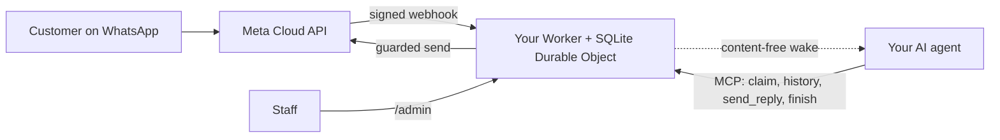

<div align="center">

[English](../../README.md) · **简体中文** · [繁體中文](README_zh-TW.md) · [日本語](README_ja.md) · [한국어](README_ko.md) · [Türkçe](README_tr.md) · [Русский](README_ru.md) · [Tiếng Việt](README_vi.md) · [ไทย](README_th.md) · [Deutsch](README_de.md) · [Español](README_es.md) · [Français](README_fr.md) · [Українська](README_uk.md) · [Polski](README_pl.md) · [Português (Brasil)](README_pt-BR.md) · [العربية](README_ar.md) · [فارسی](README_fa.md) · [Bahasa Indonesia](README_id.md) · [Italiano](README_it.md)
· [Ελληνικά](README_el.md)

</div>

<div align="center">

# WAB bot

### 一家企业的 WhatsApp 号码，一个通过 MCP 接入的 AI 智能体，运行在你自己的 Cloudflare 账号上。

**一个小型的单租户桥接服务：客户给你的 WhatsApp Cloud API 号码发消息，你的智能体通过受保护的工具作答，任何内容都不会离开你的账号。**

[](../../LICENSE)
[](../STATUS.md)
[](../CLOUDFLARE.md)
[](../../THIRD_PARTY_NOTICES.md)
[](../../.github/workflows/ci.yml)

[快速开始](#快速开始) · [工作原理](#工作原理) · [功能](#功能) · [实例演示](#实例演示) · [常见问题](#常见问题) · [文档](#文档)

</div>

> [!IMPORTANT]
> 本模板的官方来源是 [wabbot-dev/wab-bot](https://github.com/wabbot-dev/wab-bot)。
> 仓库名称相似或 README 被复制，并不能证明代码是官方的。请阅读你要部署的内容，
> 并且不要把你不会交给其作者的令牌交给任何部署脚本或助手。
> 本项目是独立项目：与 Meta 或 xAI 无关联，也未获其认可。WhatsApp 和 Grok 是其各自所有者的商标。

> [!NOTE]
> **预览版。** 已在本地针对模拟对象测试（407 项自动化测试）。早期版本曾在一次性的 Cloudflare Free 账户上实际运行。在 Meta 免费**测试**号码上的实测证据：**文字消息**于 2026-10-16 实测运行（一次真实的文字往返：收到一条入站消息，并通过桥接发回了回复）；**语音通话**于 2026-10-17 使用本仓库的代码实测运行（Grok Voice 经 Meta SIP 连接 xAI SIP）：WhatsApp 语音来电由 AI 接听，双向交谈（包括阿拉伯语），双方的转录文本均已保存，Worker 处理了模型的 `end_call`，xAI 接受了挂断请求（HTTP 200），通话开关完成布防并自动撤防。这不是经商业验证的生产号码；不支持音频录制。本项目未在生产环境中运行过。消息部分的设计据其所有者称已在其衍生来源的部署中经生产验证（所有者自述，日期待定），这并不构成对本代码的证据。已验证的全部内容及验证方式：[docs/STATUS.md](../STATUS.md)。

---

你的客户给你企业的 WhatsApp 号码发消息。Meta 把每条消息投递到**你自己的 Cloudflare 账号**中的一个 Worker，由它存储消息，并向你的 AI 智能体发送一个不含内容的唤醒通知。智能体（任何支持 MCP 的智能体）认领会话、读取历史记录，并通过 `send_reply` 回复。持有 WhatsApp 令牌并执行所有发送防护的是桥接服务，而不是智能体。工作人员可以在 `/admin` 中暂停、接管或删除某个会话。

每家企业一套部署：自己的 Meta 应用、号码、令牌和 Cloudflare 账号。本仓库中没有任何密钥。

## 快速开始

你需要：一个你自己拥有的 Cloudflare 账号、Node.js 20+（推荐 22）、一个 Meta 开发者账号并完成 WhatsApp Cloud API 设置（[清单](../META-CHECKLIST.md)）、一个**从未在任何 WhatsApp 应用中注册过的新号码**，以及一个能使用 MCP 并能被 webhook 唤醒的智能体（[唤醒流程](../WAKE-ROUTINE.md)）。你直接向 Meta 和你自己的 AI 套餐付费；就本模板所使用的功能而言，Workers Free 套餐无需绑定付款方式（[限制与条款](../CLOUDFLARE.md)）。

### 1. 离线检查（无需账号，无需网络）

```bash
git clone https://github.com/wabbot-dev/wab-bot.git && cd wab-bot
npm ci
npm run check          # typecheck, 342 logic tests, 65 workerd tests, docs check
npm run build          # wrangler deploy --dry-run: bundle and binding check
npm run smoke:local    # wrangler dev --local with random fake secrets
```

### 2. 部署到你自己的 Cloudflare 账号

```bash
bash scripts/deploy-cloudflare.sh --dry-run                  # prints the plan, makes no call
bash scripts/deploy-cloudflare.sh --name my-business-wa      # lowercase letters, digits, dashes
```

该脚本通过 `wrangler login --device` 为你登录（你在浏览器中批准一个代码；它从不创建账号），然后部署、生成桥接服务自己的令牌，并通过 stdin 上传密钥。其他方式（无需登录的 Cloudflare API、自行配置密钥）见 [docs/DEPLOY.md](../DEPLOY.md)。该设置已在 2 个不同账号上实际验证过（[状态](../STATUS.md)）。

### 3. 连接 Meta 和你的智能体

按照 [docs/META-CHECKLIST.md](../META-CHECKLIST.md) 操作（Meta 账号由你自己创建、自己完成企业验证并自己输入短信验证码），在你自己的电脑上运行 `node scripts/meta-setup.mjs`，然后让你的智能体指向 `https://<worker>.<your-subdomain>.workers.dev/mcp`，并使用 `Authorization: Bearer <MCP_TOKEN>`。

### 4. 在消息完成一次往返之前保持测试模式

安全的默认值：`LAUNCH_MODE=test`（回复只会发给 `TEST_RECIPIENTS`）、自动回复**已暂停**、模板关闭、Worker 内的 Meta 设置路由关闭。用手机发一条消息，看它出现在 `/admin` 中，让智能体作答，然后再有意识地正式上线。

## 工作原理



每个 webhook 都必须带有针对原始请求体的有效 `X-Hub-Signature-256`。每个会话对应一行 SQLite 记录，使请求相互独立；竞争失败时会重新读取并重试。唤醒用的 POST 只携带 ID 和计数器，绝不包含消息文本。边界与归属：[docs/ARCHITECTURE.md](../ARCHITECTURE.md)。存储、保留与唤醒：[docs/STATE-STORE.md](../STATE-STORE.md)。

## 功能

| 能力 | 证据与限制 |
|---|---|
| 接收 WhatsApp 文本并按会话存储，去重，并进行 HMAC 校验 | 已在本地测试；在 Meta 测试号码上收到过一条真实消息（[状态](../STATUS.md)） |
| 通过 MCP 提供的智能体工具：`list_pending`、`claim_conversation`、`get_history`、`send_reply`（16 项服务端防护）、`finish`、`release`、`escalate`、`get_controls`、只读的 `get_overview` | 已在本地并通过直接的 JSON-RPC 调用测试；**未**使用真实的 MCP 客户端测试。在 Meta 测试号码上手动驱动，发出过一条真实回复 |
| 工作人员控制台：暂停和恢复自动回复、接管、释放、重新打开、解决、唤醒、删除 | 已在本地测试。静态页面，需要令牌 |
| 删除一个会话（`DELETE /api/admin/conversations/<id>`） | 已在本地通过变异检查测试；从未实际运行。无法触及 Cloudflare 的恢复副本（[隐私](../PRIVACY.md)） |
| 唤醒你的智能体，带防抖、退避和每日重试 | 已针对一个替身接收端实际验证；从未针对真实的智能体平台验证 |
| 保留策略：已回复的聊天在 14 天后裁剪，任何内容在 180 天后丢弃 | 已用合成数据实际验证；从未在真实数据上跨越数周验证 |
| 为会隐去值的部署工具一次性自行配置密钥（`POST /api/setup`） | 已在一个测试 Worker 上实际运行；比密钥绑定更弱（[限制](../SELF-PROVISIONING.md)） |
| 接听 WhatsApp 语音来电（Meta SIP 到 xAI Grok Voice），在所有者打开开关之前保持关闭；由您向 xAI 支付，约 $0.08/分钟 | **已实测**：2026-10-17 在 Meta 测试号码上用本代码运行：由 AI 接听，双向交谈，双方转录均已保存，模型的结束通话请求已处理；不是经商业验证的生产号码（[语音](../VOICE-CALLS.md)） |
| 仅限所有者的管理 MCP，位于 `/admin/mcp`：状态、设置检查、脱敏会话、删除、启用与停用通话、通话日志、用量、版本与更新检查（17 个工具） | 除非设置了 `ADMIN_MCP_TOKEN`，否则关闭。已在本地和 workerd 中测试；**未**用真实 MCP 客户端测试（[管理 MCP](../mcp.md)） |
| 理解语音消息、图片和文档：语音消息转写为文字（阿拉伯语、法语、英语等），图片生成描述，PDF 或 Office 文档被读取，均在您自己的 Cloudflare 账户中通过 Workers AI 完成，并在每日免费额度内；位置和联系人名片会被读取；任何失败时智能体会看到一个简单标记。可选的语音消息回复，默认关闭：Workers AI 支持六种语言，阿拉伯语及其他语言使用您自己的 xAI 或 ElevenLabs 密钥 | 已在本地测试；已通过所有者自测路径在测试 Worker 上实际运行，尚未从真实手机测试（[媒体](../MEDIA.md)） |
| 可选的企业功能：服务个人客户、企业客户或两者；由所有者维护的客户账户目录；即时通知所有者；回复中可发送文档、图片、按钮和列表；由员工核实的付款；预订和订单对接钩子 | 已在本地测试；尚未实际运行（[企业模式](../BUSINESS-MODE.md)） |

不包含：视频理解（只记录有视频，不观看）、群组、外呼电话、录音、设置页面、预设流程、多租户托管。参见 [docs/ROADMAP.md](../ROADMAP.md)。

## 实例演示

**通过 MCP 处理一轮客户对话**（仅为占位符；智能体通过其 MCP 客户端完成这些操作）：

```bash
MCP=https://<worker>.<your-subdomain>.workers.dev/mcp
call() { curl -s "$MCP" -H "Authorization: Bearer $MCP_TOKEN" -H 'content-type: application/json' \
  -d "{\"jsonrpc\":\"2.0\",\"id\":1,\"method\":\"tools/call\",\"params\":{\"name\":\"$1\",\"arguments\":$2}}"; }
call list_pending '{}'
call claim_conversation '{"conversation_id":"c_<id>"}'                       # returns a lease
call get_history '{"conversation_id":"c_<id>","lease":"<lease>"}'            # customer text is wrapped as untrusted
call send_reply '{"conversation_id":"c_<id>","lease":"<lease>","text":"Hello, how can I help?"}'
call finish_conversation '{"conversation_id":"c_<id>","lease":"<lease>"}'
```

当 `LAUNCH_MODE=test` 或自动回复处于暂停状态时，`send_reply` 会返回 `blocked_test_mode_recipient_not_allowlisted` 或 `blocked_auto_reply_paused`，而不会发送。防护的顺序和每个错误字符串：[docs/CONFIGURATION.md](../CONFIGURATION.md)。

**删除一位客户：**

```bash
curl -X DELETE -H "Authorization: Bearer $ADMIN_TOKEN" https://<worker>.<your-subdomain>.workers.dev/api/admin/conversations/c_<id>
# {"ok":true,"deleted":true}   (404 if unknown or already erased)
```

**移除全部内容：**`bash scripts/teardown-cloudflare.sh`（会要求你输入 Worker 名称；删除该 Worker 和所有已存储的会话，不会删除其他任何东西）。

## 常见问题

**Cloudflare 账号归谁所有？** 归你所有：你接受条款，你在将来付费时付费，你也可以删除它。只有在获得你的书面同意、并且你被设为所有者或管理员的情况下，助手才可以为你创建 Cloudflare 和 xAI 账号；银行卡由你自己添加。Meta 账号、企业验证和短信验证码始终由你自己完成（[详情及 Cloudflare 条款的注意事项](../CLOUDFLARE.md)）。

**企业可以使用 Free 套餐吗？** 在 2026-10-17 阅读的 Cloudflare 条款中，Free 服务没有仅限个人使用的条款，但有两项与此相关的限制（不得收集银行卡信息，未经 Cloudflare 书面同意不得处理受保护的健康信息）。这不是法律意见；请重新核实（[商业使用](../CLOUDFLARE.md#commercial-use)）。

**我能使用现有的 WhatsApp Business 应用号码吗？** 不能。Cloud API 号码绝不能曾在 WhatsApp 应用中注册过；共存模式不在范围内。请使用你自己的 SIM 卡或线路，并自己输入其验证码。

**它能接听电话吗？** 可以，仅限来电，且仅在您打开开关后：通话默认关闭，在真实号码上要等您的商业验证完成并由您发话后才会开启，并且只在您启用的短时间窗口内运行。它在您自己的 xAI 账户上使用 xAI Grok Voice（约 $0.08/分钟）。2026-10-17，本代码在 Meta 测试号码上实际接听了来电（双向交谈，转录已保存）；尚未在经商业验证的生产号码上运行，也不支持音频录制（[语音](../VOICE-CALLS.md)）。

**哪些智能体可以用？** 任何能通过 HTTP 使用 MCP 并能被 webhook 唤醒的智能体。已针对直接的 JSON-RPC 调用测试，未针对真实的 MCP 客户端测试（[唤醒流程](../WAKE-ROUTINE.md)）。

**能承载多大的量？** 单租户、一个 Durable Object：适合小型企业的规模。根据我们的实测，每天大约 30,000 条消息可以放进 Free 的 Durable Object 配额；同一会话中大量同时到来的消息可能返回 503，Meta 会重新投递（[状态](../STATUS.md#live-measurements-cloudflare-free-fake-secrets-2026-10-16)）。

**它在生产环境中得到验证了吗？** 据称它所源自的设计是（所有者自述，日期待定）。这个 Cloudflare 移植版则不是。[状态](../STATUS.md)准确说明了每个级别的含义。

## 限制与良好实践

- **独立项目。** WAB bot 是非官方项目：与 Meta、WhatsApp 或 xAI 没有隶属关系，也未获其认可。WhatsApp 和 Grok 是其各自所有者的商标。
- **适用 Meta 的规则。** 您使用 WhatsApp Cloud API 须遵守 Meta 的条款、消息政策和针对每个号码的规则；在商业号码上启用通话需要完成 Meta 商业验证。
- **一个机器人一个号码。** 一次部署服务一家企业和一个 WhatsApp 号码，使用您自己的 Meta 应用、令牌和 Cloudflare 账户。如果新机器人要使用的 Meta 应用已在服务另一个机器人，设置不会做任何更改，并会请您在同一个企业资产组合中创建新的 Meta 应用。
- **通话由您自己开启。** 默认关闭；由您开启并指明号码，通话使用您自己的 xAI 额度（约 $0.08/分钟）。
- **仅限来电，不录制音频。** 不支持外呼和录制音频。默认保存文字转录，您可以关闭。
- **每个号码上 SIP 与 Graph 通话 API 互斥。** 号码使用 SIP 通话时（本机器人即如此），该号码上无法使用 Meta 的 Graph 通话端点。
- **保留备用联系渠道。** 公布另一种联系您的方式，例如电话或邮箱，并让员工随时能接管任何对话。

支持与不支持的内容：[功能一览](../CAPABILITIES.md)。实用问答：[故障排查](../TROUBLESHOOTING.md)。通话详情：[语音](../VOICE-CALLS.md)。

## 文档

[docs/index.md](../index.md) 列出了所有页面。请先阅读 [STATUS](../STATUS.md)，然后是 [DEPLOY](../DEPLOY.md)、[META-CHECKLIST](../META-CHECKLIST.md)、[CONFIGURATION](../CONFIGURATION.md)、[PRIVACY](../PRIVACY.md) 和 [TROUBLESHOOTING](../TROUBLESHOOTING.md)。另外：面向 AI 编码智能体的 [AGENTS.md](../../AGENTS.md)、[SECURITY.md](../../SECURITY.md)、[CHANGELOG.md](../../CHANGELOG.md)、[THIRD_PARTY_NOTICES.md](../../THIRD_PARTY_NOTICES.md)。

## 免责声明

这是用于合法商业消息往来的预览版软件。你需要对自己的部署、凭据、客户数据、录音与 AI 披露规则，以及你与 Meta 和 Cloudflare 之间的条款负责。不提供任何担保。请阅读 [DISCLAIMER.md](../../DISCLAIMER.md)。

## 参与贡献

欢迎有针对性的修复、文档更正和测试；请先阅读[贡献范围](../../CONTRIBUTING.md#contribution-scope)和 [PR 就绪规则](../../CONTRIBUTING.md#pull-request-ownership-and-readiness)。有 AI 参与的 PR 需要一位具名的人类负责人。安全问题：[SECURITY.md](../../SECURITY.md)。

## 许可证

[MIT](../../LICENSE), Copyright (c) 2026 wabbot-dev.
